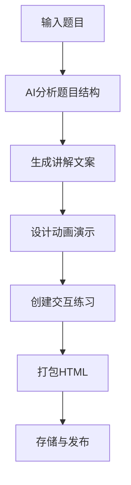
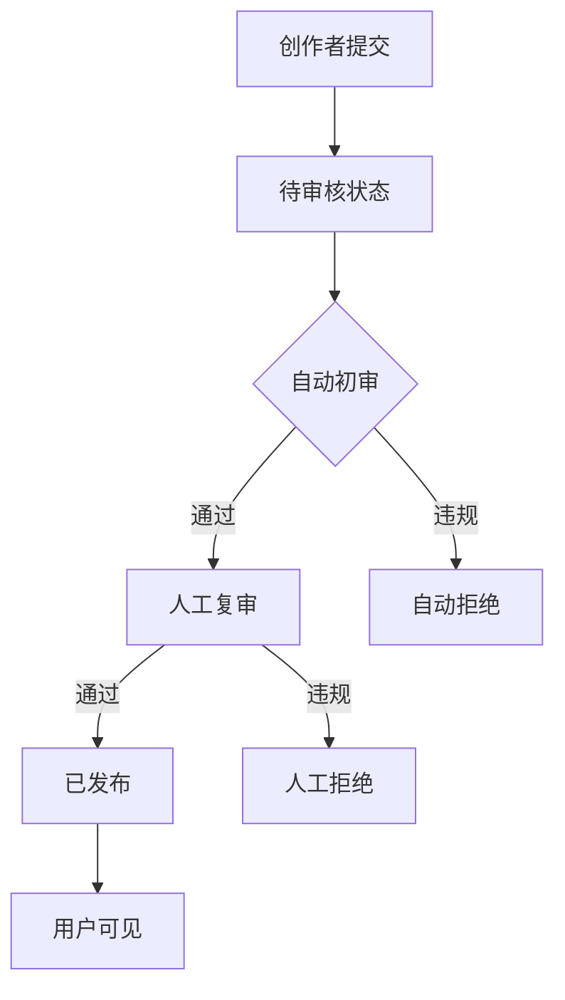

# 产品需求文档

> **项目名称**：象数演易（XSYY）- AI驱动的数学教学应用生成平台  
> **版本**：V1.0  
> **日期**：2026-05-28  
> **文档状态**：初稿

---

## 1. 产品概述

### 1.1 产品定位
象数演易（XSYY）是一款基于AI技术的数学教学应用生成平台，旨在将复杂的数学题目通过AI分析后，自动生成包含动画演示、分步讲解和交互练习的自包含HTML教学应用。

### 1.2 核心价值
| 价值点 | 描述 |
|--------|------|
| 降本增效 | AI自动生成教学应用，减少教师备课时间 |
| 个性化学习 | 基于语义推荐，提供针对性学习内容 |
| 轻量化交付 | 生成单HTML文件，无外部依赖，易于分享传播 |

---

## 2. 用户角色

| 角色 | 描述 | 权限范围 |
|------|------|----------|
| **学生** | 观看学习应用、收藏内容、参与练习 | 浏览、收藏、练习、评论、点赞 |
| **教师** | 创建教学应用、管理个人作品 | 学生权限 + 创建应用、管理作品 |
| **内容创作者** | 专业生产优质教学内容 | 教师权限 + 内容变现、收益管理 |
| **管理员** | 系统运营与内容审核 | 全系统管理、审核、配置 |

---

## 3. 功能模块

### 3.1 智能题目分析

#### 3.1.1 题目输入
| 输入方式 | 说明 |
|----------|------|
| 文本输入 | 支持数学公式LaTeX语法、手写体OCR识别 |
| 图片上传 | 支持JPG/PNG，最大5MB，自动OCR提取 |

#### 3.1.2 AI分析输出
| 输出字段 | 类型 | 说明 |
|----------|------|------|
| `title` | string | 自动生成的题目标题 |
| `primary_tag` | string | 主标签（如：代数、几何、概率） |
| `secondary_tags` | array[string] | 子标签（如：一次函数、三角形） |
| `difficulty` | enum | 简单/中等/困难/竞赛级 |
| `knowledge_points` | array[object] | 知识点清单 |
| `estimated_time` | int | 预计完成时间（分钟） |

#### 3.1.3 业务规则
- 题目内容进行敏感词过滤
- 相同题目24小时内不重复分析（缓存）
- 分析超时时间为30秒，超时返回错误

### 3.2 交互式教学应用生成

#### 3.2.1 生成流程


#### 3.2.2 HTML应用结构
```html
<!DOCTYPE html>
<html lang="zh-CN">
<head>
    <meta charset="UTF-8">
    <meta name="viewport" content="width=device-width, initial-scale=1.0">
    <style>/* 内嵌Tailwind + 自定义样式 */</style>
</head>
<body>
    <!-- 标题区域 -->
    <!-- 动画演示区 -->
    <!-- 分步讲解区 -->
    <!-- 交互练习区 -->
    <!-- 答案与解析区 -->
</body>
</html>
```

#### 3.2.3 功能特性
| 模块 | 功能点 | 描述 |
|------|--------|------|
| **动画演示** | 几何变换、函数图像、步骤还原 | 支持播放/暂停/重置 |
| **分步讲解** | 逐步展开、关键步骤高亮 | 支持展开/折叠 |
| **交互练习** | 选择题、填空题、解答题 | 即时反馈对错 |
| **响应式** | 移动端适配 | 断点：640px/768px/1024px |

### 3.3 用户系统

#### 3.3.1 认证模块
| 功能 | 路径 | 方法 |
|------|------|------|
| 注册 | `/api/v1/auth/register` | POST |
| 登录 | `/api/v1/auth/login` | POST |
| 刷新Token | `/api/v1/auth/refresh` | POST |
| 登出 | `/api/v1/auth/logout` | POST |
| 发送验证码 | `/api/v1/auth/send-code` | POST |
| 重置密码 | `/api/v1/auth/reset-password` | POST |

#### 3.3.2 Token设计
| Token类型 | 有效期 | 存储位置 |
|-----------|--------|----------|
| Access Token | 30分钟 | Memory |
| Refresh Token | 7天 | HttpOnly Cookie |

#### 3.3.3 用户资料
| 字段 | 类型 | 约束 |
|------|------|------|
| `id` | bigint | PK, 自增 |
| `username` | varchar(50) | 唯一, 3-20字符 |
| `email` | varchar(100) | 唯一, 有效邮箱格式 |
| `phone` | varchar(20) | 可选 |
| `password_hash` | varchar(255) | bcrypt |
| `role` | enum | student/teacher/creator/admin |
| `avatar_url` | varchar(500) | 可选 |
| `bio` | text | 个人简介, 最大500字 |
| `created_at` | datetime | |
| `updated_at` | datetime | |

### 3.4 个人作品集

| 功能 | 路径 | 方法 |
|------|------|------|
| 创建作品 | `/api/v1/works` | POST |
| 列表我的作品 | `/api/v1/works/my` | GET |
| 作品详情 | `/api/v1/works/{id}` | GET |
| 更新作品 | `/api/v1/works/{id}` | PUT |
| 删除作品 | `/api/v1/works/{id}` | DELETE |
| 公开/私密 | `/api/v1/works/{id}/visibility` | PATCH |

### 3.5 收藏功能

| 功能 | 路径 | 方法 |
|------|------|------|
| 收藏应用 | `/api/v1/favorites` | POST |
| 取消收藏 | `/api/v1/favorites/{id}` | DELETE |
| 我的收藏列表 | `/api/v1/favorites` | GET |

**收藏数据模型**：
| 字段 | 类型 |
|------|------|
| `id` | bigint |
| `user_id` | bigint |
| `app_id` | bigint |
| `created_at` | datetime |

### 3.6 评论与点赞

#### 3.6.1 评论
| 功能 | 路径 | 方法 |
|------|------|------|
| 发表评论 | `/api/v1/comments` | POST |
| 评论列表 | `/api/v1/apps/{id}/comments` | GET |
| 删除评论 | `/api/v1/comments/{id}` | DELETE |

#### 3.6.2 点赞
| 功能 | 路径 | 方法 |
|------|------|------|
| 点赞应用 | `/api/v1/likes` | POST |
| 取消点赞 | `/api/v1/likes/{id}` | DELETE |
| 点赞列表 | `/api/v1/apps/{id}/likes` | GET |

### 3.7 语义相似度推荐

#### 3.7.1 推荐算法
1. 将题目文本转换为向量（使用ChromaDB）
2. 计算余弦相似度
3. 返回Top-N相似应用

#### 3.7.2 API设计
| 功能 | 路径 | 方法 |
|------|------|------|
| 推荐相似应用 | `/api/v1/recommend/similar` | GET |
| 热门推荐 | `/api/v1/recommend/popular` | GET |
| 最新推荐 | `/api/v1/recommend/latest` | GET |

**请求参数**：
| 参数 | 类型 | 必填 | 说明 |
|------|------|------|------|
| `app_id` | int | 否 | 基于特定应用推荐 |
| `text` | string | 否 | 基于文本推荐 |
| `limit` | int | 否 | 返回数量，默认5 |

---

## 4. 管理后台

### 4.1 功能模块
| 模块 | 功能 |
|------|------|
| **仪表盘** | 用户统计、应用统计、活跃度趋势图 |
| **用户管理** | 用户列表、角色变更、禁用/启用 |
| **内容审核** | 待审核应用列表、审核通过/拒绝 |
| **系统配置** | AI服务配置、缓存配置、公告管理 |

### 4.2 管理员账号
| 字段 | 说明 |
|------|------|
| `username` | 管理员用户名 |
| `password` | 独立于普通用户的加密密码 |
| `permissions` | 细粒度权限控制 |

### 4.3 内容审核流程


---

## 5. 实时任务追踪

### 5.1 任务状态
| 状态 | 值 | 说明 |
|------|---|------|
| 待处理 | `pending` | 任务队列中等待 |
| 处理中 | `processing` | AI正在分析/生成 |
| 成功 | `success` | 完成 |
| 失败 | `failed` | 失败（可重试） |

### 5.2 进度更新机制
- WebSocket实时推送（可选）
- 轮询接口：`GET /api/v1/tasks/{task_id}`

### 5.3 任务查询API
| 功能 | 路径 | 方法 |
|------|------|------|
| 查询任务状态 | `/api/v1/tasks/{task_id}` | GET |
| 任务结果 | `/api/v1/tasks/{task_id}/result` | GET |

---

## 6. 界面设计要点

### 6.1 视觉风格
- **主题**：新中式风格
- **主色调**：#8B4513（檀木棕）、#D4A574（古铜色）
- **辅助色**：#2C2C2C（墨黑）、#F5F5DC（宣纸白）
- **字体**：思源宋体（标题）、系统无衬线字体（正文）

### 6.2 布局规范
| 断点 | 设备 | 最大宽度 |
|------|------|----------|
| `< 640px` | 手机 | 100% |
| `640px - 768px` | 平板 | 640px |
| `768px - 1024px` | 小屏电脑 | 768px |
| `> 1024px` | 大屏电脑 | 1024px |

### 6.3 关键页面
| 页面 | 描述 |
|------|------|
| 首页 | 热门应用展示、快速分析入口 |
| 应用详情页 | 教学应用展示、评论互动 |
| 创建页 | 题目输入、AI生成流程 |
| 个人中心 | 作品集、收藏、设置 |
| 管理后台 | 数据仪表盘、管理功能 |

---

## 7. 安全与合规

### 7.1 安全措施
| 措施 | 实现 |
|------|------|
| 密码存储 | bcrypt，salt轮数12 |
| SQL注入 | ORM参数化查询 |
| XSS防护 | 输入过滤、输出转义 |
| CSRF防护 | Token验证 |
| 敏感操作 | 二次验证 |
| API限流 | 每IP 100次/分钟 |

### 7.2 内容安全
- 用户上传图片进行AI审核
- 题目内容敏感词过滤
- 评论内容先发后审

---

## 8. 错误处理策略

### 8.1 错误码定义
| 错误码 | HTTP状态码 | 说明 |
|--------|------------|------|
| `AUTH_001` | 401 | 无效Token |
| `AUTH_002` | 401 | Token过期 |
| `AUTH_003` | 403 | 权限不足 |
| `USER_001` | 409 | 用户名已存在 |
| `USER_002` | 404 | 用户不存在 |
| `APP_001` | 404 | 应用不存在 |
| `APP_002` | 403 | 无权访问该应用 |
| `TASK_001` | 404 | 任务不存在 |
| `TASK_002` | 500 | AI服务超时 |
| `VALIDATION_001` | 422 | 参数校验失败 |
| `SYSTEM_001` | 500 | 系统内部错误 |

### 8.2 错误响应格式
```json
{
    "error": {
        "code": "AUTH_001",
        "message": "无效的访问令牌",
        "details": {}
    }
}
```

---

## 9. 性能优化策略

### 9.1 缓存策略
| 缓存层级 | 内容 | 过期时间 |
|----------|------|----------|
| 浏览器 | 静态资源 | 1年 |
| CDN | 公共资源 | 1天 |
| Redis | 会话、热门数据 | 5分钟-1小时 |
| 本地内存 | 热点数据 | 30秒 |

### 9.2 异步处理
| 场景 | 实现 |
|------|------|
| AI分析 | BackgroundTasks，5分钟超时 |
| HTML生成 | Celery任务队列 |
| 发送通知 | 异步消息队列 |
| 统计数据 | 定时批处理 |

### 9.3 数据库优化
- 读写分离
- 分表（按用户ID分表）
- 索引优化（联合索引）
- 查询缓存

---

## 10. 监控与日志

### 10.1 监控指标
| 类别 | 指标 |
|------|------|
| 系统 | CPU、内存、磁盘、网络 |
| 应用 | QPS、响应时间、错误率 |
| 业务 | DAU、MAU、生成成功率 |

### 10.2 日志规范
| 级别 | 场景 |
|------|------|
| DEBUG | 开发调试 |
| INFO | 正常业务流程 |
| WARNING | 潜在问题（如重试） |
| ERROR | 业务异常 |
| CRITICAL | 系统级故障 |

---

## 11. 附录

### 11.1 名词解释
| 术语 | 说明 |
|------|------|
| XSYY | 象数演易拼音首字母 |
| 教学应用 | 生成的HTML交互式教学文件 |
| 向量存储 | ChromaDB中的数学题目向量表示 |

### 11.2 参考资料
- Tailwind CSS官方文档
- FastAPI官方文档
- ChromaDB官方文档

---

*文档版本记录*：
| 版本 | 日期 | 修改内容 |
|------|------|----------|
| V1.0 | 2026-05-28 | 初始版本 |
