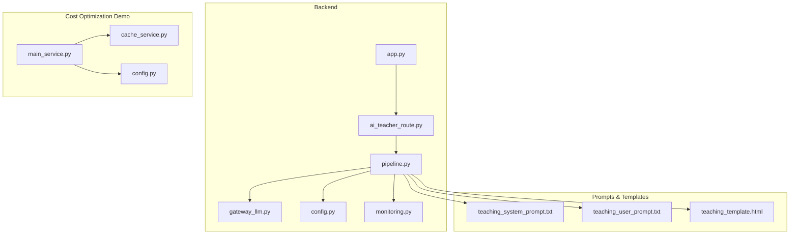
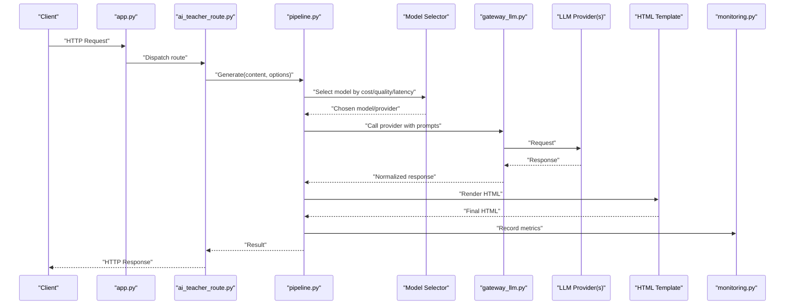
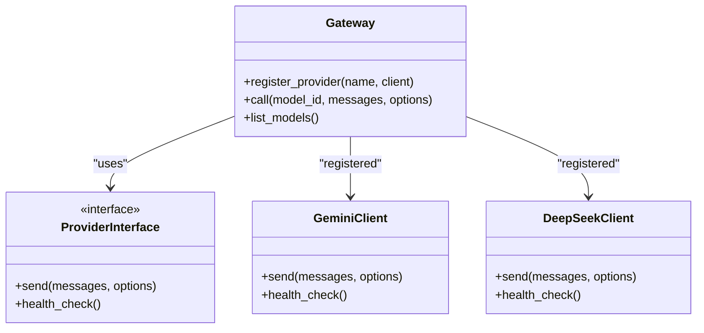
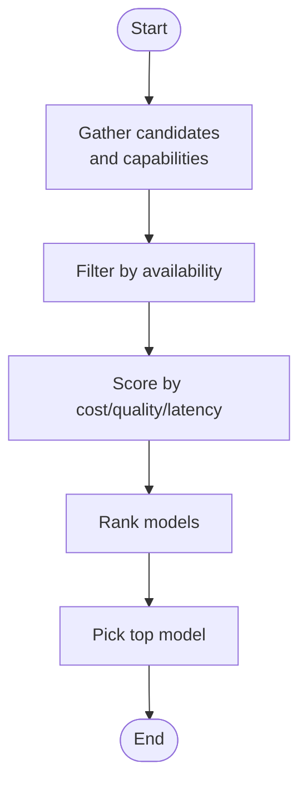
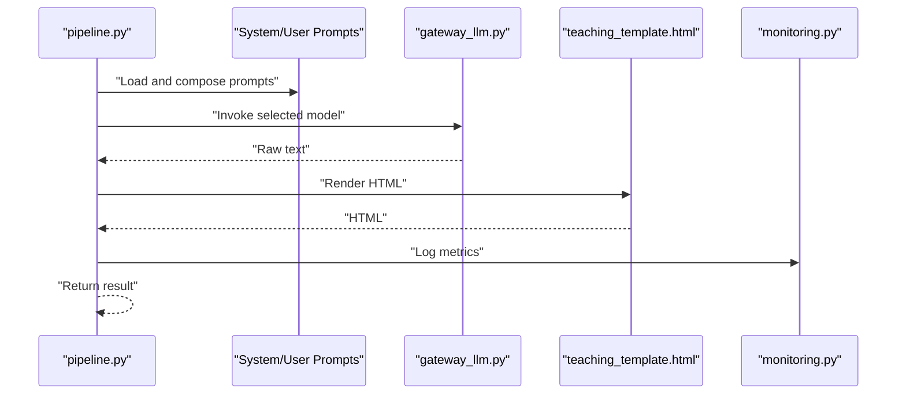
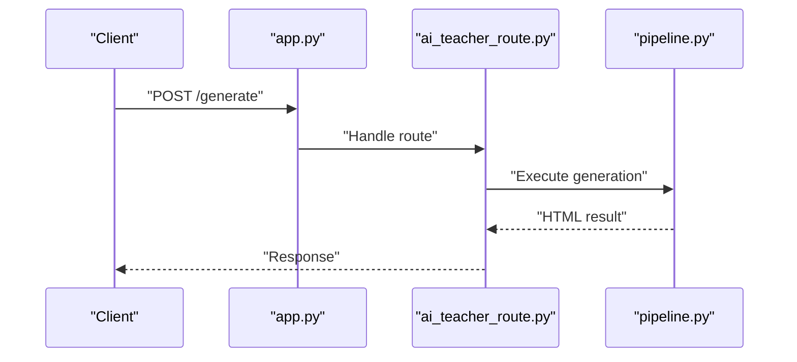
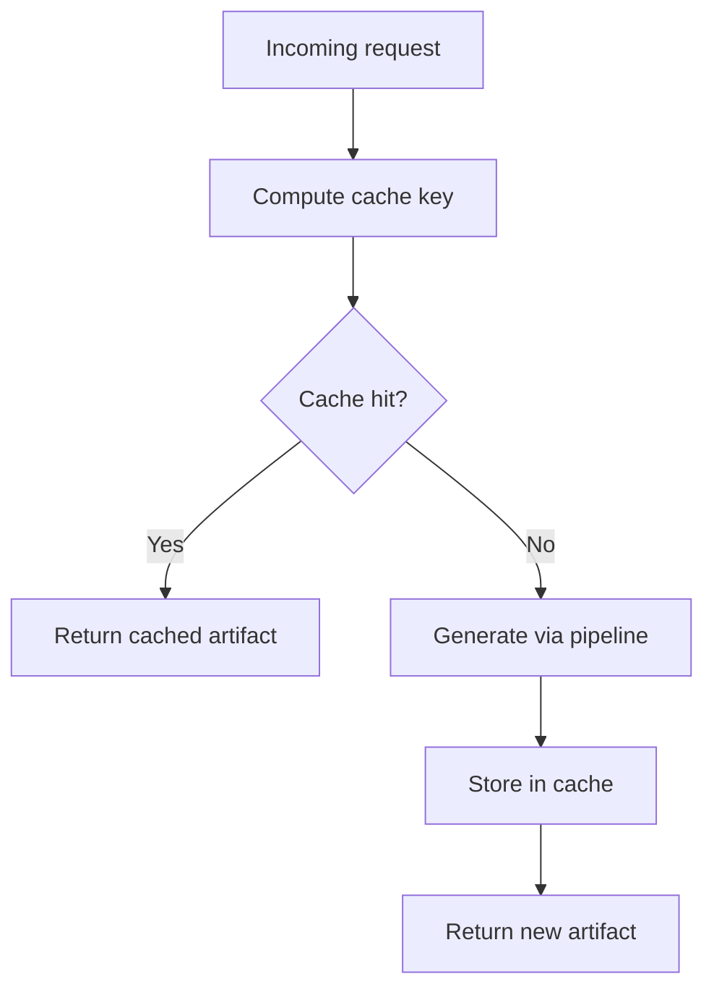
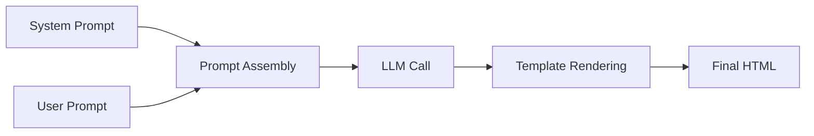
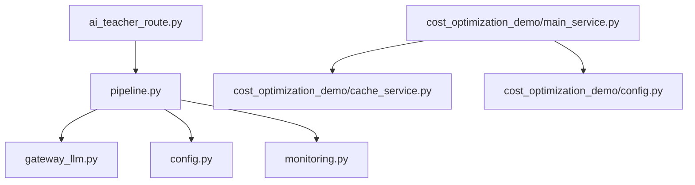

# AI Content Generation System

<cite>
**Referenced Files in This Document**
- [gateway_llm.py](file://backend/gateway_llm.py)
- [pipeline.py](file://backend/pipeline.py)
- [ai_teacher_route.py](file://backend/ai_teacher_route.py)
- [config.py](file://backend/config.py)
- [monitoring.py](file://backend/monitoring.py)
- [cost_optimization_demo/main_service.py](file://backend/cost_optimization_demo/main_service.py)
- [cost_optimization_demo/cache_service.py](file://backend/cost_optimization_demo/cache_service.py)
- [cost_optimization_demo/config.py](file://backend/cost_optimization_demo/config.py)
- [prompt/teaching_system_prompt.txt](file://backend/prompt/teaching_system_prompt.txt)
- [prompt/teaching_user_prompt.txt](file://backend/prompt/teaching_user_prompt.txt)
- [prompt/teaching_template.html](file://backend/prompt/teaching_template.html)
- [app.py](file://backend/app.py)
</cite>

## Table of Contents
1. [Introduction](#introduction)
2. [Project Structure](#project-structure)
3. [Core Components](#core-components)
4. [Architecture Overview](#architecture-overview)
5. [Detailed Component Analysis](#detailed-component-analysis)
6. [Dependency Analysis](#dependency-analysis)
7. [Performance Considerations](#performance-considerations)
8. [Troubleshooting Guide](#troubleshooting-guide)
9. [Conclusion](#conclusion)
10. [Appendices](#appendices)

## Introduction
This document explains the AI content generation system that produces educational HTML materials using a multi-model gateway. The system integrates multiple LLM providers (including Gemini and DeepSeek) through a unified interface, applies intelligent model selection to optimize cost, quality, and latency, and renders final outputs via a template pipeline. It also covers caching, fallbacks, resource management, quality assurance, error handling, retries, monitoring, and extensibility for adding new providers and customizing prompts.

## Project Structure
The backend implements:
- A unified LLM gateway for provider abstraction and routing
- A content generation pipeline orchestrating prompt assembly, model calls, and template rendering
- HTTP routes exposing generation endpoints
- Cost optimization demo with caching and configuration
- Monitoring utilities for performance and reliability tracking
- Prompt assets including system prompts, user prompts, and HTML templates

**Diagram sources**
- [app.py](file://backend/app.py)
- [ai_teacher_route.py](file://backend/ai_teacher_route.py)
- [pipeline.py](file://backend/pipeline.py)
- [gateway_llm.py](file://backend/gateway_llm.py)
- [config.py](file://backend/config.py)
- [monitoring.py](file://backend/monitoring.py)
- [cost_optimization_demo/main_service.py](file://backend/cost_optimization_demo/main_service.py)
- [cost_optimization_demo/cache_service.py](file://backend/cost_optimization_demo/cache_service.py)
- [cost_optimization_demo/config.py](file://backend/cost_optimization_demo/config.py)
- [prompt/teaching_system_prompt.txt](file://backend/prompt/teaching_system_prompt.txt)
- [prompt/teaching_user_prompt.txt](file://backend/prompt/teaching_user_prompt.txt)
- [prompt/teaching_template.html](file://backend/prompt/teaching_template.html)

**Section sources**
- [app.py](file://backend/app.py)
- [ai_teacher_route.py](file://backend/ai_teacher_route.py)
- [pipeline.py](file://backend/pipeline.py)
- [gateway_llm.py](file://backend/gateway_llm.py)
- [config.py](file://backend/config.py)
- [monitoring.py](file://backend/monitoring.py)
- [cost_optimization_demo/main_service.py](file://backend/cost_optimization_demo/main_service.py)
- [cost_optimization_demo/cache_service.py](file://backend/cost_optimization_demo/cache_service.py)
- [cost_optimization_demo/config.py](file://backend/cost_optimization_demo/config.py)
- [prompt/teaching_system_prompt.txt](file://backend/prompt/teaching_system_prompt.txt)
- [prompt/teaching_user_prompt.txt](file://backend/prompt/teaching_user_prompt.txt)
- [prompt/teaching_template.html](file://backend/prompt/teaching_template.html)

## Core Components
- Unified LLM Gateway: Abstracts provider-specific clients behind a common interface, enabling pluggable models (Gemini, DeepSeek, others).
- Intelligent Model Selector: Chooses the best model per request based on configured priorities such as cost, expected quality, and latency targets.
- Generation Pipeline: Orchestrates prompt building, model invocation, retry/fallback logic, template rendering, and output validation.
- Cost Optimization Layer: Implements caching of results and metadata, and leverages cheaper models when acceptable.
- Monitoring and Observability: Tracks metrics like latency, token usage, costs, and error rates.
- Route Handlers: Expose REST endpoints for generating teaching content and managing tasks.

**Section sources**
- [gateway_llm.py](file://backend/gateway_llm.py)
- [pipeline.py](file://backend/pipeline.py)
- [ai_teacher_route.py](file://backend/ai_teacher_route.py)
- [config.py](file://backend/config.py)
- [monitoring.py](file://backend/monitoring.py)
- [cost_optimization_demo/main_service.py](file://backend/cost_optimization_demo/main_service.py)
- [cost_optimization_demo/cache_service.py](file://backend/cost_optimization_demo/cache_service.py)

## Architecture Overview
The system follows a layered architecture:
- API Layer: Routes receive requests and delegate to the pipeline.
- Orchestration Layer: The pipeline composes prompts, selects models, handles retries/fallbacks, and renders templates.
- Provider Abstraction: The gateway normalizes calls across different LLM providers.
- Persistence and Caching: Results and metadata are cached to reduce cost and improve latency.
- Monitoring: Metrics and logs are recorded for observability.

**Diagram sources**
- [app.py](file://backend/app.py)
- [ai_teacher_route.py](file://backend/ai_teacher_route.py)
- [pipeline.py](file://backend/pipeline.py)
- [gateway_llm.py](file://backend/gateway_llm.py)
- [monitoring.py](file://backend/monitoring.py)
- [prompt/teaching_template.html](file://backend/prompt/teaching_template.html)

## Detailed Component Analysis

### Unified LLM Gateway
The gateway provides a consistent interface for calling different LLM providers. It abstracts authentication, request formatting, streaming vs non-streaming responses, and error normalization. Providers can be added by implementing the same interface and registering them with the gateway.

Key responsibilities:
- Provider registration and discovery
- Request/response normalization
- Error mapping and diagnostics
- Optional streaming support

**Diagram sources**
- [gateway_llm.py](file://backend/gateway_llm.py)

**Section sources**
- [gateway_llm.py](file://backend/gateway_llm.py)

### Intelligent Model Selection Algorithm
The selector evaluates candidate models against constraints and preferences:
- Cost: Prefer lower-cost models when quality thresholds are met.
- Quality: Enforce minimum quality expectations based on task complexity.
- Latency: Respect target response time; prefer faster models under load.
- Availability: Skip degraded or unavailable providers.

Selection flow:

**Diagram sources**
- [pipeline.py](file://backend/pipeline.py)
- [config.py](file://backend/config.py)

**Section sources**
- [pipeline.py](file://backend/pipeline.py)
- [config.py](file://backend/config.py)

### Content Generation Pipeline
The pipeline coordinates the full lifecycle:
- Prompt assembly from system and user prompts
- Model selection and invocation via the gateway
- Retry and fallback strategies
- Template rendering into final HTML
- Validation and post-processing
- Metric recording

**Diagram sources**
- [pipeline.py](file://backend/pipeline.py)
- [prompt/teaching_system_prompt.txt](file://backend/prompt/teaching_system_prompt.txt)
- [prompt/teaching_user_prompt.txt](file://backend/prompt/teaching_user_prompt.txt)
- [prompt/teaching_template.html](file://backend/prompt/teaching_template.html)
- [monitoring.py](file://backend/monitoring.py)

**Section sources**
- [pipeline.py](file://backend/pipeline.py)
- [prompt/teaching_system_prompt.txt](file://backend/prompt/teaching_system_prompt.txt)
- [prompt/teaching_user_prompt.txt](file://backend/prompt/teaching_user_prompt.txt)
- [prompt/teaching_template.html](file://backend/prompt/teaching_template.html)
- [monitoring.py](file://backend/monitoring.py)

### Route Handler and Application Entry
The application wires routes to the pipeline and exposes endpoints for generation and administrative operations.

**Diagram sources**
- [app.py](file://backend/app.py)
- [ai_teacher_route.py](file://backend/ai_teacher_route.py)
- [pipeline.py](file://backend/pipeline.py)

**Section sources**
- [app.py](file://backend/app.py)
- [ai_teacher_route.py](file://backend/ai_teacher_route.py)

### Cost Optimization Demo: Caching and Configuration
The demo showcases caching strategies and configuration-driven behavior:
- Cache service stores and retrieves generated artifacts keyed by stable inputs
- Main service demonstrates cache-first workflow and fallback to live generation
- Config module centralizes settings for providers, cache TTL, and thresholds

**Diagram sources**
- [cost_optimization_demo/main_service.py](file://backend/cost_optimization_demo/main_service.py)
- [cost_optimization_demo/cache_service.py](file://backend/cost_optimization_demo/cache_service.py)
- [cost_optimization_demo/config.py](file://backend/cost_optimization_demo/config.py)

**Section sources**
- [cost_optimization_demo/main_service.py](file://backend/cost_optimization_demo/main_service.py)
- [cost_optimization_demo/cache_service.py](file://backend/cost_optimization_demo/cache_service.py)
- [cost_optimization_demo/config.py](file://backend/cost_optimization_demo/config.py)

### Template System Architecture
Templates define the structure and styling of educational content:
- System prompt: Defines role, tone, and output constraints
- User prompt: Contains topic-specific instructions and context
- HTML template: Provides layout and placeholders for dynamic content

**Diagram sources**
- [prompt/teaching_system_prompt.txt](file://backend/prompt/teaching_system_prompt.txt)
- [prompt/teaching_user_prompt.txt](file://backend/prompt/teaching_user_prompt.txt)
- [prompt/teaching_template.html](file://backend/prompt/teaching_template.html)

**Section sources**
- [prompt/teaching_system_prompt.txt](file://backend/prompt/teaching_system_prompt.txt)
- [prompt/teaching_user_prompt.txt](file://backend/prompt/teaching_user_prompt.txt)
- [prompt/teaching_template.html](file://backend/prompt/teaching_template.html)

## Dependency Analysis
High-level dependencies among core modules:
- Routes depend on the pipeline for orchestration
- Pipeline depends on the gateway, config, and monitoring
- Gateway depends on provider implementations
- Cost optimization demo depends on its own cache and config

**Diagram sources**
- [ai_teacher_route.py](file://backend/ai_teacher_route.py)
- [pipeline.py](file://backend/pipeline.py)
- [gateway_llm.py](file://backend/gateway_llm.py)
- [config.py](file://backend/config.py)
- [monitoring.py](file://backend/monitoring.py)
- [cost_optimization_demo/main_service.py](file://backend/cost_optimization_demo/main_service.py)
- [cost_optimization_demo/cache_service.py](file://backend/cost_optimization_demo/cache_service.py)
- [cost_optimization_demo/config.py](file://backend/cost_optimization_demo/config.py)

**Section sources**
- [ai_teacher_route.py](file://backend/ai_teacher_route.py)
- [pipeline.py](file://backend/pipeline.py)
- [gateway_llm.py](file://backend/gateway_llm.py)
- [config.py](file://backend/config.py)
- [monitoring.py](file://backend/monitoring.py)
- [cost_optimization_demo/main_service.py](file://backend/cost_optimization_demo/main_service.py)
- [cost_optimization_demo/cache_service.py](file://backend/cost_optimization_demo/cache_service.py)
- [cost_optimization_demo/config.py](file://backend/cost_optimization_demo/config.py)

## Performance Considerations
- Model selection tuning: Adjust weights for cost, quality, and latency to match workload profiles.
- Caching strategy: Use stable keys and appropriate TTLs to maximize hits without stale content.
- Streaming responses: Enable streaming where supported to reduce perceived latency.
- Concurrency limits: Apply backpressure and rate limiting to protect downstream providers.
- Resource cleanup: Ensure connections and temporary resources are released promptly.

[No sources needed since this section provides general guidance]

## Troubleshooting Guide
Common issues and resolutions:
- Provider errors: Inspect normalized error codes and messages from the gateway; apply retries with exponential backoff.
- Fallback failures: Verify health checks and provider availability before switching models.
- Template rendering errors: Validate input data and ensure all required fields are present.
- Cache misses or corruption: Rebuild cache keys and clear corrupted entries; verify TTL policies.
- Monitoring gaps: Confirm metrics are being recorded and alerts are configured.

**Section sources**
- [gateway_llm.py](file://backend/gateway_llm.py)
- [pipeline.py](file://backend/pipeline.py)
- [monitoring.py](file://backend/monitoring.py)

## Conclusion
The system provides a robust, extensible foundation for AI-powered educational content generation. By unifying multiple LLM providers, optimizing model selection, and integrating caching and monitoring, it balances cost, quality, and responsiveness while remaining easy to extend with new providers and customized prompts.

[No sources needed since this section summarizes without analyzing specific files]

## Appendices

### Adding a New AI Provider
Steps:
- Implement the provider interface with send and health_check methods
- Register the provider with the gateway
- Configure model IDs and capabilities in configuration
- Test via the gateway’s list_models and call interfaces

**Section sources**
- [gateway_llm.py](file://backend/gateway_llm.py)
- [config.py](file://backend/config.py)

### Customizing Prompts
Approach:
- Update system and user prompts to refine tone, structure, and constraints
- Iterate with small changes and validate output quality
- Version prompts and track changes in source control

**Section sources**
- [prompt/teaching_system_prompt.txt](file://backend/prompt/teaching_system_prompt.txt)
- [prompt/teaching_user_prompt.txt](file://backend/prompt/teaching_user_prompt.txt)

### Optimizing Generation Workflows
Recommendations:
- Enable caching for repeated topics and inputs
- Use cheaper models for drafts and premium models for final outputs
- Tune retry and fallback policies based on observed error patterns
- Monitor latency and cost metrics to guide continuous improvements

**Section sources**
- [cost_optimization_demo/main_service.py](file://backend/cost_optimization_demo/main_service.py)
- [cost_optimization_demo/cache_service.py](file://backend/cost_optimization_demo/cache_service.py)
- [monitoring.py](file://backend/monitoring.py)