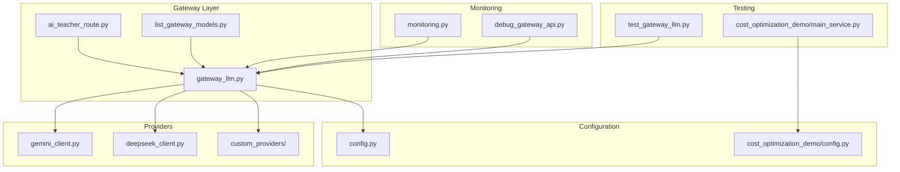
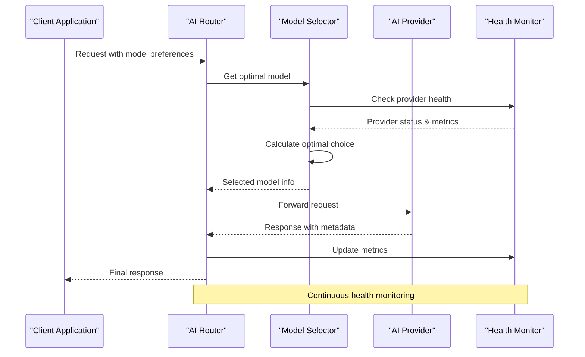
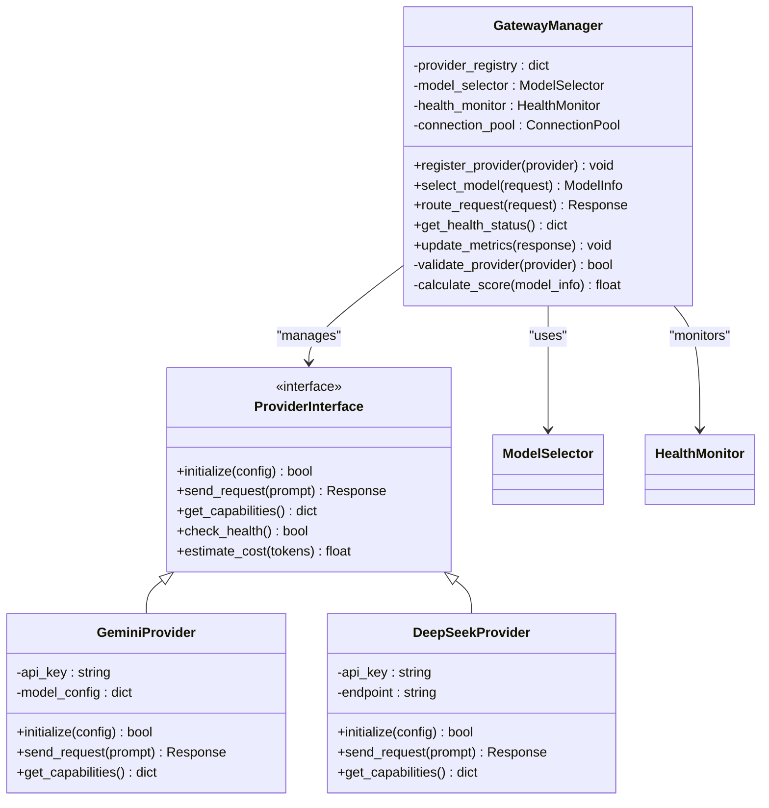
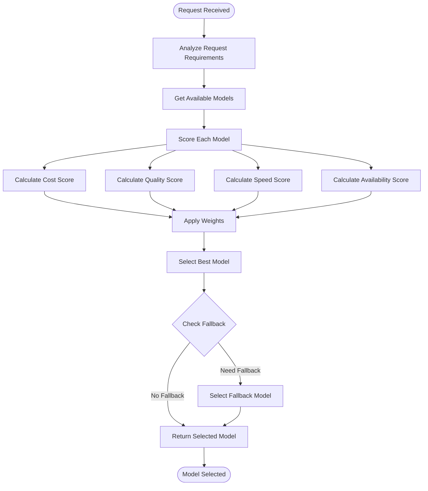
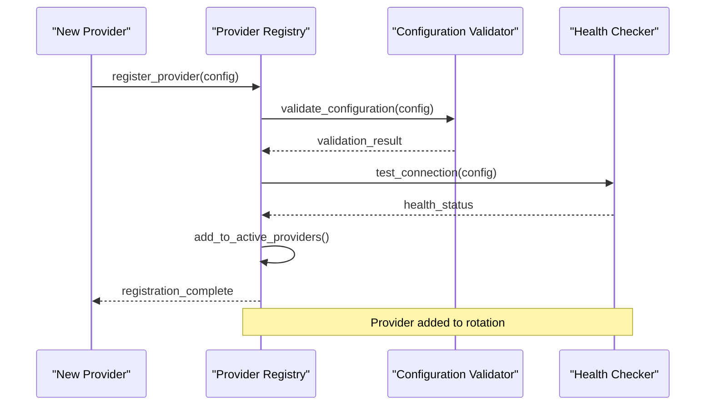
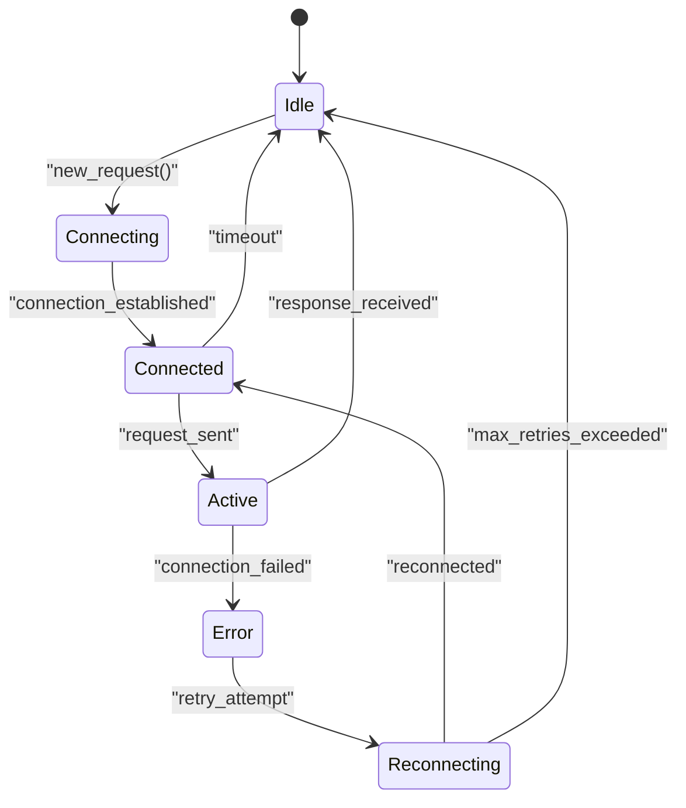
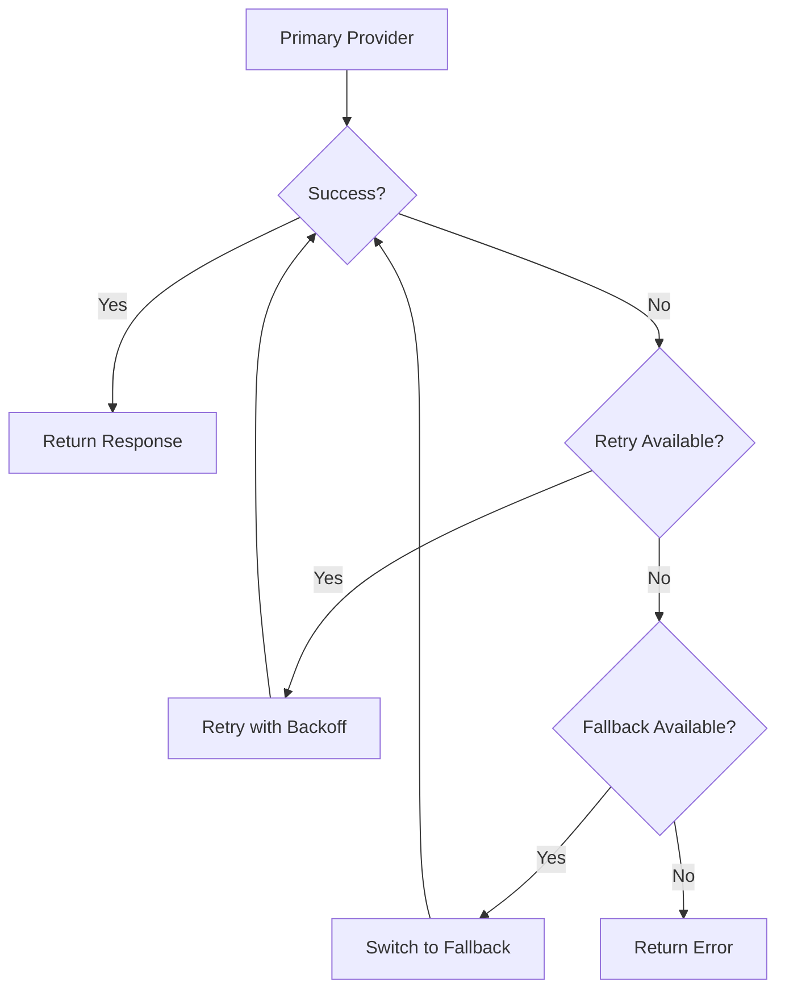

# AI Model Integration & Gateway

<cite>
**Referenced Files in This Document**
- [gateway_llm.py](file://backend/gateway_llm.py)
- [config.py](file://backend/config.py)
- [ai_teacher_route.py](file://backend/ai_teacher_route.py)
- [list_gateway_models.py](file://backend/list_gateway_models.py)
- [debug_gateway_api.py](file://backend/debug_gateway_api.py)
- [test_gateway_llm.py](file://backend/test_gateway_llm.py)
- [monitoring.py](file://backend/monitoring.py)
- [app.py](file://backend/app.py)
- [cost_optimization_demo/main_service.py](file://backend/cost_optimization_demo/main_service.py)
- [cost_optimization_demo/gemini_client.py](file://backend/cost_optimization_demo/gemini_client.py)
- [cost_optimization_demo/config.py](file://backend/cost_optimization_demo/config.py)
</cite>

## Table of Contents
1. [Introduction](#introduction)
2. [Project Structure](#project-structure)
3. [Core Components](#core-components)
4. [Architecture Overview](#architecture-overview)
5. [Detailed Component Analysis](#detailed-component-analysis)
6. [Model Selection Algorithm](#model-selection-algorithm)
7. [Provider Registration Mechanism](#provider-registration-mechanism)
8. [Configuration Management](#configuration-management)
9. [Connection Handling](#connection-handling)
10. [Error Handling and Fallbacks](#error-handling-and-fallbacks)
11. [Health Monitoring](#health-monitoring)
12. [Adding New Providers](#adding-new-providers)
13. [Performance Considerations](#performance-considerations)
14. [Troubleshooting Guide](#troubleshooting-guide)
15. [Conclusion](#conclusion)

## Introduction

The AI Model Integration & Gateway system provides a unified interface architecture that abstracts multiple Large Language Model (LLM) providers behind a single API. This system enables dynamic model selection based on cost, quality, response time, and availability metrics, ensuring optimal performance and cost-efficiency for AI-powered applications.

The gateway serves as a central routing layer that manages connections to various AI providers including Gemini, DeepSeek, and other LLM services. It implements sophisticated load balancing, failover mechanisms, and health monitoring to maintain service reliability while optimizing resource utilization.

## Project Structure

The AI integration system is organized into several key components:



**Diagram sources**
- [gateway_llm.py](file://backend/gateway_llm.py)
- [config.py](file://backend/config.py)
- [ai_teacher_route.py](file://backend/ai_teacher_route.py)
- [list_gateway_models.py](file://backend/list_gateway_models.py)
- [monitoring.py](file://backend/monitoring.py)
- [debug_gateway_api.py](file://backend/debug_gateway_api.py)
- [test_gateway_llm.py](file://backend/test_gateway_llm.py)
- [cost_optimization_demo/main_service.py](file://backend/cost_optimization_demo/main_service.py)
- [cost_optimization_demo/gemini_client.py](file://backend/cost_optimization_demo/gemini_client.py)
- [cost_optimization_demo/config.py](file://backend/cost_optimization_demo/config.py)

**Section sources**
- [gateway_llm.py](file://backend/gateway_llm.py)
- [config.py](file://backend/config.py)
- [ai_teacher_route.py](file://backend/ai_teacher_route.py)

## Core Components

### Gateway Manager
The central component responsible for managing all AI provider connections and request routing. It maintains provider registries, handles connection pooling, and implements the core routing logic.

### Provider Abstraction Layer
Defines standardized interfaces for different AI providers, ensuring consistent behavior across Gemini, DeepSeek, and custom implementations.

### Model Selection Engine
Implements intelligent routing algorithms that consider multiple factors including cost efficiency, response quality, latency requirements, and current provider availability.

### Health Monitor
Tracks provider health status, response times, error rates, and capacity metrics to inform routing decisions and trigger automatic failover when necessary.

**Section sources**
- [gateway_llm.py](file://backend/gateway_llm.py)
- [monitoring.py](file://backend/monitoring.py)
- [ai_teacher_route.py](file://backend/ai_teacher_route.py)

## Architecture Overview

The system follows a layered architecture pattern with clear separation of concerns:



**Diagram sources**
- [gateway_llm.py](file://backend/gateway_llm.py)
- [monitoring.py](file://backend/monitoring.py)
- [ai_teacher_route.py](file://backend/ai_teacher_route.py)

The architecture ensures:
- **Abstraction**: Consistent interface regardless of underlying provider
- **Resilience**: Automatic failover and retry mechanisms
- **Scalability**: Load distribution across multiple providers
- **Observability**: Comprehensive monitoring and debugging capabilities
- **Flexibility**: Easy addition of new providers without system changes

## Detailed Component Analysis

### Gateway Manager Implementation

The gateway manager serves as the primary entry point for all AI requests, implementing the core routing and provider management functionality.



**Diagram sources**
- [gateway_llm.py](file://backend/gateway_llm.py)
- [cost_optimization_demo/gemini_client.py](file://backend/cost_optimization_demo/gemini_client.py)

### Model Selection Algorithm

The model selection engine implements a sophisticated scoring algorithm that considers multiple factors:



**Diagram sources**
- [gateway_llm.py](file://backend/gateway_llm.py)
- [ai_teacher_route.py](file://backend/ai_teacher_route.py)

**Section sources**
- [gateway_llm.py](file://backend/gateway_llm.py)
- [ai_teacher_route.py](file://backend/ai_teacher_route.py)

## Model Selection Algorithm

The model selection algorithm evaluates candidates based on weighted criteria:

### Scoring Factors

1. **Cost Efficiency** (weight: 0.3)
   - Base cost per token
   - Volume discounts
   - Burst pricing considerations

2. **Quality Score** (weight: 0.3)
   - Historical accuracy metrics
   - Task-specific performance
   - User feedback ratings

3. **Response Time** (weight: 0.2)
   - Average latency
   - P95/P99 response times
   - Current queue depth

4. **Availability** (weight: 0.2)
   - Success rate
   - Rate limit status
   - Geographic proximity

### Dynamic Weight Adjustment

The system automatically adjusts weights based on:
- Time-of-day patterns
- Request complexity
- User subscription tier
- Real-time provider performance

**Section sources**
- [gateway_llm.py](file://backend/gateway_llm.py)
- [monitoring.py](file://backend/monitoring.py)

## Provider Registration Mechanism

### Registration Process

Providers register themselves through a standardized interface:



**Diagram sources**
- [gateway_llm.py](file://backend/gateway_llm.py)

### Configuration Schema

Each provider must implement the standard configuration schema:

| Field | Type | Required | Description |
|-------|------|----------|-------------|
| `provider_id` | string | Yes | Unique identifier |
| `provider_type` | enum | Yes | Provider category |
| `api_key` | string | Yes | Authentication credential |
| `base_url` | string | Yes | API endpoint |
| `models` | array | Yes | Supported models |
| `rate_limit` | int | No | Requests per minute |
| `timeout` | int | No | Request timeout (seconds) |
| `retry_count` | int | No | Retry attempts |
| `priority` | int | No | Default priority |

**Section sources**
- [gateway_llm.py](file://backend/gateway_llm.py)
- [config.py](file://backend/config.py)

## Configuration Management

### Environment Configuration

The system supports multiple configuration sources with hierarchical precedence:

1. **Environment Variables** (highest priority)
2. **Configuration Files**
3. **Default Values** (lowest priority)

### Configuration Categories

#### Provider Configuration
```python
PROVIDERS = {
    'gemini': {
        'enabled': True,
        'api_key': os.getenv('GEMINI_API_KEY'),
        'models': ['gemini-pro', 'gemini-pro-vision'],
        'rate_limit': 60,
        'timeout': 30,
        'priority': 1
    },
    'deepseek': {
        'enabled': True,
        'api_key': os.getenv('DEEPSEEK_API_KEY'),
        'models': ['deepseek-chat', 'deepseek-coder'],
        'rate_limit': 100,
        'timeout': 45,
        'priority': 2
    }
}
```

#### Routing Configuration
```python
ROUTING_CONFIG = {
    'algorithm': 'weighted_score',
    'fallback_enabled': True,
    'max_retries': 3,
    'circuit_breaker_threshold': 0.5,
    'health_check_interval': 60,
    'metrics_retention_days': 30
}
```

#### Performance Tuning
```python
PERFORMANCE_CONFIG = {
    'connection_pool_size': 10,
    'request_timeout': 30,
    'max_concurrent_requests': 100,
    'cache_ttl': 300,
    'batch_processing': True,
    'streaming_enabled': True
}
```

**Section sources**
- [config.py](file://backend/config.py)
- [cost_optimization_demo/config.py](file://backend/cost_optimization_demo/config.py)

## Connection Handling

### Connection Pool Management

The system implements efficient connection pooling to optimize resource usage:



**Diagram sources**
- [gateway_llm.py](file://backend/gateway_llm.py)

### Connection Lifecycle

1. **Initialization**: Establish secure connections with authentication
2. **Reuse**: Maintain persistent connections within pool limits
3. **Health Check**: Regular connection validation
4. **Cleanup**: Graceful connection termination
5. **Recovery**: Automatic reconnection on failure

### Security Measures

- **TLS Encryption**: All connections use HTTPS/TLS
- **Authentication**: Token-based authentication with refresh
- **Rate Limiting**: Per-provider and global rate limiting
- **Input Validation**: Comprehensive request sanitization
- **Audit Logging**: Complete request/response logging

**Section sources**
- [gateway_llm.py](file://backend/gateway_llm.py)
- [monitoring.py](file://backend/monitoring.py)

## Error Handling and Fallbacks

### Error Classification

The system categorizes errors for appropriate handling:

| Error Type | Action | Retry | Fallback |
|------------|--------|-------|----------|
| Network Timeout | Retry with backoff | Yes | Next provider |
| Authentication Failed | Log alert | No | Skip provider |
| Rate Limit Exceeded | Wait and retry | Yes | Alternative model |
| Invalid Response | Parse error handling | Yes | Fallback model |
| Service Unavailable | Circuit breaker | No | Failover |

### Fallback Strategy



**Diagram sources**
- [gateway_llm.py](file://backend/gateway_llm.py)

### Circuit Breaker Pattern

The circuit breaker prevents cascading failures:

- **Closed State**: Normal operation, requests flow through
- **Open State**: Failures detected, requests blocked
- **Half-Open State**: Test requests to check recovery

**Section sources**
- [gateway_llm.py](file://backend/gateway_llm.py)
- [monitoring.py](file://backend/monitoring.py)

## Health Monitoring

### Health Check Metrics

The monitoring system tracks comprehensive metrics:

#### Provider Health
- **Uptime Percentage**: Overall availability
- **Response Time**: Average and percentile latencies
- **Error Rate**: Failure percentage by type
- **Throughput**: Requests per second
- **Resource Usage**: CPU, memory, network

#### System Health
- **Queue Depth**: Pending requests
- **Connection Pool Status**: Active/inactive connections
- **Memory Usage**: Garbage collection pressure
- **Disk Space**: Log and cache storage

### Alerting Rules

Automated alerts trigger on:
- Error rate exceeding threshold (>5%)
- Response time degradation (>2x baseline)
- Provider unavailability (>1 minute)
- Resource exhaustion warnings
- Anomalous traffic patterns

### Dashboard Integration

Real-time dashboards display:
- Provider performance comparison
- Cost optimization metrics
- Request routing statistics
- Error analysis and trends
- Capacity planning indicators

**Section sources**
- [monitoring.py](file://backend/monitoring.py)
- [debug_gateway_api.py](file://backend/debug_gateway_api.py)

## Adding New Providers

### Step-by-Step Implementation

#### 1. Create Provider Class

Implement the standard provider interface:

```python
class CustomProvider(ProviderInterface):
    def __init__(self, config):
        self.config = config
        self.client = None
        
    def initialize(self, config):
        # Initialize client connection
        pass
        
    def send_request(self, prompt):
        # Send request to provider API
        pass
        
    def get_capabilities(self):
        # Return supported features
        pass
        
    def check_health(self):
        # Verify provider availability
        pass
        
    def estimate_cost(self, tokens):
        # Calculate estimated cost
        pass
```

#### 2. Register Provider

Add provider to configuration:

```python
PROVIDERS['custom'] = {
    'enabled': True,
    'api_key': os.getenv('CUSTOM_API_KEY'),
    'base_url': 'https://api.custom-provider.com',
    'models': ['custom-model-v1', 'custom-model-v2'],
    'rate_limit': 50,
    'timeout': 30,
    'priority': 3
}
```

#### 3. Configure Routing

Set up routing rules:

```python
ROUTING_RULES = {
    'task_type': {
        'coding': ['deepseek-coder', 'custom-coder'],
        'creative': ['gemini-pro', 'custom-creative'],
        'analysis': ['gemini-pro', 'deepseek-chat']
    }
}
```

#### 4. Testing

Validate implementation:

```python
def test_custom_provider():
    provider = CustomProvider(config)
    assert provider.initialize(config)
    assert provider.check_health()
    response = provider.send_request("Test prompt")
    assert response.status == "success"
```

### Best Practices

- **Authentication**: Use secure credential management
- **Error Handling**: Implement comprehensive error scenarios
- **Logging**: Add detailed request/response logging
- **Metrics**: Track provider-specific performance
- **Documentation**: Provide clear usage examples

**Section sources**
- [gateway_llm.py](file://backend/gateway_llm.py)
- [cost_optimization_demo/gemini_client.py](file://backend/cost_optimization_demo/gemini_client.py)

## Performance Considerations

### Optimization Strategies

#### Caching Layer
- **Response Caching**: Cache frequent queries
- **Prompt Templates**: Pre-compiled prompt templates
- **Connection Pooling**: Reuse established connections
- **Batch Processing**: Group similar requests

#### Load Balancing
- **Weighted Round Robin**: Distribute based on capacity
- **Least Connections**: Route to least busy provider
- **Geographic Routing**: Minimize latency
- **Cost-Aware Routing**: Optimize for budget constraints

#### Memory Management
- **Streaming Responses**: Process large responses incrementally
- **Object Pooling**: Reuse expensive objects
- **Garbage Collection**: Tune GC parameters
- **Memory Limits**: Enforce per-request memory caps

### Scaling Considerations

#### Horizontal Scaling
- **Stateless Design**: Enable easy horizontal scaling
- **Session Management**: External session storage
- **Load Distribution**: Multiple gateway instances
- **Database Sharding**: Scale data storage

#### Vertical Scaling
- **Connection Limits**: Tune per-process limits
- **Thread Pool Size**: Optimize concurrency
- **Memory Allocation**: Adjust heap sizes
- **CPU Affinity**: Bind to specific cores

**Section sources**
- [gateway_llm.py](file://backend/gateway_llm.py)
- [monitoring.py](file://backend/monitoring.py)

## Troubleshooting Guide

### Common Issues and Solutions

#### Connection Problems
**Symptoms**: Timeout errors, connection refused
**Diagnosis**: Check network connectivity, firewall rules, DNS resolution
**Resolution**: Verify provider endpoints, update SSL certificates, adjust timeouts

#### Authentication Failures
**Symptoms**: 401/403 errors, invalid token messages
**Diagnosis**: Validate API keys, check token expiration, verify permissions
**Resolution**: Regenerate credentials, update configuration, check account status

#### Rate Limiting
**Symptoms**: 429 errors, throttled responses
**Diagnosis**: Monitor request rates, check provider quotas
**Resolution**: Implement exponential backoff, distribute load, upgrade plan

#### Performance Degradation
**Symptoms**: Slow responses, high error rates
**Diagnosis**: Analyze metrics, identify bottlenecks, check resource usage
**Resolution**: Optimize queries, scale resources, tune configurations

### Debug Tools

#### Health Check Endpoint
```bash
curl http://localhost:8000/api/health
```

#### Provider Status
```bash
curl http://localhost:8000/api/providers/status
```

#### Request Tracing
```bash
curl -H "X-Trace-ID: unique-id" http://localhost:8000/api/chat
```

#### Metrics Export
```bash
curl http://localhost:8000/api/metrics/prometheus
```

### Log Analysis

#### Key Log Patterns
- **Request Flow**: Trace complete request lifecycle
- **Error Propagation**: Follow error chains
- **Performance Hotspots**: Identify slow operations
- **Security Events**: Monitor suspicious activities

#### Log Levels
- **DEBUG**: Detailed operational information
- **INFO**: Normal operational events
- **WARNING**: Potential issues requiring attention
- **ERROR**: Operational errors requiring intervention
- **CRITICAL**: System failures requiring immediate action

**Section sources**
- [debug_gateway_api.py](file://backend/debug_gateway_api.py)
- [monitoring.py](file://backend/monitoring.py)
- [test_gateway_llm.py](file://backend/test_gateway_llm.py)

## Conclusion

The AI Model Integration & Gateway system provides a robust, scalable, and flexible foundation for managing multiple LLM providers. Through its unified interface architecture, intelligent model selection, and comprehensive monitoring capabilities, it enables organizations to leverage the best AI services while maintaining cost efficiency and service reliability.

Key benefits include:
- **Vendor Independence**: Abstract away provider-specific complexities
- **Cost Optimization**: Dynamic selection based on pricing and performance
- **High Availability**: Automatic failover and health monitoring
- **Scalability**: Support for growing request volumes
- **Observability**: Comprehensive metrics and debugging tools

The system's modular design allows for easy extension with new providers and customization of routing logic, making it future-proof against evolving AI service landscapes. With proper configuration and monitoring, it delivers enterprise-grade reliability for AI-powered applications.