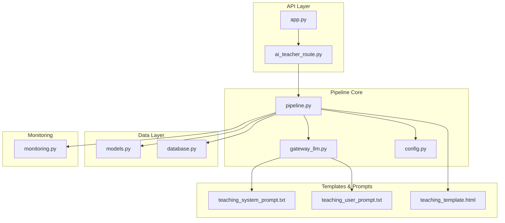
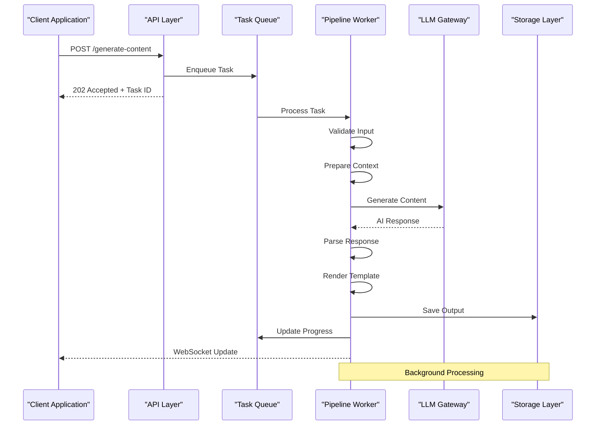
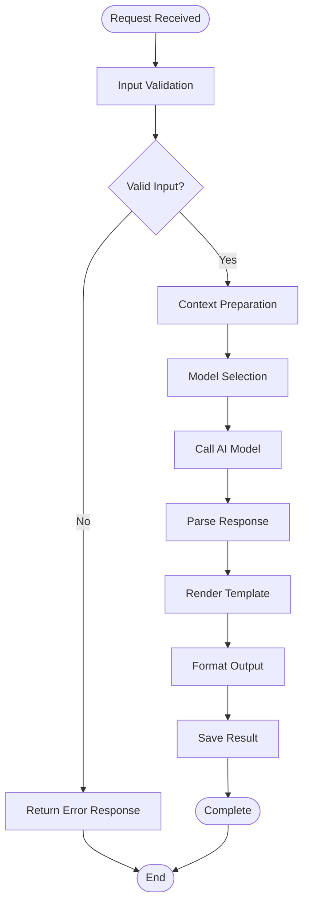
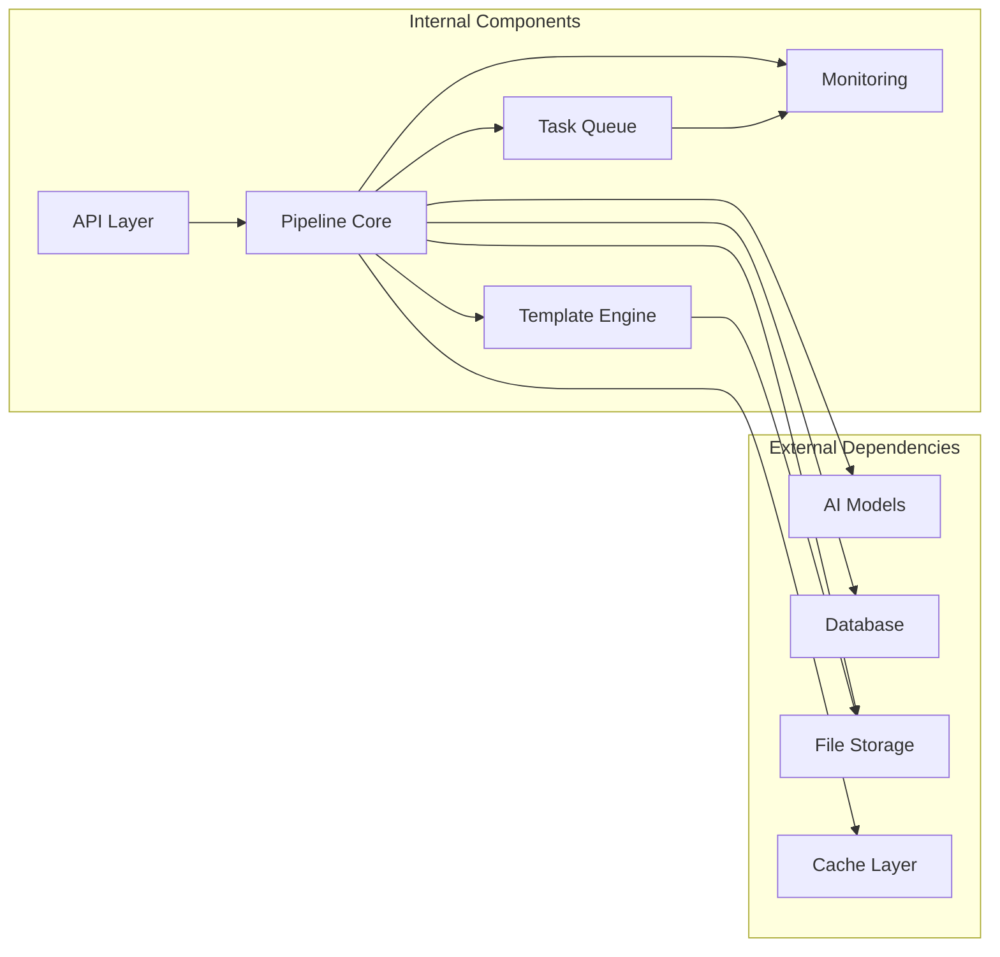

# Content Generation Pipeline

<cite>
**Referenced Files in This Document**
- [pipeline.py](file://backend/pipeline.py)
- [app.py](file://backend/app.py)
- [ai_teacher_route.py](file://backend/ai_teacher_route.py)
- [gateway_llm.py](file://backend/gateway_llm.py)
- [config.py](file://backend/config.py)
- [monitoring.py](file://backend/monitoring.py)
- [teaching_system_prompt.txt](file://backend/prompt/teaching_system_prompt.txt)
- [teaching_user_prompt.txt](file://backend/prompt/teaching_user_prompt.txt)
- [teaching_template.html](file://backend/prompt/teaching_template.html)
- [models.py](file://backend/database/models.py)
- [database.py](file://backend/database/database.py)
</cite>

## Table of Contents
1. [Introduction](#introduction)
2. [Project Structure](#project-structure)
3. [Core Components](#core-components)
4. [Architecture Overview](#architecture-overview)
5. [Detailed Component Analysis](#detailed-component-analysis)
6. [Dependency Analysis](#dependency-analysis)
7. [Performance Considerations](#performance-considerations)
8. [Troubleshooting Guide](#troubleshooting-guide)
9. [Conclusion](#conclusion)

## Introduction

The Content Generation Pipeline is a sophisticated system designed to process user requests through multiple stages to generate educational teaching materials using AI models. The pipeline implements a robust architecture that handles asynchronous processing, task queuing, progress tracking, and error recovery mechanisms. It transforms user inputs into structured HTML output through prompt engineering, AI model invocation, template rendering, and final formatting processes.

## Project Structure

The content generation pipeline is organized across multiple modules within the backend directory, following a modular architecture pattern:

**Diagram sources**
- [app.py](file://backend/app.py)
- [ai_teacher_route.py](file://backend/ai_teacher_route.py)
- [pipeline.py](file://backend/pipeline.py)
- [gateway_llm.py](file://backend/gateway_llm.py)
- [config.py](file://backend/config.py)
- [models.py](file://backend/database/models.py)
- [database.py](file://backend/database/database.py)
- [monitoring.py](file://backend/monitoring.py)

**Section sources**
- [app.py](file://backend/app.py)
- [ai_teacher_route.py](file://backend/ai_teacher_route.py)
- [pipeline.py](file://backend/pipeline.py)

## Core Components

The content generation pipeline consists of several key components that work together to process requests and generate educational content:

### Pipeline Orchestrator
The main orchestrator manages the entire workflow from request validation to final output generation. It coordinates between different stages including input validation, context preparation, model selection, response parsing, and output formatting.

### Task Queue System
Implements asynchronous processing capabilities allowing the system to handle multiple concurrent requests efficiently. The queue system ensures proper task distribution and resource management.

### LLM Gateway
Provides abstraction over different AI model providers, handling authentication, rate limiting, and response parsing. It supports multiple model backends and provides fallback mechanisms.

### Template Engine
Manages HTML template rendering with dynamic content injection. Supports various template formats and provides validation and error handling for template processing.

### Monitoring System
Tracks pipeline performance metrics, error rates, and processing times. Provides real-time monitoring capabilities and generates detailed logs for debugging and optimization.

**Section sources**
- [pipeline.py](file://backend/pipeline.py)
- [gateway_llm.py](file://backend/gateway_llm.py)
- [monitoring.py](file://backend/monitoring.py)

## Architecture Overview

The pipeline follows a layered architecture pattern with clear separation of concerns:

**Diagram sources**
- [ai_teacher_route.py](file://backend/ai_teacher_route.py)
- [pipeline.py](file://backend/pipeline.py)
- [gateway_llm.py](file://backend/gateway_llm.py)

The architecture implements several key design patterns:

### Request-Response Pattern
HTTP endpoints accept requests and return appropriate responses, with long-running operations handled asynchronously.

### Observer Pattern
Progress updates are pushed to clients via WebSocket connections, providing real-time feedback during processing.

### Strategy Pattern
Different AI models and templates can be selected dynamically based on configuration and requirements.

### Circuit Breaker Pattern
Error handling includes circuit breaker logic to prevent cascading failures when external services are unavailable.

## Detailed Component Analysis

### Pipeline Stage Implementation

The pipeline consists of several distinct stages, each responsible for specific processing tasks:

#### Input Validation Stage
Validates incoming requests, checks required parameters, and ensures data integrity before processing begins.

#### Context Preparation Stage
Gathers additional information needed for content generation, including user preferences, historical data, and contextual metadata.

#### Model Selection Stage
Determines the appropriate AI model based on content type, complexity, and available resources.

#### Response Parsing Stage
Processes raw AI model outputs, extracts relevant information, and structures it for template rendering.

#### Output Formatting Stage
Applies templates, generates final HTML output, and performs post-processing validation.

**Diagram sources**
- [pipeline.py](file://backend/pipeline.py)

**Section sources**
- [pipeline.py](file://backend/pipeline.py)

### Task Queue System

The task queue system provides asynchronous processing capabilities:

#### Queue Management
Handles task creation, prioritization, and distribution across available workers. Implements retry logic for failed tasks and dead letter queues for permanently failed operations.

#### Worker Pool
Manages a pool of worker processes that consume tasks from the queue. Workers are load-balanced and can be scaled horizontally based on demand.

#### Progress Tracking
Monitors task execution status and provides progress updates to clients through WebSocket connections or polling APIs.

#### Error Recovery
Implements automatic retry mechanisms with exponential backoff for transient failures. Failed tasks are logged and can be manually retried through admin interfaces.

**Section sources**
- [ai_teacher_route.py](file://backend/ai_teacher_route.py)
- [pipeline.py](file://backend/pipeline.py)

### LLM Gateway Integration

The LLM gateway abstracts interactions with various AI model providers:

#### Model Abstraction
Provides a unified interface for different AI models, hiding provider-specific implementation details from the rest of the pipeline.

#### Rate Limiting
Implements rate limiting and quota management to prevent API abuse and ensure fair usage across users.

#### Caching
Caches frequently requested responses to reduce API calls and improve response times. Cache invalidation strategies ensure data freshness.

#### Fallback Mechanisms
Automatically switches to backup models when primary models are unavailable or exceed rate limits.

**Section sources**
- [gateway_llm.py](file://backend/gateway_llm.py)
- [config.py](file://backend/config.py)

### Template Rendering System

The template engine handles HTML generation and styling:

#### Template Management
Supports multiple template formats and provides versioning capabilities for template evolution without breaking existing functionality.

#### Dynamic Content Injection
Safely injects generated content into templates while preventing XSS attacks and maintaining security boundaries.

#### Styling and Branding
Applies consistent styling across all generated content and supports customization based on user preferences or organizational branding.

**Section sources**
- [teaching_template.html](file://backend/prompt/teaching_template.html)
- [pipeline.py](file://backend/pipeline.py)

## Dependency Analysis

The pipeline components have well-defined dependencies that ensure loose coupling and high cohesion:

**Diagram sources**
- [app.py](file://backend/app.py)
- [pipeline.py](file://backend/pipeline.py)
- [gateway_llm.py](file://backend/gateway_llm.py)
- [models.py](file://backend/database/models.py)
- [database.py](file://backend/database/database.py)

### Key Dependencies

#### External Services
- **AI Model Providers**: Multiple LLM backends for content generation
- **Database**: Persistent storage for tasks, results, and metadata
- **File Storage**: Object storage for generated HTML files and assets
- **Cache Layer**: Redis or similar for caching frequent responses

#### Internal Modules
- **Configuration Management**: Centralized configuration for all components
- **Logging Framework**: Structured logging with correlation IDs for tracing
- **Authentication**: User authentication and authorization middleware
- **Metrics Collection**: Performance metrics and health check endpoints

**Section sources**
- [config.py](file://backend/config.py)
- [models.py](file://backend/database/models.py)
- [database.py](file://backend/database/database.py)

## Performance Considerations

The pipeline is designed with performance optimization in mind:

### Asynchronous Processing
All long-running operations are processed asynchronously to maintain responsive API endpoints. This allows the system to handle high concurrency while keeping response times low.

### Connection Pooling
Database and external service connections are pooled to minimize connection overhead and improve throughput.

### Memory Management
Generators and streaming responses are used where possible to minimize memory footprint for large content generation tasks.

### Caching Strategies
Multi-level caching reduces redundant processing and external API calls:
- **Response Cache**: Caches complete generated content
- **Model Cache**: Caches intermediate model outputs
- **Template Cache**: Pre-compiles templates for faster rendering

### Scaling Considerations
The stateless design allows horizontal scaling of both API servers and worker processes. Load balancers distribute traffic evenly across instances.

## Troubleshooting Guide

### Common Issues and Solutions

#### Pipeline Stalls
If the pipeline appears stuck, check:
- Task queue depth and worker availability
- Database connectivity and lock contention
- External API rate limits and timeouts
- Memory usage and garbage collection

#### Slow Response Times
Performance bottlenecks typically occur in:
- AI model response times (check provider status)
- Template rendering complexity (optimize templates)
- Database query performance (review indexes)
- File I/O operations (use async I/O)

#### Memory Leaks
Monitor memory usage patterns and look for:
- Unclosed file handles
- Large object retention in cache
- Circular references in task objects
- Insufficient garbage collection tuning

### Monitoring and Diagnostics

#### Health Checks
The system provides health check endpoints for:
- Database connectivity
- External service availability
- Worker process status
- Resource utilization metrics

#### Logging and Tracing
Comprehensive logging includes:
- Request correlation IDs for end-to-end tracing
- Pipeline stage timing and status
- Error details with stack traces
- Performance metrics and counters

#### Alerting
Configurable alerts for:
- High error rates
- Slow response times
- Resource exhaustion
- Service degradation

**Section sources**
- [monitoring.py](file://backend/monitoring.py)
- [pipeline.py](file://backend/pipeline.py)

## Conclusion

The Content Generation Pipeline provides a robust, scalable solution for automated educational content creation. Its modular architecture enables easy extension and customization while maintaining reliability and performance. The comprehensive error handling, monitoring, and troubleshooting capabilities ensure operational stability in production environments.

Key strengths include:
- **Scalability**: Horizontal scaling support for high-throughput scenarios
- **Reliability**: Comprehensive error handling and recovery mechanisms
- **Flexibility**: Pluggable architecture supporting multiple AI models and templates
- **Observability**: Rich monitoring and diagnostic capabilities
- **Maintainability**: Clean separation of concerns and well-documented interfaces

Future enhancements could include advanced caching strategies, machine learning-based model selection, and enhanced template personalization capabilities.