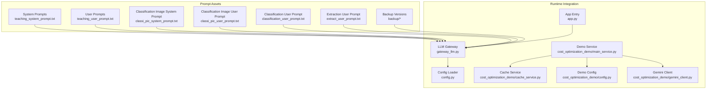
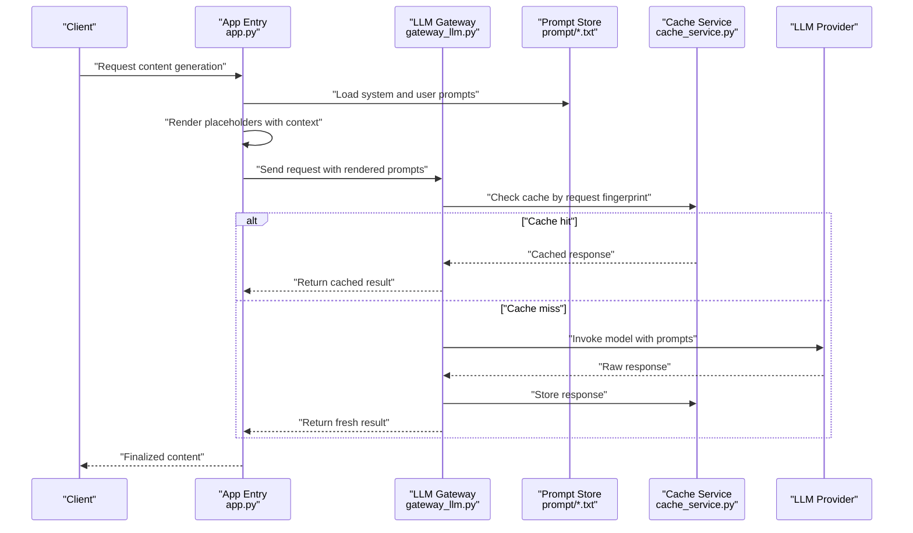
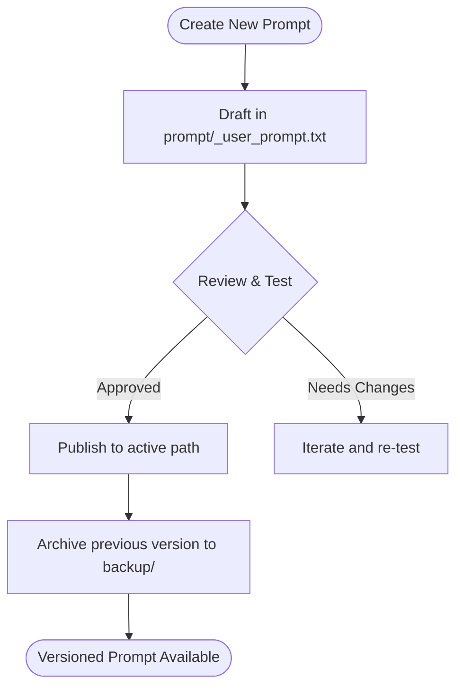
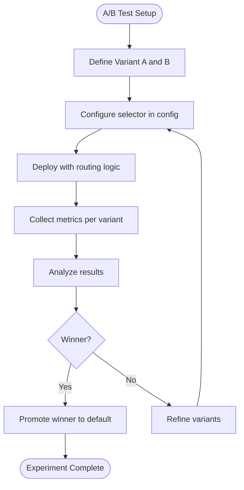
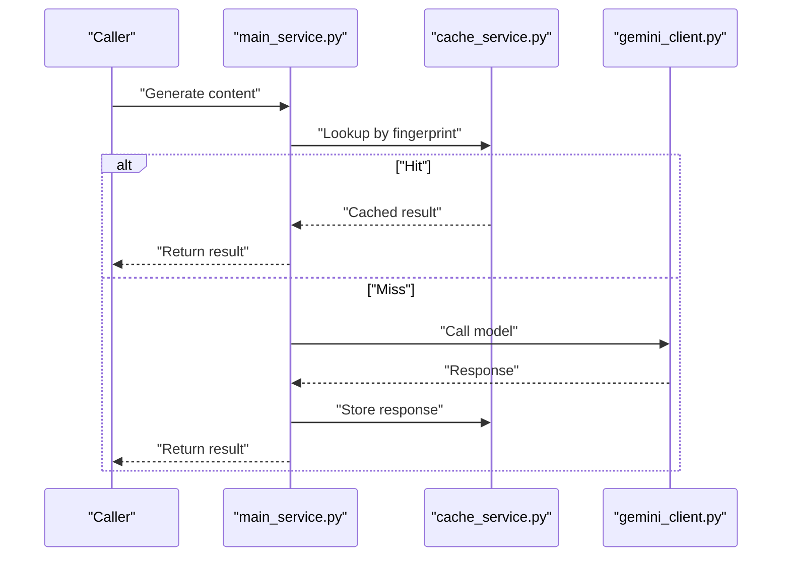
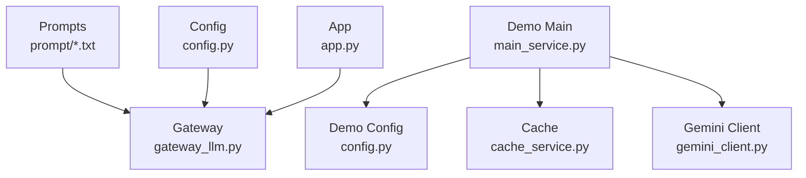

# Prompt Engineering System

<cite>
**Referenced Files in This Document**
- [backend/prompt/teaching_system_prompt.txt](file://backend/prompt/teaching_system_prompt.txt)
- [backend/prompt/teaching_user_prompt.txt](file://backend/prompt/teaching_user_prompt.txt)
- [backend/prompt/classification_user_prompt.txt](file://backend/prompt/classification_user_prompt.txt)
- [backend/prompt/extract_user_prompt.txt](file://backend/prompt/extract_user_prompt.txt)
- [backend/prompt/classi_pic_system_prompt.txt](file://backend/prompt/classi_pic_system_prompt.txt)
- [backend/prompt/classi_pic_user_prompt.txt](file://backend/prompt/classi_pic_user_prompt.txt)
- [backend/prompt/backup/teaching_system_prompt_0110.txt](file://backend/prompt/backup/teaching_system_prompt_0110.txt)
- [backend/prompt/backup/teaching_system_prompt - 副本.txt](file://backend/prompt/backup/teaching_system_prompt - 副本.txt)
- [backend/prompt/backup/teaching_user_prompt.txt](file://backend/prompt/backup/teaching_user_prompt.txt)
- [backend/prompt/backup/classification_user_prompt_v0.txt](file://backend/prompt/backup/classification_user_prompt_v0.txt)
- [backend/prompt/backup/extract_user_prompt.txt](file://backend/prompt/backup/extract_user_prompt.txt)
- [backend/gateway_llm.py](file://backend/gateway_llm.py)
- [backend/app.py](file://backend/app.py)
- [backend/config.py](file://backend/config.py)
- [backend/cost_optimization_demo/main_service.py](file://backend/cost_optimization_demo/main_service.py)
- [backend/cost_optimization_demo/cache_service.py](file://backend/cost_optimization_demo/cache_service.py)
- [backend/cost_optimization_demo/config.py](file://backend/cost_optimization_demo/config.py)
- [backend/cost_optimization_demo/gemini_client.py](file://backend/cost_optimization_demo/gemini_client.py)
- [backend/tests/test_config.py](file://backend/tests/test_config.py)
</cite>

## Table of Contents
1. [Introduction](#introduction)
2. [Project Structure](#project-structure)
3. [Core Components](#core-components)
4. [Architecture Overview](#architecture-overview)
5. [Detailed Component Analysis](#detailed-component-analysis)
6. [Dependency Analysis](#dependency-analysis)
7. [Performance Considerations](#performance-considerations)
8. [Troubleshooting Guide](#troubleshooting-guide)
9. [Conclusion](#conclusion)
10. [Appendices](#appendices)

## Introduction
This document explains the prompt engineering system used for AI content generation within the project. It focuses on the dual-prompt architecture where system prompts define behavior and user prompts contain specific instructions, along with template variables, dynamic content injection, context management, versioning, A/B testing capabilities, and performance optimization techniques. It also provides guidelines for writing effective prompts, debugging issues, and optimizing structure for different AI models, including examples for creating new templates, modifying existing ones, and testing effectiveness.

## Project Structure
The prompt assets are organized under a dedicated directory with clear separation between system and user prompts, plus a backup folder for historical versions. The runtime integration is implemented in backend modules that load these prompts and render them into model requests.

**Diagram sources**
- [backend/prompt/teaching_system_prompt.txt](file://backend/prompt/teaching_system_prompt.txt)
- [backend/prompt/teaching_user_prompt.txt](file://backend/prompt/teaching_user_prompt.txt)
- [backend/prompt/classi_pic_system_prompt.txt](file://backend/prompt/classi_pic_system_prompt.txt)
- [backend/prompt/classi_pic_user_prompt.txt](file://backend/prompt/classi_pic_user_prompt.txt)
- [backend/prompt/classification_user_prompt.txt](file://backend/prompt/classification_user_prompt.txt)
- [backend/prompt/extract_user_prompt.txt](file://backend/prompt/extract_user_prompt.txt)
- [backend/prompt/backup/teaching_system_prompt_0110.txt](file://backend/prompt/backup/teaching_system_prompt_0110.txt)
- [backend/prompt/backup/teaching_system_prompt - 副本.txt](file://backend/prompt/backup/teaching_system_prompt - 副本.txt)
- [backend/prompt/backup/teaching_user_prompt.txt](file://backend/prompt/backup/teaching_user_prompt.txt)
- [backend/prompt/backup/classification_user_prompt_v0.txt](file://backend/prompt/backup/classification_user_prompt_v0.txt)
- [backend/prompt/backup/extract_user_prompt.txt](file://backend/prompt/backup/extract_user_prompt.txt)
- [backend/gateway_llm.py](file://backend/gateway_llm.py)
- [backend/app.py](file://backend/app.py)
- [backend/config.py](file://backend/config.py)
- [backend/cost_optimization_demo/main_service.py](file://backend/cost_optimization_demo/main_service.py)
- [backend/cost_optimization_demo/cache_service.py](file://backend/cost_optimization_demo/cache_service.py)
- [backend/cost_optimization_demo/config.py](file://backend/cost_optimization_demo/config.py)
- [backend/cost_optimization_demo/gemini_client.py](file://backend/cost_optimization_demo/gemini_client.py)

**Section sources**
- [backend/prompt/teaching_system_prompt.txt](file://backend/prompt/teaching_system_prompt.txt)
- [backend/prompt/teaching_user_prompt.txt](file://backend/prompt/teaching_user_prompt.txt)
- [backend/prompt/classi_pic_system_prompt.txt](file://backend/prompt/classi_pic_system_prompt.txt)
- [backend/prompt/classi_pic_user_prompt.txt](file://backend/prompt/classi_pic_user_prompt.txt)
- [backend/prompt/classification_user_prompt.txt](file://backend/prompt/classification_user_prompt.txt)
- [backend/prompt/extract_user_prompt.txt](file://backend/prompt/extract_user_prompt.txt)
- [backend/prompt/backup/teaching_system_prompt_0110.txt](file://backend/prompt/backup/teaching_system_prompt_0110.txt)
- [backend/prompt/backup/teaching_system_prompt - 副本.txt](file://backend/prompt/backup/teaching_system_prompt - 副本.txt)
- [backend/prompt/backup/teaching_user_prompt.txt](file://backend/prompt/backup/teaching_user_prompt.txt)
- [backend/prompt/backup/classification_user_prompt_v0.txt](file://backend/prompt/backup/classification_user_prompt_v0.txt)
- [backend/prompt/backup/extract_user_prompt.txt](file://backend/prompt/backup/extract_user_prompt.txt)
- [backend/gateway_llm.py](file://backend/gateway_llm.py)
- [backend/app.py](file://backend/app.py)
- [backend/config.py](file://backend/config.py)
- [backend/cost_optimization_demo/main_service.py](file://backend/cost_optimization_demo/main_service.py)
- [backend/cost_optimization_demo/cache_service.py](file://backend/cost_optimization_demo/cache_service.py)
- [backend/cost_optimization_demo/config.py](file://backend/cost_optimization_demo/config.py)
- [backend/cost_optimization_demo/gemini_client.py](file://backend/cost_optimization_demo/gemini_client.py)

## Core Components
- Dual-prompt architecture:
  - System prompts define role, constraints, output format, safety rules, and model behavior.
  - User prompts carry task-specific instructions, inputs, and formatting directives.
- Template variables and dynamic injection:
  - Placeholders in prompts are replaced at runtime with contextual data (e.g., topic, audience, style).
- Context management:
  - Prompts can include references to prior conversation turns or retrieved knowledge snippets.
- Versioning and backups:
  - Historical prompt files are preserved in a backup directory to enable rollback and comparison.
- A/B testing hooks:
  - Configuration-driven selection of prompt variants allows controlled experiments.
- Performance optimization:
  - Caching of rendered prompts and responses reduces cost and latency.

**Section sources**
- [backend/prompt/teaching_system_prompt.txt](file://backend/prompt/teaching_system_prompt.txt)
- [backend/prompt/teaching_user_prompt.txt](file://backend/prompt/teaching_user_prompt.txt)
- [backend/prompt/backup/teaching_system_prompt_0110.txt](file://backend/prompt/backup/teaching_system_prompt_0110.txt)
- [backend/prompt/backup/teaching_system_prompt - 副本.txt](file://backend/prompt/backup/teaching_system_prompt - 副本.txt)
- [backend/prompt/backup/teaching_user_prompt.txt](file://backend/prompt/backup/teaching_user_prompt.txt)
- [backend/cost_optimization_demo/cache_service.py](file://backend/cost_optimization_demo/cache_service.py)
- [backend/cost_optimization_demo/config.py](file://backend/cost_optimization_demo/config.py)

## Architecture Overview
The runtime loads prompt templates from disk, renders them with dynamic variables, and sends them to an LLM gateway. The gateway abstracts provider details and returns structured outputs. Optional caching improves performance and cost efficiency.

**Diagram sources**
- [backend/app.py](file://backend/app.py)
- [backend/gateway_llm.py](file://backend/gateway_llm.py)
- [backend/prompt/teaching_system_prompt.txt](file://backend/prompt/teaching_system_prompt.txt)
- [backend/prompt/teaching_user_prompt.txt](file://backend/prompt/teaching_user_prompt.txt)
- [backend/cost_optimization_demo/cache_service.py](file://backend/cost_optimization_demo/cache_service.py)

## Detailed Component Analysis

### Prompt Templates and Variables
- Teaching prompts:
  - System prompt defines teaching persona, pedagogical constraints, and output structure.
  - User prompt specifies lesson topic, target audience, difficulty level, and desired sections.
- Classification prompts:
  - System prompt sets classification schema and decision rules.
  - User prompt provides input items and expected categories.
- Extraction prompts:
  - User prompt instructs extraction targets and output format.

Template variables typically include:
- Topic, audience, tone, length, language, domain tags
- Prior context snippets, references, examples
- Output schema hints (JSON keys, section names)

Dynamic injection occurs before sending to the model, ensuring consistent structure and reducing hallucination risk.

**Section sources**
- [backend/prompt/teaching_system_prompt.txt](file://backend/prompt/teaching_system_prompt.txt)
- [backend/prompt/teaching_user_prompt.txt](file://backend/prompt/teaching_user_prompt.txt)
- [backend/prompt/classi_pic_system_prompt.txt](file://backend/prompt/classi_pic_system_prompt.txt)
- [backend/prompt/classi_pic_user_prompt.txt](file://backend/prompt/classi_pic_user_prompt.txt)
- [backend/prompt/classification_user_prompt.txt](file://backend/prompt/classification_user_prompt.txt)
- [backend/prompt/extract_user_prompt.txt](file://backend/prompt/extract_user_prompt.txt)

### Versioning and Backup Strategy
- Historical versions are stored under a backup directory.
- Naming conventions indicate dates or iteration numbers for traceability.
- Rollback is supported by switching file paths or configuration pointers.

[No sources needed since this diagram shows conceptual workflow, not actual code structure]

**Section sources**
- [backend/prompt/backup/teaching_system_prompt_0110.txt](file://backend/prompt/backup/teaching_system_prompt_0110.txt)
- [backend/prompt/backup/teaching_system_prompt - 副本.txt](file://backend/prompt/backup/teaching_system_prompt - 副本.txt)
- [backend/prompt/backup/teaching_user_prompt.txt](file://backend/prompt/backup/teaching_user_prompt.txt)
- [backend/prompt/backup/classification_user_prompt_v0.txt](file://backend/prompt/backup/classification_user_prompt_v0.txt)
- [backend/prompt/backup/extract_user_prompt.txt](file://backend/prompt/backup/extract_user_prompt.txt)

### A/B Testing Capabilities
- Configuration-driven selection of prompt variants enables controlled experiments.
- Variants can be selected per environment or per request using feature flags.
- Metrics collection should track success rates, latency, and cost per variant.

[No sources needed since this diagram shows conceptual workflow, not actual code structure]

**Section sources**
- [backend/config.py](file://backend/config.py)
- [backend/tests/test_config.py](file://backend/tests/test_config.py)

### Performance Optimization Techniques
- Prompt rendering cache:
  - Cache rendered prompts and model responses keyed by request fingerprints.
- Cost-aware client usage:
  - Use efficient clients and batch operations when possible.
- Response caching:
  - Avoid redundant calls for identical inputs.

**Diagram sources**
- [backend/cost_optimization_demo/main_service.py](file://backend/cost_optimization_demo/main_service.py)
- [backend/cost_optimization_demo/cache_service.py](file://backend/cost_optimization_demo/cache_service.py)
- [backend/cost_optimization_demo/gemini_client.py](file://backend/cost_optimization_demo/gemini_client.py)

**Section sources**
- [backend/cost_optimization_demo/main_service.py](file://backend/cost_optimization_demo/main_service.py)
- [backend/cost_optimization_demo/cache_service.py](file://backend/cost_optimization_demo/cache_service.py)
- [backend/cost_optimization_demo/config.py](file://backend/cost_optimization_demo/config.py)
- [backend/cost_optimization_demo/gemini_client.py](file://backend/cost_optimization_demo/gemini_client.py)

### Guidelines for Writing Effective Prompts
- Be explicit about role and constraints in system prompts.
- Provide structured output schemas to improve parsing reliability.
- Include examples or few-shot patterns when necessary.
- Keep user prompts focused and concise; avoid ambiguity.
- Use placeholders consistently and validate injected values.
- Separate concerns: system for behavior, user for task specifics.
- Maintain readability and modularity for easier maintenance.

[No sources needed since this section provides general guidance]

### Debugging Prompt Issues
- Validate placeholder substitution by logging rendered prompts in development.
- Compare outputs across versions to isolate regressions.
- Use minimal reproducible inputs to diagnose edge cases.
- Check model-specific quirks (token limits, formatting expectations).
- Inspect error logs and stack traces around rendering and API calls.

**Section sources**
- [backend/gateway_llm.py](file://backend/gateway_llm.py)
- [backend/app.py](file://backend/app.py)

### Optimizing Prompt Structure for Different Models
- Adjust verbosity based on model capacity and cost constraints.
- Prefer explicit JSON schemas for models that support structured outputs.
- Use shorter instructions for constrained contexts; expand only when needed.
- Tailor examples to model strengths (reasoning vs. instruction-following).

[No sources needed since this section provides general guidance]

### Examples: Creating New Prompt Templates
- Create a new pair:
  - Add a system prompt defining behavior and output format.
  - Add a user prompt with placeholders for dynamic content.
- Integrate into the pipeline:
  - Load both templates at runtime.
  - Render with context variables before invoking the gateway.
- Version control:
  - Commit changes and archive previous versions in backup.

**Section sources**
- [backend/prompt/teaching_system_prompt.txt](file://backend/prompt/teaching_system_prompt.txt)
- [backend/prompt/teaching_user_prompt.txt](file://backend/prompt/teaching_user_prompt.txt)
- [backend/prompt/backup/teaching_system_prompt_0110.txt](file://backend/prompt/backup/teaching_system_prompt_0110.txt)

### Examples: Modifying Existing Prompts
- Identify the active prompt files for the task.
- Update placeholders and instructions incrementally.
- Run tests and compare outputs against baselines.
- Archive old versions and document changes.

**Section sources**
- [backend/prompt/backup/teaching_user_prompt.txt](file://backend/prompt/backup/teaching_user_prompt.txt)
- [backend/prompt/backup/classification_user_prompt_v0.txt](file://backend/prompt/backup/classification_user_prompt_v0.txt)

### Examples: Testing Prompt Effectiveness
- Define evaluation criteria (accuracy, coherence, compliance).
- Build test suites that render prompts with diverse inputs.
- Track metrics over time and across variants.
- Use A/B testing to validate improvements.

**Section sources**
- [backend/tests/test_config.py](file://backend/tests/test_config.py)
- [backend/config.py](file://backend/config.py)

## Dependency Analysis
The prompt system depends on configuration and gateway layers, with optional caching for performance.

**Diagram sources**
- [backend/prompt/teaching_system_prompt.txt](file://backend/prompt/teaching_system_prompt.txt)
- [backend/prompt/teaching_user_prompt.txt](file://backend/prompt/teaching_user_prompt.txt)
- [backend/gateway_llm.py](file://backend/gateway_llm.py)
- [backend/app.py](file://backend/app.py)
- [backend/config.py](file://backend/config.py)
- [backend/cost_optimization_demo/main_service.py](file://backend/cost_optimization_demo/main_service.py)
- [backend/cost_optimization_demo/cache_service.py](file://backend/cost_optimization_demo/cache_service.py)
- [backend/cost_optimization_demo/config.py](file://backend/cost_optimization_demo/config.py)
- [backend/cost_optimization_demo/gemini_client.py](file://backend/cost_optimization_demo/gemini_client.py)

**Section sources**
- [backend/gateway_llm.py](file://backend/gateway_llm.py)
- [backend/app.py](file://backend/app.py)
- [backend/config.py](file://backend/config.py)
- [backend/cost_optimization_demo/main_service.py](file://backend/cost_optimization_demo/main_service.py)
- [backend/cost_optimization_demo/cache_service.py](file://backend/cost_optimization_demo/cache_service.py)
- [backend/cost_optimization_demo/config.py](file://backend/cost_optimization_demo/config.py)
- [backend/cost_optimization_demo/gemini_client.py](file://backend/cost_optimization_demo/gemini_client.py)

## Performance Considerations
- Cache rendered prompts and responses to reduce latency and cost.
- Minimize unnecessary context to stay within token limits.
- Use structured outputs to simplify post-processing.
- Monitor model throughput and adjust batching strategies.
- Profile prompt rendering overhead and optimize variable injection.

[No sources needed since this section provides general guidance]

## Troubleshooting Guide
- Symptom: Unexpected output format
  - Action: Verify system prompt constraints and output schema; check recent changes in backup.
- Symptom: Placeholder not substituted
  - Action: Inspect rendering logic and ensure all required variables are provided.
- Symptom: High latency or cost
  - Action: Enable caching; review prompt length and context size.
- Symptom: Model errors or timeouts
  - Action: Reduce input size; add retries; check gateway error handling.

**Section sources**
- [backend/gateway_llm.py](file://backend/gateway_llm.py)
- [backend/app.py](file://backend/app.py)
- [backend/cost_optimization_demo/cache_service.py](file://backend/cost_optimization_demo/cache_service.py)

## Conclusion
The prompt engineering system combines well-structured dual prompts, robust versioning, and performance optimizations to deliver reliable AI-generated content. By following the guidelines and leveraging the provided components, teams can iteratively improve prompt quality, maintain consistency across models, and achieve measurable gains in accuracy, speed, and cost efficiency.

[No sources needed since this section summarizes without analyzing specific files]

## Appendices

### Quick Reference: Key Files
- System and user prompts for teaching, classification, and extraction tasks.
- Gateway and app entry points for prompt loading and invocation.
- Demo service demonstrating caching and client usage.

**Section sources**
- [backend/prompt/teaching_system_prompt.txt](file://backend/prompt/teaching_system_prompt.txt)
- [backend/prompt/teaching_user_prompt.txt](file://backend/prompt/teaching_user_prompt.txt)
- [backend/prompt/classi_pic_system_prompt.txt](file://backend/prompt/classi_pic_system_prompt.txt)
- [backend/prompt/classi_pic_user_prompt.txt](file://backend/prompt/classi_pic_user_prompt.txt)
- [backend/prompt/classification_user_prompt.txt](file://backend/prompt/classification_user_prompt.txt)
- [backend/prompt/extract_user_prompt.txt](file://backend/prompt/extract_user_prompt.txt)
- [backend/gateway_llm.py](file://backend/gateway_llm.py)
- [backend/app.py](file://backend/app.py)
- [backend/cost_optimization_demo/main_service.py](file://backend/cost_optimization_demo/main_service.py)
- [backend/cost_optimization_demo/cache_service.py](file://backend/cost_optimization_demo/cache_service.py)
- [backend/cost_optimization_demo/config.py](file://backend/cost_optimization_demo/config.py)
- [backend/cost_optimization_demo/gemini_client.py](file://backend/cost_optimization_demo/gemini_client.py)