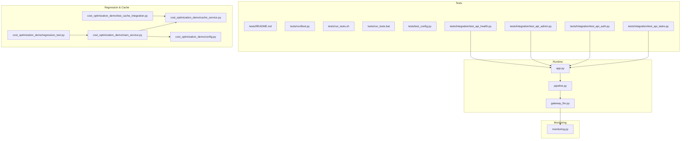
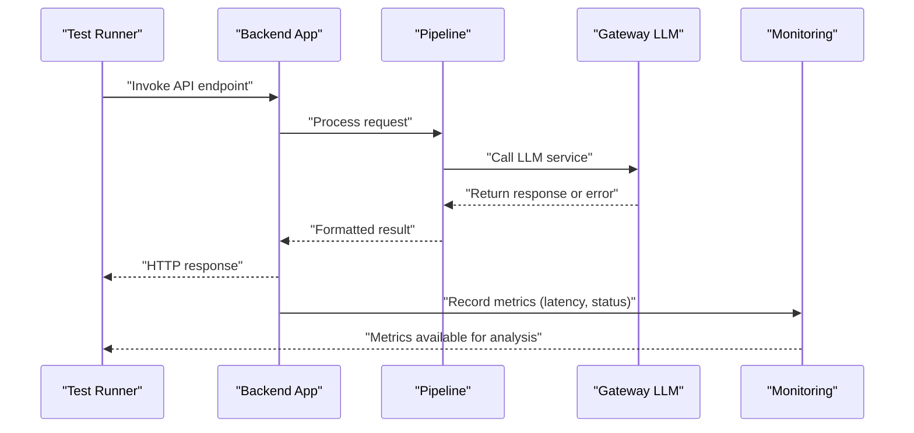
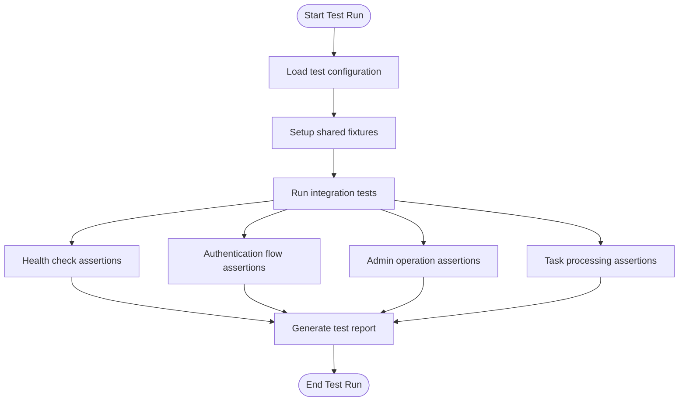
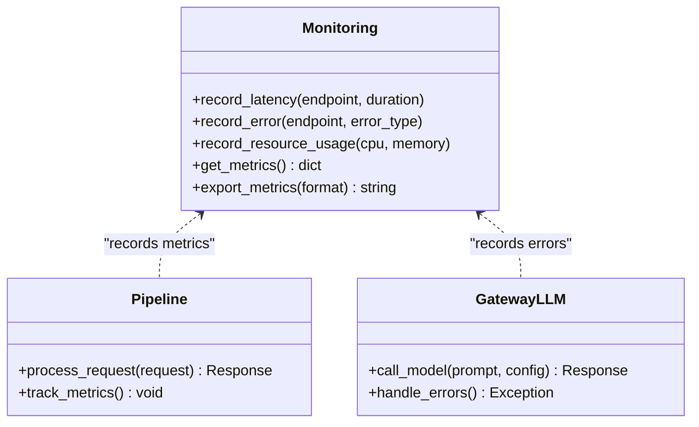
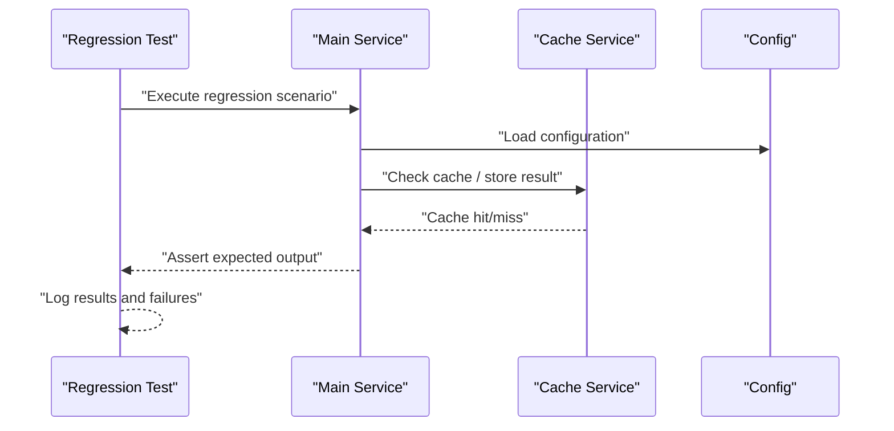
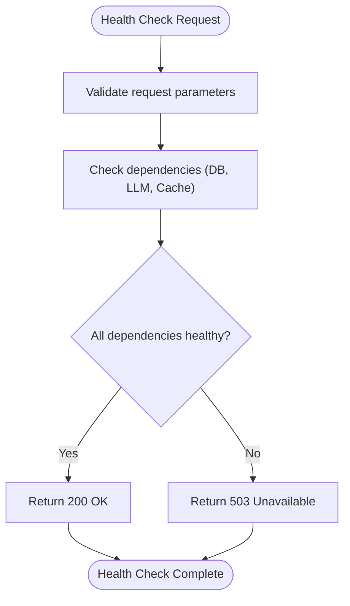
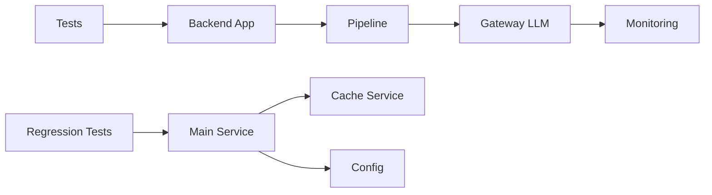

# Quality Assurance & Performance Monitoring

<cite>
**Referenced Files in This Document**
- [backend/tests/README.md](file://backend/tests/README.md)
- [backend/tests/conftest.py](file://backend/tests/conftest.py)
- [backend/tests/run_tests.sh](file://backend/tests/run_tests.sh)
- [backend/tests/run_tests.bat](file://backend/tests/run_tests.bat)
- [backend/tests/test_config.py](file://backend/tests/test_config.py)
- [backend/tests/integration/test_api_health.py](file://backend/tests/integration/test_api_health.py)
- [backend/tests/integration/test_api_admin.py](file://backend/tests/integration/test_api_admin.py)
- [backend/tests/integration/test_api_auth.py](file://backend/tests/integration/test_api_auth.py)
- [backend/tests/integration/test_api_tasks.py](file://backend/tests/integration/test_api_tasks.py)
- [backend/monitoring.py](file://backend/monitoring.py)
- [backend/app.py](file://backend/app.py)
- [backend/pipeline.py](file://backend/pipeline.py)
- [backend/gateway_llm.py](file://backend/gateway_llm.py)
- [backend/cost_optimization_demo/regression_test.py](file://backend/cost_optimization_demo/regression_test.py)
- [backend/cost_optimization_demo/cache_service.py](file://backend/cost_optimization_demo/cache_service.py)
- [backend/cost_optimization_demo/config.py](file://backend/cost_optimization_demo/config.py)
- [backend/cost_optimization_demo/main_service.py](file://backend/cost_optimization_demo/main_service.py)
- [backend/cost_optimization_demo/test_cache_integration.py](file://backend/cost_optimization_demo/test_cache_integration.py)
- [backend/PERFORMANCE_OPTIMIZATION.md](file://backend/PERFORMANCE_OPTIMIZATION.md)
</cite>

## Table of Contents
1. [Introduction](#introduction)
2. [Project Structure](#project-structure)
3. [Core Components](#core-components)
4. [Architecture Overview](#architecture-overview)
5. [Detailed Component Analysis](#detailed-component-analysis)
6. [Dependency Analysis](#dependency-analysis)
7. [Performance Considerations](#performance-considerations)
8. [Troubleshooting Guide](#troubleshooting-guide)
9. [Conclusion](#conclusion)
10. [Appendices](#appendices)

## Introduction
This document explains the quality assurance and performance monitoring systems for AI content generation within the project. It covers:
- Automated testing framework for validating generated content quality, format compliance, and functional correctness
- Performance monitoring tools that track response times, error rates, and resource utilization
- Regression testing suite to ensure consistency across model updates and prompt changes
- Health check mechanisms, alerting systems, and diagnostic tools for troubleshooting generation issues
- Practical examples for adding new quality metrics, configuring monitoring alerts, and interpreting performance reports

The goal is to provide both technical depth and accessible guidance for engineers and operators managing AI-driven content pipelines.

## Project Structure
Quality assurance and performance monitoring are implemented across several areas:
- Tests directory with unit, integration, and end-to-end tests
- Monitoring module for metrics collection and reporting
- Pipeline and gateway modules for request processing and LLM interactions
- Cost optimization demo including regression tests and cache integration tests
- Documentation files describing performance optimizations and test execution

**Diagram sources**
- [backend/tests/README.md](file://backend/tests/README.md)
- [backend/tests/conftest.py](file://backend/tests/conftest.py)
- [backend/tests/run_tests.sh](file://backend/tests/run_tests.sh)
- [backend/tests/run_tests.bat](file://backend/tests/run_tests.bat)
- [backend/tests/test_config.py](file://backend/tests/test_config.py)
- [backend/tests/integration/test_api_health.py](file://backend/tests/integration/test_api_health.py)
- [backend/tests/integration/test_api_admin.py](file://backend/tests/integration/test_api_admin.py)
- [backend/tests/integration/test_api_auth.py](file://backend/tests/integration/test_api_auth.py)
- [backend/tests/integration/test_api_tasks.py](file://backend/tests/integration/test_api_tasks.py)
- [backend/monitoring.py](file://backend/monitoring.py)
- [backend/app.py](file://backend/app.py)
- [backend/pipeline.py](file://backend/pipeline.py)
- [backend/gateway_llm.py](file://backend/gateway_llm.py)
- [backend/cost_optimization_demo/regression_test.py](file://backend/cost_optimization_demo/regression_test.py)
- [backend/cost_optimization_demo/cache_service.py](file://backend/cost_optimization_demo/cache_service.py)
- [backend/cost_optimization_demo/config.py](file://backend/cost_optimization_demo/config.py)
- [backend/cost_optimization_demo/main_service.py](file://backend/cost_optimization_demo/main_service.py)
- [backend/cost_optimization_demo/test_cache_integration.py](file://backend/cost_optimization_demo/test_cache_integration.py)

**Section sources**
- [backend/tests/README.md](file://backend/tests/README.md)
- [backend/PERFORMANCE_OPTIMIZATION.md](file://backend/PERFORMANCE_OPTIMIZATION.md)

## Core Components
- Automated Testing Framework
  - Test configuration and fixtures via conftest.py
  - Integration tests covering health, admin, auth, and task APIs
  - Configuration validation tests
  - Cross-platform test runners (shell and batch scripts)
- Performance Monitoring
  - Centralized metrics collection and reporting in monitoring.py
  - Request/response timing and error rate tracking
  - Resource utilization indicators
- Regression Testing Suite
  - Dedicated regression tests for cost optimization demo
  - Cache integration tests ensuring consistent behavior across updates
- Health Checks and Diagnostics
  - API health endpoints validated by integration tests
  - Diagnostic utilities embedded in test suites and monitoring

**Section sources**
- [backend/tests/conftest.py](file://backend/tests/conftest.py)
- [backend/tests/integration/test_api_health.py](file://backend/tests/integration/test_api_health.py)
- [backend/tests/integration/test_api_admin.py](file://backend/tests/integration/test_api_admin.py)
- [backend/tests/integration/test_api_auth.py](file://backend/tests/integration/test_api_auth.py)
- [backend/tests/integration/test_api_tasks.py](file://backend/tests/integration/test_api_tasks.py)
- [backend/tests/test_config.py](file://backend/tests/test_config.py)
- [backend/monitoring.py](file://backend/monitoring.py)
- [backend/cost_optimization_demo/regression_test.py](file://backend/cost_optimization_demo/regression_test.py)
- [backend/cost_optimization_demo/test_cache_integration.py](file://backend/cost_optimization_demo/test_cache_integration.py)

## Architecture Overview
The QA and monitoring architecture integrates tests, runtime services, and monitoring components:
- Tests invoke API endpoints and validate responses, asserting quality and correctness
- Runtime services process requests through pipeline and gateway layers
- Monitoring captures metrics at key points for performance and error analysis
- Regression tests ensure stability across model and prompt changes

**Diagram sources**
- [backend/app.py](file://backend/app.py)
- [backend/pipeline.py](file://backend/pipeline.py)
- [backend/gateway_llm.py](file://backend/gateway_llm.py)
- [backend/monitoring.py](file://backend/monitoring.py)

## Detailed Component Analysis

### Automated Testing Framework
- Test configuration and shared fixtures are defined in conftest.py
- Integration tests cover:
  - Health checks to verify service availability
  - Admin operations for management tasks
  - Authentication flows for user access control
  - Task processing endpoints for generation workflows
- Configuration tests validate environment settings and defaults
- Cross-platform runners enable consistent execution on different environments

**Diagram sources**
- [backend/tests/conftest.py](file://backend/tests/conftest.py)
- [backend/tests/integration/test_api_health.py](file://backend/tests/integration/test_api_health.py)
- [backend/tests/integration/test_api_auth.py](file://backend/tests/integration/test_api_auth.py)
- [backend/tests/integration/test_api_admin.py](file://backend/tests/integration/test_api_admin.py)
- [backend/tests/integration/test_api_tasks.py](file://backend/tests/integration/test_api_tasks.py)

**Section sources**
- [backend/tests/conftest.py](file://backend/tests/conftest.py)
- [backend/tests/integration/test_api_health.py](file://backend/tests/integration/test_api_health.py)
- [backend/tests/integration/test_api_auth.py](file://backend/tests/integration/test_api_auth.py)
- [backend/tests/integration/test_api_admin.py](file://backend/tests/integration/test_api_admin.py)
- [backend/tests/integration/test_api_tasks.py](file://backend/tests/integration/test_api_tasks.py)
- [backend/tests/test_config.py](file://backend/tests/test_config.py)
- [backend/tests/run_tests.sh](file://backend/tests/run_tests.sh)
- [backend/tests/run_tests.bat](file://backend/tests/run_tests.bat)

### Performance Monitoring Tools
- Centralized monitoring module collects metrics such as:
  - Response times per endpoint
  - Error rates and failure categories
  - Resource utilization indicators
- Metrics are recorded during request processing and can be exported or visualized
- Integration with pipeline and gateway ensures comprehensive coverage

**Diagram sources**
- [backend/monitoring.py](file://backend/monitoring.py)
- [backend/pipeline.py](file://backend/pipeline.py)
- [backend/gateway_llm.py](file://backend/gateway_llm.py)

**Section sources**
- [backend/monitoring.py](file://backend/monitoring.py)
- [backend/pipeline.py](file://backend/pipeline.py)
- [backend/gateway_llm.py](file://backend/gateway_llm.py)

### Regression Testing Suite
- Regression tests focus on cost optimization features and cache behavior
- Ensures consistency across model updates and prompt changes
- Includes dedicated cache integration tests to validate caching strategies

**Diagram sources**
- [backend/cost_optimization_demo/regression_test.py](file://backend/cost_optimization_demo/regression_test.py)
- [backend/cost_optimization_demo/main_service.py](file://backend/cost_optimization_demo/main_service.py)
- [backend/cost_optimization_demo/cache_service.py](file://backend/cost_optimization_demo/cache_service.py)
- [backend/cost_optimization_demo/config.py](file://backend/cost_optimization_demo/config.py)

**Section sources**
- [backend/cost_optimization_demo/regression_test.py](file://backend/cost_optimization_demo/regression_test.py)
- [backend/cost_optimization_demo/test_cache_integration.py](file://backend/cost_optimization_demo/test_cache_integration.py)
- [backend/cost_optimization_demo/main_service.py](file://backend/cost_optimization_demo/main_service.py)
- [backend/cost_optimization_demo/cache_service.py](file://backend/cost_optimization_demo/cache_service.py)
- [backend/cost_optimization_demo/config.py](file://backend/cost_optimization_demo/config.py)

### Health Check Mechanisms
- Health check endpoints are validated by integration tests
- Ensure service readiness and dependency availability
- Provide clear status signals for orchestration and monitoring systems

**Diagram sources**
- [backend/tests/integration/test_api_health.py](file://backend/tests/integration/test_api_health.py)
- [backend/app.py](file://backend/app.py)

**Section sources**
- [backend/tests/integration/test_api_health.py](file://backend/tests/integration/test_api_health.py)
- [backend/app.py](file://backend/app.py)

### Alerting Systems and Diagnostic Tools
- Monitoring module supports metric export for alerting systems
- Integration tests include diagnostic assertions for common failure modes
- Test runners provide consistent execution and reporting across environments

**Section sources**
- [backend/monitoring.py](file://backend/monitoring.py)
- [backend/tests/run_tests.sh](file://backend/tests/run_tests.sh)
- [backend/tests/run_tests.bat](file://backend/tests/run_tests.bat)

## Dependency Analysis
Key dependencies between QA and monitoring components:
- Tests depend on backend app endpoints for integration validation
- Pipeline and gateway modules interact with monitoring for metrics collection
- Regression tests rely on configuration and cache services for consistent behavior

**Diagram sources**
- [backend/tests/integration/test_api_health.py](file://backend/tests/integration/test_api_health.py)
- [backend/app.py](file://backend/app.py)
- [backend/pipeline.py](file://backend/pipeline.py)
- [backend/gateway_llm.py](file://backend/gateway_llm.py)
- [backend/monitoring.py](file://backend/monitoring.py)
- [backend/cost_optimization_demo/regression_test.py](file://backend/cost_optimization_demo/regression_test.py)
- [backend/cost_optimization_demo/main_service.py](file://backend/cost_optimization_demo/main_service.py)
- [backend/cost_optimization_demo/cache_service.py](file://backend/cost_optimization_demo/cache_service.py)
- [backend/cost_optimization_demo/config.py](file://backend/cost_optimization_demo/config.py)

**Section sources**
- [backend/tests/integration/test_api_health.py](file://backend/tests/integration/test_api_health.py)
- [backend/app.py](file://backend/app.py)
- [backend/pipeline.py](file://backend/pipeline.py)
- [backend/gateway_llm.py](file://backend/gateway_llm.py)
- [backend/monitoring.py](file://backend/monitoring.py)
- [backend/cost_optimization_demo/regression_test.py](file://backend/cost_optimization_demo/regression_test.py)
- [backend/cost_optimization_demo/main_service.py](file://backend/cost_optimization_demo/main_service.py)
- [backend/cost_optimization_demo/cache_service.py](file://backend/cost_optimization_demo/cache_service.py)
- [backend/cost_optimization_demo/config.py](file://backend/cost_optimization_demo/config.py)

## Performance Considerations
- Monitor response times and error rates to identify bottlenecks
- Use caching strategies to reduce latency and costs
- Implement efficient resource utilization patterns in pipeline and gateway layers
- Leverage regression tests to detect performance regressions early

[No sources needed since this section provides general guidance]

## Troubleshooting Guide
Common issues and diagnostics:
- Health check failures indicate dependency problems; verify database, LLM, and cache connectivity
- High error rates in monitoring suggest upstream service issues or misconfiguration
- Regression test failures point to changes in model behavior or prompt formatting
- Use test runners to isolate and reproduce issues consistently

**Section sources**
- [backend/tests/integration/test_api_health.py](file://backend/tests/integration/test_api_health.py)
- [backend/monitoring.py](file://backend/monitoring.py)
- [backend/cost_optimization_demo/regression_test.py](file://backend/cost_optimization_demo/regression_test.py)
- [backend/tests/run_tests.sh](file://backend/tests/run_tests.sh)
- [backend/tests/run_tests.bat](file://backend/tests/run_tests.bat)

## Conclusion
The project implements a robust QA and monitoring system for AI content generation. Automated tests validate functionality and quality, monitoring tracks performance and errors, and regression tests ensure stability across changes. Operators can extend metrics, configure alerts, and interpret reports using the provided frameworks and tools.

[No sources needed since this section summarizes without analyzing specific files]

## Appendices

### Adding New Quality Metrics
- Extend the monitoring module to record additional metrics
- Update tests to assert new quality thresholds
- Integrate with alerting systems for real-time notifications

**Section sources**
- [backend/monitoring.py](file://backend/monitoring.py)
- [backend/tests/integration/test_api_health.py](file://backend/tests/integration/test_api_health.py)

### Configuring Monitoring Alerts
- Export metrics from monitoring module to external systems
- Define thresholds based on historical data and SLAs
- Configure alerting rules for critical metrics like error rates and latency

**Section sources**
- [backend/monitoring.py](file://backend/monitoring.py)

### Interpreting Performance Reports
- Analyze response time distributions to identify slow endpoints
- Review error rate trends to detect degradation patterns
- Correlate resource utilization with performance bottlenecks

**Section sources**
- [backend/monitoring.py](file://backend/monitoring.py)
- [backend/PERFORMANCE_OPTIMIZATION.md](file://backend/PERFORMANCE_OPTIMIZATION.md)