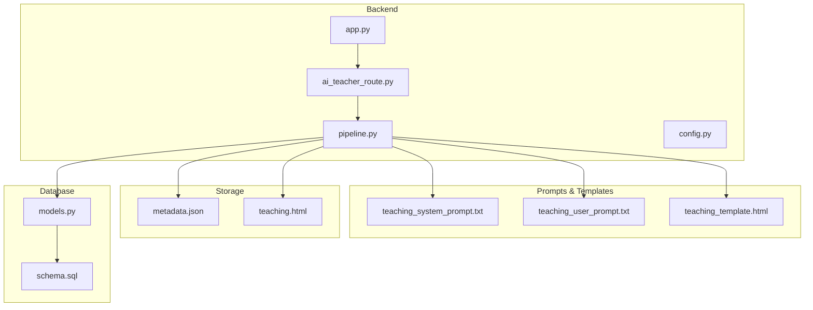
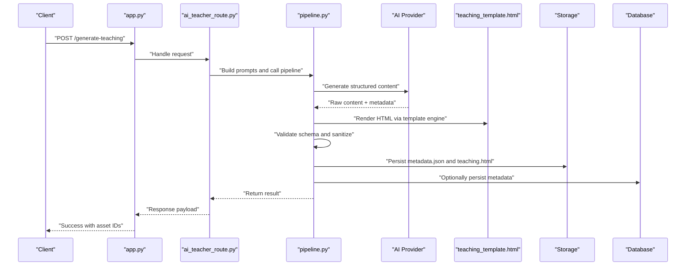
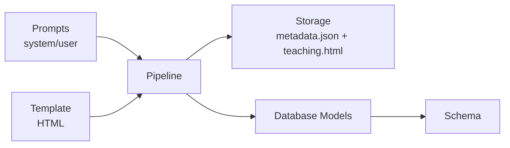
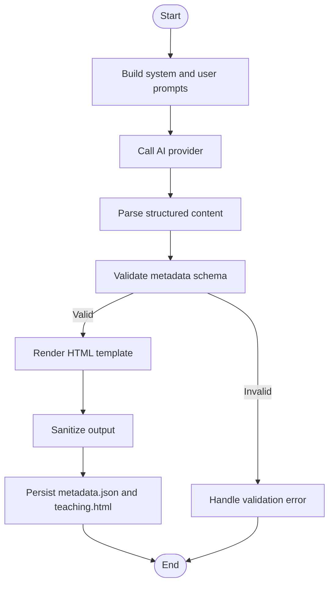

# Template Rendering System

<cite>
**Referenced Files in This Document**
- [teaching_template.html](file://backend/prompt/teaching_template.html)
- [teaching_system_prompt.txt](file://backend/prompt/teaching_system_prompt.txt)
- [teaching_user_prompt.txt](file://backend/prompt/teaching_user_prompt.txt)
- [app.py](file://backend/app.py)
- [ai_teacher_route.py](file://backend/ai_teacher_route.py)
- [pipeline.py](file://backend/pipeline.py)
- [config.py](file://backend/config.py)
- [models.py](file://backend/database/models.py)
- [schema.sql](file://backend/database/schema.sql)
- [metadata.json](file://storage/02f5efec-416c-4a17-9bf2-7ebea80cf178/metadata.json)
- [teaching.html](file://storage/02f5efec-416c-4a17-9bf2-7ebea80cf178/teaching.html)
</cite>

## Table of Contents
1. [Introduction](#introduction)
2. [Project Structure](#project-structure)
3. [Core Components](#core-components)
4. [Architecture Overview](#architecture-overview)
5. [Detailed Component Analysis](#detailed-component-analysis)
6. [Dependency Analysis](#dependency-analysis)
7. [Performance Considerations](#performance-considerations)
8. [Troubleshooting Guide](#troubleshooting-guide)
9. [Conclusion](#conclusion)
10. [Appendices](#appendices)

## Introduction
This document explains the template rendering system that transforms AI-generated content into structured HTML educational materials. It covers the HTML template architecture, variable substitution, conditional rendering, dynamic content insertion, metadata schema (tags, categories, difficulty levels, learning objectives), validation and security measures against XSS, responsive design considerations, and guidance for creating custom templates, extending metadata fields, and optimizing performance for large content sets.

## Project Structure
The template rendering system spans backend services, prompts/templates, storage artifacts, and database models:
- Backend orchestrates AI generation, template rendering, persistence, and API exposure.
- Prompts define how AI produces structured content and which template to use.
- Storage holds rendered teaching assets as paired files: a metadata descriptor and an HTML file.
- Database models and schema support persistent metadata and relationships.

**Diagram sources**
- [app.py](file://backend/app.py)
- [ai_teacher_route.py](file://backend/ai_teacher_route.py)
- [pipeline.py](file://backend/pipeline.py)
- [config.py](file://backend/config.py)
- [teaching_system_prompt.txt](file://backend/prompt/teaching_system_prompt.txt)
- [teaching_user_prompt.txt](file://backend/prompt/teaching_user_prompt.txt)
- [teaching_template.html](file://backend/prompt/teaching_template.html)
- [metadata.json](file://storage/02f5efec-416c-4a17-9bf2-7ebea80cf178/metadata.json)
- [teaching.html](file://storage/02f5efec-416c-4a17-9bf2-7ebea80cf178/teaching.html)
- [models.py](file://backend/database/models.py)
- [schema.sql](file://backend/database/schema.sql)

**Section sources**
- [app.py](file://backend/app.py)
- [ai_teacher_route.py](file://backend/ai_teacher_route.py)
- [pipeline.py](file://backend/pipeline.py)
- [config.py](file://backend/config.py)
- [teaching_template.html](file://backend/prompt/teaching_template.html)
- [teaching_system_prompt.txt](file://backend/prompt/teaching_system_prompt.txt)
- [teaching_user_prompt.txt](file://backend/prompt/teaching_user_prompt.txt)
- [models.py](file://backend/database/models.py)
- [schema.sql](file://backend/database/schema.sql)
- [metadata.json](file://storage/02f5efec-416c-4a17-9bf2-7ebea80cf178/metadata.json)
- [teaching.html](file://storage/02f5efec-416c-4a17-9bf2-7ebea80cf178/teaching.html)

## Core Components
- HTML Template Engine: Loads a base HTML template and substitutes placeholders with data from AI outputs and metadata. Supports conditional blocks and loops for lists like tags, categories, and learning objectives.
- Metadata Schema: A JSON structure describing the generated teaching asset, including identifiers, title, description, tags, categories, difficulty level, learning objectives, and links to assets.
- Pipeline Orchestration: Coordinates prompt construction, AI calls, parsing, template rendering, validation, sanitization, and persistence.
- Storage Layer: Persists rendered HTML and metadata as paired files under a unique ID directory.
- Database Integration: Optionally persists key metadata for search, filtering, and admin views.

Key responsibilities:
- Variable substitution: Replace template variables with values from metadata and AI content.
- Conditional rendering: Show/hide sections based on presence or values of metadata fields.
- Dynamic content insertion: Inject lists, images, code blocks, and interactive elements safely.
- Validation and sanitization: Ensure output conforms to expected schema and is safe for browsers.
- Responsive design: Use CSS classes and layout patterns that adapt across devices.

**Section sources**
- [pipeline.py](file://backend/pipeline.py)
- [teaching_template.html](file://backend/prompt/teaching_template.html)
- [metadata.json](file://storage/02f5efec-416c-4a17-9bf2-7ebea80cf178/metadata.json)
- [models.py](file://backend/database/models.py)

## Architecture Overview
The rendering pipeline follows a clear sequence: request handling, prompt assembly, AI generation, parsing, template rendering, validation, sanitization, and storage.

**Diagram sources**
- [app.py](file://backend/app.py)
- [ai_teacher_route.py](file://backend/ai_teacher_route.py)
- [pipeline.py](file://backend/pipeline.py)
- [teaching_template.html](file://backend/prompt/teaching_template.html)
- [models.py](file://backend/database/models.py)

## Detailed Component Analysis

### HTML Template Architecture
- Base structure: The template defines semantic HTML sections for header, body, and footer, with placeholder markers for dynamic content.
- Placeholders: Variables are marked using consistent naming conventions (e.g., {{title}}, {{description}}, {{tags}}). These are replaced by the template engine during rendering.
- Conditional blocks: Sections can be conditionally included based on metadata flags (e.g., show objectives only if present).
- Loops: Lists such as tags, categories, and learning objectives are rendered via iteration constructs.
- Styling hooks: CSS classes are used for responsive behavior; ensure media queries and utility classes are available at runtime.

Best practices:
- Keep placeholders descriptive and namespaced where necessary.
- Avoid inline scripts; prefer external JS modules loaded securely.
- Use semantic HTML elements to improve accessibility.

**Section sources**
- [teaching_template.html](file://backend/prompt/teaching_template.html)

### Variable Substitution and Conditional Rendering
- Variable substitution: The engine maps metadata keys to template variables. Missing keys should render gracefully with fallbacks.
- Conditional rendering: Use boolean flags in metadata to toggle visibility of sections (e.g., has_objectives, has_images).
- Dynamic lists: Iterate over arrays in metadata to generate bullet points, cards, or tables.

Example flows:
- If metadata.tags exists, render a tag cloud or list.
- If metadata.difficulty_level is set, display a badge or progress indicator.
- If metadata.learning_objectives is non-empty, render an ordered list.

**Section sources**
- [teaching_template.html](file://backend/prompt/teaching_template.html)
- [metadata.json](file://storage/02f5efec-416c-4a17-9bf2-7ebea80cf178/metadata.json)

### Dynamic Content Insertion
- Images: Insert via src attributes pointing to stored assets; validate URLs and enforce CSP policies.
- Code blocks: Wrap in pre/code with syntax highlighting classes; ensure no executable scripts are injected.
- Interactive elements: Use buttons and modals with event handlers bound via external JS modules.

Security considerations:
- Sanitize all user-provided or AI-generated content before insertion.
- Escape HTML entities for text nodes; avoid innerHTML for untrusted strings.
- Enforce strict Content Security Policy headers.

**Section sources**
- [pipeline.py](file://backend/pipeline.py)
- [teaching_template.html](file://backend/prompt/teaching_template.html)

### Metadata Schema
The metadata JSON accompanies each teaching asset and includes:
- Identifiers: id, version, created_at, updated_at
- Title and description: human-readable summary
- Tags: array of keywords for categorization
- Categories: hierarchical or flat classification
- Difficulty level: e.g., beginner, intermediate, advanced
- Learning objectives: array of statements describing outcomes
- Assets: references to images, videos, or downloadable resources
- Links: optional external references

Validation rules:
- Required fields must be present and non-empty.
- Arrays must contain valid entries (strings for tags/objectives, URLs for assets).
- Enums for difficulty_level must match allowed values.

Persistence:
- Optional database records mirror key fields for search and filtering.

**Section sources**
- [metadata.json](file://storage/02f5efec-416c-4a17-9bf2-7ebea80cf178/metadata.json)
- [models.py](file://backend/database/models.py)
- [schema.sql](file://backend/database/schema.sql)

### Template Validation Process
- Schema validation: Ensure metadata conforms to the defined schema before rendering.
- Template integrity: Verify that all required placeholders exist and are resolvable.
- Output validation: Post-render checks for malformed HTML or missing critical sections.
- Error handling: Fail fast with detailed diagnostics when validation fails.

**Section sources**
- [pipeline.py](file://backend/pipeline.py)

### Security Measures Against XSS
- Input sanitization: Strip or escape dangerous characters and tags from AI outputs and user inputs.
- Output encoding: Encode text content to prevent script injection.
- CSP enforcement: Restrict script sources and inline execution.
- Safe APIs: Use DOM APIs that do not evaluate untrusted strings as HTML.

**Section sources**
- [pipeline.py](file://backend/pipeline.py)
- [teaching_template.html](file://backend/prompt/teaching_template.html)

### Responsive Design Considerations
- Use flexible layouts (flexbox/grid) and relative units.
- Apply media queries for breakpoints across mobile, tablet, and desktop.
- Ensure images scale properly and text remains readable.
- Test templates on multiple devices and screen sizes.

**Section sources**
- [teaching_template.html](file://backend/prompt/teaching_template.html)

### Creating Custom Templates
Steps:
- Duplicate the base template and rename it.
- Define new placeholders aligned with extended metadata fields.
- Implement conditional blocks for new features.
- Update the template loader to recognize the new template type.
- Validate and test with sample metadata payloads.

Extending metadata fields:
- Add new keys to the schema and update validation rules.
- Ensure backward compatibility by providing defaults for existing assets.
- Update database models and migrations if persisting new fields.

**Section sources**
- [teaching_template.html](file://backend/prompt/teaching_template.html)
- [models.py](file://backend/database/models.py)
- [schema.sql](file://backend/database/schema.sql)

### Optimizing Template Performance for Large Content Sets
- Precompile templates: Cache compiled templates to reduce rendering overhead.
- Batch rendering: Process multiple assets concurrently with controlled concurrency limits.
- Lazy loading: Defer heavy assets (images, scripts) until needed.
- Caching: Cache rendered HTML for identical metadata payloads.
- Minification: Minify CSS/JS and strip unnecessary whitespace in production.

**Section sources**
- [pipeline.py](file://backend/pipeline.py)
- [config.py](file://backend/config.py)

## Dependency Analysis
The rendering system depends on:
- Prompt definitions for AI generation structure.
- Template engine for HTML substitution and logic.
- Storage for artifact persistence.
- Database models for metadata indexing and retrieval.

**Diagram sources**
- [teaching_system_prompt.txt](file://backend/prompt/teaching_system_prompt.txt)
- [teaching_user_prompt.txt](file://backend/prompt/teaching_user_prompt.txt)
- [teaching_template.html](file://backend/prompt/teaching_template.html)
- [pipeline.py](file://backend/pipeline.py)
- [models.py](file://backend/database/models.py)
- [schema.sql](file://backend/database/schema.sql)

**Section sources**
- [pipeline.py](file://backend/pipeline.py)
- [models.py](file://backend/database/models.py)
- [schema.sql](file://backend/database/schema.sql)

## Performance Considerations
- Template caching: Store compiled templates in memory to avoid repeated parsing.
- Concurrency control: Limit parallel rendering tasks to prevent resource exhaustion.
- Asset optimization: Compress images and defer non-critical scripts.
- Monitoring: Track rendering latency and error rates; alert on anomalies.
- Scaling: Horizontal scaling of rendering workers behind a load balancer.

[No sources needed since this section provides general guidance]

## Troubleshooting Guide
Common issues and resolutions:
- Missing placeholders: Ensure all required variables exist in metadata; add fallbacks in templates.
- Invalid metadata schema: Validate input early; log detailed errors for missing or malformed fields.
- XSS warnings: Review sanitization steps; enforce CSP and avoid unsafe HTML injection.
- Slow rendering: Enable caching, reduce asset sizes, and optimize concurrency settings.
- Broken responsive layout: Inspect CSS media queries and container widths; test on real devices.

Debugging tips:
- Log metadata payloads and rendered HTML diffs.
- Use browser dev tools to inspect network requests and console errors.
- Run unit tests for template rendering with sample datasets.

**Section sources**
- [pipeline.py](file://backend/pipeline.py)
- [teaching_template.html](file://backend/prompt/teaching_template.html)

## Conclusion
The template rendering system converts AI-generated content into safe, structured, and responsive HTML educational materials through a robust pipeline. By adhering to a well-defined metadata schema, implementing secure validation and sanitization, and optimizing for performance, the system delivers high-quality learning assets at scale. Extensibility is supported via customizable templates and metadata fields, enabling continuous improvement and adaptation to evolving educational needs.

[No sources needed since this section summarizes without analyzing specific files]

## Appendices

### Metadata Schema Reference
- id: string (unique identifier)
- version: string (semantic version)
- created_at: timestamp
- updated_at: timestamp
- title: string
- description: string
- tags: array of strings
- categories: array of strings
- difficulty_level: enum (beginner, intermediate, advanced)
- learning_objectives: array of strings
- assets: array of objects with url and alt
- links: array of objects with label and url

**Section sources**
- [metadata.json](file://storage/02f5efec-416c-4a17-9bf2-7ebea80cf178/metadata.json)
- [models.py](file://backend/database/models.py)
- [schema.sql](file://backend/database/schema.sql)

### Example Workflow: Generating a Teaching Asset

**Diagram sources**
- [pipeline.py](file://backend/pipeline.py)
- [teaching_template.html](file://backend/prompt/teaching_template.html)
- [metadata.json](file://storage/02f5efec-416c-4a17-9bf2-7ebea80cf178/metadata.json)