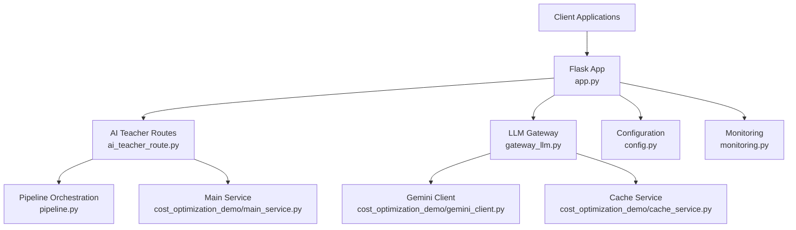
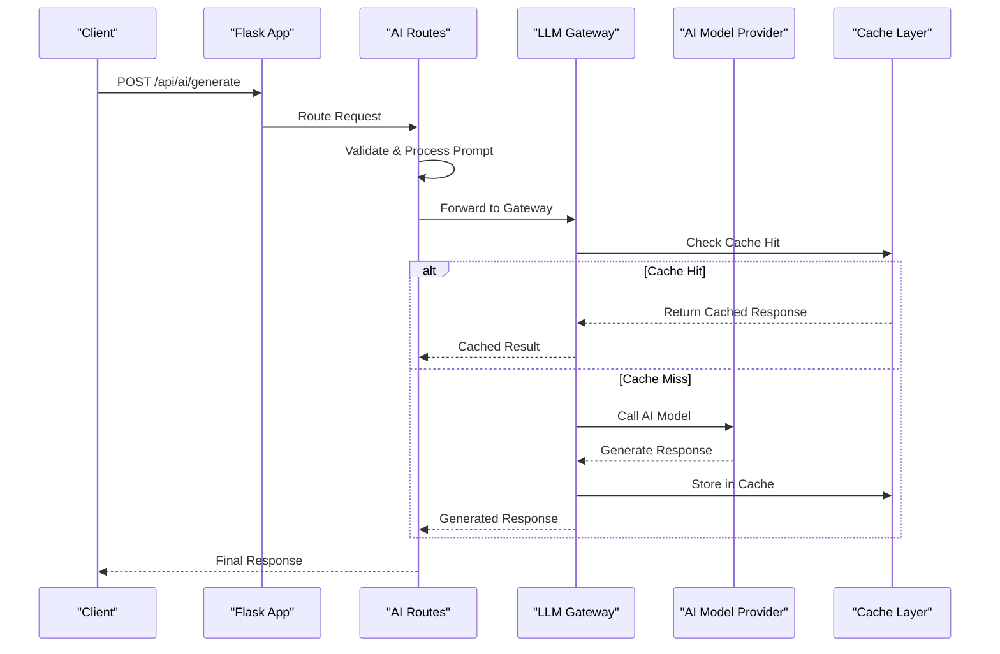
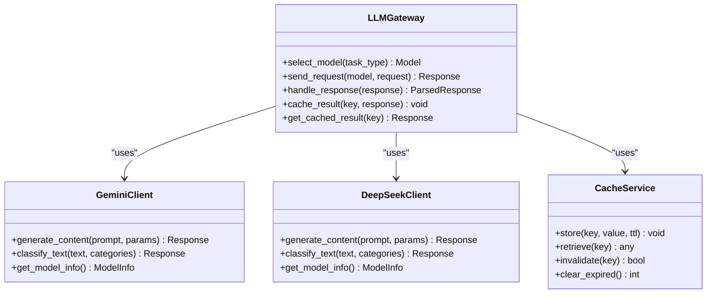
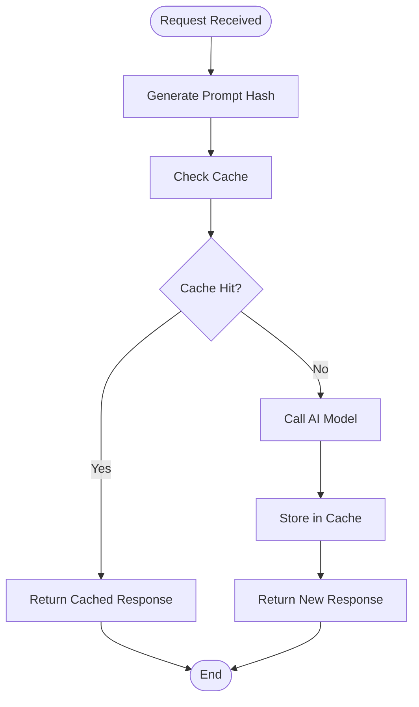
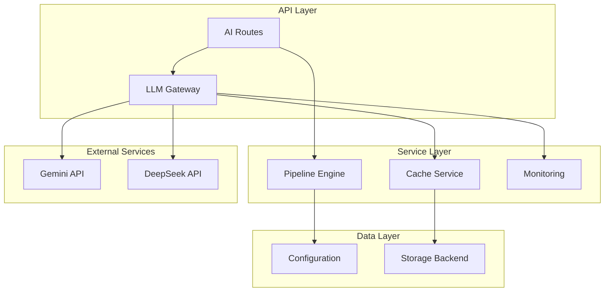

# AI Processing API

<cite>
**Referenced Files in This Document**
- [app.py](file://backend/app.py)
- [ai_teacher_route.py](file://backend/ai_teacher_route.py)
- [gateway_llm.py](file://backend/gateway_llm.py)
- [config.py](file://backend/config.py)
- [monitoring.py](file://backend/monitoring.py)
- [pipeline.py](file://backend/pipeline.py)
- [main_service.py](file://backend/cost_optimization_demo/main_service.py)
- [cache_service.py](file://backend/cost_optimization_demo/cache_service.py)
- [gemini_client.py](file://backend/cost_optimization_demo/gemini_client.py)
- [test_gateway_llm.py](file://backend/test_gateway_llm.py)
- [list_gateway_models.py](file://backend/list_gateway_models.py)
- [debug_gateway_api.py](file://backend/debug_gateway_api.py)
</cite>

## Table of Contents
1. [Introduction](#introduction)
2. [Project Structure](#project-structure)
3. [Core Components](#core-components)
4. [Architecture Overview](#architecture-overview)
5. [Detailed Component Analysis](#detailed-component-analysis)
6. [Dependency Analysis](#dependency-analysis)
7. [Performance Considerations](#performance-considerations)
8. [Troubleshooting Guide](#troubleshooting-guide)
9. [Conclusion](#conclusion)
10. [Appendices](#appendices)

## Introduction
This document provides comprehensive API documentation for the AI processing capabilities of the XSYY Edu platform. It covers all AI-related endpoints under /api/ai/* and /api/gateway/*, including content generation, model selection, prompt processing, cost optimization, and quality assurance. The system supports multi-model orchestration (Gemini, DeepSeek), caching mechanisms to reduce costs, and performance monitoring for reliability and observability.

## Project Structure
The AI processing features are implemented primarily in the backend Python application with a modular design:
- Application entry point and route registration
- AI teacher routes for content generation workflows
- LLM gateway abstraction for multi-model support
- Configuration management for models and parameters
- Monitoring and metrics collection
- Pipeline orchestration for complex generation tasks
- Cost optimization demo with caching and client abstractions



**Diagram sources**
- [app.py](file://backend/app.py)
- [ai_teacher_route.py](file://backend/ai_teacher_route.py)
- [gateway_llm.py](file://backend/gateway_llm.py)
- [config.py](file://backend/config.py)
- [monitoring.py](file://backend/monitoring.py)
- [pipeline.py](file://backend/pipeline.py)
- [main_service.py](file://backend/cost_optimization_demo/main_service.py)
- [cache_service.py](file://backend/cost_optimization_demo/cache_service.py)
- [gemini_client.py](file://backend/cost_optimization_demo/gemini_client.py)

**Section sources**
- [app.py](file://backend/app.py)
- [ai_teacher_route.py](file://backend/ai_teacher_route.py)
- [gateway_llm.py](file://backend/gateway_llm.py)
- [config.py](file://backend/config.py)

## Core Components
The AI processing system consists of several key components that work together to provide comprehensive AI capabilities:

### AI Teacher Routes
Handles content generation requests, manages prompt templates, and orchestrates the generation pipeline. Supports various content types including teaching materials, classifications, and educational content.

### LLM Gateway
Provides a unified interface for multiple AI models including Gemini and DeepSeek. Handles model selection, request routing, response parsing, and error handling across different providers.

### Configuration Management
Centralized configuration for AI models, API keys, rate limits, and generation parameters. Supports environment-based configuration and runtime parameter overrides.

### Monitoring and Metrics
Comprehensive monitoring for API usage, performance metrics, error tracking, and cost analysis. Provides insights into model performance and resource utilization.

**Section sources**
- [ai_teacher_route.py](file://backend/ai_teacher_route.py)
- [gateway_llm.py](file://backend/gateway_llm.py)
- [config.py](file://backend/config.py)
- [monitoring.py](file://backend/monitoring.py)

## Architecture Overview
The AI processing architecture follows a layered approach with clear separation of concerns:



**Diagram sources**
- [app.py](file://backend/app.py)
- [ai_teacher_route.py](file://backend/ai_teacher_route.py)
- [gateway_llm.py](file://backend/gateway_llm.py)
- [cache_service.py](file://backend/cost_optimization_demo/cache_service.py)

## Detailed Component Analysis

### AI Content Generation Endpoints

#### POST /api/ai/generate
Generates AI content based on provided prompts and parameters.

**Request Schema:**
```json
{
  "prompt": "string - The main prompt text",
  "model": "string - AI model identifier (optional)",
  "temperature": "number - Generation temperature (0.0-2.0)",
  "max_tokens": "number - Maximum output tokens",
  "content_type": "string - Type of content to generate",
  "format": "string - Output format (text, html, json)"
}
```

**Response Schema:**
```json
{
  "success": "boolean - Request success status",
  "data": {
    "content": "string - Generated content",
    "model_used": "string - Model that generated response",
    "tokens_used": "number - Token consumption",
    "generation_time": "number - Generation time in seconds"
  },
  "error": "string - Error message if failed"
}
```

#### POST /api/ai/classify
Performs content classification using AI models.

**Request Schema:**
```json
{
  "text": "string - Text to classify",
  "categories": "array - Available categories",
  "model": "string - Classification model"
}
```

#### GET /api/ai/models
Lists available AI models and their configurations.

**Response Schema:**
```json
{
  "models": [
    {
      "id": "string - Model identifier",
      "name": "string - Human-readable name",
      "provider": "string - Model provider",
      "capabilities": "array - Supported capabilities",
      "status": "string - Model availability status"
    }
  ]
}
```

**Section sources**
- [ai_teacher_route.py](file://backend/ai_teacher_route.py)
- [app.py](file://backend/app.py)

### LLM Gateway System

#### Model Selection Strategy
The gateway implements intelligent model selection based on:
- Task type compatibility
- Performance requirements
- Cost constraints
- Availability status
- Historical performance data

#### Multi-Provider Support
Supports multiple AI providers through a unified interface:



**Diagram sources**
- [gateway_llm.py](file://backend/gateway_llm.py)
- [gemini_client.py](file://backend/cost_optimization_demo/gemini_client.py)
- [cache_service.py](file://backend/cost_optimization_demo/cache_service.py)

**Section sources**
- [gateway_llm.py](file://backend/gateway_llm.py)
- [gemini_client.py](file://backend/cost_optimization_demo/gemini_client.py)
- [cache_service.py](file://backend/cost_optimization_demo/cache_service.py)

### Cost Optimization Strategies

#### Caching Mechanism
Implements intelligent caching to reduce API calls and costs:



**Diagram sources**
- [cache_service.py](file://backend/cost_optimization_demo/cache_service.py)
- [main_service.py](file://backend/cost_optimization_demo/main_service.py)

#### Model Selection Optimization
- Automatic fallback to cheaper models when primary fails
- Load balancing across multiple models
- Performance-based routing decisions
- Cost-aware request routing

**Section sources**
- [main_service.py](file://backend/cost_optimization_demo/main_service.py)
- [cache_service.py](file://backend/cost_optimization_demo/cache_service.py)

### Quality Assurance Features

#### Response Validation
- Output format validation
- Content quality scoring
- Error detection and recovery
- Retry mechanisms with exponential backoff

#### Monitoring and Analytics
- Real-time performance monitoring
- Cost tracking and analysis
- Error rate monitoring
- Usage pattern analytics

**Section sources**
- [monitoring.py](file://backend/monitoring.py)
- [pipeline.py](file://backend/pipeline.py)

## Dependency Analysis
The AI processing system has well-defined dependencies between components:



**Diagram sources**
- [app.py](file://backend/app.py)
- [ai_teacher_route.py](file://backend/ai_teacher_route.py)
- [gateway_llm.py](file://backend/gateway_llm.py)
- [pipeline.py](file://backend/pipeline.py)
- [config.py](file://backend/config.py)
- [monitoring.py](file://backend/monitoring.py)

**Section sources**
- [app.py](file://backend/app.py)
- [ai_teacher_route.py](file://backend/ai_teacher_route.py)
- [gateway_llm.py](file://backend/gateway_llm.py)
- [pipeline.py](file://backend/pipeline.py)

## Performance Considerations
Several performance optimizations are implemented throughout the system:

### Connection Pooling
- Reuse connections to external APIs
- Implement connection timeouts
- Handle connection failures gracefully

### Request Batching
- Batch similar requests when possible
- Implement request deduplication
- Optimize network round trips

### Memory Management
- Efficient prompt processing
- Stream large responses when possible
- Implement memory limits and cleanup

### Caching Strategies
- Multi-level caching (in-memory, distributed)
- Intelligent cache invalidation
- Cache warming for popular queries

## Troubleshooting Guide

### Common Issues and Solutions

#### Model Connection Failures
- Verify API credentials and permissions
- Check network connectivity and firewall rules
- Monitor rate limits and quotas
- Implement retry logic with backoff

#### Performance Degradation
- Monitor cache hit rates
- Analyze model response times
- Check for memory leaks
- Review database query performance

#### Cost Overruns
- Monitor token usage patterns
- Implement cost alerts and thresholds
- Review model selection strategies
- Optimize prompt efficiency

### Debugging Tools
- Comprehensive logging at all levels
- Request tracing and profiling
- Error reporting and alerting
- Performance metrics collection

**Section sources**
- [test_gateway_llm.py](file://backend/test_gateway_llm.py)
- [debug_gateway_api.py](file://backend/debug_gateway_api.py)
- [monitoring.py](file://backend/monitoring.py)

## Conclusion
The XSYY Edu AI Processing API provides a robust, scalable, and cost-effective solution for AI-powered content generation and processing. With multi-model support, intelligent caching, comprehensive monitoring, and strong quality assurance measures, it serves as a solid foundation for educational AI applications. The modular architecture allows for easy extension and customization while maintaining high performance and reliability.

## Appendices

### API Endpoint Reference

#### AI Generation Endpoints
- `POST /api/ai/generate` - Generate AI content
- `POST /api/ai/classify` - Classify content
- `GET /api/ai/models` - List available models
- `POST /api/ai/prompt` - Process custom prompts

#### Gateway Management Endpoints
- `GET /api/gateway/status` - Check gateway health
- `POST /api/gateway/route` - Manual model routing
- `GET /api/gateway/metrics` - Performance metrics

### Configuration Parameters

#### Model Configuration
- `MODEL_PROVIDER` - Primary AI provider
- `GEMINI_API_KEY` - Gemini API credentials
- `DEEPSEEK_API_KEY` - DeepSeek API credentials
- `MAX_TOKENS` - Default maximum tokens
- `TEMPERATURE` - Default generation temperature

#### Cache Configuration
- `CACHE_ENABLED` - Enable/disable caching
- `CACHE_TTL` - Time-to-live for cached items
- `CACHE_MAX_SIZE` - Maximum cache size
- `CACHE_BACKEND` - Cache storage backend

**Section sources**
- [config.py](file://backend/config.py)
- [list_gateway_models.py](file://backend/list_gateway_models.py)