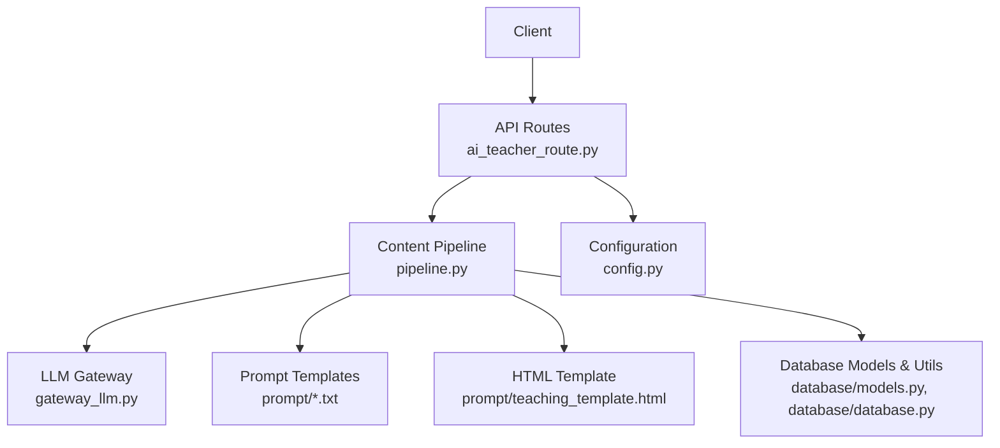
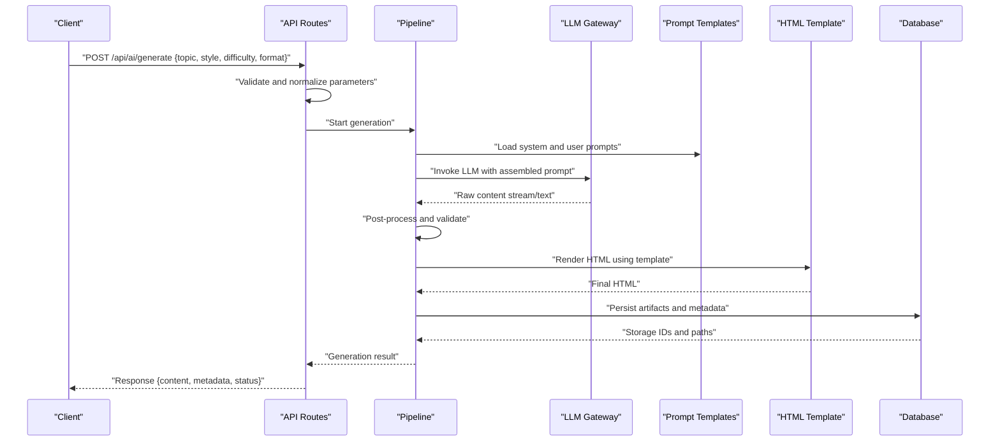
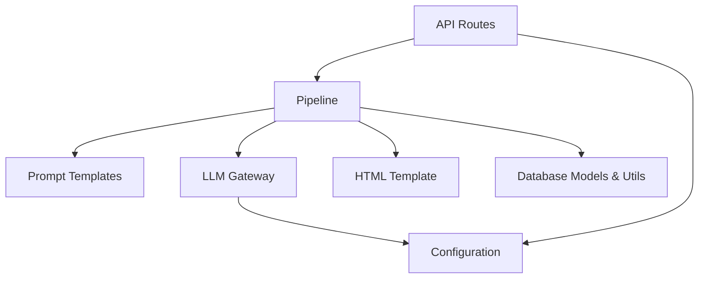

# Content Generation API

<cite>
**Referenced Files in This Document**
- [app.py](file://backend/app.py)
- [ai_teacher_route.py](file://backend/ai_teacher_route.py)
- [pipeline.py](file://backend/pipeline.py)
- [gateway_llm.py](file://backend/gateway_llm.py)
- [config.py](file://backend/config.py)
- [teaching_system_prompt.txt](file://backend/prompt/teaching_system_prompt.txt)
- [teaching_user_prompt.txt](file://backend/prompt/teaching_user_prompt.txt)
- [teaching_template.html](file://backend/prompt/teaching_template.html)
- [models.py](file://backend/database/models.py)
- [database.py](file://backend/database/database.py)
</cite>

## Table of Contents
1. [Introduction](#introduction)
2. [Project Structure](#project-structure)
3. [Core Components](#core-components)
4. [Architecture Overview](#architecture-overview)
5. [Detailed Component Analysis](#detailed-component-analysis)
6. [Dependency Analysis](#dependency-analysis)
7. [Performance Considerations](#performance-considerations)
8. [Troubleshooting Guide](#troubleshooting-guide)
9. [Conclusion](#conclusion)

## Introduction
This document provides detailed API documentation for the content generation endpoints, focusing on the main workflow that transforms user prompts into structured teaching materials and HTML output. It covers request parameters (topic selection, content style, difficulty level, formatting options), response schemas (generated content and metadata), error handling, and the end-to-end pipeline from prompt input to final HTML rendering.

## Project Structure
The content generation feature is implemented primarily in the backend:
- HTTP routes define the API surface and parameter validation.
- A pipeline orchestrates prompt construction, LLM invocation, template rendering, and storage.
- Prompt templates and system/user prompts define how content is generated.
- Database models and utilities persist metadata and artifacts.

**Diagram sources**
- [ai_teacher_route.py](file://backend/ai_teacher_route.py)
- [pipeline.py](file://backend/pipeline.py)
- [gateway_llm.py](file://backend/gateway_llm.py)
- [teaching_system_prompt.txt](file://backend/prompt/teaching_system_prompt.txt)
- [teaching_user_prompt.txt](file://backend/prompt/teaching_user_prompt.txt)
- [teaching_template.html](file://backend/prompt/teaching_template.html)
- [models.py](file://backend/database/models.py)
- [database.py](file://backend/database/database.py)
- [config.py](file://backend/config.py)

**Section sources**
- [app.py](file://backend/app.py)
- [ai_teacher_route.py](file://backend/ai_teacher_route.py)
- [pipeline.py](file://backend/pipeline.py)
- [gateway_llm.py](file://backend/gateway_llm.py)
- [config.py](file://backend/config.py)
- [models.py](file://backend/database/models.py)
- [database.py](file://backend/database/database.py)

## Core Components
- API Route Layer: Defines POST /api/ai/generate, validates inputs, and returns standardized responses.
- Pipeline Orchestrator: Builds prompts, calls the LLM gateway, renders HTML via a template, and persists results.
- LLM Gateway: Abstracts provider-specific calls and handles retries/timeouts.
- Prompt Templates: System and user prompts guide content structure and tone.
- HTML Template: Renders structured content into final HTML.
- Storage and Metadata: Persists teaching materials and associated metadata.

Key responsibilities:
- Input validation and normalization.
- Prompt assembly using templates and configuration.
- LLM invocation with streaming or non-streaming modes.
- Post-processing and quality checks.
- Rendering HTML and saving artifacts.

**Section sources**
- [ai_teacher_route.py](file://backend/ai_teacher_route.py)
- [pipeline.py](file://backend/pipeline.py)
- [gateway_llm.py](file://backend/gateway_llm.py)
- [teaching_system_prompt.txt](file://backend/prompt/teaching_system_prompt.txt)
- [teaching_user_prompt.txt](file://backend/prompt/teaching_user_prompt.txt)
- [teaching_template.html](file://backend/prompt/teaching_template.html)
- [models.py](file://backend/database/models.py)
- [database.py](file://backend/database/database.py)

## Architecture Overview
The content generation flow follows these stages:
1. Request received at POST /api/ai/generate.
2. Parameters validated and normalized.
3. Prompt constructed using system and user templates.
4. LLM invoked through the gateway.
5. Raw content post-processed and validated.
6. HTML rendered using the teaching template.
7. Artifacts stored; metadata persisted.
8. Response returned with content and metadata.

**Diagram sources**
- [ai_teacher_route.py](file://backend/ai_teacher_route.py)
- [pipeline.py](file://backend/pipeline.py)
- [gateway_llm.py](file://backend/gateway_llm.py)
- [teaching_system_prompt.txt](file://backend/prompt/teaching_system_prompt.txt)
- [teaching_user_prompt.txt](file://backend/prompt/teaching_user_prompt.txt)
- [teaching_template.html](file://backend/prompt/teaching_template.html)
- [models.py](file://backend/database/models.py)
- [database.py](file://backend/database/database.py)

## Detailed Component Analysis

### API Endpoint: POST /api/ai/generate
Purpose: Generate teaching materials based on topic, style, difficulty, and formatting options.

Request parameters:
- topic: string, required. The subject or concept to generate content about.
- content_type: enum, optional. One of lesson, exercise, explanation. Defaults to lesson if not provided.
- style: enum, optional. Tone/style such as formal, conversational, concise. Defaults to a configured default.
- difficulty: enum, optional. Levels like beginner, intermediate, advanced. Defaults to a configured default.
- format: enum, optional. Output format such as html, markdown. Defaults to html.
- additional_instructions: string, optional. Free-form guidance to refine content.
- max_tokens: integer, optional. Upper bound for LLM output length.
- temperature: number, optional. Controls randomness; higher values increase creativity.
- timeout_seconds: integer, optional. Request timeout for LLM call.

Validation rules:
- topic must be non-empty and within length limits.
- content_type must be one of allowed types.
- style and difficulty must be within allowed enums.
- format must be supported by the renderer.
- numeric bounds enforced for tokens and timeout.

Response schema:
- status: string. One of success, partial, error.
- content_type: string. The type of generated content.
- content: object or string. Depends on format; may include structured sections when applicable.
- html: string. Final rendered HTML when format is html.
- metadata: object. Includes identifiers, timestamps, model info, and usage stats.
- errors: array. List of error objects with code and message fields.

Example responses:
- Success: Returns content and HTML along with metadata.
- Partial: Returns partially generated content with warnings.
- Error: Returns error details and suggestions for retry or correction.

Error handling:
- Validation errors return 400 with descriptive messages.
- LLM failures return 502/504 with retry hints.
- Template rendering errors return 500 with stack traces suppressed.

**Section sources**
- [ai_teacher_route.py](file://backend/ai_teacher_route.py)
- [config.py](file://backend/config.py)

### Pipeline Orchestration
Responsibilities:
- Assemble prompts using system and user templates.
- Call the LLM gateway with appropriate parameters.
- Post-process raw outputs (e.g., JSON parsing, section extraction).
- Render HTML using the teaching template.
- Persist artifacts and metadata.

Processing logic:
- Load templates and merge with request parameters.
- Build structured prompt blocks for context, instructions, and constraints.
- Invoke gateway with streaming support where available.
- Validate output against expected schema; fallback strategies applied.
- Render HTML and write files to storage.
- Record metadata including model, tokens used, and duration.

Quality checks:
- Ensure required sections exist (e.g., objectives, examples).
- Check for excessive verbosity or missing explanations.
- Normalize headings and lists for consistent structure.

Optimization opportunities:
- Cache frequent topics/styles/difficulty combinations.
- Pre-warm templates and reduce I/O overhead.
- Use streaming to improve perceived latency.

**Section sources**
- [pipeline.py](file://backend/pipeline.py)
- [teaching_system_prompt.txt](file://backend/prompt/teaching_system_prompt.txt)
- [teaching_user_prompt.txt](file://backend/prompt/teaching_user_prompt.txt)
- [teaching_template.html](file://backend/prompt/teaching_template.html)

### LLM Gateway Integration
Responsibilities:
- Provide a unified interface to different LLM providers.
- Handle retries, timeouts, and rate limiting.
- Stream responses when supported.

Integration points:
- Configuration-driven endpoint URLs and keys.
- Model selection and token limits.
- Error mapping to standardized codes.

**Section sources**
- [gateway_llm.py](file://backend/gateway_llm.py)
- [config.py](file://backend/config.py)

### Prompt Templates and Rendering
System prompt:
- Defines role, tone, and structural expectations for generated content.
- Encourages pedagogical best practices and clarity.

User prompt:
- Incorporates topic, content type, style, difficulty, and additional instructions.
- Provides constraints and formatting directives.

HTML template:
- Defines layout, sections, and styling hooks.
- Accepts structured data to produce final HTML.

Rendering process:
- Merge template variables with processed content.
- Validate resulting HTML for completeness.
- Save HTML artifact and link it in metadata.

**Section sources**
- [teaching_system_prompt.txt](file://backend/prompt/teaching_system_prompt.txt)
- [teaching_user_prompt.txt](file://backend/prompt/teaching_user_prompt.txt)
- [teaching_template.html](file://backend/prompt/teaching_template.html)

### Data Models and Storage
Models:
- Teaching material records with fields for content type, topic, style, difficulty, and timestamps.
- Metadata entries linking to HTML artifacts and usage statistics.

Storage operations:
- Create new records upon successful generation.
- Update view counts and feedback metrics over time.
- Support retrieval by ID and filtering by attributes.

**Section sources**
- [models.py](file://backend/database/models.py)
- [database.py](file://backend/database/database.py)

### Content Type Examples and Parameter Requirements
Lessons:
- Recommended parameters: content_type=lesson, style=formal or conversational, difficulty=beginner/intermediate/advanced.
- Expected sections: objectives, introduction, core concepts, examples, summary.

Exercises:
- Recommended parameters: content_type=exercise, style=concise, difficulty=intermediate/advanced.
- Expected sections: problem statements, hints, solutions, grading criteria.

Explanations:
- Recommended parameters: content_type=explanation, style=conversational, difficulty=beginner/intermediate.
- Expected sections: overview, detailed breakdown, analogies, references.

Formatting options:
- format=html for rich output; format=markdown for plain text.
- Additional instructions can tailor depth, examples, and audience level.

**Section sources**
- [ai_teacher_route.py](file://backend/ai_teacher_route.py)
- [pipeline.py](file://backend/pipeline.py)
- [teaching_template.html](file://backend/prompt/teaching_template.html)

## Dependency Analysis
High-level dependencies:
- Routes depend on pipeline orchestration and configuration.
- Pipeline depends on prompt templates, gateway, and storage.
- Gateway depends on external LLM services and configuration.
- Storage depends on database models and utilities.

**Diagram sources**
- [ai_teacher_route.py](file://backend/ai_teacher_route.py)
- [pipeline.py](file://backend/pipeline.py)
- [gateway_llm.py](file://backend/gateway_llm.py)
- [teaching_system_prompt.txt](file://backend/prompt/teaching_system_prompt.txt)
- [teaching_user_prompt.txt](file://backend/prompt/teaching_user_prompt.txt)
- [teaching_template.html](file://backend/prompt/teaching_template.html)
- [models.py](file://backend/database/models.py)
- [database.py](file://backend/database/database.py)
- [config.py](file://backend/config.py)

**Section sources**
- [ai_teacher_route.py](file://backend/ai_teacher_route.py)
- [pipeline.py](file://backend/pipeline.py)
- [gateway_llm.py](file://backend/gateway_llm.py)
- [config.py](file://backend/config.py)
- [models.py](file://backend/database/models.py)
- [database.py](file://backend/database/database.py)

## Performance Considerations
- Use streaming responses to reduce perceived latency.
- Cache common prompt combinations and rendered HTML.
- Limit max_tokens and temperature to control cost and variability.
- Implement retries with exponential backoff for transient failures.
- Monitor token usage and adjust quotas per user or service tier.

[No sources needed since this section provides general guidance]

## Troubleshooting Guide
Common issues:
- Validation errors: Check parameter enums and lengths; ensure topic is present.
- LLM timeouts: Increase timeout_seconds or reduce max_tokens.
- Template rendering failures: Verify template variables are populated; check HTML structure.
- Storage errors: Confirm database connectivity and permissions.

Diagnostic steps:
- Inspect request payload and route logs.
- Review pipeline logs for prompt assembly and post-processing.
- Check gateway logs for provider-specific errors.
- Validate database records and file artifacts.

**Section sources**
- [ai_teacher_route.py](file://backend/ai_teacher_route.py)
- [pipeline.py](file://backend/pipeline.py)
- [gateway_llm.py](file://backend/gateway_llm.py)
- [models.py](file://backend/database/models.py)
- [database.py](file://backend/database/database.py)

## Conclusion
The content generation API provides a robust pipeline for transforming user prompts into high-quality teaching materials. By leveraging structured prompts, configurable styles and difficulties, and a templated HTML renderer, the system delivers consistent, reusable educational content. Proper validation, error handling, and performance optimizations ensure reliability and scalability.

[No sources needed since this section summarizes without analyzing specific files]