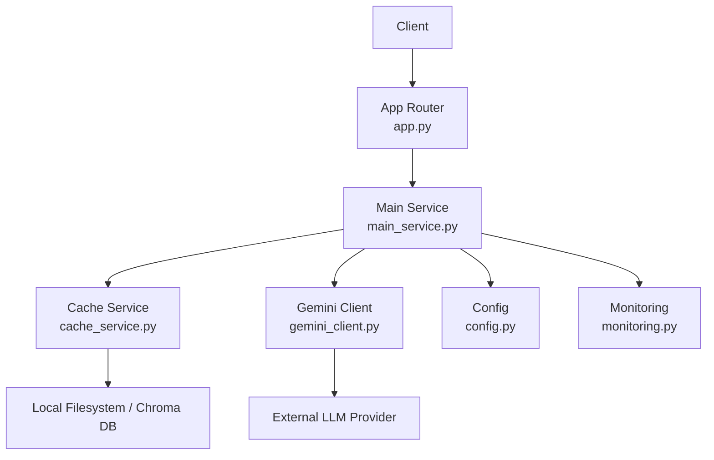
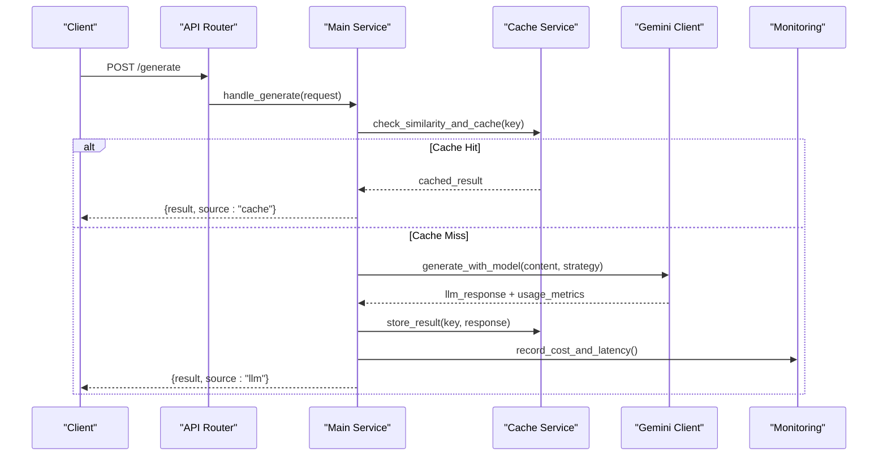
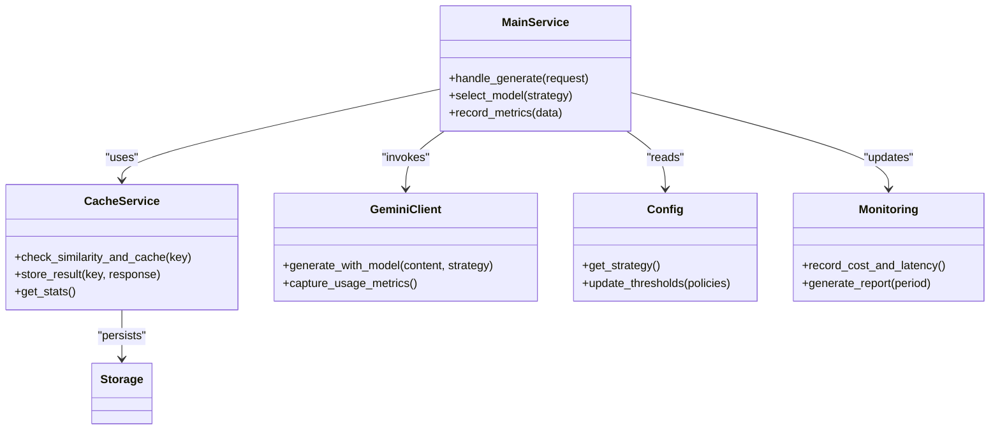

# Cost Optimization API

<cite>
**Referenced Files in This Document**
- [main_service.py](file://backend/cost_optimization_demo/main_service.py)
- [cache_service.py](file://backend/cost_optimization_demo/cache_service.py)
- [config.py](file://backend/cost_optimization_demo/config.py)
- [gemini_client.py](file://backend/cost_optimization_demo/gemini_client.py)
- [regression_test.py](file://backend/cost_optimization_demo/regression_test.py)
- [test_cache_integration.py](file://backend/cost_optimization_demo/test_cache_integration.py)
- [app.py](file://backend/app.py)
- [monitoring.py](file://backend/monitoring.py)
</cite>

## Table of Contents
1. [Introduction](#introduction)
2. [Project Structure](#project-structure)
3. [Core Components](#core-components)
4. [Architecture Overview](#architecture-overview)
5. [Detailed Component Analysis](#detailed-component-analysis)
6. [Dependency Analysis](#dependency-analysis)
7. [Performance Considerations](#performance-considerations)
8. [Troubleshooting Guide](#troubleshooting-guide)
9. [Conclusion](#conclusion)
10. [Appendices](#appendices)

## Introduction
This document provides comprehensive API documentation for the cost optimization features implemented in the project’s backend. It focuses on caching mechanisms, model selection algorithms, and resource optimization endpoints. The goal is to enable developers to implement cost-aware content generation workflows, monitor optimization effectiveness, and configure intelligent routing based on cost-performance trade-offs.

Key topics covered:
- Cache management APIs with hit/miss statistics
- Cost tracking and reporting endpoints
- Intelligent model routing and selection strategies
- Content similarity detection and result reuse
- Usage analytics and monitoring dashboards
- Configuration of optimization strategies

## Project Structure
The cost optimization feature set resides primarily under the backend/cost_optimization_demo directory, with supporting modules in the backend root. The main service exposes HTTP endpoints, while cache and client utilities encapsulate lower-level logic. Monitoring and configuration are provided by dedicated modules.

**Diagram sources**
- [app.py](file://backend/app.py)
- [main_service.py](file://backend/cost_optimization_demo/main_service.py)
- [cache_service.py](file://backend/cost_optimization_demo/cache_service.py)
- [gemini_client.py](file://backend/cost_optimization_demo/gemini_client.py)
- [config.py](file://backend/cost_optimization_demo/config.py)
- [monitoring.py](file://backend/monitoring.py)

**Section sources**
- [app.py](file://backend/app.py)
- [main_service.py](file://backend/cost_optimization_demo/main_service.py)
- [cache_service.py](file://backend/cost_optimization_demo/cache_service.py)
- [gemini_client.py](file://backend/cost_optimization_demo/gemini_client.py)
- [config.py](file://backend/cost_optimization_demo/config.py)
- [monitoring.py](file://backend/monitoring.py)

## Core Components
- Main Service: Orchestrates request handling, invokes cache checks, selects models, and returns results or cached responses.
- Cache Service: Manages key-based caching, computes hashes for content similarity, tracks hits/misses, and persists results.
- Gemini Client: Interfaces with external LLM providers, captures usage metrics, and handles retries/timeouts.
- Config: Centralizes optimization strategy settings such as thresholds, TTLs, and model preferences.
- Monitoring: Aggregates metrics like cache hit rate, cost per request, latency, and error rates.

**Section sources**
- [main_service.py](file://backend/cost_optimization_demo/main_service.py)
- [cache_service.py](file://backend/cost_optimization_demo/cache_service.py)
- [gemini_client.py](file://backend/cost_optimization_demo/gemini_client.py)
- [config.py](file://backend/cost_optimization_demo/config.py)
- [monitoring.py](file://backend/monitoring.py)

## Architecture Overview
The system follows a layered architecture where the API layer delegates to the main service, which coordinates caching and model invocation. Caching reduces redundant calls to expensive LLM endpoints, while monitoring ensures visibility into performance and cost.

**Diagram sources**
- [app.py](file://backend/app.py)
- [main_service.py](file://backend/cost_optimization_demo/main_service.py)
- [cache_service.py](file://backend/cost_optimization_demo/cache_service.py)
- [gemini_client.py](file://backend/cost_optimization_demo/gemini_client.py)
- [monitoring.py](file://backend/monitoring.py)

## Detailed Component Analysis

### Cache Management API
Endpoints for managing cache entries and retrieving statistics:
- GET /api/cost/cache/stats: Returns cache hit/miss counts, hit rate, and storage size.
- POST /api/cost/cache/purge: Clears expired or all entries based on parameters.
- GET /api/cost/cache/keys: Lists current keys with metadata (e.g., timestamp, size).

Request/Response Schemas:
- Cache Stats Response:
  - hits: integer
  - misses: integer
  - hit_rate: float
  - total_entries: integer
  - storage_bytes: integer
- Purge Request:
  - mode: "expired" | "all"
  - ttl_seconds: integer (optional)
- Keys List Response:
  - keys: array of strings
  - metadata: map of key -> {created_at, size_bytes}

Implementation Notes:
- Similarity detection uses hashing and optional vector embeddings to identify near-duplicate inputs.
- TTL policies can be configured via environment variables or config file.

**Section sources**
- [cache_service.py](file://backend/cost_optimization_demo/cache_service.py)
- [config.py](file://backend/cost_optimization_demo/config.py)

### Model Selection and Routing API
Intelligent routing chooses between multiple models based on cost-performance trade-offs:
- POST /api/cost/model/route: Accepts content and strategy flags; returns selected model and reasoning.
- GET /api/cost/model/config: Retrieves current model selection policy and thresholds.

Request/Response Schemas:
- Route Request:
  - content: string
  - priority: "cost" | "latency" | "quality"
  - max_cost_per_request: float (optional)
  - preferred_models: array of strings (optional)
- Route Response:
  - selected_model: string
  - rationale: string
  - estimated_cost: float
  - expected_latency_ms: int
- Config Response:
  - policies: map of strategy -> {thresholds, weights}
  - fallback_model: string
  - retry_policy: {max_retries, backoff_strategy}

Implementation Notes:
- Strategy evaluation considers historical performance, current pricing, and content complexity.
- Fallback models are used when primary selections fail or exceed cost limits.

**Section sources**
- [main_service.py](file://backend/cost_optimization_demo/main_service.py)
- [config.py](file://backend/cost_optimization_demo/config.py)

### Cost Tracking and Reporting API
Endpoints for tracking costs and generating reports:
- GET /api/cost/report: Aggregates cost data over time windows.
- POST /api/cost/track: Records individual request costs and usage metrics.

Request/Response Schemas:
- Track Request:
  - request_id: string
  - model: string
  - tokens_used: int
  - cost_usd: float
  - latency_ms: int
  - status: "success" | "error"
- Report Response:
  - period: {start, end}
  - total_cost_usd: float
  - requests_count: int
  - avg_latency_ms: float
  - cache_hit_rate: float
  - top_models: [{model, cost, count}]

Implementation Notes:
- Metrics are stored in memory or persisted to a database depending on configuration.
- Reports support filtering by model, date range, and user context.

**Section sources**
- [monitoring.py](file://backend/monitoring.py)
- [main_service.py](file://backend/cost_optimization_demo/main_service.py)

### Usage Analytics API
Provides insights into usage patterns and optimization effectiveness:
- GET /api/analytics/usage: Summarizes usage trends and model distribution.
- GET /api/analytics/effectiveness: Measures impact of caching and routing decisions.

Request/Response Schemas:
- Usage Response:
  - daily_requests: array of {date, count}
  - model_distribution: map of model -> percentage
  - peak_hours: array of hour -> count
- Effectiveness Response:
  - cost_savings_percent: float
  - latency_improvement_percent: float
  - cache_contribution_percent: float

Implementation Notes:
- Analytics aggregate data from monitoring and cache services.
- Dashboards can consume these endpoints for visualization.

**Section sources**
- [monitoring.py](file://backend/monitoring.py)
- [cache_service.py](file://backend/cost_optimization_demo/cache_service.py)

### Content Similarity Detection and Result Reuse
Similarity detection enables result reuse by identifying near-duplicate inputs:
- Hash-based matching for exact duplicates
- Vector embedding comparison for semantic similarity
- Threshold tuning to balance accuracy and performance

Implementation Notes:
- Embeddings are computed once per unique input and stored alongside results.
- Reuse strategy respects TTL and freshness requirements.

**Section sources**
- [cache_service.py](file://backend/cost_optimization_demo/cache_service.py)
- [config.py](file://backend/cost_optimization_demo/config.py)

## Dependency Analysis
The cost optimization components have clear dependencies:
- Main Service depends on Cache Service, Gemini Client, Config, and Monitoring.
- Cache Service may depend on storage backends (filesystem or Chroma DB).
- Gemini Client interacts with external LLM providers.
- Monitoring aggregates data from other components.

**Diagram sources**
- [main_service.py](file://backend/cost_optimization_demo/main_service.py)
- [cache_service.py](file://backend/cost_optimization_demo/cache_service.py)
- [gemini_client.py](file://backend/cost_optimization_demo/gemini_client.py)
- [config.py](file://backend/cost_optimization_demo/config.py)
- [monitoring.py](file://backend/monitoring.py)

**Section sources**
- [main_service.py](file://backend/cost_optimization_demo/main_service.py)
- [cache_service.py](file://backend/cost_optimization_demo/cache_service.py)
- [gemini_client.py](file://backend/cost_optimization_demo/gemini_client.py)
- [config.py](file://backend/cost_optimization_demo/config.py)
- [monitoring.py](file://backend/monitoring.py)

## Performance Considerations
- Cache TTL should be tuned based on content volatility and update frequency.
- Embedding computation adds overhead; consider batching or async processing.
- Model selection algorithms should minimize cold starts and leverage warm caches.
- Monitoring queries should be optimized to avoid blocking request paths.

[No sources needed since this section provides general guidance]

## Troubleshooting Guide
Common issues and resolutions:
- Cache misses due to incorrect key generation: Verify hash functions and input normalization.
- High latency from LLM calls: Implement retries with exponential backoff and fallback models.
- Cost spikes: Review model selection policies and adjust thresholds.
- Monitoring gaps: Ensure metrics recording is enabled and not blocked by errors.

**Section sources**
- [regression_test.py](file://backend/cost_optimization_demo/regression_test.py)
- [test_cache_integration.py](file://backend/cost_optimization_demo/test_cache_integration.py)
- [monitoring.py](file://backend/monitoring.py)

## Conclusion
The cost optimization API provides robust tools for reducing expenses and improving performance through caching, intelligent model routing, and detailed monitoring. By leveraging these features, developers can build efficient, cost-aware content generation systems that adapt to changing conditions and user needs.

[No sources needed since this section summarizes without analyzing specific files]

## Appendices

### Example Workflows
Implementing cost-aware content generation:
1. Receive user request with content and preferences.
2. Check cache for similar inputs using hash and embedding comparison.
3. If cache hit, return cached result immediately.
4. If cache miss, select optimal model based on strategy and constraints.
5. Generate content via LLM, track usage metrics, and store result in cache.
6. Return response with source indicator (cache vs. LLM).

Monitoring optimization effectiveness:
- Track cache hit rate and cost savings over time.
- Analyze model selection decisions and their outcomes.
- Adjust policies dynamically based on observed performance and cost trends.

[No sources needed since this section provides conceptual examples]