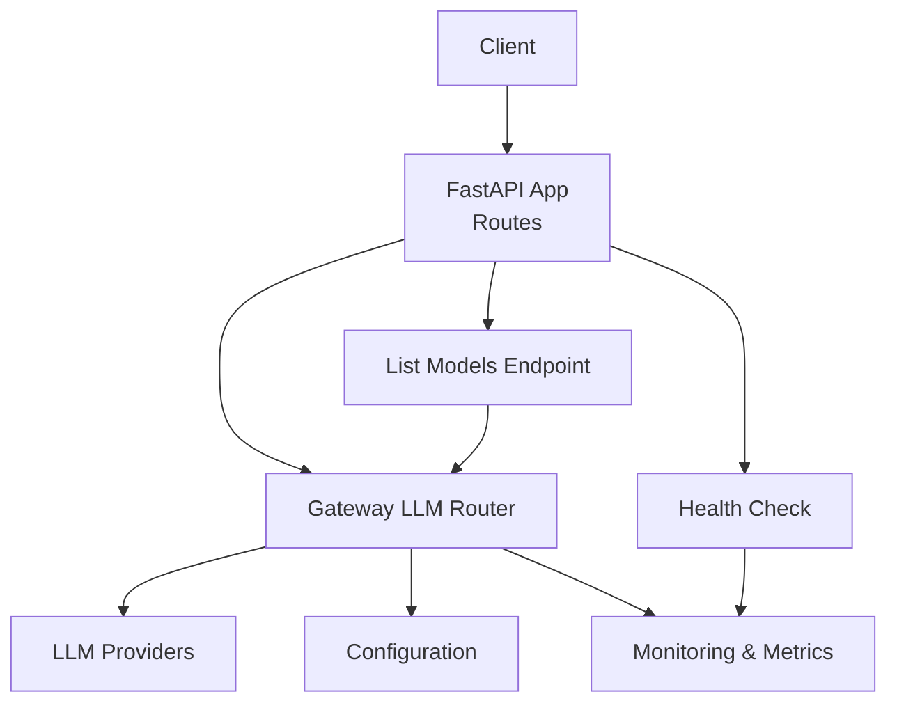
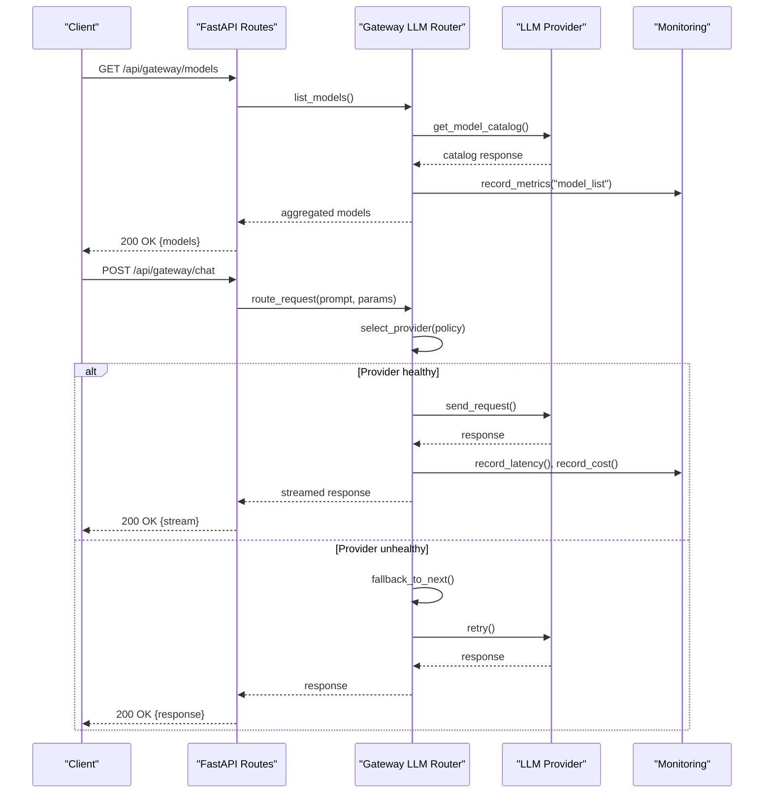
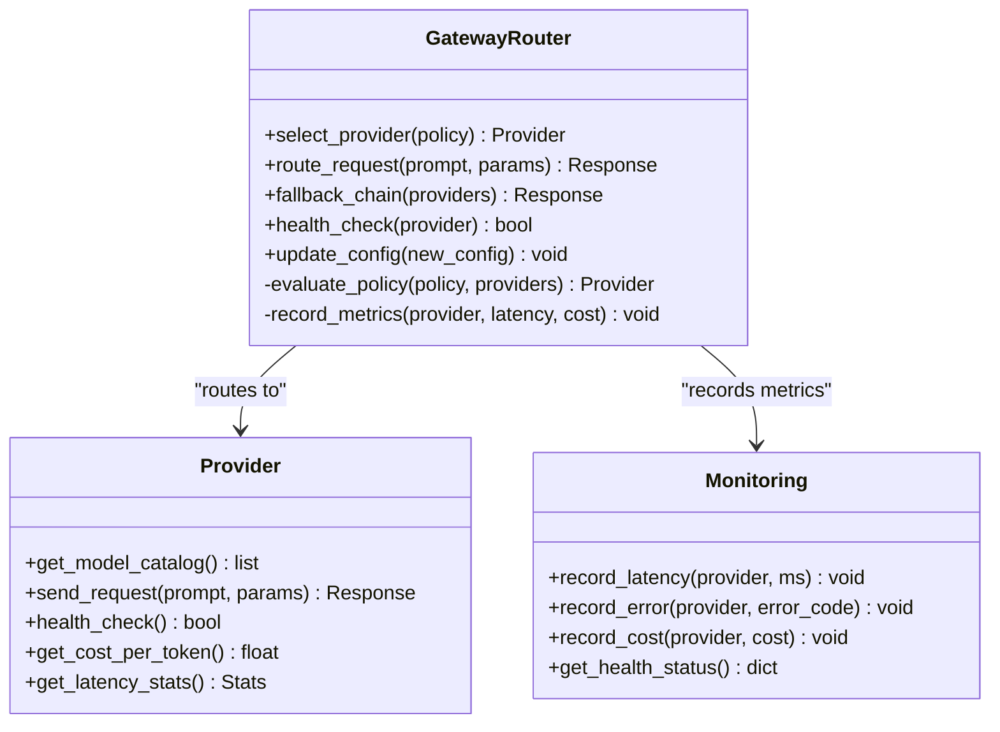
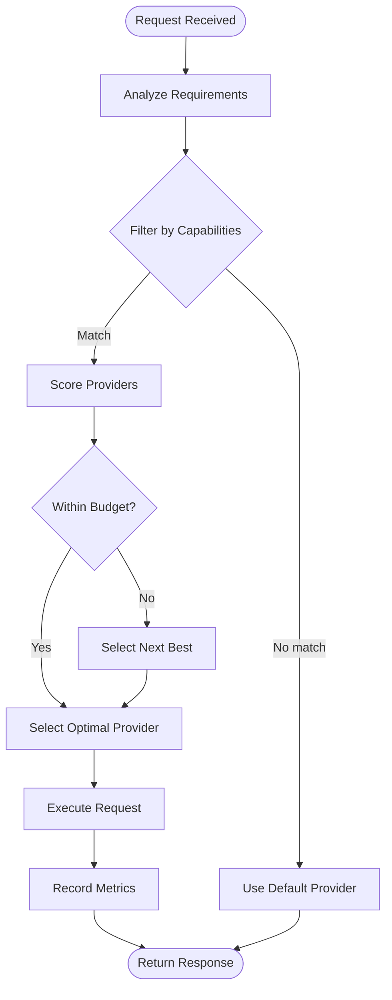
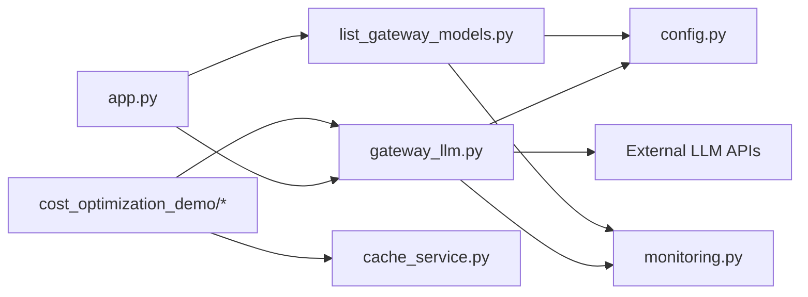

# Model Management API

<cite>
**Referenced Files in This Document**
- [app.py](file://backend/app.py)
- [gateway_llm.py](file://backend/gateway_llm.py)
- [list_gateway_models.py](file://backend/list_gateway_models.py)
- [config.py](file://backend/config.py)
- [monitoring.py](file://backend/monitoring.py)
- [ai_teacher_route.py](file://backend/ai_teacher_route.py)
- [cost_optimization_demo/main_service.py](file://backend/cost_optimization_demo/main_service.py)
- [cost_optimization_demo/config.py](file://backend/cost_optimization_demo/config.py)
- [cost_optimization_demo/cache_service.py](file://backend/cost_optimization_demo/cache_service.py)
</cite>

## Table of Contents
1. [Introduction](#introduction)
2. [Project Structure](#project-structure)
3. [Core Components](#core-components)
4. [Architecture Overview](#architecture-overview)
5. [Detailed Component Analysis](#detailed-component-analysis)
6. [Dependency Analysis](#dependency-analysis)
7. [Performance Considerations](#performance-considerations)
8. [Troubleshooting Guide](#troubleshooting-guide)
9. [Conclusion](#conclusion)
10. [Appendices](#appendices)

## Introduction
This document provides comprehensive API documentation for AI model management endpoints, focusing on model discovery, configuration, and switching capabilities via the gateway layer. It covers:
- GET /api/gateway/models for listing available models and their metadata
- Model availability checking, performance metrics, and cost information retrieval
- Request/response schemas for model listing, status monitoring, and configuration updates
- Multi-model routing logic, fallback mechanisms, and load balancing strategies
- Programmatic model selection based on cost, performance, or capability criteria
- Model health monitoring and automatic failover scenarios

The backend exposes a gateway abstraction that routes requests to multiple LLM providers, aggregates model metadata, and supports dynamic configuration and health checks.

## Project Structure
The relevant code resides primarily under the backend directory with supporting modules for cost optimization and monitoring. Key files include:
- Application entrypoint and route registration
- Gateway LLM abstraction and routing
- Model listing utilities
- Configuration management
- Monitoring and metrics collection
- Cost optimization demo services



**Diagram sources**
- [app.py](file://backend/app.py)
- [gateway_llm.py](file://backend/gateway_llm.py)
- [list_gateway_models.py](file://backend/list_gateway_models.py)
- [config.py](file://backend/config.py)
- [monitoring.py](file://backend/monitoring.py)

**Section sources**
- [app.py](file://backend/app.py)
- [gateway_llm.py](file://backend/gateway_llm.py)
- [list_gateway_models.py](file://backend/list_gateway_models.py)
- [config.py](file://backend/config.py)
- [monitoring.py](file://backend/monitoring.py)

## Core Components
- Gateway LLM Router: Centralizes multi-provider routing, selection, and fallback logic.
- Model Listing Service: Aggregates available models from configured providers and returns standardized metadata.
- Configuration Manager: Loads and validates provider credentials, model mappings, and routing policies.
- Monitoring Module: Tracks latency, error rates, throughput, and cost per request; exposes health endpoints.
- Cost Optimization Demo: Demonstrates programmatic selection based on cost, performance, and capability constraints.

Key responsibilities:
- Discover and expose model catalogs
- Route requests to optimal providers based on policy
- Maintain health status and metrics
- Support dynamic configuration updates without restarts

**Section sources**
- [gateway_llm.py](file://backend/gateway_llm.py)
- [list_gateway_models.py](file://backend/list_gateway_models.py)
- [config.py](file://backend/config.py)
- [monitoring.py](file://backend/monitoring.py)
- [cost_optimization_demo/main_service.py](file://backend/cost_optimization_demo/main_service.py)

## Architecture Overview
The gateway architecture abstracts multiple LLM providers behind a unified interface. Clients interact with REST endpoints to discover models, check health, and send prompts. The router selects providers using configurable policies (round-robin, least-cost, best-latency), with fallback chains and circuit breakers.



**Diagram sources**
- [app.py](file://backend/app.py)
- [gateway_llm.py](file://backend/gateway_llm.py)
- [monitoring.py](file://backend/monitoring.py)

## Detailed Component Analysis

### Gateway LLM Router
The router implements multi-model routing with support for:
- Policy-based selection (cost, latency, capability)
- Fallback chains when primary providers fail
- Circuit breaker patterns to avoid cascading failures
- Dynamic reconfiguration without service restart



**Diagram sources**
- [gateway_llm.py](file://backend/gateway_llm.py)
- [monitoring.py](file://backend/monitoring.py)

**Section sources**
- [gateway_llm.py](file://backend/gateway_llm.py)
- [monitoring.py](file://backend/monitoring.py)

### Model Listing Endpoint
The GET /api/gateway/models endpoint returns a standardized catalog of available models across all configured providers. Each model entry includes:
- Model identifier and display name
- Provider source
- Capability flags (text, image, audio)
- Pricing information per token
- Current health status
- Performance metrics (latency percentiles)

Request schema:
- Method: GET
- Path: /api/gateway/models
- Headers: Authorization (optional, if required by provider)
- Query parameters: filter_by_capability, include_metrics

Response schema:
```json
{
  "status": "success",
  "timestamp": "2024-01-01T00:00:00Z",
  "models": [
    {
      "id": "gpt-4o",
      "name": "GPT-4 Omni",
      "provider": "openai",
      "capabilities": ["text", "image"],
      "pricing": {
        "input_token_cost": 0.00003,
        "output_token_cost": 0.00006
      },
      "health": {
        "status": "healthy",
        "last_check": "2024-01-01T00:00:00Z",
        "error_rate_5m": 0.01
      },
      "metrics": {
        "avg_latency_ms": 150,
        "p95_latency_ms": 300,
        "requests_per_minute": 120
      }
    }
  ]
}
```

**Section sources**
- [list_gateway_models.py](file://backend/list_gateway_models.py)
- [app.py](file://backend/app.py)

### Configuration Management
Model configuration is managed through environment variables and runtime updates. Supported configuration keys include:
- Provider credentials and endpoints
- Model mapping and aliases
- Routing policies and weights
- Health check intervals and thresholds
- Cost limits and budget controls

Runtime updates are supported via PUT /api/gateway/config endpoint, allowing hot-reloading of provider configurations without service interruption.

**Section sources**
- [config.py](file://backend/config.py)
- [gateway_llm.py](file://backend/gateway_llm.py)

### Health Monitoring and Metrics
The monitoring system tracks:
- Request latency distributions (avg, p50, p95, p99)
- Error rates by provider and error type
- Token usage and cost accumulation
- Model availability and health status
- Throughput and concurrency metrics

Health endpoints:
- GET /api/gateway/health: Overall system health
- GET /api/gateway/providers/{provider}/health: Provider-specific health
- GET /api/gateway/metrics: Aggregated performance metrics

**Section sources**
- [monitoring.py](file://backend/monitoring.py)
- [app.py](file://backend/app.py)

### Cost Optimization Demo
The cost optimization module demonstrates programmatic model selection based on business requirements:
- Minimum cost selection within quality thresholds
- Performance-aware selection with latency guarantees
- Capability-based filtering for specialized tasks
- Budget enforcement with automatic fallback



**Diagram sources**
- [cost_optimization_demo/main_service.py](file://backend/cost_optimization_demo/main_service.py)
- [cost_optimization_demo/config.py](file://backend/cost_optimization_demo/config.py)

**Section sources**
- [cost_optimization_demo/main_service.py](file://backend/cost_optimization_demo/main_service.py)
- [cost_optimization_demo/config.py](file://backend/cost_optimization_demo/config.py)
- [cost_optimization_demo/cache_service.py](file://backend/cost_optimization_demo/cache_service.py)

## Dependency Analysis
The gateway system has clear separation of concerns with minimal coupling between components:



**Diagram sources**
- [app.py](file://backend/app.py)
- [gateway_llm.py](file://backend/gateway_llm.py)
- [list_gateway_models.py](file://backend/list_gateway_models.py)
- [config.py](file://backend/config.py)
- [monitoring.py](file://backend/monitoring.py)
- [cost_optimization_demo/main_service.py](file://backend/cost_optimization_demo/main_service.py)
- [cost_optimization_demo/cache_service.py](file://backend/cost_optimization_demo/cache_service.py)

**Section sources**
- [app.py](file://backend/app.py)
- [gateway_llm.py](file://backend/gateway_llm.py)
- [list_gateway_models.py](file://backend/list_gateway_models.py)
- [config.py](file://backend/config.py)
- [monitoring.py](file://backend/monitoring.py)
- [cost_optimization_demo/main_service.py](file://backend/cost_optimization_demo/main_service.py)

## Performance Considerations
- Connection pooling for provider APIs to reduce latency
- Caching of model catalogs to minimize provider calls
- Asynchronous health checks to avoid blocking requests
- Rate limiting per provider to prevent quota exhaustion
- Streaming responses for long-running operations
- Memory-efficient token counting and cost calculation

Optimization strategies:
- Implement request deduplication for identical prompts
- Use connection multiplexing where supported
- Cache frequently accessed model metadata
- Implement exponential backoff for failed requests
- Monitor and alert on latency spikes and error rate increases

## Troubleshooting Guide
Common issues and resolutions:
- Provider authentication failures: Verify API keys and endpoint configurations
- Model not found errors: Check model mapping and availability status
- High latency: Investigate network connectivity and provider performance
- Cost overruns: Review budget settings and implement stricter filters
- Health check failures: Validate provider endpoints and certificate configurations

Debugging steps:
1. Check system health endpoint for overall status
2. Verify individual provider health and metrics
3. Review error logs for specific failure patterns
4. Test model availability with simple prompts
5. Monitor real-time metrics during troubleshooting

**Section sources**
- [monitoring.py](file://backend/monitoring.py)
- [gateway_llm.py](file://backend/gateway_llm.py)

## Conclusion
The Model Management API provides a robust foundation for multi-provider AI model orchestration. With comprehensive model discovery, intelligent routing, health monitoring, and cost optimization capabilities, it enables flexible and reliable AI service delivery. The modular architecture supports easy integration of new providers and customization of routing policies to meet specific business requirements.

## Appendices

### API Reference Summary

#### Model Discovery
- GET /api/gateway/models: List all available models with metadata
- GET /api/gateway/providers: List configured providers
- GET /api/gateway/providers/{provider}/models: List models for specific provider

#### Status and Health
- GET /api/gateway/health: System health status
- GET /api/gateway/providers/{provider}/health: Provider health
- GET /api/gateway/metrics: Performance metrics

#### Configuration
- PUT /api/gateway/config: Update provider configurations
- GET /api/gateway/config: Get current configuration

#### Request Routing
- POST /api/gateway/chat: Send chat completion request
- POST /api/gateway/completion: Send text completion request
- POST /api/gateway/embeddings: Generate embeddings

**Section sources**
- [app.py](file://backend/app.py)
- [ai_teacher_route.py](file://backend/ai_teacher_route.py)