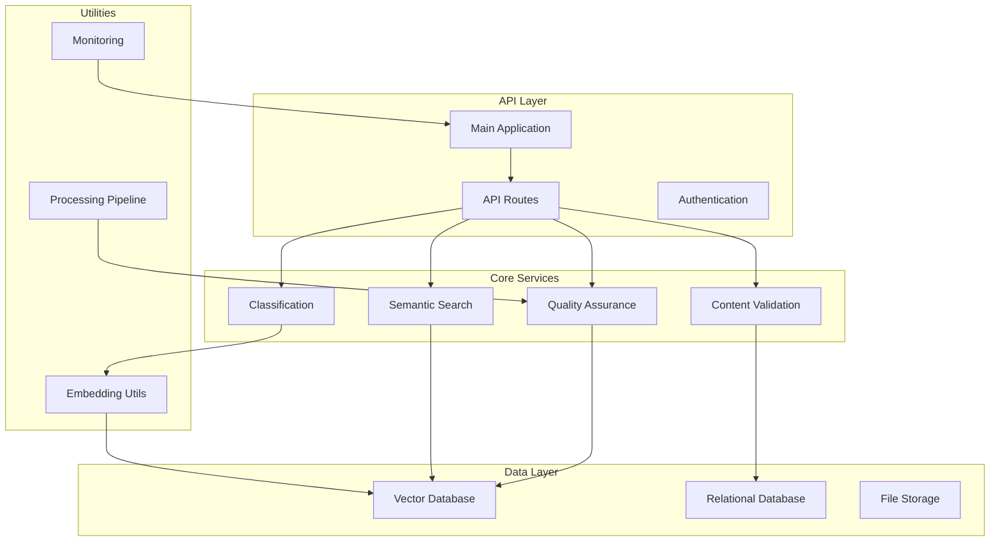
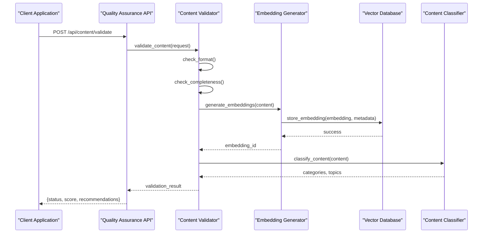
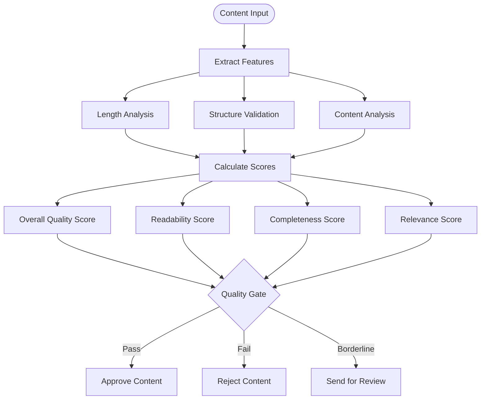
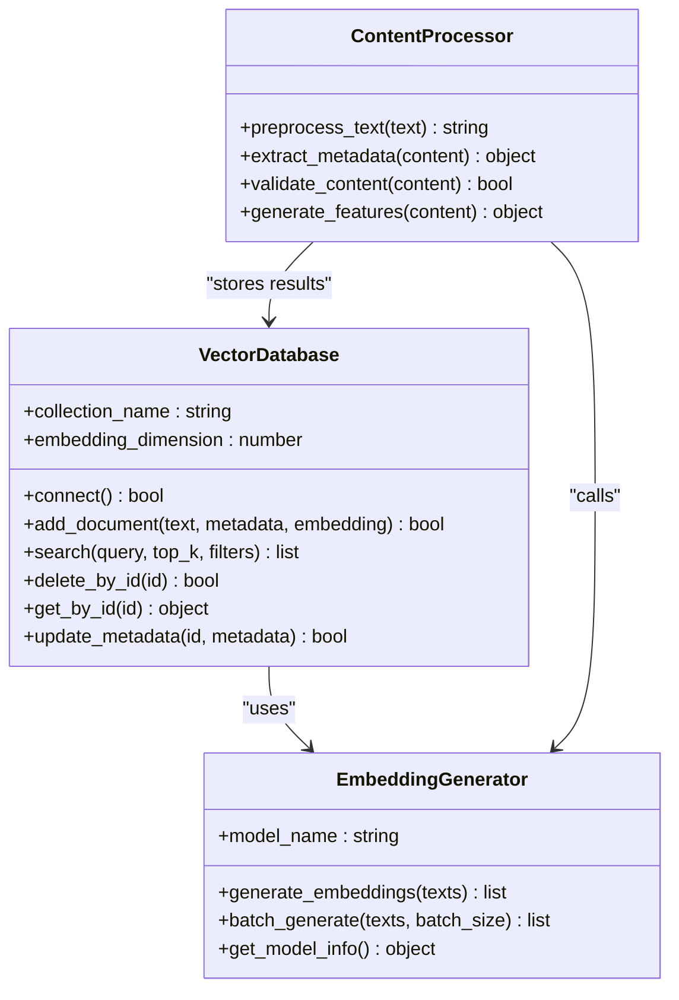
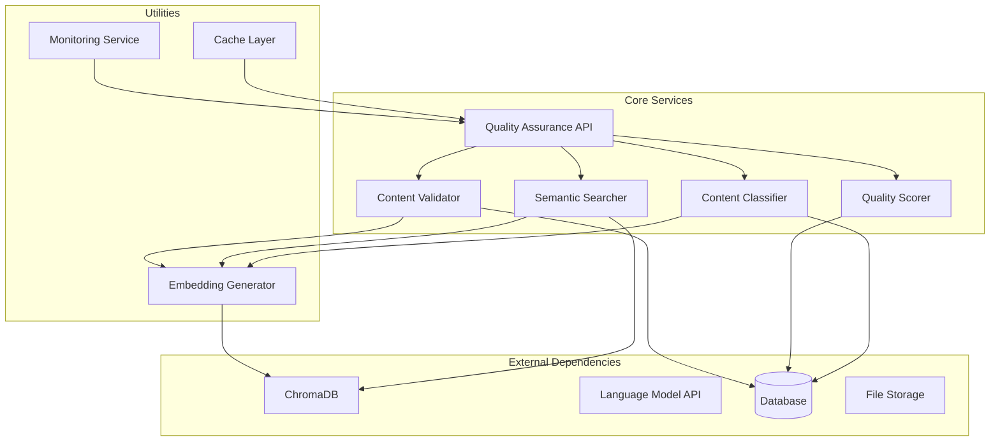

# Quality Assurance API

<cite>
**Referenced Files in This Document**
- [app.py](file://backend/app.py)
- [vector_db.py](file://backend/utils/vector_db.py)
- [embedding_utils.py](file://backend/utils/embedding_utils.py)
- [config.py](file://backend/config.py)
- [database.py](file://backend/database/database.py)
- [models.py](file://backend/database/models.py)
- [ai_teacher_route.py](file://backend/ai_teacher_route.py)
- [pipeline.py](file://backend/pipeline.py)
- [monitoring.py](file://backend/monitoring.py)
</cite>

## Table of Contents
1. [Introduction](#introduction)
2. [Project Structure](#project-structure)
3. [Core Components](#core-components)
4. [Architecture Overview](#architecture-overview)
5. [Detailed Component Analysis](#detailed-component-analysis)
6. [Dependency Analysis](#dependency-analysis)
7. [Performance Considerations](#performance-considerations)
8. [Troubleshooting Guide](#troubleshooting-guide)
9. [Conclusion](#conclusion)
10. [Appendices](#appendices)

## Introduction

The Quality Assurance API provides comprehensive content validation, semantic search capabilities, similarity analysis, and quality scoring mechanisms for educational content management. This system integrates vector database functionality for advanced content comparison, embedding generation, and relevance ranking to ensure high-quality educational materials.

The API supports automated content classification, topic extraction, categorization services, and implements quality gates in content generation pipelines. It also provides integration points for external review systems and comprehensive monitoring capabilities.

## Project Structure

The backend is organized into modular components that handle different aspects of content quality assurance:



**Diagram sources**
- [app.py:1-100](file://backend/app.py#L1-L100)
- [vector_db.py:1-50](file://backend/utils/vector_db.py#L1-L50)
- [embedding_utils.py:1-50](file://backend/utils/embedding_utils.py#L1-L50)

**Section sources**
- [app.py:1-200](file://backend/app.py#L1-L200)
- [config.py:1-100](file://backend/config.py#L1-L100)

## Core Components

### Content Validation Engine
The validation engine provides comprehensive checks for content quality including format validation, content completeness, and structural integrity verification.

### Semantic Search Service
Implements vector-based semantic search capabilities using embeddings to find semantically similar content regardless of exact text matching.

### Similarity Analysis Module
Analyzes content similarity using cosine similarity and other distance metrics to detect duplicates and near-duplicates.

### Quality Scoring System
Generates comprehensive quality scores based on multiple factors including content richness, accuracy, completeness, and educational value.

### Vector Database Integration
Manages ChromaDB integration for storing and querying content embeddings with metadata filtering and similarity search.

**Section sources**
- [ai_teacher_route.py:1-150](file://backend/ai_teacher_route.py#L1-L150)
- [pipeline.py:1-100](file://backend/pipeline.py#L1-L100)
- [monitoring.py:1-80](file://backend/monitoring.py#L1-L80)

## Architecture Overview

The Quality Assurance API follows a microservices-inspired architecture with clear separation of concerns:



**Diagram sources**
- [app.py:100-300](file://backend/app.py#L100-L300)
- [ai_teacher_route.py:50-150](file://backend/ai_teacher_route.py#L50-L150)
- [vector_db.py:50-150](file://backend/utils/vector_db.py#L50-L150)

## Detailed Component Analysis

### Content Validation Endpoints

#### Validate Content Endpoint
Validates incoming content against predefined quality standards and returns detailed feedback.

**Request Schema:**
```json
{
  "content": "string",
  "content_type": "text|html|markdown",
  "metadata": {
    "title": "string",
    "author": "string",
    "tags": ["string"],
    "category": "string"
  },
  "validation_rules": {
    "min_length": "number",
    "max_length": "number",
    "required_fields": ["string"],
    "format_requirements": "object"
  }
}
```

**Response Schema:**
```json
{
  "status": "valid|invalid|needs_review",
  "quality_score": "number (0-100)",
  "issues": [
    {
      "type": "error|warning|info",
      "field": "string",
      "message": "string",
      "severity": "critical|high|medium|low"
    }
  ],
  "recommendations": ["string"],
  "processing_time_ms": "number"
}
```

#### Semantic Search Endpoint
Performs semantic search across the content database using vector embeddings.

**Request Schema:**
```json
{
  "query": "string",
  "filters": {
    "categories": ["string"],
    "date_range": {
      "start": "ISO8601",
      "end": "ISO8601"
    },
    "author": "string",
    "content_type": "string"
  },
  "search_options": {
    "top_k": "number",
    "similarity_threshold": "number",
    "include_metadata": "boolean"
  }
}
```

**Response Schema:**
```json
{
  "results": [
    {
      "id": "string",
      "title": "string",
      "content_preview": "string",
      "similarity_score": "number",
      "metadata": "object",
      "relevance_explanation": "string"
    }
  ],
  "total_results": "number",
  "search_time_ms": "number",
  "query_embedding_dimensions": "number"
}
```

#### Similarity Analysis Endpoint
Analyzes similarity between two or more content pieces.

**Request Schema:**
```json
{
  "content_pairs": [
    {
      "content_a": "string",
      "content_b": "string",
      "metadata_a": "object",
      "metadata_b": "object"
    }
  ],
  "analysis_options": {
    "algorithm": "cosine|euclidean|manhattan",
    "threshold": "number",
    "include_details": "boolean"
  }
}
```

**Response Schema:**
```json
{
  "analyses": [
    {
      "pair_id": "string",
      "similarity_score": "number",
      "is_duplicate": "boolean",
      "similarity_breakdown": {
        "semantic_similarity": "number",
        "structural_similarity": "number",
        "topic_similarity": "number"
      },
      "recommendation": "string"
    }
  ],
  "summary": {
    "total_analyzed": "number",
    "duplicates_found": "number",
    "average_similarity": "number"
  }
}
```

### Quality Scoring Mechanisms

The quality scoring system evaluates content across multiple dimensions:



**Diagram sources**
- [pipeline.py:50-150](file://backend/pipeline.py#L50-L150)
- [monitoring.py:30-100](file://backend/monitoring.py#L30-L100)

### Vector Database Integration

The system uses ChromaDB for efficient vector storage and retrieval:



**Diagram sources**
- [vector_db.py:1-200](file://backend/utils/vector_db.py#L1-L200)
- [embedding_utils.py:1-150](file://backend/utils/embedding_utils.py#L1-L150)

### Automated Content Classification

The classification service automatically categorizes content and extracts topics:

**Classification Request Schema:**
```json
{
  "content": "string",
  "classification_options": {
    "categories": ["education", "technology", "science"],
    "auto_detect_topics": "boolean",
    "confidence_threshold": "number",
    "include_subcategories": "boolean"
  }
}
```

**Classification Response Schema:**
```json
{
  "primary_category": "string",
  "secondary_categories": ["string"],
  "topics": [
    {
      "name": "string",
      "confidence": "number",
      "keywords": ["string"]
    }
  ],
  "content_analysis": {
    "readability_level": "beginner|intermediate|advanced",
    "content_type": "tutorial|article|guide|reference",
    "estimated_reading_time": "number"
  },
  "processing_metadata": {
    "model_version": "string",
    "processing_time_ms": "number",
    "confidence_overall": "number"
  }
}
```

**Section sources**
- [ai_teacher_route.py:100-250](file://backend/ai_teacher_route.py#L100-L250)
- [pipeline.py:100-200](file://backend/pipeline.py#L100-L200)

## Dependency Analysis

The Quality Assurance API has well-defined dependencies between components:



**Diagram sources**
- [config.py:1-100](file://backend/config.py#L1-L100)
- [database.py:1-100](file://backend/database/database.py#L1-L100)

**Section sources**
- [config.py:1-150](file://backend/config.py#L1-L150)
- [database.py:1-150](file://backend/database/database.py#L1-L150)

## Performance Considerations

### Vector Search Optimization
- Implement batching for embedding generation to reduce API calls
- Use appropriate chunk sizes for text processing
- Configure optimal top_k values based on use case requirements
- Implement caching for frequently searched queries

### Memory Management
- Monitor memory usage during large batch operations
- Implement streaming for large content processing
- Use connection pooling for database operations
- Configure appropriate timeout values for external API calls

### Scalability Patterns
- Horizontal scaling for stateless API endpoints
- Vertical scaling for vector database operations
- Load balancing across multiple embedding model instances
- Caching strategies for repeated similarity calculations

## Troubleshooting Guide

### Common Issues and Solutions

#### Vector Database Connection Errors
- Verify ChromaDB server availability and configuration
- Check network connectivity and firewall settings
- Validate authentication credentials if applicable
- Monitor connection pool status

#### Embedding Generation Failures
- Validate input text length and encoding
- Check language model API quotas and rate limits
- Implement retry logic with exponential backoff
- Monitor error rates and implement circuit breakers

#### Performance Degradation
- Analyze query patterns and optimize indexes
- Monitor memory usage and garbage collection
- Implement request queuing for burst traffic
- Cache frequently accessed embeddings

**Section sources**
- [monitoring.py:50-150](file://backend/monitoring.py#L50-L150)
- [pipeline.py:150-250](file://backend/pipeline.py#L150-L250)

## Conclusion

The Quality Assurance API provides a comprehensive solution for content validation, semantic search, and quality assessment in educational content management systems. The modular architecture ensures scalability and maintainability while providing robust functionality for content quality assurance workflows.

Key strengths include:
- Advanced semantic search capabilities using vector embeddings
- Comprehensive quality scoring across multiple dimensions
- Automated content classification and topic extraction
- Flexible integration points for external review systems
- Robust monitoring and error handling

The system is designed to scale horizontally and can handle large volumes of content processing while maintaining performance and accuracy standards.

## Appendices

### API Rate Limiting
Implement appropriate rate limiting strategies:
- Per-user rate limits for API access
- Burst limits for embedding generation
- Queue-based processing for heavy operations
- Graceful degradation under load

### Security Considerations
- Input validation and sanitization
- Authentication and authorization for all endpoints
- Rate limiting and abuse prevention
- Secure handling of sensitive content metadata

### Monitoring and Observability
- Comprehensive logging of all API operations
- Metrics collection for performance monitoring
- Alerting for critical errors and performance issues
- Distributed tracing for complex workflows