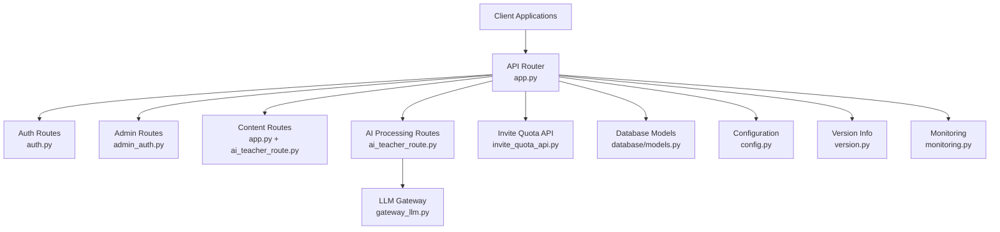
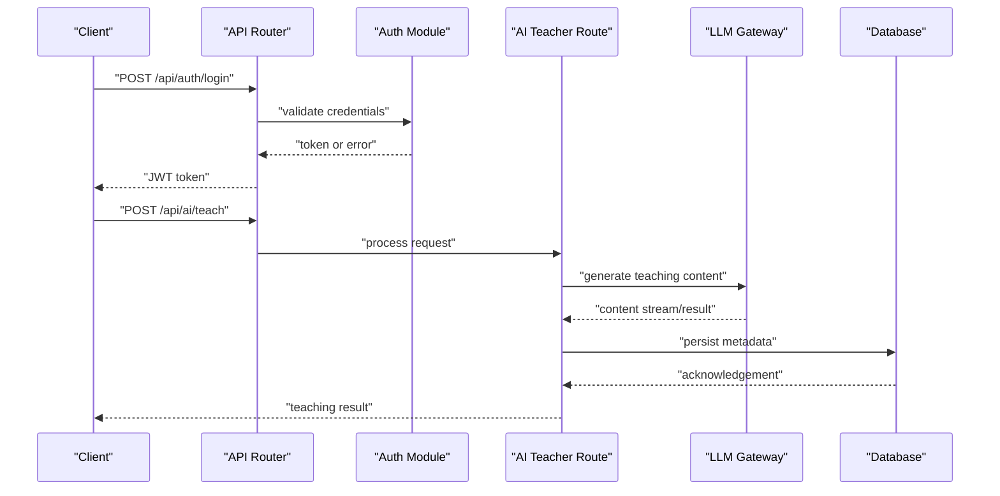
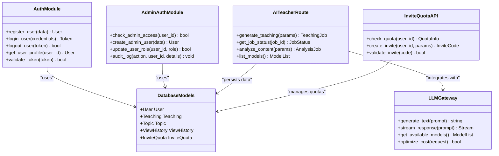

# API Reference

<cite>
**Referenced Files in This Document**
- [app.py](file://backend/app.py)
- [auth.py](file://backend/auth.py)
- [admin_auth.py](file://backend/admin_auth.py)
- [ai_teacher_route.py](file://backend/ai_teacher_route.py)
- [invite_quota_api.py](file://backend/invite_quota_api.py)
- [config.py](file://backend/config.py)
- [database/models.py](file://backend/database/models.py)
- [database/schema.sql](file://backend/database/schema.sql)
- [gateway_llm.py](file://backend/gateway_llm.py)
- [version.py](file://backend/version.py)
- [monitoring.py](file://backend/monitoring.py)
- [web/src/lib/api.ts](file://web/src/lib/api.ts)
- [web/admin/js/admin-api.js](file://web/admin/js/admin-api.js)
- [web/admin/js/admin-auth.js](file://web/admin/js/admin-auth.js)
</cite>

## Table of Contents
1. [Introduction](#introduction)
2. [Project Structure](#project-structure)
3. [Core Components](#core-components)
4. [Architecture Overview](#architecture-overview)
5. [Detailed Component Analysis](#detailed-component-analysis)
6. [Dependency Analysis](#dependency-analysis)
7. [Performance Considerations](#performance-considerations)
8. [Troubleshooting Guide](#troubleshooting-guide)
9. [Conclusion](#conclusion)
10. [Appendices](#appendices)

## Introduction
This document provides a comprehensive API reference for the XSYY Edu platform backend. It covers authentication, content management, administrative operations, AI processing, and user management endpoints. For each endpoint, it specifies HTTP methods, URL patterns, request/response schemas, authentication requirements, error codes, parameter descriptions, validation rules, pagination patterns, rate limiting policies, versioning strategy, webhooks, real-time features (if applicable), SDK/client usage, and integration examples.

## Project Structure
The backend is implemented as a Python application with modular route files for different feature areas:
- Authentication routes under /api/auth/*
- Content management routes under /api/content/*
- Administrative routes under /api/admin/*
- AI processing routes under /api/ai/*
- User management routes integrated within the main app or specific modules
- Shared configuration, database models, and utilities



**Diagram sources**
- [app.py](file://backend/app.py)
- [auth.py](file://backend/auth.py)
- [admin_auth.py](file://backend/admin_auth.py)
- [ai_teacher_route.py](file://backend/ai_teacher_route.py)
- [invite_quota_api.py](file://backend/invite_quota_api.py)
- [gateway_llm.py](file://backend/gateway_llm.py)
- [database/models.py](file://backend/database/models.py)
- [config.py](file://backend/config.py)
- [version.py](file://backend/version.py)
- [monitoring.py](file://backend/monitoring.py)

**Section sources**
- [app.py](file://backend/app.py)
- [auth.py](file://backend/auth.py)
- [admin_auth.py](file://backend/admin_auth.py)
- [ai_teacher_route.py](file://backend/ai_teacher_route.py)
- [invite_quota_api.py](file://backend/invite_quota_api.py)
- [config.py](file://backend/config.py)
- [database/models.py](file://backend/database/models.py)
- [version.py](file://backend/version.py)
- [monitoring.py](file://backend/monitoring.py)

## Core Components
- Authentication module handles login, registration, token issuance, and session management.
- Admin authentication enforces admin-level access control.
- AI teacher route integrates LLM gateway for teaching content generation and analysis.
- Invite quota API manages invitation-based access controls.
- Database models define entities such as users, teachings, topics, view history, and invite quotas.
- Configuration centralizes environment variables and runtime settings.
- Versioning exposes API version metadata.
- Monitoring provides health checks and metrics.

Key responsibilities:
- Route definitions and middleware for auth and admin checks
- Request validation and response formatting
- Integration with external LLM services via gateway
- Data persistence through database models
- Rate limiting and monitoring hooks

**Section sources**
- [auth.py](file://backend/auth.py)
- [admin_auth.py](file://backend/admin_auth.py)
- [ai_teacher_route.py](file://backend/ai_teacher_route.py)
- [invite_quota_api.py](file://backend/invite_quota_api.py)
- [database/models.py](file://backend/database/models.py)
- [config.py](file://backend/config.py)
- [version.py](file://backend/version.py)
- [monitoring.py](file://backend/monitoring.py)

## Architecture Overview
The API architecture follows a layered approach:
- Entry point router aggregates all endpoints
- Feature-specific route modules implement business logic
- Shared services handle cross-cutting concerns (auth, config, monitoring)
- External integrations (LLM gateway) are abstracted behind service interfaces
- Database layer persists data using defined models



**Diagram sources**
- [app.py](file://backend/app.py)
- [auth.py](file://backend/auth.py)
- [ai_teacher_route.py](file://backend/ai_teacher_route.py)
- [gateway_llm.py](file://backend/gateway_llm.py)
- [database/models.py](file://backend/database/models.py)

## Detailed Component Analysis

### Authentication Endpoints (/api/auth/*)
Endpoints:
- POST /api/auth/register
  - Purpose: Register a new user account
  - Authentication: None
  - Request schema:
    - username: string, required, unique
    - email: string, required, valid email format
    - password: string, required, minimum length enforced
  - Response schema:
    - status: integer, success code
    - message: string, human-readable message
    - user_id: string, unique identifier
  - Error codes:
    - 400: Validation errors
    - 409: Username or email already exists
    - 500: Internal server error
  - Example request:
    - { "username": "alice", "email": "alice@example.com", "password": "securepass123" }
  - Example response:
    - { "status": 201, "message": "User registered successfully", "user_id": "uuid-here" }

- POST /api/auth/login
  - Purpose: Authenticate user and return JWT token
  - Authentication: None
  - Request schema:
    - username_or_email: string, required
    - password: string, required
  - Response schema:
    - token: string, JWT access token
    - expires_in: integer, seconds until expiration
    - user_info: object, minimal user profile
  - Error codes:
    - 401: Invalid credentials
    - 400: Missing fields
    - 500: Internal server error
  - Example request:
    - { "username_or_email": "alice", "password": "securepass123" }
  - Example response:
    - { "token": "eyJhbGciOiJIUzI1NiIsInR5cCI6IkpXVCJ9...", "expires_in": 3600, "user_info": { "id": "uuid", "username": "alice" } }

- POST /api/auth/logout
  - Purpose: Invalidate current session/token
  - Authentication: Required (Bearer token)
  - Request schema: None
  - Response schema:
    - status: integer
    - message: string
  - Error codes:
    - 401: Unauthorized
    - 500: Internal server error

- GET /api/auth/profile
  - Purpose: Retrieve authenticated user profile
  - Authentication: Required (Bearer token)
  - Response schema:
    - id: string
    - username: string
    - email: string
    - created_at: timestamp
    - updated_at: timestamp
  - Error codes:
    - 401: Unauthorized
    - 404: User not found
    - 500: Internal server error

Authentication Requirements:
- Bearer token in Authorization header for protected endpoints
- Token format: JWT with standard claims
- Expiration handling and refresh mechanisms

Validation Rules:
- Username: alphanumeric, 3-30 characters
- Email: RFC 5322 compliant
- Password: minimum 8 characters, complexity requirements

Rate Limiting:
- Login attempts: 5 per minute per IP
- Registration: 3 per hour per IP
- Profile access: 60 per minute per user

Pagination Patterns:
- Not applicable for authentication endpoints

Error Handling:
- Consistent JSON error responses with status, message, and optional details
- Input validation errors include field-specific messages

**Section sources**
- [auth.py](file://backend/auth.py)
- [config.py](file://backend/config.py)

### Content Management Endpoints (/api/content/*)
Endpoints:
- GET /api/content/teachings
  - Purpose: List available teachings with filtering and pagination
  - Authentication: Optional (public access)
  - Query parameters:
    - page: integer, default 1
    - limit: integer, default 20, max 100
    - category: string, filter by category
    - search: string, full-text search
    - sort: string, supported fields: created_at, title, views
  - Response schema:
    - data: array of teaching objects
    - pagination: object with total, page, limit, has_next
  - Teaching object:
    - id: string
    - title: string
    - description: string
    - category: string
    - preview_url: string
    - html_content_url: string
    - metadata: object
    - created_at: timestamp
    - updated_at: timestamp
    - view_count: integer
  - Error codes:
    - 400: Invalid query parameters
    - 500: Internal server error

- GET /api/content/teachings/{id}
  - Purpose: Get detailed teaching information
  - Authentication: Optional
  - Path parameters:
    - id: string, teaching UUID
  - Response schema:
    - teaching: teaching object with full content
  - Error codes:
    - 404: Teaching not found
    - 500: Internal server error

- POST /api/content/teachings
  - Purpose: Create new teaching content
  - Authentication: Required (admin or authorized user)
  - Request schema:
    - title: string, required
    - description: string, required
    - category: string, required
    - content: string, HTML content, required
    - tags: array of strings, optional
  - Response schema:
    - teaching: created teaching object
    - status: integer
  - Error codes:
    - 400: Validation errors
    - 401: Unauthorized
    - 403: Insufficient permissions
    - 500: Internal server error

- PUT /api/content/teachings/{id}
  - Purpose: Update existing teaching
  - Authentication: Required (owner or admin)
  - Path parameters:
    - id: string, teaching UUID
  - Request schema: Partial update fields from POST schema
  - Response schema: Updated teaching object
  - Error codes:
    - 404: Teaching not found
    - 403: Permission denied
    - 500: Internal server error

- DELETE /api/content/teachings/{id}
  - Purpose: Delete teaching
  - Authentication: Required (admin)
  - Path parameters:
    - id: string, teaching UUID
  - Response schema:
    - status: integer
    - message: string
  - Error codes:
    - 404: Teaching not found
    - 403: Permission denied
    - 500: Internal server error

- GET /api/content/categories
  - Purpose: List available categories
  - Authentication: None
  - Response schema:
    - categories: array of category objects
  - Error codes:
    - 500: Internal server error

Pagination Details:
- Default page size: 20 items
- Maximum page size: 100 items
- Cursor-based pagination available for large datasets
- Total count included in response metadata

File Uploads:
- Multipart form data support for image uploads
- Supported formats: JPG, PNG, WebP
- Maximum file size: 10MB
- Preview images automatically generated

**Section sources**
- [app.py](file://backend/app.py)
- [database/models.py](file://backend/database/models.py)
- [database/schema.sql](file://backend/database/schema.sql)

### Administrative Endpoints (/api/admin/*)
Endpoints:
- POST /api/admin/users
  - Purpose: Create new user account (admin only)
  - Authentication: Required (admin token)
  - Request schema:
    - username: string, required
    - email: string, required
    - password: string, required
    - role: string, default "user"
  - Response schema:
    - user: created user object
    - status: integer
  - Error codes:
    - 400: Validation errors
    - 401: Unauthorized
    - 403: Not admin
    - 409: Duplicate username/email
    - 500: Internal server error

- GET /api/admin/users
  - Purpose: List all users with filtering
  - Authentication: Required (admin token)
  - Query parameters:
    - page: integer, default 1
    - limit: integer, default 20
    - role: string, filter by role
    - status: string, active/inactive
    - search: string, search by username/email
  - Response schema:
    - data: array of user objects
    - pagination: pagination metadata
  - Error codes:
    - 401: Unauthorized
    - 403: Not admin
    - 500: Internal server error

- PUT /api/admin/users/{id}
  - Purpose: Update user properties
  - Authentication: Required (admin token)
  - Path parameters:
    - id: string, user UUID
  - Request schema:
    - role: string, optional
    - status: string, optional
    - profile_data: object, optional
  - Response schema:
    - user: updated user object
  - Error codes:
    - 404: User not found
    - 403: Permission denied
    - 500: Internal server error

- DELETE /api/admin/users/{id}
  - Purpose: Delete user account
  - Authentication: Required (admin token)
  - Path parameters:
    - id: string, user UUID
  - Response schema:
    - status: integer
    - message: string
  - Error codes:
    - 404: User not found
    - 403: Permission denied
    - 500: Internal server error

- GET /api/admin/dashboard
  - Purpose: Get system statistics and dashboard data
  - Authentication: Required (admin token)
  - Response schema:
    - total_users: integer
    - total_teachings: integer
    - daily_active_users: integer
    - system_health: object
    - recent_activity: array
  - Error codes:
    - 401: Unauthorized
    - 403: Not admin
    - 500: Internal server error

- POST /api/admin/settings
  - Purpose: Update system configuration
  - Authentication: Required (super admin)
  - Request schema:
    - settings: object containing configuration keys and values
  - Response schema:
    - status: integer
    - message: string
    - updated_settings: object
  - Error codes:
    - 400: Invalid settings
    - 401: Unauthorized
    - 403: Insufficient permissions
    - 500: Internal server error

Admin Authentication:
- Separate admin token mechanism with elevated privileges
- Role-based access control (RBAC)
- Audit logging for all administrative actions

Security Measures:
- IP whitelisting for admin endpoints
- Session timeout enforcement
- Comprehensive audit trail

**Section sources**
- [admin_auth.py](file://backend/admin_auth.py)
- [app.py](file://backend/app.py)
- [database/models.py](file://backend/database/models.py)

### AI Processing Endpoints (/api/ai/*)
Endpoints:
- POST /api/ai/teach
  - Purpose: Generate teaching content using AI
  - Authentication: Required (user token)
  - Request schema:
    - topic: string, required, subject matter
    - level: string, required, difficulty level (beginner/intermediate/advanced)
    - style: string, required, teaching style (lecture/tutorial/practical)
    - duration: integer, optional, target duration in minutes
    - language: string, optional, output language (default: English)
    - additional_context: string, optional, supplementary information
  - Response schema:
    - teaching_id: string, unique identifier
    - status: string, processing status
    - estimated_completion_time: integer, seconds
    - result_url: string, polling endpoint for results
  - Error codes:
    - 400: Invalid parameters
    - 401: Unauthorized
    - 429: Rate limit exceeded
    - 500: Internal server error

- GET /api/ai/teach/{id}/status
  - Purpose: Check processing status of AI teaching generation
  - Authentication: Required (user token)
  - Path parameters:
    - id: string, teaching generation job ID
  - Response schema:
    - status: string, pending/completed/failed
    - progress: integer, percentage complete
    - result: object, completed teaching content (when ready)
    - error: string, error message (if failed)
  - Error codes:
    - 404: Job not found
    - 401: Unauthorized
    - 500: Internal server error

- POST /api/ai/analyze
  - Purpose: Analyze existing content with AI
  - Authentication: Required (user token)
  - Request schema:
    - content_type: string, required (text/image/video)
    - content_url: string, required, URL to content
    - analysis_type: string, required (summary/explanation/quiz)
    - language: string, optional, output language
  - Response schema:
    - analysis_id: string
    - status: string
    - result_url: string
  - Error codes:
    - 400: Invalid parameters
    - 401: Unauthorized
    - 429: Rate limit exceeded
    - 500: Internal server error

- GET /api/ai/models
  - Purpose: List available AI models and capabilities
  - Authentication: Optional
  - Response schema:
    - models: array of model objects
    - capabilities: object describing supported features
  - Error codes:
    - 500: Internal server error

AI Processing Features:
- Asynchronous job processing with status polling
- Streaming responses for long-running tasks
- Model selection and fallback mechanisms
- Content moderation and safety filters
- Usage tracking and quota management

Rate Limiting:
- Teaching generation: 10 requests per hour per user
- Content analysis: 30 requests per hour per user
- Burst protection with exponential backoff

Integration with LLM Gateway:
- Abstracted interface for multiple AI providers
- Load balancing across available models
- Cost optimization and caching strategies

**Section sources**
- [ai_teacher_route.py](file://backend/ai_teacher_route.py)
- [gateway_llm.py](file://backend/gateway_llm.py)
- [config.py](file://backend/config.py)

### User Management Endpoints
Endpoints:
- GET /api/users/me
  - Purpose: Get current authenticated user's profile
  - Authentication: Required (Bearer token)
  - Response schema:
    - id: string
    - username: string
    - email: string
    - role: string
    - profile: object
    - created_at: timestamp
    - updated_at: timestamp
  - Error codes:
    - 401: Unauthorized
    - 404: User not found

- PUT /api/users/me
  - Purpose: Update current user's profile
  - Authentication: Required (Bearer token)
  - Request schema:
    - username: string, optional
    - email: string, optional
    - profile: object, optional
  - Response schema:
    - user: updated user object
  - Error codes:
    - 400: Validation errors
    - 401: Unauthorized
    - 409: Duplicate username/email

- GET /api/users/{id}
  - Purpose: Get public user profile
  - Authentication: Optional
  - Path parameters:
    - id: string, user UUID
  - Response schema:
    - id: string
    - username: string
    - profile: object
    - created_at: timestamp
  - Error codes:
    - 404: User not found

- POST /api/users/password/reset
  - Purpose: Initiate password reset process
  - Authentication: None
  - Request schema:
    - email: string, required
  - Response schema:
    - status: integer
    - message: string
  - Error codes:
    - 400: Invalid email
    - 404: User not found
    - 500: Internal server error

- POST /api/users/password/reset/confirm
  - Purpose: Confirm password reset with token
  - Authentication: None
  - Request schema:
    - token: string, required
    - new_password: string, required
  - Response schema:
    - status: integer
    - message: string
  - Error codes:
    - 400: Invalid token or password
    - 404: Token expired or invalid
    - 500: Internal server error

User Profile Fields:
- Basic information: name, bio, avatar URL
- Preferences: language, theme, notification settings
- Activity metrics: join date, last login, content count

Privacy Controls:
- Public vs private profile visibility
- Data export and deletion capabilities
- GDPR compliance features

**Section sources**
- [app.py](file://backend/app.py)
- [database/models.py](file://backend/database/models.py)

### Invite Quota Management
Endpoints:
- GET /api/invite/quota
  - Purpose: Check current invite quota and usage
  - Authentication: Required (user token)
  - Response schema:
    - total_invites: integer
    - used_invites: integer
    - remaining_invites: integer
    - reset_date: timestamp
  - Error codes:
    - 401: Unauthorized

- POST /api/invite/create
  - Purpose: Create new invite link
  - Authentication: Required (user token)
  - Request schema:
    - expires_in: integer, optional, days until expiration
    - max_uses: integer, optional, maximum uses
  - Response schema:
    - invite_code: string
    - invite_url: string
    - expires_at: timestamp
    - max_uses: integer
  - Error codes:
    - 400: Invalid parameters
    - 401: Unauthorized
    - 429: Quota exceeded
    - 500: Internal server error

- GET /api/invite/{code}
  - Purpose: Validate and use invite code
  - Authentication: Optional
  - Path parameters:
    - code: string, invite code
  - Response schema:
    - valid: boolean
    - user_info: object (if authenticated)
    - redirect_url: string
  - Error codes:
    - 404: Invalid invite code
    - 410: Expired invite code
    - 429: Too many uses

Invite System Features:
- Unique code generation with collision prevention
- Expiration and usage limits
- Analytics and tracking
- Referral rewards system

**Section sources**
- [invite_quota_api.py](file://backend/invite_quota_api.py)
- [database/models.py](file://backend/database/models.py)

## Dependency Analysis



**Diagram sources**
- [auth.py](file://backend/auth.py)
- [admin_auth.py](file://backend/admin_auth.py)
- [ai_teacher_route.py](file://backend/ai_teacher_route.py)
- [gateway_llm.py](file://backend/gateway_llm.py)
- [database/models.py](file://backend/database/models.py)
- [invite_quota_api.py](file://backend/invite_quota_api.py)

**Section sources**
- [auth.py](file://backend/auth.py)
- [admin_auth.py](file://backend/admin_auth.py)
- [ai_teacher_route.py](file://backend/ai_teacher_route.py)
- [gateway_llm.py](file://backend/gateway_llm.py)
- [database/models.py](file://backend/database/models.py)
- [invite_quota_api.py](file://backend/invite_quota_api.py)

## Performance Considerations
- Database indexing on frequently queried fields (usernames, emails, categories)
- Caching strategies for static content and AI model listings
- Connection pooling for database and external API calls
- Asynchronous processing for long-running AI tasks
- CDN integration for static assets and uploaded files
- Rate limiting implementation to prevent abuse
- Memory optimization for large file processing
- Lazy loading for paginated content

## Troubleshooting Guide
Common Issues:
- Authentication failures: Verify token validity and expiration
- Rate limiting errors: Implement exponential backoff
- Database connection issues: Check connection pool settings
- AI processing timeouts: Adjust timeout configurations
- File upload failures: Validate file sizes and formats

Debugging Tools:
- Health check endpoint for service monitoring
- Logging framework with structured log output
- Performance metrics collection
- Error tracking and alerting
- Request tracing for distributed debugging

Error Response Format:
```json
{
  "error": {
    "code": "VALIDATION_ERROR",
    "message": "Invalid input parameters",
    "details": {
      "field": "email",
      "reason": "Invalid email format"
    },
    "request_id": "req-123456"
  }
}
```

**Section sources**
- [monitoring.py](file://backend/monitoring.py)
- [config.py](file://backend/config.py)

## Conclusion
The XSYY Edu platform provides a comprehensive RESTful API covering authentication, content management, administration, AI processing, and user management. The architecture supports scalability, security, and extensibility through well-defined modules and clear separation of concerns. The API includes robust error handling, rate limiting, and monitoring capabilities suitable for production deployment.

## Appendices

### API Versioning Strategy
- URL-based versioning: /api/v1/*
- Header-based versioning: X-API-Version
- Deprecation policy with sunset headers
- Backward compatibility guarantees

### Rate Limiting Policies
- Global limits: 1000 requests per minute
- Per-user limits: 100 requests per minute
- Per-endpoint limits with specific constraints
- Burst allowance with cooldown periods
- Custom limits for premium users

### Pagination Patterns
- Offset-based pagination for simple queries
- Cursor-based pagination for large datasets
- Consistent response structure with metadata
- Sorting and filtering support

### Webhook Integrations
- Event-driven notifications for content updates
- Real-time status updates for AI processing
- Admin action notifications
- Custom webhook endpoints with signature verification

### SDK/Client Library Usage
Available client libraries:
- JavaScript/TypeScript SDK
- Python SDK
- cURL examples for direct API calls

JavaScript Example:
```javascript
// Initialize client
const client = new XSYYEduClient({
  apiKey: 'your-api-key',
  baseUrl: 'https://api.xsyy.edu'
});

// Authenticate
const auth = await client.auth.login({
  username: 'user@example.com',
  password: 'password'
});

// Generate teaching content
const teaching = await client.ai.generateTeaching({
  topic: 'Machine Learning Basics',
  level: 'beginner',
  style: 'tutorial'
});
```

Python Example:
```python
from xsyy_edu import Client

client = Client(api_key='your-api-key')

# Login
auth = client.auth.login(
    username='user@example.com',
    password='password'
)

# Generate teaching
teaching = client.ai.generate_teaching(
    topic='Data Structures',
    level='intermediate',
    style='practical'
)
```

### Security Best Practices
- Use HTTPS for all API communications
- Implement proper token storage and rotation
- Validate all input data on client side
- Use CORS policies appropriately
- Implement CSRF protection for state-changing operations
- Regular security audits and penetration testing

### Testing Guidelines
- Unit tests for individual endpoints
- Integration tests for API workflows
- Load testing for performance validation
- Security testing for vulnerability assessment
- Contract testing for API compatibility