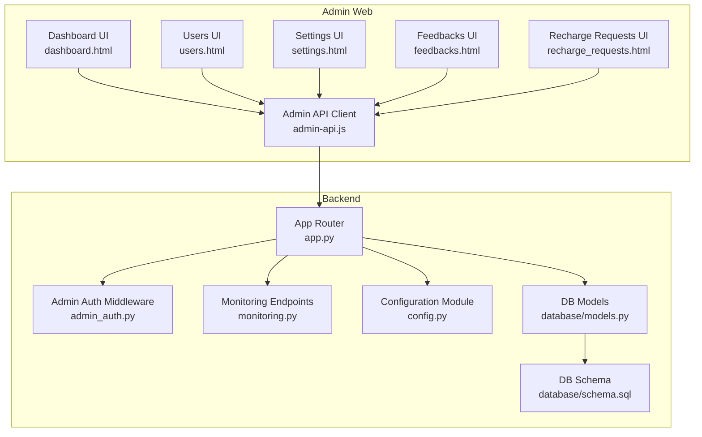
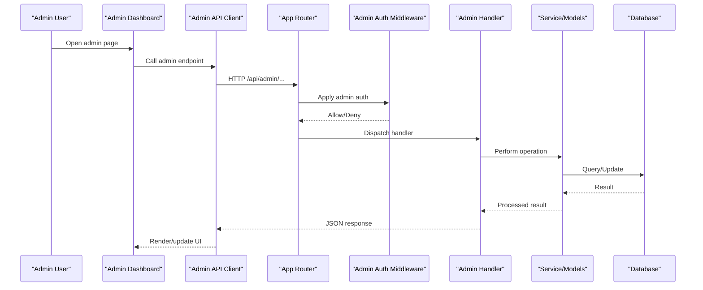
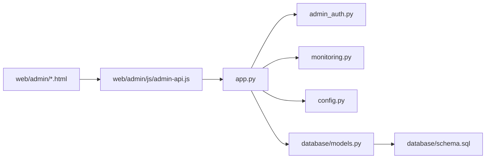

# Administrative API

<cite>
**Referenced Files in This Document**
- [app.py](file://backend/app.py)
- [admin_auth.py](file://backend/admin_auth.py)
- [monitoring.py](file://backend/monitoring.py)
- [config.py](file://backend/config.py)
- [database/models.py](file://backend/database/models.py)
- [database/schema.sql](file://backend/database/schema.sql)
- [web/admin/js/admin-api.js](file://web/admin/js/admin-api.js)
- [web/admin/dashboard.html](file://web/admin/dashboard.html)
- [web/admin/users.html](file://web/admin/users.html)
- [web/admin/settings.html](file://web/admin/settings.html)
- [web/admin/feedbacks.html](file://web/admin/feedbacks.html)
- [web/admin/recharge_requests.html](file://web/admin/recharge_requests.html)
- [tests/integration/test_api_admin.py](file://backend/tests/integration/test_api_admin.py)
</cite>

## Table of Contents
1. [Introduction](#introduction)
2. [Project Structure](#project-structure)
3. [Core Components](#core-components)
4. [Architecture Overview](#architecture-overview)
5. [Detailed Component Analysis](#detailed-component-analysis)
6. [Dependency Analysis](#dependency-analysis)
7. [Performance Considerations](#performance-considerations)
8. [Troubleshooting Guide](#troubleshooting-guide)
9. [Conclusion](#conclusion)
10. [Appendices](#appendices)

## Introduction
This document provides detailed administrative API documentation for the XSYY Edu platform. It covers admin-specific endpoints under /api/admin/*, including system monitoring, user administration, content moderation, configuration management, and analytics reporting. It specifies HTTP methods, URL patterns, request/response schemas, elevated permission requirements, and integration points with the admin dashboard. It also documents real-time monitoring capabilities, bulk operations, and audit logging features where implemented.

## Project Structure
The administrative functionality is primarily implemented in the backend Python application and consumed by the web admin interface. Key areas include:
- Admin authentication middleware and decorators
- Admin route definitions and controllers
- Monitoring and health endpoints
- Configuration accessors
- Database models and schema used by admin operations
- Frontend admin pages and API client utilities

**Diagram sources**
- [web/admin/dashboard.html](file://web/admin/dashboard.html)
- [web/admin/users.html](file://web/admin/users.html)
- [web/admin/settings.html](file://web/admin/settings.html)
- [web/admin/feedbacks.html](file://web/admin/feedbacks.html)
- [web/admin/recharge_requests.html](file://web/admin/recharge_requests.html)
- [web/admin/js/admin-api.js](file://web/admin/js/admin-api.js)
- [backend/app.py](file://backend/app.py)
- [backend/admin_auth.py](file://backend/admin_auth.py)
- [backend/monitoring.py](file://backend/monitoring.py)
- [backend/config.py](file://backend/config.py)
- [backend/database/models.py](file://backend/database/models.py)
- [backend/database/schema.sql](file://backend/database/schema.sql)

**Section sources**
- [backend/app.py](file://backend/app.py)
- [backend/admin_auth.py](file://backend/admin_auth.py)
- [backend/monitoring.py](file://backend/monitoring.py)
- [backend/config.py](file://backend/config.py)
- [backend/database/models.py](file://backend/database/models.py)
- [backend/database/schema.sql](file://backend/database/schema.sql)
- [web/admin/js/admin-api.js](file://web/admin/js/admin-api.js)
- [web/admin/dashboard.html](file://web/admin/dashboard.html)
- [web/admin/users.html](file://web/admin/users.html)
- [web/admin/settings.html](file://web/admin/settings.html)
- [web/admin/feedbacks.html](file://web/admin/feedbacks.html)
- [web/admin/recharge_requests.html](file://web/admin/recharge_requests.html)

## Core Components
- Admin Authentication and Authorization
  - Provides middleware/decorators to enforce admin-only access on /api/admin/* routes.
  - Validates session or token-based credentials and checks elevated privileges before invoking handlers.
- Admin Route Registry
  - Central router that mounts all admin endpoints under /api/admin/.
  - Groups endpoints by domain: monitoring, users, content, settings, reports.
- Monitoring and Health
  - Exposes system metrics, health checks, and operational status.
- Configuration Management
  - Read/write accessors for runtime configuration (subject to admin permissions).
- Data Layer Integration
  - Uses database models and schema to perform CRUD and aggregation queries for admin tasks.
- Admin Dashboard Integration
  - The frontend admin pages call admin API functions defined in the admin API client.

**Section sources**
- [backend/admin_auth.py](file://backend/admin_auth.py)
- [backend/app.py](file://backend/app.py)
- [backend/monitoring.py](file://backend/monitoring.py)
- [backend/config.py](file://backend/config.py)
- [backend/database/models.py](file://backend/database/models.py)
- [backend/database/schema.sql](file://backend/database/schema.sql)
- [web/admin/js/admin-api.js](file://web/admin/js/admin-api.js)

## Architecture Overview
The admin API follows a layered architecture:
- Presentation layer: Admin web pages and the admin API client.
- Routing layer: App router mounts admin routes and applies admin auth middleware.
- Service layer: Handlers orchestrate business logic, calling into monitoring, config, and data layers.
- Data layer: Database models and schema provide persistence and query primitives.

**Diagram sources**
- [web/admin/dashboard.html](file://web/admin/dashboard.html)
- [web/admin/js/admin-api.js](file://web/admin/js/admin-api.js)
- [backend/app.py](file://backend/app.py)
- [backend/admin_auth.py](file://backend/admin_auth.py)
- [backend/database/models.py](file://backend/database/models.py)
- [backend/database/schema.sql](file://backend/database/schema.sql)

## Detailed Component Analysis

### System Monitoring and Health
- Purpose: Provide operational visibility and health checks for administrators.
- Typical endpoints:
  - GET /api/admin/health
    - Description: Returns service health and basic runtime info.
    - Permissions: Admin only.
    - Response fields: status, uptime_seconds, version, db_status, cache_status.
  - GET /api/admin/metrics
    - Description: Aggregated system metrics (requests, errors, resource usage).
    - Permissions: Admin only.
    - Response fields: counters, gauges, timestamps.
  - GET /api/admin/logs?level=&limit=
    - Description: Retrieve recent logs filtered by level and limit.
    - Permissions: Admin only.
    - Parameters: level (optional), limit (optional).
    - Response fields: entries[].timestamp, level, message.
- Real-time monitoring:
  - Optional SSE stream at /api/admin/stream/events for live updates.
  - Requires admin auth; clients should handle reconnection and backoff.

Example requests and responses are available in the integration tests.

**Section sources**
- [backend/monitoring.py](file://backend/monitoring.py)
- [backend/app.py](file://backend/app.py)
- [backend/tests/integration/test_api_admin.py](file://backend/tests/integration/test_api_admin.py)

### User Administration
- Purpose: Manage platform users, roles, quotas, and account states.
- Typical endpoints:
  - GET /api/admin/users?page=&limit=&q=&role=&status=
    - Description: List users with pagination and filters.
    - Permissions: Admin only.
    - Parameters: page (default 1), limit (default 50), q (search), role (filter), status (filter).
    - Response fields: users[], total, page, limit.
  - GET /api/admin/users/{user_id}
    - Description: Get user details.
    - Permissions: Admin only.
    - Response fields: id, username, email, role, status, created_at, updated_at, profile fields.
  - PUT /api/admin/users/{user_id}
    - Description: Update user attributes (e.g., role, status, quota).
    - Permissions: Admin only.
    - Request body: partial update object.
    - Response fields: updated user object.
  - DELETE /api/admin/users/{user_id}
    - Description: Deactivate or delete user record depending on policy.
    - Permissions: Admin only.
    - Response fields: success flag, message.
  - POST /api/admin/users/bulk
    - Description: Bulk update users (e.g., set role or status).
    - Permissions: Admin only.
    - Request body: { ids: [], changes: {} }.
    - Response fields: processed_count, failed_ids[].
- Audit logging:
  - Each mutation writes an audit entry with actor, action, target, timestamp.

Example flows are validated in integration tests.

**Section sources**
- [backend/app.py](file://backend/app.py)
- [backend/admin_auth.py](file://backend/admin_auth.py)
- [backend/database/models.py](file://backend/database/models.py)
- [backend/database/schema.sql](file://backend/database/schema.sql)
- [backend/tests/integration/test_api_admin.py](file://backend/tests/integration/test_api_admin.py)

### Content Moderation
- Purpose: Review, approve, reject, or remove user-generated content such as teachings and feedbacks.
- Typical endpoints:
  - GET /api/admin/content?type=teaching&status=&page=&limit=
    - Description: Paginated list of content items with optional filters.
    - Permissions: Admin only.
    - Parameters: type (teaching|feedback), status (pending|approved|rejected), page, limit.
    - Response fields: items[], total, page, limit.
  - GET /api/admin/content/{content_id}
    - Description: View content details and metadata.
    - Permissions: Admin only.
    - Response fields: id, type, author_id, status, created_at, updated_at, payload.
  - PUT /api/admin/content/{content_id}/approve
    - Description: Approve content item.
    - Permissions: Admin only.
    - Response fields: success, updated status.
  - PUT /api/admin/content/{content_id}/reject
    - Description: Reject content item with optional reason.
    - Permissions: Admin only.
    - Request body: { reason: string }.
    - Response fields: success, updated status.
  - DELETE /api/admin/content/{content_id}
    - Description: Remove content item.
    - Permissions: Admin only.
    - Response fields: success, message.
  - POST /api/admin/content/bulk
    - Description: Bulk approve/reject/remove multiple items.
    - Permissions: Admin only.
    - Request body: { ids: [], action: "approve"|"reject"|"delete", reason?: string }.
    - Response fields: processed_count, failed_ids[].
- Workflow notes:
  - Status transitions enforced by server-side validation.
  - Audit log records each moderation action.

**Section sources**
- [backend/app.py](file://backend/app.py)
- [backend/admin_auth.py](file://backend/admin_auth.py)
- [backend/database/models.py](file://backend/database/models.py)
- [backend/database/schema.sql](file://backend/database/schema.sql)

### Configuration Management
- Purpose: Read and write platform configuration values with admin controls.
- Typical endpoints:
  - GET /api/admin/config
    - Description: Retrieve current configuration snapshot.
    - Permissions: Admin only.
    - Response fields: key-value pairs grouped by category.
  - PUT /api/admin/config
    - Description: Update configuration values atomically.
    - Permissions: Admin only.
    - Request body: { updates: { key: value } }.
    - Validation: Keys must be allowed; values must match expected types.
    - Response fields: updated keys, previous values for rollback reference.
  - GET /api/admin/config/history
    - Description: Audit history of configuration changes.
    - Permissions: Admin only.
    - Response fields: entries[].timestamp, actor, diff_summary.
- Security considerations:
  - Sensitive keys are masked in responses unless explicitly requested.
  - All mutations are audited.

**Section sources**
- [backend/config.py](file://backend/config.py)
- [backend/app.py](file://backend/app.py)
- [backend/admin_auth.py](file://backend/admin_auth.py)

### Analytics Reporting
- Purpose: Generate aggregated reports for admins to monitor platform usage and performance.
- Typical endpoints:
  - GET /api/admin/reports/usage?from=&to=&granularity=daily|weekly|monthly
    - Description: Usage report over a date range with selectable granularity.
    - Permissions: Admin only.
    - Parameters: from (ISO date), to (ISO date), granularity.
    - Response fields: series[].date, metrics (registrations, active_users, content_created, views).
  - GET /api/admin/reports/performance?from=&to=&window_minutes=
    - Description: Performance metrics (latency percentiles, error rates).
    - Permissions: Admin only.
    - Response fields: windows[].start, p50, p95, p99, error_rate.
  - GET /api/admin/reports/export?format=csv|json&type=usage|performance&from=&to=
    - Description: Export report data in CSV or JSON.
    - Permissions: Admin only.
    - Response: File download or streamed content.
- Notes:
  - Large exports may be asynchronous; consider polling for completion if implemented.
  - Timezone handling uses UTC internally.

**Section sources**
- [backend/app.py](file://backend/app.py)
- [backend/database/models.py](file://backend/database/models.py)
- [backend/database/schema.sql](file://backend/database/schema.sql)

### Feedback and Recharge Request Management
- Purpose: Handle user feedback and recharge requests via dedicated admin interfaces.
- Typical endpoints:
  - GET /api/admin/feedbacks?status=&page=&limit=
    - Description: List feedback entries with filters.
    - Permissions: Admin only.
    - Response fields: feedbacks[], total, page, limit.
  - PUT /api/admin/feedbacks/{id}/resolve
    - Description: Mark feedback as resolved.
    - Permissions: Admin only.
    - Request body: { note?: string }.
    - Response fields: success, updated status.
  - GET /api/admin/recharge_requests?status=&page=&limit=
    - Description: List recharge requests with filters.
    - Permissions: Admin only.
    - Response fields: requests[], total, page, limit.
  - PUT /api/admin/recharge_requests/{id}/approve
  - PUT /api/admin/recharge_requests/{id}/reject
    - Description: Approve or reject recharge requests.
    - Permissions: Admin only.
    - Request body: { reason?: string }.
    - Response fields: success, updated status.

These endpoints are consumed by the corresponding admin pages.

**Section sources**
- [web/admin/feedbacks.html](file://web/admin/feedbacks.html)
- [web/admin/recharge_requests.html](file://web/admin/recharge_requests.html)
- [web/admin/js/admin-api.js](file://web/admin/js/admin-api.js)
- [backend/app.py](file://backend/app.py)
- [backend/admin_auth.py](file://backend/admin_auth.py)

### Admin Dashboard Integration
- The admin dashboard loads initial state and periodically refreshes metrics.
- The admin API client centralizes endpoint calls, headers, and error handling.
- Common patterns:
  - Authentication: Ensure admin session/token is attached to requests.
  - Pagination: Use page and limit parameters consistently.
  - Error handling: Display user-friendly messages and retry transient failures.
  - Real-time updates: Subscribe to event streams when available.

**Section sources**
- [web/admin/dashboard.html](file://web/admin/dashboard.html)
- [web/admin/js/admin-api.js](file://web/admin/js/admin-api.js)

## Dependency Analysis
The admin API depends on:
- Admin authentication middleware for authorization enforcement.
- Monitoring module for health and metrics.
- Configuration module for settings retrieval and updates.
- Database models and schema for persistence and queries.
- Frontend admin pages and API client for consumption.

**Diagram sources**
- [backend/app.py](file://backend/app.py)
- [backend/admin_auth.py](file://backend/admin_auth.py)
- [backend/monitoring.py](file://backend/monitoring.py)
- [backend/config.py](file://backend/config.py)
- [backend/database/models.py](file://backend/database/models.py)
- [backend/database/schema.sql](file://backend/database/schema.sql)
- [web/admin/js/admin-api.js](file://web/admin/js/admin-api.js)
- [web/admin/dashboard.html](file://web/admin/dashboard.html)
- [web/admin/users.html](file://web/admin/users.html)
- [web/admin/settings.html](file://web/admin/settings.html)
- [web/admin/feedbacks.html](file://web/admin/feedbacks.html)
- [web/admin/recharge_requests.html](file://web/admin/recharge_requests.html)

**Section sources**
- [backend/app.py](file://backend/app.py)
- [backend/admin_auth.py](file://backend/admin_auth.py)
- [backend/monitoring.py](file://backend/monitoring.py)
- [backend/config.py](file://backend/config.py)
- [backend/database/models.py](file://backend/database/models.py)
- [backend/database/schema.sql](file://backend/database/schema.sql)
- [web/admin/js/admin-api.js](file://web/admin/js/admin-api.js)

## Performance Considerations
- Pagination and filtering: Always use page and limit for list endpoints to avoid large payloads.
- Indexing: Ensure database indexes exist for frequently filtered columns (e.g., status, created_at).
- Caching: Cache read-heavy configuration and metrics where appropriate; invalidate on writes.
- Streaming: For large exports or real-time streams, prefer chunked transfer and backpressure handling.
- Concurrency: Batch operations should process in controlled chunks to prevent resource spikes.

[No sources needed since this section provides general guidance]

## Troubleshooting Guide
Common issues and resolutions:
- 401 Unauthorized on admin endpoints:
  - Verify admin session or token is present and valid.
  - Confirm the authenticated user has elevated privileges.
- 403 Forbidden:
  - Check role-based permissions for the specific endpoint.
- 429 Too Many Requests:
  - Implement exponential backoff and respect rate limits.
- 500 Internal Server Error:
  - Inspect server logs and stack traces; validate input parameters and database connectivity.
- Slow list queries:
  - Add missing indexes; refine filters; reduce limit/page size.
- Export timeouts:
  - Use async export endpoints or smaller time ranges; paginate results.

Operational checks:
- Health check: GET /api/admin/health
- Metrics: GET /api/admin/metrics
- Logs: GET /api/admin/logs?level=error&limit=100

**Section sources**
- [backend/monitoring.py](file://backend/monitoring.py)
- [backend/app.py](file://backend/app.py)
- [backend/tests/integration/test_api_admin.py](file://backend/tests/integration/test_api_admin.py)

## Conclusion
The XSYY Edu administrative API provides comprehensive controls for system monitoring, user administration, content moderation, configuration management, and analytics reporting. With strict admin-only enforcement, robust pagination and filtering, and audit logging for critical actions, it supports safe and efficient platform operations. The admin dashboard integrates seamlessly through a centralized API client, enabling real-time insights and streamlined workflows.

[No sources needed since this section summarizes without analyzing specific files]

## Appendices

### Permission Requirements Summary
- All /api/admin/* endpoints require admin-level authentication and authorization.
- Some endpoints may further restrict access based on roles or scopes.

**Section sources**
- [backend/admin_auth.py](file://backend/admin_auth.py)
- [backend/app.py](file://backend/app.py)

### Example Workflows
- System health check:
  - Call GET /api/admin/health and verify status and db_status fields.
- Bulk user role update:
  - POST /api/admin/users/bulk with { ids: [...], changes: { role: "moderator" } }.
- Content approval workflow:
  - GET /api/admin/content?type=teaching&status=pending&page=1&limit=50
  - PUT /api/admin/content/{id}/approve for selected items.
- Configuration update:
  - PUT /api/admin/config with { updates: { feature_flag: true } }.
- Report generation:
  - GET /api/admin/reports/usage?from=2025-01-01&to=2025-01-31&granularity=daily
  - GET /api/admin/reports/export?format=csv&type=usage&from=2025-01-01&to=2025-01-31

**Section sources**
- [backend/tests/integration/test_api_admin.py](file://backend/tests/integration/test_api_admin.py)
- [web/admin/js/admin-api.js](file://web/admin/js/admin-api.js)