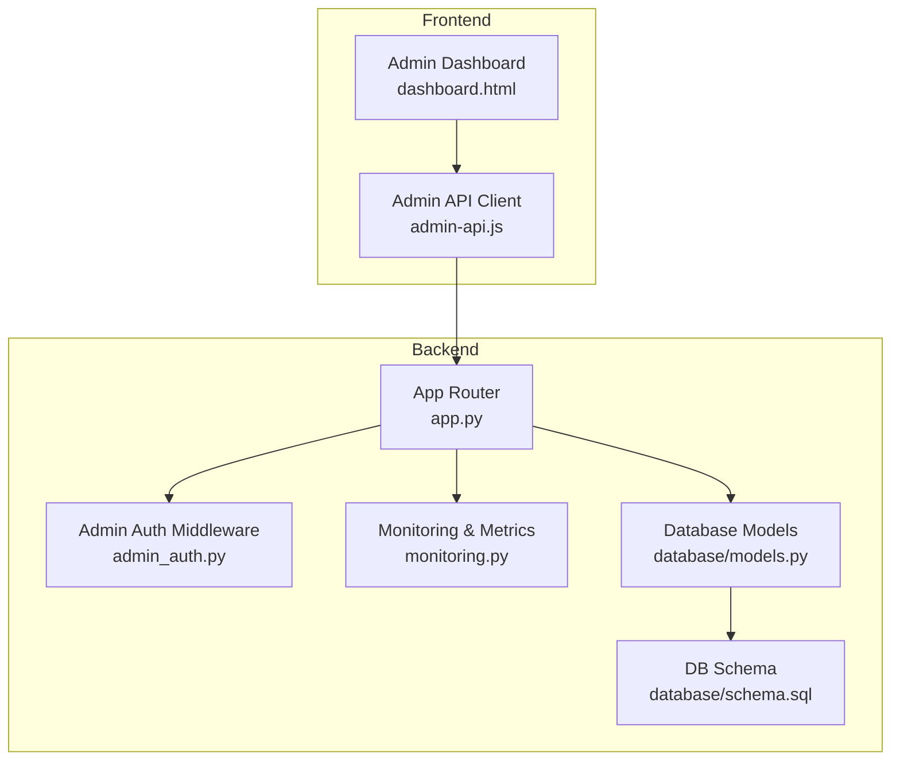
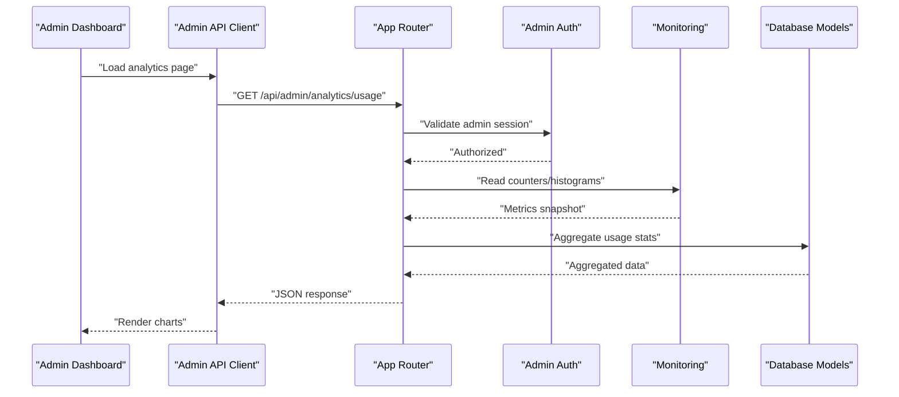
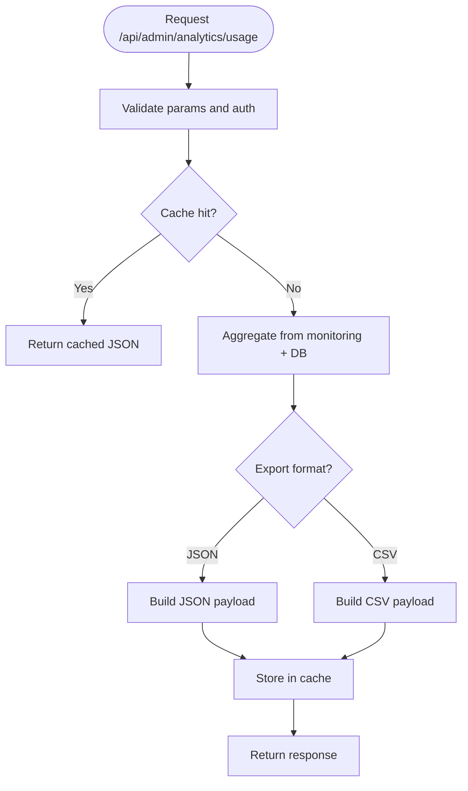
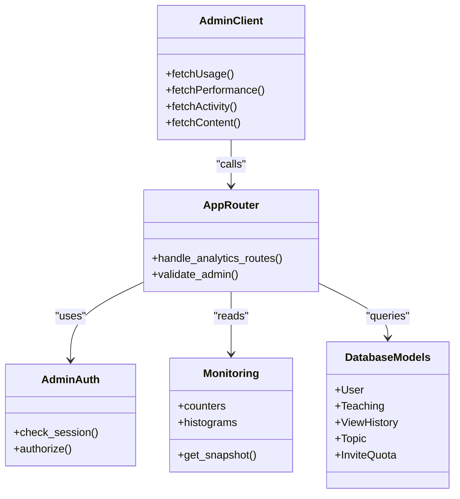

# Analytics & Reporting API

<cite>
**Referenced Files in This Document**
- [app.py](file://backend/app.py)
- [admin_auth.py](file://backend/admin_auth.py)
- [monitoring.py](file://backend/monitoring.py)
- [database/models.py](file://backend/database/models.py)
- [database/schema.sql](file://backend/database/schema.sql)
- [web/admin/js/admin-api.js](file://web/admin/js/admin-api.js)
- [web/admin/dashboard.html](file://web/admin/dashboard.html)
</cite>

## Table of Contents
1. [Introduction](#introduction)
2. [Project Structure](#project-structure)
3. [Core Components](#core-components)
4. [Architecture Overview](#architecture-overview)
5. [Detailed Component Analysis](#detailed-component-analysis)
6. [Dependency Analysis](#dependency-analysis)
7. [Performance Considerations](#performance-considerations)
8. [Troubleshooting Guide](#troubleshooting-guide)
9. [Conclusion](#conclusion)
10. [Appendices](#appendices)

## Introduction
This document specifies the analytics and reporting API endpoints for the application, focusing on usage statistics, performance metrics, user activity tracking, and content analytics. It defines HTTP methods, URL patterns under /api/admin/analytics/*, request/response schemas, data aggregation intervals, caching strategies, export formats, and integration guidance for external analytics tools and custom reporting solutions. Where applicable, it also provides examples for custom report creation, scheduled reporting, and real-time dashboards.

## Project Structure
The analytics and reporting capabilities are implemented primarily in the backend Python application with administrative routes and monitoring utilities. The frontend admin dashboard consumes these endpoints to render charts and tables.

**Diagram sources**
- [app.py](file://backend/app.py)
- [admin_auth.py](file://backend/admin_auth.py)
- [monitoring.py](file://backend/monitoring.py)
- [database/models.py](file://backend/database/models.py)
- [database/schema.sql](file://backend/database/schema.sql)
- [web/admin/dashboard.html](file://web/admin/dashboard.html)
- [web/admin/js/admin-api.js](file://web/admin/js/admin-api.js)

**Section sources**
- [app.py](file://backend/app.py)
- [admin_auth.py](file://backend/admin_auth.py)
- [monitoring.py](file://backend/monitoring.py)
- [database/models.py](file://backend/database/models.py)
- [database/schema.sql](file://backend/database/schema.sql)
- [web/admin/dashboard.html](file://web/admin/dashboard.html)
- [web/admin/js/admin-api.js](file://web/admin/js/admin-api.js)

## Core Components
- Admin-authenticated analytics routes: All analytics endpoints are protected by admin authentication middleware to ensure only authorized administrators can access sensitive metrics.
- Monitoring module: Provides counters, histograms, and timing utilities used to aggregate performance metrics and usage statistics.
- Database models and schema: Define entities such as users, teachings, view history, topics, and invite quotas that feed into analytics queries.
- Admin client: JavaScript layer that calls analytics endpoints and renders results in the admin dashboard.

Key responsibilities:
- Expose REST endpoints for aggregated metrics and raw or summarized reports.
- Enforce admin authorization and rate limiting where applicable.
- Aggregate data from database tables efficiently using indexes and optimized queries.
- Support multiple output formats (JSON, CSV) for exports.

**Section sources**
- [admin_auth.py](file://backend/admin_auth.py)
- [monitoring.py](file://backend/monitoring.py)
- [database/models.py](file://backend/database/models.py)
- [database/schema.sql](file://backend/database/schema.sql)
- [web/admin/js/admin-api.js](file://web/admin/js/admin-api.js)

## Architecture Overview
The analytics pipeline follows a clear separation of concerns:
- Frontend admin UI requests metrics via the admin API client.
- Backend app router validates admin auth and dispatches to analytics handlers.
- Monitoring utilities collect runtime metrics and expose them.
- Database models and schema provide the data sources for aggregations.

**Diagram sources**
- [app.py](file://backend/app.py)
- [admin_auth.py](file://backend/admin_auth.py)
- [monitoring.py](file://backend/monitoring.py)
- [database/models.py](file://backend/database/models.py)

**Section sources**
- [app.py](file://backend/app.py)
- [admin_auth.py](file://backend/admin_auth.py)
- [monitoring.py](file://backend/monitoring.py)
- [database/models.py](file://backend/database/models.py)

## Detailed Component Analysis

### Usage Statistics Endpoint
Purpose: Provide aggregated usage metrics such as total requests, active users, and feature adoption over time.

- Method: GET
- URL: /api/admin/analytics/usage
- Authentication: Admin required
- Query parameters:
  - interval: day|week|month (default: day)
  - start_date: ISO 8601 date string
  - end_date: ISO 8601 date string
  - group_by: none|user|feature|endpoint
- Response schema (JSON):
  - summary: object with total_requests, unique_users, avg_response_time_ms
  - series: array of {timestamp, value}
  - breakdown: object keyed by group_by dimension
- Export: Accept header application/json; add ?format=csv to return CSV

Data sources:
- Request counters and timing metrics from monitoring module
- User activity tables from database models

Caching:
- Short-lived cache keyed by interval and date range
- Cache invalidation on new data writes

Example flow:

**Diagram sources**
- [app.py](file://backend/app.py)
- [monitoring.py](file://backend/monitoring.py)
- [database/models.py](file://backend/database/models.py)

**Section sources**
- [app.py](file://backend/app.py)
- [monitoring.py](file://backend/monitoring.py)
- [database/models.py](file://backend/database/models.py)

### Performance Metrics Endpoint
Purpose: Serve latency percentiles, error rates, and throughput metrics.

- Method: GET
- URL: /api/admin/analytics/performance
- Authentication: Admin required
- Query parameters:
  - window: minute|hour|day
  - percentile: p50|p90|p95|p99
  - endpoint: optional filter by route
- Response schema (JSON):
  - metrics: {latency_pX, error_rate, throughput_rps}
  - timeline: array of {timestamp, metric_value}
- Export: CSV supported via ?format=csv

Data sources:
- Histograms and counters from monitoring module
- Error logs and status code distributions

Caching:
- Windowed cache aligned to requested window size

**Section sources**
- [monitoring.py](file://backend/monitoring.py)
- [app.py](file://backend/app.py)

### User Activity Tracking Endpoint
Purpose: Track user actions, sessions, and engagement metrics.

- Method: GET
- URL: /api/admin/analytics/user_activity
- Authentication: Admin required
- Query parameters:
  - period: day|week|month
  - cohort: all|new|returning
  - action_type: login|view|create|update|delete
- Response schema (JSON):
  - totals: {sessions, logins, views, creations}
  - per_user: array of {user_id, actions_count, last_seen}
  - trends: array of {timestamp, count}
- Export: CSV

Data sources:
- View history and user tables
- Session and event logs if available

Caching:
- Period-based cache with TTL aligned to cohort granularity

**Section sources**
- [database/models.py](file://backend/database/models.py)
- [database/schema.sql](file://backend/database/schema.sql)
- [app.py](file://backend/app.py)

### Content Analytics Endpoint
Purpose: Analyze teaching content performance, views, and popularity.

- Method: GET
- URL: /api/admin/analytics/content
- Authentication: Admin required
- Query parameters:
  - category: all|topic|author
  - sort: views|created_at|updated_at
  - limit: integer (default 50)
- Response schema (JSON):
  - items: array of {id, title, views, likes, created_at}
  - aggregates: {total_views, avg_engagement}
- Export: CSV

Data sources:
- Teachings table and related metadata
- View counts and engagement metrics

Caching:
- Sorted list cache with TTL based on update frequency

**Section sources**
- [database/models.py](file://backend/database/models.py)
- [database/schema.sql](file://backend/database/schema.sql)
- [app.py](file://backend/app.py)

### Custom Report Creation Endpoint
Purpose: Allow admins to define and run ad-hoc reports with filters and aggregations.

- Method: POST
- URL: /api/admin/analytics/reports/custom
- Authentication: Admin required
- Request body (JSON):
  - name: string
  - description: string
  - filters: object with key-value pairs (e.g., date_range, user_role)
  - aggregations: array of {metric, operation, group_by}
  - output_format: json|csv
- Response schema (JSON):
  - report_id: string
  - status: pending|running|completed|failed
  - result_url: string to poll for completion
- Polling endpoint:
  - GET /api/admin/analytics/reports/{report_id}/status
  - GET /api/admin/analytics/reports/{report_id}/download

Scheduling:
- POST /api/admin/analytics/reports/schedule
- Body includes cron expression, report definition, and delivery options

**Section sources**
- [app.py](file://backend/app.py)
- [database/models.py](file://backend/database/models.py)

### Real-Time Analytics Endpoint
Purpose: Stream live metrics for dashboards.

- Method: GET
- URL: /api/admin/analytics/stream
- Authentication: Admin required
- Query parameters:
  - channels: usage|performance|activity
  - refresh_interval_ms: integer
- Response: Server-sent events or WebSocket frames with incremental updates

Integration:
- Frontend subscribes and updates charts in real time

**Section sources**
- [monitoring.py](file://backend/monitoring.py)
- [app.py](file://backend/app.py)

## Dependency Analysis
Analytics endpoints depend on:
- Admin authentication middleware for security
- Monitoring module for runtime metrics
- Database models and schema for persistent data
- Admin client for rendering and interaction

**Diagram sources**
- [app.py](file://backend/app.py)
- [admin_auth.py](file://backend/admin_auth.py)
- [monitoring.py](file://backend/monitoring.py)
- [database/models.py](file://backend/database/models.py)
- [web/admin/js/admin-api.js](file://web/admin/js/admin-api.js)

**Section sources**
- [app.py](file://backend/app.py)
- [admin_auth.py](file://backend/admin_auth.py)
- [monitoring.py](file://backend/monitoring.py)
- [database/models.py](file://backend/database/models.py)
- [web/admin/js/admin-api.js](file://web/admin/js/admin-api.js)

## Performance Considerations
- Aggregation intervals:
  - Use sliding windows for real-time metrics (minute/hour).
  - Pre-aggregate daily/weekly/monthly snapshots to reduce query load.
- Caching strategies:
  - In-memory cache for short-lived metrics with TTL aligned to intervals.
  - Page-level cache for static report definitions.
  - Cache invalidation on write operations to avoid stale data.
- Query optimization:
  - Add indexes on frequently filtered columns (timestamps, user_id, entity_id).
  - Use materialized views for heavy aggregations when supported.
- Large datasets:
  - Implement pagination and cursor-based navigation for large lists.
  - Stream responses for exports to avoid memory spikes.
- Rate limiting:
  - Apply per-admin rate limits to prevent abuse.
- Concurrency:
  - Use async processing for long-running custom reports.

[No sources needed since this section provides general guidance]

## Troubleshooting Guide
Common issues and resolutions:
- Unauthorized access: Ensure admin session is valid and permissions are granted.
- Missing metrics: Verify monitoring counters are being incremented and database tables are populated.
- Slow queries: Check indexes and consider pre-aggregation or materialized views.
- Export failures: Validate output format and ensure sufficient memory for large datasets.
- Real-time stream drops: Inspect server-side event publishing and network stability.

Debugging steps:
- Enable detailed logging for analytics endpoints.
- Monitor error rates and latency percentiles via the performance endpoint.
- Validate database schema migrations and model consistency.

**Section sources**
- [monitoring.py](file://backend/monitoring.py)
- [database/schema.sql](file://backend/database/schema.sql)

## Conclusion
The analytics and reporting API provides comprehensive coverage for usage statistics, performance metrics, user activity, and content analytics. With robust admin authentication, efficient aggregation, caching, and export capabilities, it supports both interactive dashboards and automated reporting. Integration with external analytics tools is facilitated through standardized JSON/CSV outputs and streaming endpoints.

[No sources needed since this section summarizes without analyzing specific files]

## Appendices

### API Endpoints Summary
- GET /api/admin/analytics/usage
- GET /api/admin/analytics/performance
- GET /api/admin/analytics/user_activity
- GET /api/admin/analytics/content
- POST /api/admin/analytics/reports/custom
- GET /api/admin/analytics/reports/{report_id}/status
- GET /api/admin/analytics/reports/{report_id}/download
- POST /api/admin/analytics/reports/schedule
- GET /api/admin/analytics/stream

### Data Aggregation Intervals
- Real-time: minute-level windows
- Daily: midnight rollover
- Weekly: Monday rollover
- Monthly: first-day rollover

### Export Formats
- JSON: default
- CSV: via query parameter

### Integration Guidance
- External tools: Consume JSON endpoints and schedule periodic pulls.
- Custom reporting: Use custom report endpoint to build tailored analyses.
- Dashboards: Subscribe to streaming endpoint for live updates.

[No sources needed since this section provides general guidance]