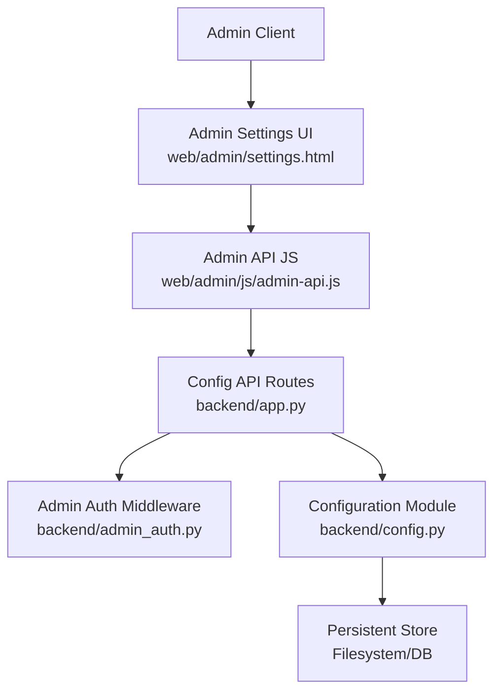
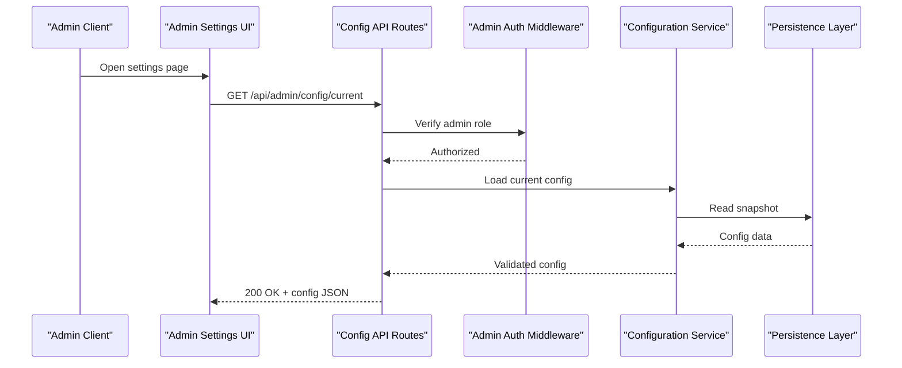
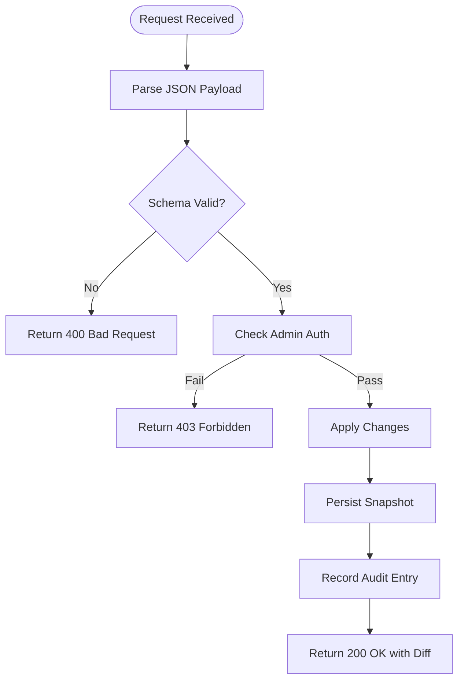
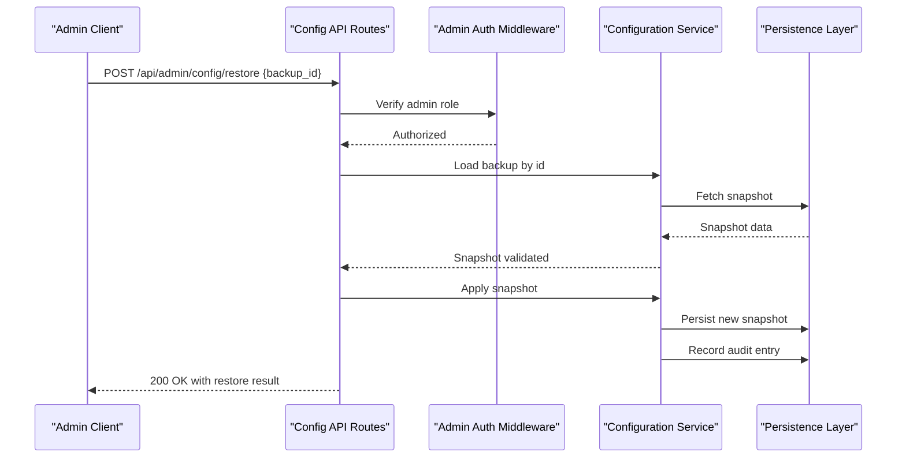
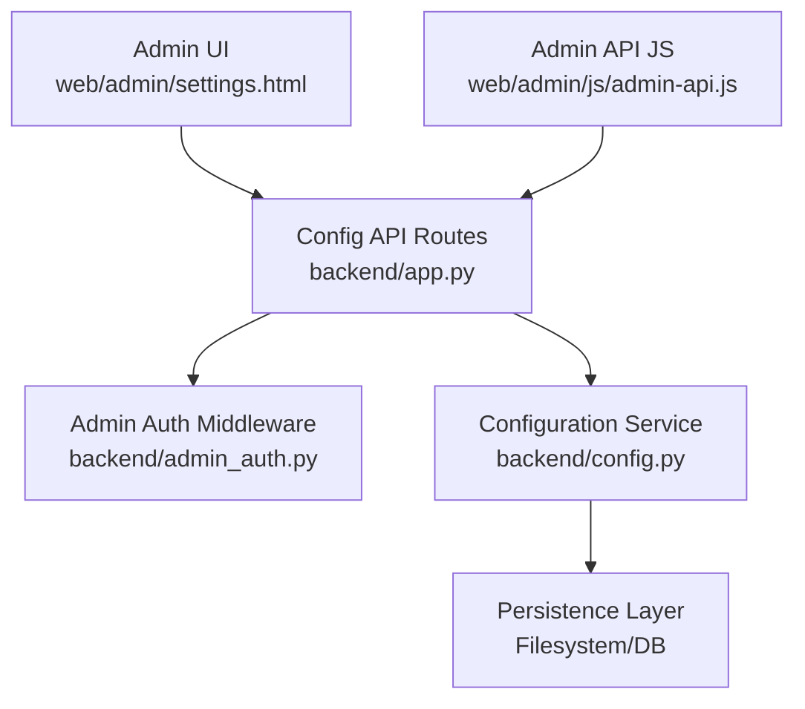

# Configuration Management API

<cite>
**Referenced Files in This Document**
- [config.py](file://backend/config.py)
- [app.py](file://backend/app.py)
- [admin_auth.py](file://backend/admin_auth.py)
- [test_config.py](file://backend/tests/test_config.py)
- [settings.html](file://web/admin/settings.html)
- [admin-api.js](file://web/admin/js/admin-api.js)
</cite>

## Table of Contents
1. [Introduction](#introduction)
2. [Project Structure](#project-structure)
3. [Core Components](#core-components)
4. [Architecture Overview](#architecture-overview)
5. [Detailed Component Analysis](#detailed-component-analysis)
6. [Dependency Analysis](#dependency-analysis)
7. [Performance Considerations](#performance-considerations)
8. [Troubleshooting Guide](#troubleshooting-guide)
9. [Conclusion](#conclusion)
10. [Appendices](#appendices)

## Introduction
This document specifies the configuration management API endpoints for system administration. It covers application settings, AI model parameters, database connections, and feature flags under the /api/admin/config/* namespace. It defines HTTP methods, URL patterns, request/response schemas, validation rules, environment-specific behavior, runtime updates, backup/restore operations, auditing, and rollback capabilities. The goal is to enable safe, auditable, and reversible configuration changes across environments.

## Project Structure
The configuration management functionality spans backend modules that expose admin APIs, authentication middleware, and a web-based admin interface for managing settings. Key areas include:
- Backend configuration module for loading, validating, and serving configuration
- Admin authentication middleware to protect configuration endpoints
- API routes for configuration retrieval, update, validation, backup, and restore
- Frontend admin UI for interactive configuration editing and operations

**Diagram sources**
- [app.py](file://backend/app.py)
- [admin_auth.py](file://backend/admin_auth.py)
- [config.py](file://backend/config.py)
- [settings.html](file://web/admin/settings.html)
- [admin-api.js](file://web/admin/js/admin-api.js)

**Section sources**
- [config.py](file://backend/config.py)
- [app.py](file://backend/app.py)
- [admin_auth.py](file://backend/admin_auth.py)
- [settings.html](file://web/admin/settings.html)
- [admin-api.js](file://web/admin/js/admin-api.js)

## Core Components
- Configuration Module: Centralizes loading, merging, validation, and serialization of configuration values (application settings, AI model parameters, database connections, feature flags).
- Admin Authentication: Enforces admin privileges for all configuration endpoints.
- API Routes: Expose REST endpoints for CRUD-like operations on configuration, plus validation, backup, and restore.
- Persistence Layer: Stores configuration snapshots and audit logs for rollback and auditing.
- Admin UI: Provides an interface to view, edit, validate, and manage configuration changes.

Key responsibilities:
- Provide read-only access to current configuration with environment context
- Allow privileged updates with validation and immediate or staged application
- Support backup creation and restore from backups
- Record change history and support rollback to previous versions

**Section sources**
- [config.py](file://backend/config.py)
- [admin_auth.py](file://backend/admin_auth.py)
- [app.py](file://backend/app.py)

## Architecture Overview
The configuration management API follows a layered architecture:
- Client layer: Admin UI and automated clients interact via HTTP
- API layer: Flask/FastAPI routes handle requests, enforce auth, and delegate to services
- Service layer: Configuration service validates inputs, applies changes, and persists state
- Storage layer: Filesystem or database stores configuration snapshots and audit logs

**Diagram sources**
- [app.py](file://backend/app.py)
- [admin_auth.py](file://backend/admin_auth.py)
- [config.py](file://backend/config.py)

## Detailed Component Analysis

### Configuration Retrieval
- Endpoint: GET /api/admin/config/current
- Purpose: Retrieve the current active configuration including application settings, AI model parameters, database connections, and feature flags.
- Request: No body; requires admin authentication.
- Response: JSON object containing configuration sections with metadata such as last updated timestamp and environment context.
- Validation: Server-side schema validation ensures required fields are present and types are correct.
- Error handling: Returns 401 if unauthorized, 500 on internal errors.

Example response structure:
- application: { name, version, debug }
- ai_models: { provider, api_key_masked, timeout, max_tokens }
- database: { host, port, name, pool_size }
- feature_flags: { enable_xxx, disable_yyy }

**Section sources**
- [app.py](file://backend/app.py)
- [config.py](file://backend/config.py)
- [admin_auth.py](file://backend/admin_auth.py)

### Configuration Update
- Endpoint: PUT /api/admin/config/update
- Purpose: Apply runtime configuration changes with validation and optional staging.
- Request: JSON payload specifying target sections and new values. Supports partial updates.
- Response: Confirmation with diff summary and status (applied immediately or staged).
- Validation: Strict schema checks, type coercion, and cross-field constraints.
- Error handling: Returns 400 for invalid payloads, 403 for insufficient permissions, 500 for failures.

Update flow:

**Diagram sources**
- [app.py](file://backend/app.py)
- [config.py](file://backend/config.py)

**Section sources**
- [app.py](file://backend/app.py)
- [config.py](file://backend/config.py)

### Configuration Validation
- Endpoint: POST /api/admin/config/validate
- Purpose: Validate proposed configuration changes without applying them.
- Request: JSON payload mirroring update format.
- Response: Validation results with field-level errors and warnings.
- Use cases: Pre-flight checks before deployment or batch updates.

Validation result structure:
- valid: boolean
- errors: array of field paths and messages
- warnings: array of advisory notes

**Section sources**
- [app.py](file://backend/app.py)
- [config.py](file://backend/config.py)

### Backup Operations
- Create Backup:
  - Endpoint: POST /api/admin/config/backup
  - Purpose: Create a named snapshot of the current configuration.
  - Request: Optional name and description.
  - Response: Backup ID and metadata.
- List Backups:
  - Endpoint: GET /api/admin/config/backups
  - Purpose: Enumerate available backups with timestamps and labels.
  - Response: Array of backup entries.
- Delete Backup:
  - Endpoint: DELETE /api/admin/config/backups/{id}
  - Purpose: Remove a specific backup.
  - Response: Confirmation.

Backup storage:
- Snapshots stored in persistent store with metadata and checksums.
- Retention policies may apply based on environment.

**Section sources**
- [app.py](file://backend/app.py)
- [config.py](file://backend/config.py)

### Restore Operations
- Endpoint: POST /api/admin/config/restore
- Purpose: Roll back to a specified backup snapshot.
- Request: Backup ID and optional confirmation flag.
- Response: Status indicating success or failure with details.
- Safety: Requires explicit confirmation for destructive restores.

Restore flow:

**Diagram sources**
- [app.py](file://backend/app.py)
- [admin_auth.py](file://backend/admin_auth.py)
- [config.py](file://backend/config.py)

**Section sources**
- [app.py](file://backend/app.py)
- [config.py](file://backend/config.py)

### Auditing and Rollback
- Audit Log:
  - All configuration changes are recorded with actor, timestamp, action, and diff.
  - Logs are queryable via admin endpoints or exported for compliance.
- Rollback:
  - Supported through restore endpoint using backup IDs.
  - Automated rollback triggers can be configured based on health checks.

Audit entry structure:
- id: unique identifier
- actor: user or system
- action: create, update, restore, delete
- timestamp: ISO 8601
- diff: structured change summary

**Section sources**
- [config.py](file://backend/config.py)
- [app.py](file://backend/app.py)

### Environment-Specific Settings
- Environment Context:
  - Configuration includes environment tags (development, staging, production).
  - Overrides allowed per environment with precedence rules.
- Runtime Behavior:
  - Some settings apply immediately; others require restart or reload.
  - Feature flags can toggle behaviors at runtime without downtime.

Environment precedence:
- Base configuration -> Environment overrides -> Runtime overrides

**Section sources**
- [config.py](file://backend/config.py)

### Multi-Environment Management
- Strategy:
  - Maintain base configuration with environment-specific overlays.
  - Use naming conventions for backups per environment.
- Operations:
  - Validate against target environment schema.
  - Apply changes with environment context preserved.

**Section sources**
- [config.py](file://backend/config.py)

### Dynamic Configuration Updates
- Immediate vs Staged:
  - Certain parameters can be applied immediately (e.g., feature flags).
  - Others require staged application and service reload.
- Validation:
  - Pre-validation ensures compatibility before application.
- Examples:
  - Toggle debug mode in development.
  - Adjust AI model timeouts for load testing.

**Section sources**
- [config.py](file://backend/config.py)
- [app.py](file://backend/app.py)

### Configuration Validation Examples
- Schema Enforcement:
  - Required fields enforced with clear error messages.
  - Type coercion where safe (e.g., string to integer).
- Cross-Field Constraints:
  - Database connection parameters validated together.
  - AI model parameters checked for consistency.

**Section sources**
- [config.py](file://backend/config.py)

### Backup/Restore Examples
- Create Backup:
  - Name snapshots with descriptive labels.
  - Include metadata for traceability.
- Restore:
  - Select backup by ID.
  - Confirm destructive actions.

**Section sources**
- [config.py](file://backend/config.py)
- [app.py](file://backend/app.py)

### Admin Interface Integration
- UI Components:
  - Settings page displays current configuration.
  - Forms for updates with inline validation feedback.
- API Calls:
  - JavaScript client interacts with admin API endpoints.
  - Handles responses and updates UI accordingly.

**Section sources**
- [settings.html](file://web/admin/settings.html)
- [admin-api.js](file://web/admin/js/admin-api.js)

## Dependency Analysis
The configuration management system has clear dependencies:
- API routes depend on admin authentication middleware
- Configuration service depends on persistence layer for snapshots and audit logs
- Admin UI depends on API endpoints for data and operations

**Diagram sources**
- [app.py](file://backend/app.py)
- [admin_auth.py](file://backend/admin_auth.py)
- [config.py](file://backend/config.py)
- [settings.html](file://web/admin/settings.html)
- [admin-api.js](file://web/admin/js/admin-api.js)

**Section sources**
- [app.py](file://backend/app.py)
- [admin_auth.py](file://backend/admin_auth.py)
- [config.py](file://backend/config.py)

## Performance Considerations
- Caching:
  - Cache frequently accessed configuration to reduce I/O overhead.
  - Invalidate cache on updates or restores.
- Validation Efficiency:
  - Use incremental validation for large payloads.
  - Defer expensive checks until necessary.
- Concurrency:
  - Serialize configuration writes to prevent race conditions.
  - Use locks for critical sections during updates.

[No sources needed since this section provides general guidance]

## Troubleshooting Guide
Common issues and resolutions:
- Unauthorized Access:
  - Ensure admin credentials are valid and roles are correctly assigned.
- Validation Errors:
  - Review error messages for field-level issues.
  - Use validation endpoint to pre-check changes.
- Restore Failures:
  - Verify backup integrity and availability.
  - Check audit logs for context around failed operations.

**Section sources**
- [admin_auth.py](file://backend/admin_auth.py)
- [config.py](file://backend/config.py)
- [test_config.py](file://backend/tests/test_config.py)

## Conclusion
The configuration management API provides a robust, secure, and auditable way to manage system settings across environments. With comprehensive validation, backup/restore capabilities, and detailed auditing, it supports safe operational practices and rapid recovery from misconfigurations.

[No sources needed since this section summarizes without analyzing specific files]

## Appendices

### API Endpoints Summary
- GET /api/admin/config/current: Retrieve current configuration
- PUT /api/admin/config/update: Apply configuration changes
- POST /api/admin/config/validate: Validate proposed changes
- POST /api/admin/config/backup: Create configuration backup
- GET /api/admin/config/backups: List available backups
- DELETE /api/admin/config/backups/{id}: Delete a backup
- POST /api/admin/config/restore: Restore from backup

### Request/Response Schemas
- Current Configuration:
  - application: object with name, version, debug
  - ai_models: object with provider, api_key_masked, timeout, max_tokens
  - database: object with host, port, name, pool_size
  - feature_flags: object with boolean toggles
- Update Payload:
  - Partial updates supported with nested objects
  - Field-level validation errors returned
- Validation Result:
  - valid: boolean
  - errors: array of field paths and messages
  - warnings: array of advisory notes
- Backup Metadata:
  - id: unique identifier
  - name: descriptive label
  - timestamp: creation time
  - checksum: integrity verification

[No sources needed since this section provides general guidance]