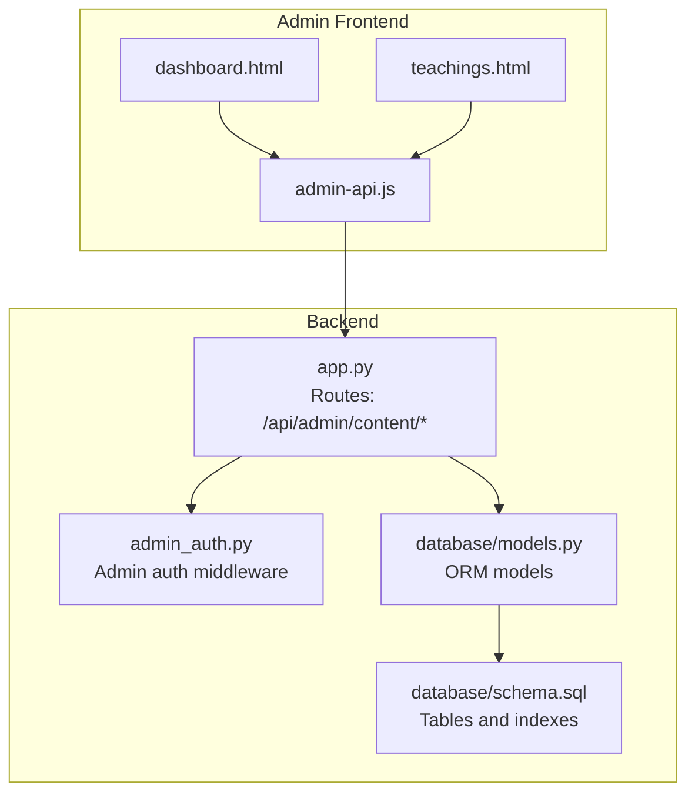
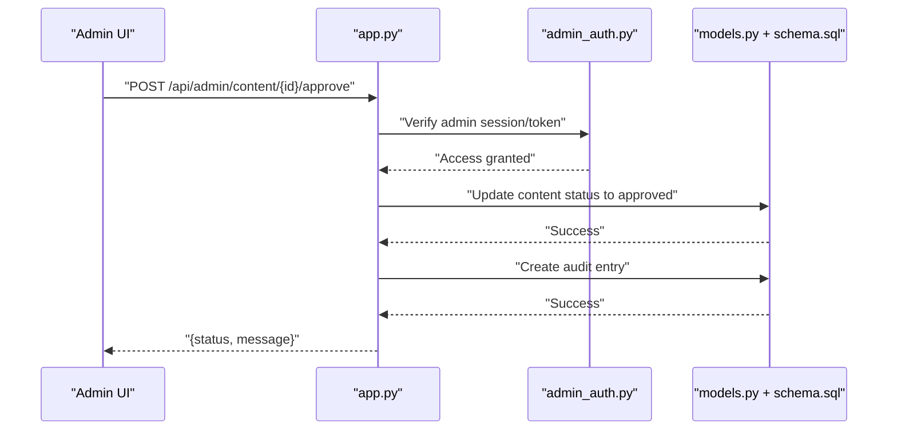
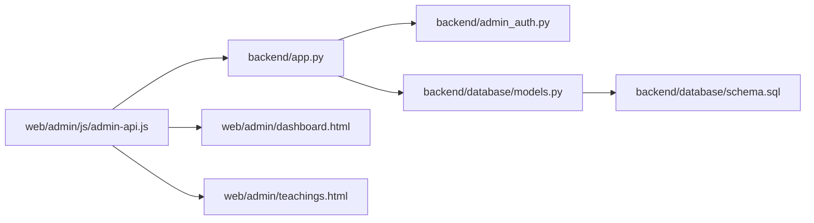

# Content Moderation API

<cite>
**Referenced Files in This Document**
- [app.py](file://backend/app.py)
- [admin_auth.py](file://backend/admin_auth.py)
- [database/models.py](file://backend/database/models.py)
- [database/schema.sql](file://backend/database/schema.sql)
- [web/admin/js/admin-api.js](file://web/admin/js/admin-api.js)
- [web/admin/dashboard.html](file://web/admin/dashboard.html)
- [web/admin/teachings.html](file://web/admin/teachings.html)
</cite>

## Table of Contents
1. [Introduction](#introduction)
2. [Project Structure](#project-structure)
3. [Core Components](#core-components)
4. [Architecture Overview](#architecture-overview)
5. [Detailed Component Analysis](#detailed-component-analysis)
6. [Dependency Analysis](#dependency-analysis)
7. [Performance Considerations](#performance-considerations)
8. [Troubleshooting Guide](#troubleshooting-guide)
9. [Conclusion](#conclusion)

## Introduction
This document specifies the content moderation API endpoints for reviewing, filtering, and managing content within the system. It focuses on approval workflows, automated moderation rules, quality assessment, bulk operations, metadata updates, versioning, rollback, and audit trails. The API is exposed under /api/admin/content/* and requires admin authentication.

## Project Structure
The backend exposes admin routes and integrates with a database schema that includes content entities and audit records. The frontend admin UI calls these endpoints to perform moderation tasks.

**Diagram sources**
- [app.py](file://backend/app.py)
- [admin_auth.py](file://backend/admin_auth.py)
- [database/models.py](file://backend/database/models.py)
- [database/schema.sql](file://backend/database/schema.sql)
- [web/admin/dashboard.html](file://web/admin/dashboard.html)
- [web/admin/teachings.html](file://web/admin/teachings.html)
- [web/admin/js/admin-api.js](file://web/admin/js/admin-api.js)

**Section sources**
- [app.py](file://backend/app.py)
- [admin_auth.py](file://backend/admin_auth.py)
- [database/models.py](file://backend/database/models.py)
- [database/schema.sql](file://backend/database/schema.sql)
- [web/admin/js/admin-api.js](file://web/admin/js/admin-api.js)
- [web/admin/dashboard.html](file://web/admin/dashboard.html)
- [web/admin/teachings.html](file://web/admin/teachings.html)

## Core Components
- Admin Authentication Middleware: Protects all /api/admin/content/* endpoints.
- Content Review Endpoints: Approval/rejection, status transitions, and metadata updates.
- Bulk Operations: Batch approve/reject and mass metadata updates.
- Search and Filtering: Query by status, tags, author, date ranges, and text search.
- Versioning and Rollback: Create versions, list versions, and revert to a previous version.
- Audit Trail: Immutable log of moderation actions and metadata changes.

Key responsibilities:
- Validate requests and enforce admin permissions.
- Persist state changes and create audit entries.
- Return consistent JSON responses with pagination and error details.

**Section sources**
- [admin_auth.py](file://backend/admin_auth.py)
- [app.py](file://backend/app.py)
- [database/models.py](file://backend/database/models.py)
- [database/schema.sql](file://backend/database/schema.sql)

## Architecture Overview
The moderation workflow involves the admin client invoking protected endpoints. The server validates access, applies business logic (approval, filtering, versioning), persists changes, and writes audit records.

**Diagram sources**
- [app.py](file://backend/app.py)
- [admin_auth.py](file://backend/admin_auth.py)
- [database/models.py](file://backend/database/models.py)
- [database/schema.sql](file://backend/database/schema.sql)

## Detailed Component Analysis

### Authentication and Access Control
- All /api/admin/content/* endpoints require admin authentication via the middleware.
- Unauthorized or forbidden requests return appropriate HTTP errors.

**Section sources**
- [admin_auth.py](file://backend/admin_auth.py)
- [app.py](file://backend/app.py)

### Content Review Endpoints

#### Approve Content
- Method: POST
- URL: /api/admin/content/{id}/approve
- Request body: optional reason string
- Response: updated content object with new status and audit reference

Behavior:
- Validates admin permission.
- Transitions content status to approved.
- Creates an audit record for the action.

**Section sources**
- [app.py](file://backend/app.py)
- [database/models.py](file://backend/database/models.py)
- [database/schema.sql](file://backend/database/schema.sql)

#### Reject Content
- Method: POST
- URL: /api/admin/content/{id}/reject
- Request body: required reason string
- Response: updated content object with rejected status and audit reference

Behavior:
- Validates admin permission.
- Transitions content status to rejected.
- Creates an audit record for the action.

**Section sources**
- [app.py](file://backend/app.py)
- [database/models.py](file://backend/database/models.py)
- [database/schema.sql](file://backend/database/schema.sql)

#### Update Metadata
- Method: PATCH
- URL: /api/admin/content/{id}/metadata
- Request body: partial metadata fields to update
- Response: updated metadata snapshot

Behavior:
- Validates admin permission.
- Applies allowed metadata updates.
- Records change in audit trail.

**Section sources**
- [app.py](file://backend/app.py)
- [database/models.py](file://backend/database/models.py)
- [database/schema.sql](file://backend/database/schema.sql)

#### List and Filter Content
- Method: GET
- URL: /api/admin/content
- Query parameters:
  - status: pending|approved|rejected
  - tag: string
  - author_id: string
  - created_after: ISO-8601
  - created_before: ISO-8601
  - q: free-text search
  - page: integer
  - per_page: integer
- Response: paginated list of content items

Behavior:
- Applies filters and full-text search where supported.
- Returns results with pagination metadata.

**Section sources**
- [app.py](file://backend/app.py)
- [database/models.py](file://backend/database/models.py)
- [database/schema.sql](file://backend/database/schema.sql)

#### Get Content Detail
- Method: GET
- URL: /api/admin/content/{id}
- Response: full content detail including current status and latest metadata

**Section sources**
- [app.py](file://backend/app.py)
- [database/models.py](file://backend/database/models.py)
- [database/schema.sql](file://backend/database/schema.sql)

### Bulk Operations

#### Bulk Approve
- Method: POST
- URL: /api/admin/content/bulk/approve
- Request body: array of content IDs
- Response: summary of successes and failures

Behavior:
- Validates admin permission.
- Updates statuses in batch.
- Creates multiple audit entries.

**Section sources**
- [app.py](file://backend/app.py)
- [database/models.py](file://backend/database/models.py)
- [database/schema.sql](file://backend/database/schema.sql)

#### Bulk Reject
- Method: POST
- URL: /api/admin/content/bulk/reject
- Request body: array of content IDs and optional reason
- Response: summary of successes and failures

**Section sources**
- [app.py](file://backend/app.py)
- [database/models.py](file://backend/database/models.py)
- [database/schema.sql](file://backend/database/schema.sql)

#### Bulk Metadata Update
- Method: PATCH
- URL: /api/admin/content/bulk/metadata
- Request body: array of {id, metadata_updates}
- Response: summary of successes and failures

**Section sources**
- [app.py](file://backend/app.py)
- [database/models.py](file://backend/database/models.py)
- [database/schema.sql](file://backend/database/schema.sql)

### Automated Moderation Rules and Quality Assessment
- Rule engine triggers can be invoked to re-evaluate content based on configured policies.
- Quality scores and flags are stored in metadata and reflected in listing/filtering.

Typical flow:
- Trigger rule evaluation.
- Apply scoring and classification.
- Optionally auto-transition status if policy allows.
- Record audit entry for automated decisions.

**Section sources**
- [app.py](file://backend/app.py)
- [database/models.py](file://backend/database/models.py)
- [database/schema.sql](file://backend/database/schema.sql)

### Content Versioning and Rollback

#### Create Version
- Method: POST
- URL: /api/admin/content/{id}/version
- Request body: optional label and description
- Response: new version identifier and snapshot reference

Behavior:
- Captures current content and metadata snapshot.
- Assigns version number.
- Records audit entry.

**Section sources**
- [app.py](file://backend/app.py)
- [database/models.py](file://backend/database/models.py)
- [database/schema.sql](file://backend/database/schema.sql)

#### List Versions
- Method: GET
- URL: /api/admin/content/{id}/versions
- Response: ordered list of versions with labels and timestamps

**Section sources**
- [app.py](file://backend/app.py)
- [database/models.py](file://backend/database/models.py)
- [database/schema.sql](file://backend/database/schema.sql)

#### Revert to Version
- Method: POST
- URL: /api/admin/content/{id}/revert
- Request body: version_id
- Response: updated content reflecting reverted state

Behavior:
- Restores content and metadata from specified version.
- Creates new version snapshot post-revert.
- Records audit entry.

**Section sources**
- [app.py](file://backend/app.py)
- [database/models.py](file://backend/database/models.py)
- [database/schema.sql](file://backend/database/schema.sql)

### Audit Trail

#### List Audit Entries
- Method: GET
- URL: /api/admin/content/{id}/audit
- Query parameters:
  - actor_id: string
  - action: approve|reject|metadata_update|version_create|revert
  - after: ISO-8601
  - before: ISO-8601
  - page: integer
  - per_page: integer
- Response: paginated audit entries

Behavior:
- Immutable log of moderation actions and metadata changes.
- Supports filtering by actor, action type, and time range.

**Section sources**
- [app.py](file://backend/app.py)
- [database/models.py](file://backend/database/models.py)
- [database/schema.sql](file://backend/database/schema.sql)

### Example Workflows

#### Manual Approval Workflow
- Admin reviews content detail.
- Calls approve endpoint with optional reason.
- System updates status and logs audit entry.
- Admin verifies via list and audit endpoints.

#### Automated Moderation with Human-in-the-Loop
- Rule engine evaluates content and sets quality score.
- If below threshold, content remains pending.
- Admin reviews flagged items and approves/rejects.
- Audit captures both automated and manual decisions.

#### Bulk Cleanup
- Admin selects pending items by filter.
- Uses bulk approve or reject to process many items.
- Reviews summary response and audit entries.

[No sources needed since this section provides conceptual examples]

## Dependency Analysis
The moderation API depends on admin authentication, ORM models, and the database schema. The admin UI consumes the API through JavaScript helpers.

**Diagram sources**
- [web/admin/js/admin-api.js](file://web/admin/js/admin-api.js)
- [app.py](file://backend/app.py)
- [admin_auth.py](file://backend/admin_auth.py)
- [database/models.py](file://backend/database/models.py)
- [database/schema.sql](file://backend/database/schema.sql)
- [web/admin/dashboard.html](file://web/admin/dashboard.html)
- [web/admin/teachings.html](file://web/admin/teachings.html)

**Section sources**
- [web/admin/js/admin-api.js](file://web/admin/js/admin-api.js)
- [app.py](file://backend/app.py)
- [admin_auth.py](file://backend/admin_auth.py)
- [database/models.py](file://backend/database/models.py)
- [database/schema.sql](file://backend/database/schema.sql)
- [web/admin/dashboard.html](file://web/admin/dashboard.html)
- [web/admin/teachings.html](file://web/admin/teachings.html)

## Performance Considerations
- Use pagination for list endpoints to avoid large payloads.
- Index frequently filtered columns (status, author_id, created_at).
- Prefer targeted metadata updates to minimize write amplification.
- Batch operations should be transactional and idempotent where possible.
- Cache frequent read-only queries behind short-lived caches when appropriate.

[No sources needed since this section provides general guidance]

## Troubleshooting Guide
Common issues and resolutions:
- 401/403 errors: Ensure admin session/token is valid and has sufficient privileges.
- Validation errors: Check request bodies for required fields and correct types.
- Duplicate operations: Implement idempotency keys for bulk operations to prevent double-processing.
- Audit gaps: Verify audit logging is enabled and database writes succeed.

**Section sources**
- [admin_auth.py](file://backend/admin_auth.py)
- [app.py](file://backend/app.py)
- [database/models.py](file://backend/database/models.py)
- [database/schema.sql](file://backend/database/schema.sql)

## Conclusion
The content moderation API provides comprehensive tools for approving, rejecting, filtering, and managing content at scale. With robust versioning, rollback, and audit capabilities, it supports both manual review and automated moderation strategies while maintaining transparency and traceability.