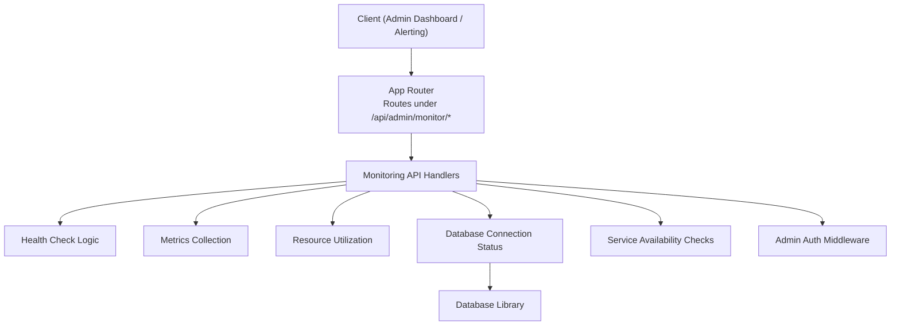
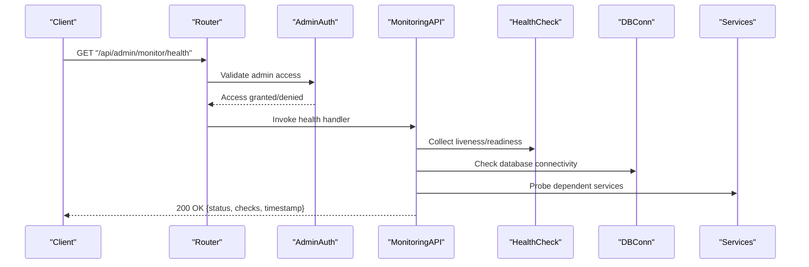
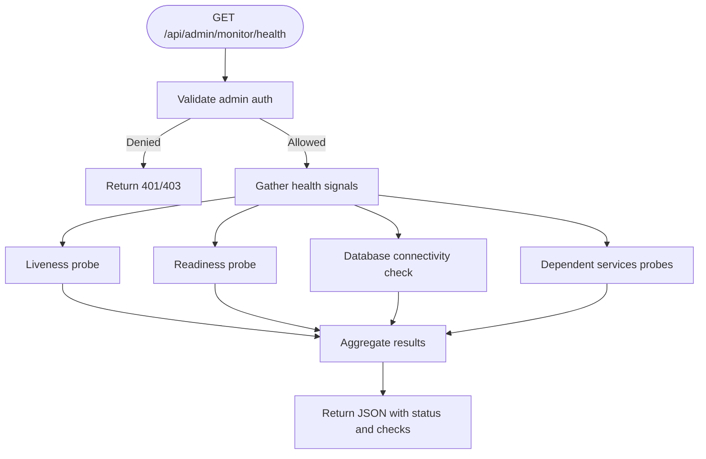
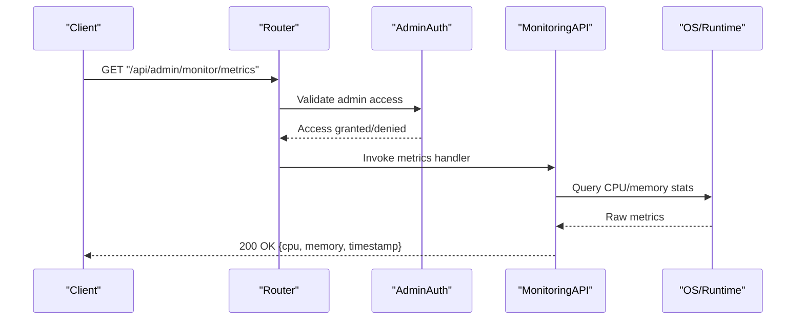
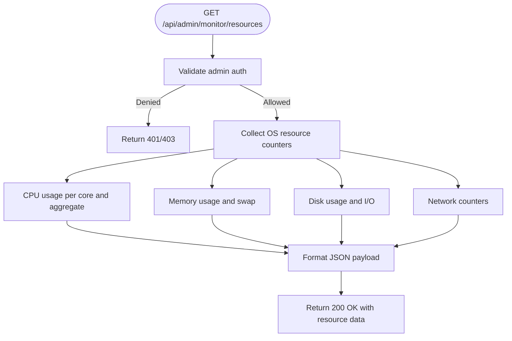
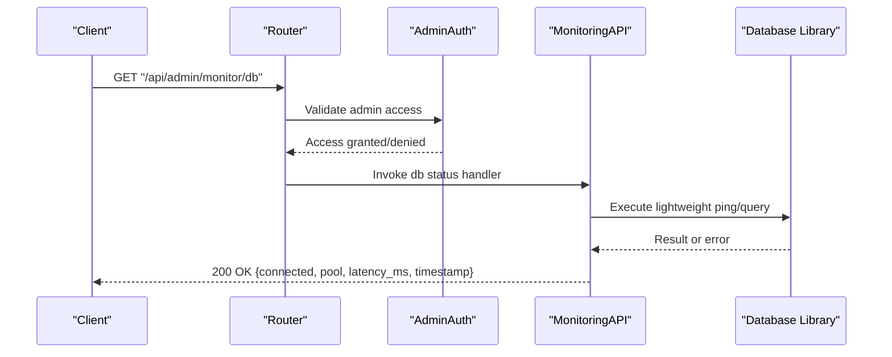
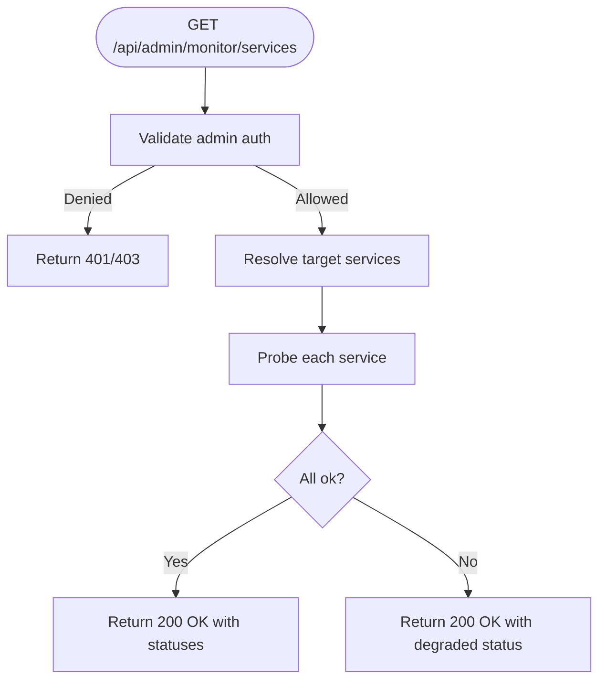
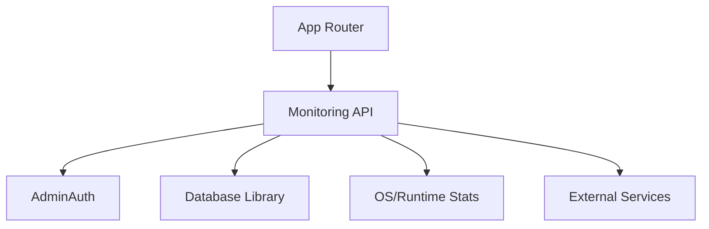

# System Monitoring API

<cite>
**Referenced Files in This Document**
- [app.py](file://backend/app.py)
- [monitoring.py](file://backend/monitoring.py)
- [database.py](file://backend/database/database.py)
- [admin_auth.py](file://backend/admin_auth.py)
- [test_api_health.py](file://backend/tests/integration/test_api_health.py)
</cite>

## Table of Contents
1. [Introduction](#introduction)
2. [Project Structure](#project-structure)
3. [Core Components](#core-components)
4. [Architecture Overview](#architecture-overview)
5. [Detailed Component Analysis](#detailed-component-analysis)
6. [Dependency Analysis](#dependency-analysis)
7. [Performance Considerations](#performance-considerations)
8. [Troubleshooting Guide](#troubleshooting-guide)
9. [Conclusion](#conclusion)
10. [Appendices](#appendices)

## Introduction
This document describes the system monitoring API endpoints for health checks, performance metrics collection, resource utilization monitoring, and system status reporting. It focuses on the /api/admin/monitor/* namespace, detailing HTTP methods, URL patterns, request/response schemas, and operational considerations such as rate limiting, data retention, and performance impact. It also provides examples for real-time monitoring integration, alerting configuration, and dashboard data fetching.

## Project Structure
The monitoring functionality is implemented within the backend application and exposed via admin-scoped routes. Key files include:
- Application entrypoint and route registration
- Monitoring module providing metrics and health logic
- Database connectivity utilities used by health checks
- Admin authentication middleware protecting monitoring endpoints
- Integration tests validating health endpoint behavior

**Diagram sources**
- [app.py](file://backend/app.py)
- [monitoring.py](file://backend/monitoring.py)
- [database.py](file://backend/database/database.py)
- [admin_auth.py](file://backend/admin_auth.py)

**Section sources**
- [app.py](file://backend/app.py)
- [monitoring.py](file://backend/monitoring.py)
- [database.py](file://backend/database/database.py)
- [admin_auth.py](file://backend/admin_auth.py)

## Core Components
- Monitoring API handlers: Provide endpoints for health, metrics, resources, database status, and service availability.
- Health check logic: Aggregates liveness/readiness signals from subsystems.
- Metrics collection: Gathers CPU/memory usage and other runtime indicators.
- Resource utilization: Reports process-level resource consumption.
- Database connection status: Validates connectivity and reports pool/connection state.
- Service availability checks: Probes dependent services or internal components.
- Admin authentication: Protects monitoring endpoints with admin-only access.

Operational notes:
- Endpoints are scoped under /api/admin/monitor/.
- Responses are JSON objects containing structured status and metric data.
- Some endpoints may require admin credentials enforced by middleware.

**Section sources**
- [monitoring.py](file://backend/monitoring.py)
- [admin_auth.py](file://backend/admin_auth.py)
- [database.py](file://backend/database/database.py)

## Architecture Overview
The monitoring API follows a layered design:
- HTTP layer: Routes handle requests under /api/admin/monitor/*.
- Business logic layer: Monitoring handlers orchestrate data gathering.
- Infrastructure layer: Database library and OS/runtime interfaces provide raw metrics and connectivity checks.

**Diagram sources**
- [app.py](file://backend/app.py)
- [monitoring.py](file://backend/monitoring.py)
- [admin_auth.py](file://backend/admin_auth.py)
- [database.py](file://backend/database/database.py)

## Detailed Component Analysis

### Health Check Endpoint
- Method: GET
- Path: /api/admin/monitor/health
- Authentication: Admin required
- Purpose: Aggregate system health including liveness, readiness, database connectivity, and dependent services.
- Request: None (query parameters optional for extended checks if supported).
- Response schema:
  - status: string ("healthy", "degraded", "unhealthy")
  - checks: object mapping component names to sub-statuses
  - timestamp: ISO 8601 time string
  - details: object with additional diagnostics (optional)
- Example response fields:
  - checks.liveness: "ok" | "fail"
  - checks.readiness: "ok" | "fail"
  - checks.database: "connected" | "disconnected"
  - checks.services.<name>: "ok" | "fail"

**Diagram sources**
- [monitoring.py](file://backend/monitoring.py)
- [admin_auth.py](file://backend/admin_auth.py)
- [database.py](file://backend/database/database.py)

**Section sources**
- [monitoring.py](file://backend/monitoring.py)
- [admin_auth.py](file://backend/admin_auth.py)
- [database.py](file://backend/database/database.py)
- [test_api_health.py](file://backend/tests/integration/test_api_health.py)

### Performance Metrics Endpoint
- Method: GET
- Path: /api/admin/monitor/metrics
- Authentication: Admin required
- Purpose: Return current performance metrics including CPU and memory usage.
- Request: Optional query parameters for aggregation window or granularity if supported.
- Response schema:
  - cpu: object with usage percentage(s)
  - memory: object with usage and total values
  - timestamp: ISO 8601 time string
  - runtime: object with process uptime and thread count (optional)

Example fields:
  - cpu.usage_percent: number
  - memory.used_bytes: number
  - memory.total_bytes: number

**Diagram sources**
- [monitoring.py](file://backend/monitoring.py)
- [admin_auth.py](file://backend/admin_auth.py)

**Section sources**
- [monitoring.py](file://backend/monitoring.py)
- [admin_auth.py](file://backend/admin_auth.py)

### Resource Utilization Endpoint
- Method: GET
- Path: /api/admin/monitor/resources
- Authentication: Admin required
- Purpose: Provide detailed resource utilization including CPU cores, memory, disk I/O, and network counters.
- Request: None (optional filters if supported).
- Response schema:
  - cpu: object with per-core usage and overall usage
  - memory: object with used/free/total and swap info (if available)
  - disk: object with usage percentages and I/O counters
  - network: object with bytes sent/received
  - timestamp: ISO 8601 time string

**Diagram sources**
- [monitoring.py](file://backend/monitoring.py)
- [admin_auth.py](file://backend/admin_auth.py)

**Section sources**
- [monitoring.py](file://backend/monitoring.py)
- [admin_auth.py](file://backend/admin_auth.py)

### Database Connection Status Endpoint
- Method: GET
- Path: /api/admin/monitor/db
- Authentication: Admin required
- Purpose: Report database connectivity and connection pool status.
- Request: None.
- Response schema:
  - connected: boolean
  - pool: object with active/idle/max connections (if applicable)
  - latency_ms: number (round-trip time for a lightweight query)
  - error: string (present when not connected)
  - timestamp: ISO 8601 time string

**Diagram sources**
- [monitoring.py](file://backend/monitoring.py)
- [admin_auth.py](file://backend/admin_auth.py)
- [database.py](file://backend/database/database.py)

**Section sources**
- [monitoring.py](file://backend/monitoring.py)
- [admin_auth.py](file://backend/admin_auth.py)
- [database.py](file://backend/database/database.py)

### Service Availability Endpoint
- Method: GET
- Path: /api/admin/monitor/services
- Authentication: Admin required
- Purpose: Check availability of dependent services or internal components.
- Request: Optional query parameter to specify which services to probe.
- Response schema:
  - services: object mapping service names to status ("ok", "fail", "timeout")
  - last_check: ISO 8601 time string
  - errors: object mapping service names to error messages (optional)

**Diagram sources**
- [monitoring.py](file://backend/monitoring.py)
- [admin_auth.py](file://backend/admin_auth.py)

**Section sources**
- [monitoring.py](file://backend/monitoring.py)
- [admin_auth.py](file://backend/admin_auth.py)

## Dependency Analysis
The monitoring API depends on:
- Admin authentication middleware to restrict access.
- Database library for connectivity checks.
- OS/runtime interfaces for CPU/memory/resource metrics.
- Optional external service clients for availability probing.

**Diagram sources**
- [app.py](file://backend/app.py)
- [monitoring.py](file://backend/monitoring.py)
- [admin_auth.py](file://backend/admin_auth.py)
- [database.py](file://backend/database/database.py)

**Section sources**
- [app.py](file://backend/app.py)
- [monitoring.py](file://backend/monitoring.py)
- [admin_auth.py](file://backend/admin_auth.py)
- [database.py](file://backend/database/database.py)

## Performance Considerations
- Rate limiting: Apply strict rate limits to monitoring endpoints to prevent overload. Recommended baseline:
  - /api/admin/monitor/health: 10 requests per minute per client IP
  - /api/admin/monitor/metrics: 5 requests per minute per client IP
  - /api/admin/monitor/resources: 5 requests per minute per client IP
  - /api/admin/monitor/db: 10 requests per minute per client IP
  - /api/admin/monitor/services: 5 requests per minute per client IP
- Data retention: Keep only recent snapshots in memory; persist aggregated metrics externally if needed.
- Impact minimization: Avoid heavy computations inside handlers; use lazy evaluation and caching where appropriate.
- Concurrency: Ensure handlers are non-blocking and do not hold long-running locks.

[No sources needed since this section provides general guidance]

## Troubleshooting Guide
Common issues and resolutions:
- Authentication failures: Verify admin credentials and token validity.
- Database connectivity errors: Inspect connection strings, pool settings, and network reachability.
- High latency on metrics: Reduce sampling frequency or offload metrics collection to background tasks.
- Service probes failing: Confirm upstream service health and adjust timeouts/retries.

Validation references:
- Health endpoint behavior validated by integration tests.

**Section sources**
- [test_api_health.py](file://backend/tests/integration/test_api_health.py)

## Conclusion
The system monitoring API provides essential observability into application health, performance, resources, database connectivity, and service availability. By enforcing admin-only access, applying rate limits, and minimizing overhead, these endpoints enable reliable real-time monitoring, alerting, and dashboard integration.

[No sources needed since this section summarizes without analyzing specific files]

## Appendices

### Real-Time Monitoring Integration Examples
- Polling: Periodically call /api/admin/monitor/health and /api/admin/monitor/metrics at safe intervals respecting rate limits.
- Streaming: If supported, subscribe to server-sent events or WebSocket channels for live updates.
- Alerting: Configure thresholds on CPU usage, memory pressure, and database latency to trigger alerts.

### Dashboard Data Fetching
- Aggregate responses from /api/admin/monitor/resources and /api/admin/monitor/metrics to render graphs.
- Use timestamps to align data across endpoints and compute trends.

### Alerting Configuration
- Define rules based on:
  - CPU usage percent exceeding threshold
  - Memory usage approaching total capacity
  - Database latency above acceptable bounds
  - Service availability failures

[No sources needed since this section provides general guidance]