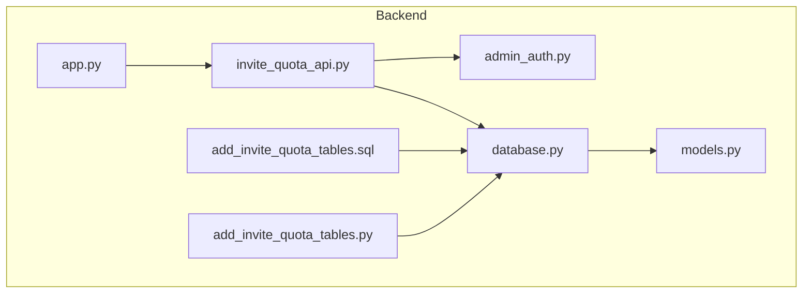
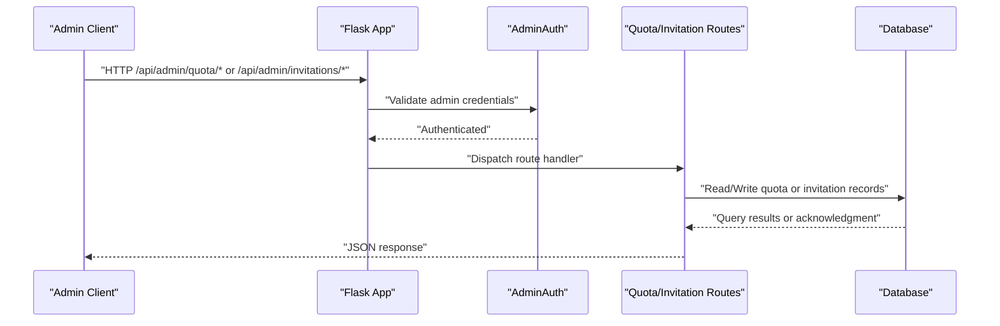
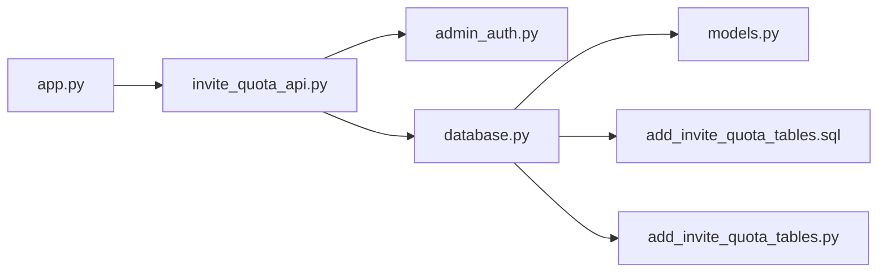

# Quota & Invitation System

<cite>
**Referenced Files in This Document**
- [invite_quota_api.py](file://backend/invite_quota_api.py)
- [add_invite_quota_tables.py](file://backend/database/add_invite_quota_tables.py)
- [add_invite_quota_tables.sql](file://backend/database/add_invite_quota_tables.sql)
- [app.py](file://backend/app.py)
- [admin_auth.py](file://backend/admin_auth.py)
- [database.py](file://backend/database/database.py)
- [models.py](file://backend/database/models.py)
</cite>

## Table of Contents
1. [Introduction](#introduction)
2. [Project Structure](#project-structure)
3. [Core Components](#core-components)
4. [Architecture Overview](#architecture-overview)
5. [Detailed Component Analysis](#detailed-component-analysis)
6. [Dependency Analysis](#dependency-analysis)
7. [Performance Considerations](#performance-considerations)
8. [Troubleshooting Guide](#troubleshooting-guide)
9. [Conclusion](#conclusion)

## Introduction
This document describes the user quota and invitation system APIs exposed under /api/admin/quota/* and /api/admin/invitations/*. It covers:
- Quota management endpoints for allocation, updates, and usage monitoring
- Invitation code generation with expiration settings
- Request/response schemas for quota operations and invitation creation
- Examples for setting up quotas, generating invitations, and monitoring consumption
- Enforcement mechanisms for quotas and validation processes for invitations

The system is implemented as a Flask backend with database-backed storage for quotas and invitations.

## Project Structure
The relevant implementation resides primarily in the backend module:
- API routes for quota and invitations are defined in invite_quota_api.py
- Database schema and migration scripts for quota and invitation tables are in add_invite_quota_tables.sql and add_invite_quota_tables.py
- Application wiring and admin authentication middleware are in app.py and admin_auth.py
- Database connection and ORM models are in database.py and models.py

**Diagram sources**
- [app.py](file://backend/app.py)
- [invite_quota_api.py](file://backend/invite_quota_api.py)
- [admin_auth.py](file://backend/admin_auth.py)
- [database.py](file://backend/database/database.py)
- [models.py](file://backend/database/models.py)
- [add_invite_quota_tables.sql](file://backend/database/add_invite_quota_tables.sql)
- [add_invite_quota_tables.py](file://backend/database/add_invite_quota_tables.py)

**Section sources**
- [invite_quota_api.py](file://backend/invite_quota_api.py)
- [add_invite_quota_tables.sql](file://backend/database/add_invite_quota_tables.sql)
- [add_invite_quota_tables.py](file://backend/database/add_invite_quota_tables.py)
- [app.py](file://backend/app.py)
- [admin_auth.py](file://backend/admin_auth.py)
- [database.py](file://backend/database/database.py)
- [models.py](file://backend/database/models.py)

## Core Components
- Quota Management API: Endpoints to allocate, update, and query user quotas and usage metrics.
- Invitation Code API: Endpoints to generate invitation codes with optional expiration and metadata.
- Admin Authentication Middleware: Protects admin routes using admin credentials or tokens.
- Data Layer: SQL schema and Python migration utilities to create and maintain quota and invitation tables.

Key responsibilities:
- Validate request payloads and enforce business rules (e.g., non-negative values, valid date ranges).
- Persist quota allocations and invitation records.
- Track usage counters and provide monitoring endpoints.
- Enforce quota limits at service boundaries before processing resource-intensive operations.

**Section sources**
- [invite_quota_api.py](file://backend/invite_quota_api.py)
- [admin_auth.py](file://backend/admin_auth.py)
- [add_invite_quota_tables.sql](file://backend/database/add_invite_quota_tables.sql)
- [add_invite_quota_tables.py](file://backend/database/add_invite_quota_tables.py)

## Architecture Overview
High-level flow for quota and invitation operations:
- Client sends an authenticated admin request to /api/admin/quota/* or /api/admin/invitations/*.
- Admin auth middleware validates the request.
- Route handlers parse and validate inputs, then call data layer functions.
- Data layer executes SQL queries against the database.
- Responses include structured JSON with success status, data, and error details when applicable.

**Diagram sources**
- [app.py](file://backend/app.py)
- [admin_auth.py](file://backend/admin_auth.py)
- [invite_quota_api.py](file://backend/invite_quota_api.py)
- [database.py](file://backend/database/database.py)

## Detailed Component Analysis

### Quota Management API (/api/admin/quota/*)
Endpoints overview:
- Allocate or update quota for a user
- Query current quota and usage
- Reset or adjust usage counters
- List quota summaries across users

Request/response patterns:
- Allocation request includes user identifier, quota amount, and optional period or type.
- Response includes updated quota fields, effective dates, and status.
- Usage monitoring returns current usage counters and remaining allowance.

Example flows:
- Set up user quotas: POST to allocate initial quota with a start date and limit.
- Adjust quota mid-cycle: PATCH to increase or decrease remaining allowance.
- Monitor consumption: GET to retrieve usage metrics and thresholds.

Enforcement mechanism:
- Before executing resource-heavy operations, services check the user’s remaining quota via the quota API.
- If usage would exceed the allocated limit, the operation is rejected with a quota exceeded response.

Notes:
- All quota endpoints require admin authentication.
- Input validation ensures non-negative amounts and valid date ranges.

**Section sources**
- [invite_quota_api.py](file://backend/invite_quota_api.py)
- [admin_auth.py](file://backend/admin_auth.py)
- [add_invite_quota_tables.sql](file://backend/database/add_invite_quota_tables.sql)

### Invitation Code API (/api/admin/invitations/*)
Endpoints overview:
- Generate invitation codes with optional expiration and metadata
- Validate an invitation code
- Revoke or deactivate an invitation code
- List or search invitations by criteria

Request/response patterns:
- Generation request includes code length, expiration time, and optional attributes (e.g., allowed features, max uses).
- Response includes generated code(s), expiration timestamp, and status.
- Validation request includes the code; response indicates validity and associated permissions.

Example flows:
- Generate single-use code with 7-day expiration: POST with expiration and constraints.
- Validate code during onboarding: POST to verify and apply benefits if valid.
- Revoke code after misuse: PATCH to mark invalid.

Validation process:
- Check existence and active status of the code.
- Verify expiration timestamp.
- Confirm any usage limits have not been exceeded.
- Return detailed validity result and associated metadata.

**Section sources**
- [invite_quota_api.py](file://backend/invite_quota_api.py)
- [admin_auth.py](file://backend/admin_auth.py)
- [add_invite_quota_tables.sql](file://backend/database/add_invite_quota_tables.sql)

### Data Model and Schema
Schema highlights:
- Quota table stores per-user allocations, usage counters, effective periods, and status flags.
- Invitation table stores generated codes, expiration timestamps, usage counts, and metadata.

Migration utilities:
- Python script applies SQL migrations to create or update tables.
- SQL file defines table structures, indexes, and constraints.

Operational notes:
- Use transactions for atomic updates to usage counters.
- Index frequently queried fields (user_id, code, expiration) for performance.

**Section sources**
- [add_invite_quota_tables.sql](file://backend/database/add_invite_quota_tables.sql)
- [add_invite_quota_tables.py](file://backend/database/add_invite_quota_tables.py)
- [models.py](file://backend/database/models.py)

### Admin Authentication Middleware
Responsibilities:
- Validate admin credentials or tokens for all /api/admin/* routes.
- Reject unauthorized requests with appropriate HTTP status codes.
- Provide consistent error responses for missing or invalid credentials.

Integration:
- Applied globally to admin routes in the application router.
- Used by both quota and invitation endpoints.

**Section sources**
- [admin_auth.py](file://backend/admin_auth.py)
- [app.py](file://backend/app.py)

## Dependency Analysis
Component relationships:
- The application entry point registers admin routes and applies authentication middleware.
- Quota and invitation route handlers depend on admin auth and database access.
- Database layer depends on schema definitions and migration scripts.

**Diagram sources**
- [app.py](file://backend/app.py)
- [invite_quota_api.py](file://backend/invite_quota_api.py)
- [admin_auth.py](file://backend/admin_auth.py)
- [database.py](file://backend/database/database.py)
- [models.py](file://backend/database/models.py)
- [add_invite_quota_tables.sql](file://backend/database/add_invite_quota_tables.sql)
- [add_invite_quota_tables.py](file://backend/database/add_invite_quota_tables.py)

**Section sources**
- [app.py](file://backend/app.py)
- [invite_quota_api.py](file://backend/invite_quota_api.py)
- [admin_auth.py](file://backend/admin_auth.py)
- [database.py](file://backend/database/database.py)
- [models.py](file://backend/database/models.py)
- [add_invite_quota_tables.sql](file://backend/database/add_invite_quota_tables.sql)
- [add_invite_quota_tables.py](file://backend/database/add_invite_quota_tables.py)

## Performance Considerations
- Indexing: Ensure indexes on user_id, code, and expiration fields to optimize lookups.
- Batch operations: For bulk quota adjustments or invitation generation, use batch endpoints where available.
- Connection pooling: Configure database connections appropriately for concurrent admin operations.
- Rate limiting: Consider rate-limiting admin endpoints to prevent abuse.
- Monitoring: Expose metrics for quota checks and invitation validations to detect hotspots.

[No sources needed since this section provides general guidance]

## Troubleshooting Guide
Common issues and resolutions:
- Unauthorized access: Verify admin credentials and token validity; ensure middleware is applied to admin routes.
- Invalid input: Check payload fields for required keys, correct types, and valid ranges (e.g., non-negative amounts, future expiration times).
- Quota exceeded: Review user’s current usage and remaining allowance; consider adjusting quotas or resetting counters.
- Expired invitation: Confirm expiration timestamp and reissue if necessary.
- Database errors: Inspect migration status and schema consistency; run migration scripts if tables are missing or outdated.

Operational tips:
- Log request IDs for tracing admin operations.
- Use transaction logs for quota updates to audit changes.
- Validate environment configuration for database connectivity.

**Section sources**
- [admin_auth.py](file://backend/admin_auth.py)
- [invite_quota_api.py](file://backend/invite_quota_api.py)
- [add_invite_quota_tables.py](file://backend/database/add_invite_quota_tables.py)

## Conclusion
The quota and invitation system provides robust admin APIs for managing user resource allowances and secure invitation workflows. With clear request/response schemas, enforcement mechanisms, and validation processes, it supports scalable control over resource consumption and controlled user onboarding. Proper indexing, monitoring, and error handling ensure reliable operation in production environments.

[No sources needed since this section summarizes without analyzing specific files]