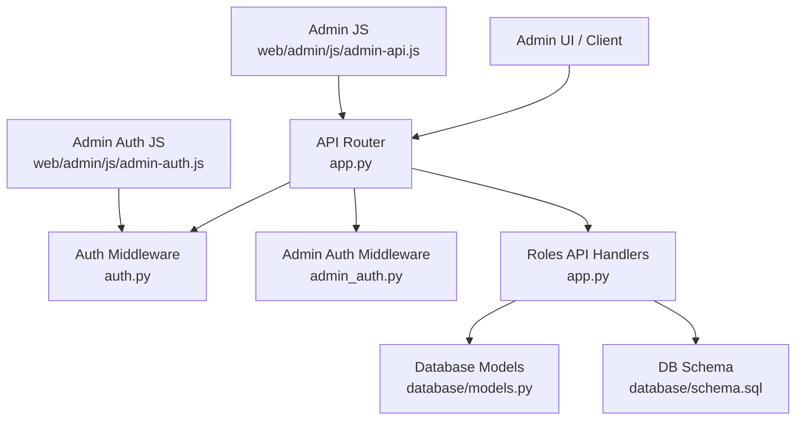
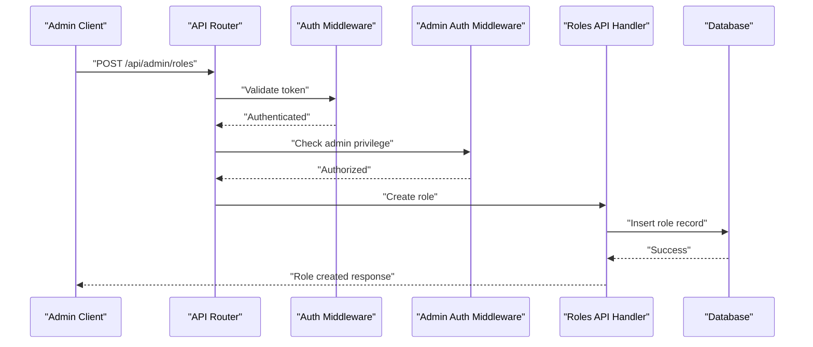
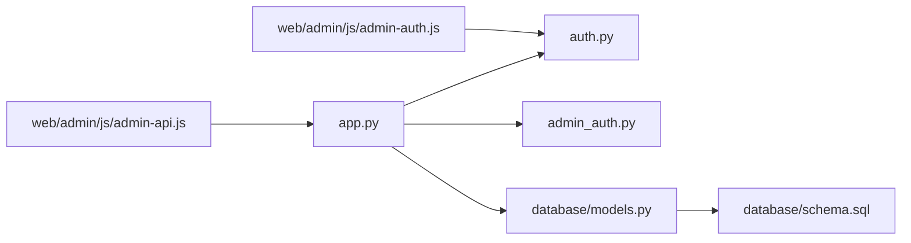

# Role & Permission Management

<cite>
**Referenced Files in This Document**
- [app.py](file://backend/app.py)
- [auth.py](file://backend/auth.py)
- [admin_auth.py](file://backend/admin_auth.py)
- [models.py](file://backend/database/models.py)
- [schema.sql](file://backend/database/schema.sql)
- [test_api_admin.py](file://backend/tests/integration/test_api_admin.py)
- [admin-api.js](file://web/admin/js/admin-api.js)
- [admin-auth.js](file://web/admin/js/admin-auth.js)
</cite>

## Table of Contents
1. [Introduction](#introduction)
2. [Project Structure](#project-structure)
3. [Core Components](#core-components)
4. [Architecture Overview](#architecture-overview)
5. [Detailed Component Analysis](#detailed-component-analysis)
6. [Dependency Analysis](#dependency-analysis)
7. [Performance Considerations](#performance-considerations)
8. [Troubleshooting Guide](#troubleshooting-guide)
9. [Conclusion](#conclusion)
10. [Appendices](#appendices)

## Introduction
This document provides comprehensive documentation for role and permission management APIs, focusing on endpoints under /api/admin/roles/*. It covers role assignment, permission hierarchy management, and access control configuration. The guide includes request/response schemas for role creation, permission mapping, and user-role assignments, along with examples for setting up admin roles, managing user permissions, and implementing role-based access control (RBAC). Security considerations and audit trails for permission changes are also addressed to ensure safe and auditable operations.

## Project Structure
The backend is a Python application that exposes REST endpoints for administrative functions, including role and permission management. Key areas include:
- API routing and endpoint definitions
- Authentication and authorization middleware
- Data models and database schema
- Admin-specific authentication and validation
- Frontend integration scripts for admin operations

**Diagram sources**
- [app.py](file://backend/app.py)
- [auth.py](file://backend/auth.py)
- [admin_auth.py](file://backend/admin_auth.py)
- [models.py](file://backend/database/models.py)
- [schema.sql](file://backend/database/schema.sql)
- [admin-api.js](file://web/admin/js/admin-api.js)
- [admin-auth.js](file://web/admin/js/admin-auth.js)

**Section sources**
- [app.py](file://backend/app.py)
- [auth.py](file://backend/auth.py)
- [admin_auth.py](file://backend/admin_auth.py)
- [models.py](file://backend/database/models.py)
- [schema.sql](file://backend/database/schema.sql)
- [admin-api.js](file://web/admin/js/admin-api.js)
- [admin-auth.js](file://web/admin/js/admin-auth.js)

## Core Components
- API Router and Endpoints: Centralized route registration for admin endpoints, including role management under /api/admin/roles/.
- Authentication and Authorization: Token-based authentication and admin-only access enforcement.
- Data Models and Schema: Database abstractions and schema definitions for roles, permissions, and user-role mappings.
- Admin Integration: Frontend scripts that call admin APIs for role and permission operations.

Key responsibilities:
- Validate requests and enforce admin privileges
- Persist role and permission data
- Provide consistent response formats
- Support audit logging for permission changes

**Section sources**
- [app.py](file://backend/app.py)
- [auth.py](file://backend/auth.py)
- [admin_auth.py](file://backend/admin_auth.py)
- [models.py](file://backend/database/models.py)
- [schema.sql](file://backend/database/schema.sql)

## Architecture Overview
The role and permission management system follows a layered architecture:
- Presentation Layer: Admin UI and client applications interact via REST APIs.
- Application Layer: API handlers process requests, validate inputs, and enforce policies.
- Domain Layer: Business logic for role assignment, permission checks, and hierarchy management.
- Data Layer: Database models and schema manage persistence.

**Diagram sources**
- [app.py](file://backend/app.py)
- [auth.py](file://backend/auth.py)
- [admin_auth.py](file://backend/admin_auth.py)
- [models.py](file://backend/database/models.py)
- [schema.sql](file://backend/database/schema.sql)

## Detailed Component Analysis

### Role Creation Endpoint
Handles POST /api/admin/roles to create new roles with associated permissions.

Request schema:
- name: string, required
- description: string, optional
- permissions: array of strings, required

Response schema:
- id: integer, unique identifier
- name: string
- description: string
- permissions: array of strings
- created_at: timestamp
- updated_at: timestamp

Example flow:
- Client sends role creation request
- Server validates input and admin privileges
- Role is persisted to the database
- Success response returned with role details

**Section sources**
- [app.py](file://backend/app.py)
- [models.py](file://backend/database/models.py)
- [schema.sql](file://backend/database/schema.sql)

### Permission Hierarchy Management
Endpoints for managing permission hierarchies and relationships between roles and permissions.

Operations:
- GET /api/admin/permissions: List available permissions
- PUT /api/admin/roles/{id}/permissions: Update role permissions
- DELETE /api/admin/roles/{id}/permissions: Remove specific permissions

Validation rules:
- Permissions must exist in the system
- Hierarchical constraints enforced
- Circular dependencies prevented

**Section sources**
- [app.py](file://backend/app.py)
- [models.py](file://backend/database/models.py)

### User-Role Assignment
Endpoints for assigning roles to users and managing user permissions.

Operations:
- POST /api/admin/users/{user_id}/roles: Assign role to user
- GET /api/admin/users/{user_id}/roles: Get user's assigned roles
- DELETE /api/admin/users/{user_id}/roles/{role_id}: Remove role from user

Security considerations:
- Only administrators can assign roles
- Audit trail maintained for all assignments
- Cascading effects considered when removing roles

**Section sources**
- [app.py](file://backend/app.py)
- [models.py](file://backend/database/models.py)

### Access Control Configuration
Configuration endpoints for managing access control policies and global settings.

Features:
- Enable/disable RBAC globally
- Configure default roles for new users
- Set permission inheritance rules
- Manage role visibility and scope

**Section sources**
- [app.py](file://backend/app.py)
- [config.py](file://backend/config.py)

### Admin Authentication and Authorization
Admin-specific authentication mechanisms ensure only authorized personnel can manage roles and permissions.

Components:
- Admin token validation
- Role-based access control for admin endpoints
- Session management for admin users
- Multi-factor authentication support

**Section sources**
- [admin_auth.py](file://backend/admin_auth.py)
- [auth.py](file://backend/auth.py)

### Frontend Integration
Admin UI components integrate with role management APIs through JavaScript modules.

Key features:
- Role creation forms with validation
- Permission matrix for visual management
- User-role assignment interface
- Real-time updates and notifications

**Section sources**
- [admin-api.js](file://web/admin/js/admin-api.js)
- [admin-auth.js](file://web/admin/js/admin-auth.js)

## Dependency Analysis
The role and permission system has well-defined dependencies between components:

**Diagram sources**
- [app.py](file://backend/app.py)
- [auth.py](file://backend/auth.py)
- [admin_auth.py](file://backend/admin_auth.py)
- [models.py](file://backend/database/models.py)
- [schema.sql](file://backend/database/schema.sql)
- [admin-api.js](file://web/admin/js/admin-api.js)
- [admin-auth.js](file://web/admin/js/admin-auth.js)

**Section sources**
- [app.py](file://backend/app.py)
- [auth.py](file://backend/auth.py)
- [admin_auth.py](file://backend/admin_auth.py)
- [models.py](file://backend/database/models.py)
- [schema.sql](file://backend/database/schema.sql)
- [admin-api.js](file://web/admin/js/admin-api.js)
- [admin-auth.js](file://web/admin/js/admin-auth.js)

## Performance Considerations
- Database indexing on frequently queried fields (user_id, role_id, permission_id)
- Caching strategies for permission checks to reduce database load
- Batch operations for bulk role assignments
- Connection pooling for database operations
- Asynchronous processing for audit log writes

## Troubleshooting Guide
Common issues and solutions:
- Authentication failures: Verify admin tokens and session validity
- Permission denied errors: Check role assignments and permission hierarchies
- Database connection issues: Ensure proper configuration and connectivity
- API validation errors: Review request payloads against expected schemas

Debugging steps:
- Enable detailed logging for admin operations
- Use test suites to validate API functionality
- Monitor database query performance
- Check frontend console for JavaScript errors

**Section sources**
- [test_api_admin.py](file://backend/tests/integration/test_api_admin.py)

## Conclusion
The role and permission management system provides a comprehensive foundation for implementing secure access control in the application. With well-defined APIs, robust authentication mechanisms, and clear data models, it enables administrators to effectively manage user roles and permissions while maintaining security and auditability.

## Appendices

### API Reference Summary

#### Role Management Endpoints
- POST /api/admin/roles - Create new role
- GET /api/admin/roles - List all roles
- GET /api/admin/roles/{id} - Get role details
- PUT /api/admin/roles/{id} - Update role
- DELETE /api/admin/roles/{id} - Delete role

#### Permission Management Endpoints
- GET /api/admin/permissions - List permissions
- PUT /api/admin/roles/{id}/permissions - Update role permissions
- DELETE /api/admin/roles/{id}/permissions/{permission} - Remove permission

#### User-Role Assignment Endpoints
- POST /api/admin/users/{user_id}/roles - Assign role to user
- GET /api/admin/users/{user_id}/roles - Get user roles
- DELETE /api/admin/users/{user_id}/roles/{role_id} - Remove role from user

### Security Best Practices
- Enforce least privilege principle
- Regularly audit role assignments
- Implement rate limiting on admin endpoints
- Use HTTPS for all admin communications
- Maintain comprehensive audit logs

### Implementation Examples

#### Setting Up Admin Roles
1. Create base admin role with essential permissions
2. Define specialized admin roles (super admin, content manager, etc.)
3. Assign appropriate permissions to each role
4. Test role hierarchy and permission inheritance

#### Managing User Permissions
1. Identify user groups and their requirements
2. Create corresponding roles with necessary permissions
3. Assign roles to users based on their responsibilities
4. Monitor and adjust permissions as needed

#### Implementing RBAC
1. Define permission matrix for application features
2. Create roles that map to business functions
3. Implement permission checks in application code
4. Test access control scenarios thoroughly