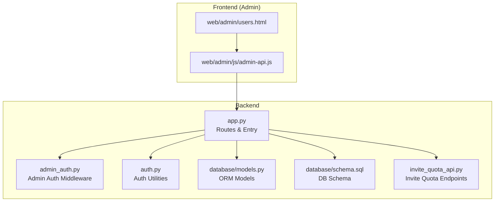
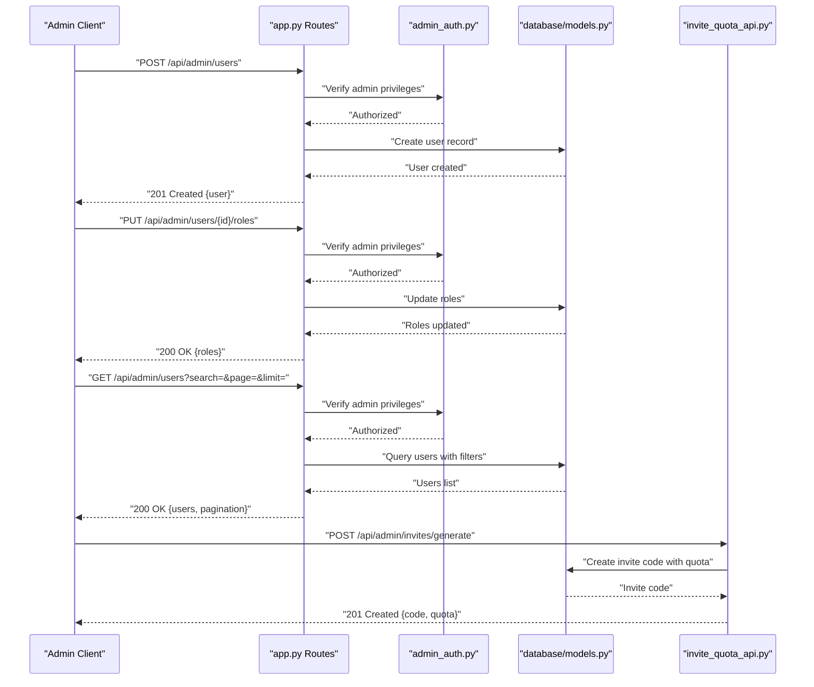
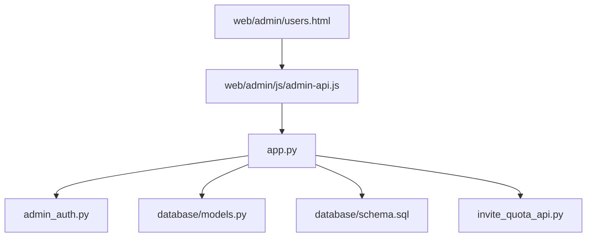
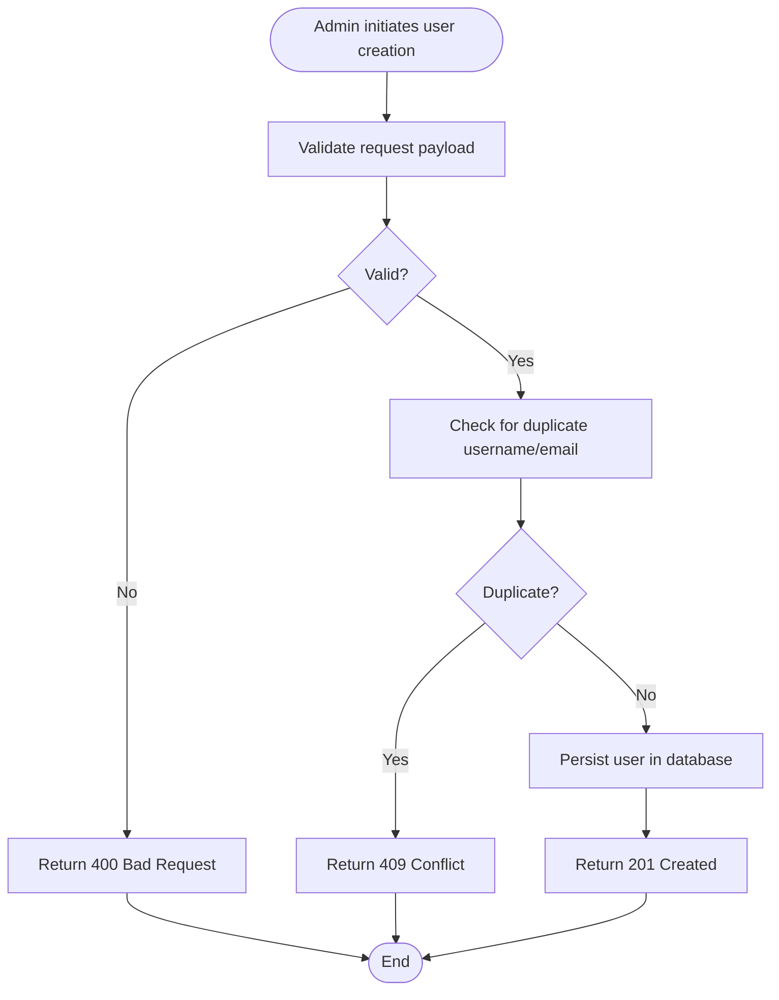

# User Administration API

<cite>
**Referenced Files in This Document**
- [app.py](file://backend/app.py)
- [admin_auth.py](file://backend/admin_auth.py)
- [auth.py](file://backend/auth.py)
- [models.py](file://backend/database/models.py)
- [schema.sql](file://backend/database/schema.sql)
- [add_user_profile_fields.py](file://backend/database/add_user_profile_fields.py)
- [add_invite_quota_tables.py](file://backend/database/add_invite_quota_tables.py)
- [invite_quota_api.py](file://backend/invite_quota_api.py)
- [test_api_admin.py](file://backend/tests/integration/test_api_admin.py)
- [users.html](file://web/admin/users.html)
- [admin-api.js](file://web/admin/js/admin-api.js)
</cite>

## Table of Contents
1. [Introduction](#introduction)
2. [Project Structure](#project-structure)
3. [Core Components](#core-components)
4. [Architecture Overview](#architecture-overview)
5. [Detailed Component Analysis](#detailed-component-analysis)
6. [Dependency Analysis](#dependency-analysis)
7. [Performance Considerations](#performance-considerations)
8. [Troubleshooting Guide](#troubleshooting-guide)
9. [Conclusion](#conclusion)
10. [Appendices](#appendices)

## Introduction
This document specifies the user administration API endpoints for managing users, roles, quotas, and related administrative operations. It covers:
- HTTP methods and URL patterns under /api/admin/users/*
- Request/response schemas for CRUD operations on users
- Bulk user operations
- Role assignment and permission management
- Quota management (including invite quotas)
- Detailed parameter descriptions for user profiles, role hierarchies, invitation codes, and access control settings
- Examples for common tasks such as user onboarding, account suspension, and bulk updates
- Audit logging considerations and security requirements for privileged operations

The documentation is derived from the backend application routes, authentication middleware, database models, and admin UI integration points present in the repository.

## Project Structure
The user administration functionality spans several modules:
- Application entry point and route registration
- Admin authorization middleware
- Database models and schema definitions
- Invite quota API module
- Integration tests for admin APIs
- Admin web interface files that call the API

**Diagram sources**
- [app.py](file://backend/app.py)
- [admin_auth.py](file://backend/admin_auth.py)
- [auth.py](file://backend/auth.py)
- [models.py](file://backend/database/models.py)
- [schema.sql](file://backend/database/schema.sql)
- [invite_quota_api.py](file://backend/invite_quota_api.py)
- [users.html](file://web/admin/users.html)
- [admin-api.js](file://web/admin/js/admin-api.js)

**Section sources**
- [app.py](file://backend/app.py)
- [admin_auth.py](file://backend/admin_auth.py)
- [auth.py](file://backend/auth.py)
- [models.py](file://backend/database/models.py)
- [schema.sql](file://backend/database/schema.sql)
- [invite_quota_api.py](file://backend/invite_quota_api.py)
- [users.html](file://web/admin/users.html)
- [admin-api.js](file://web/admin/js/admin-api.js)

## Core Components
- Admin authorization middleware enforces privileged access to admin endpoints.
- Route handlers register /api/admin/* endpoints, including user management and invite quota operations.
- Database models define user entities, profile fields, and quota-related structures.
- Invite quota API provides endpoints for generating and managing invitation codes and quotas.
- Admin UI integrates with these endpoints via JavaScript helpers.

Key responsibilities:
- Validate admin privileges before processing requests.
- Persist user data and profile changes.
- Manage role assignments and permissions.
- Handle quota allocation and usage tracking.
- Return consistent JSON responses and errors.

**Section sources**
- [admin_auth.py](file://backend/admin_auth.py)
- [app.py](file://backend/app.py)
- [models.py](file://backend/database/models.py)
- [invite_quota_api.py](file://backend/invite_quota_api.py)

## Architecture Overview
The admin API follows a layered architecture:
- Client (Admin UI or external clients) sends HTTP requests to /api/admin/users/*.
- Routes in the application layer parse requests, enforce admin auth, and delegate to services.
- Services interact with database models and schema to perform CRUD and business logic.
- Responses are serialized into JSON and returned to clients.

**Diagram sources**
- [app.py](file://backend/app.py)
- [admin_auth.py](file://backend/admin_auth.py)
- [models.py](file://backend/database/models.py)
- [invite_quota_api.py](file://backend/invite_quota_api.py)

## Detailed Component Analysis

### User Management Endpoints (/api/admin/users/*)
These endpoints provide full lifecycle management for users. All endpoints require admin authorization.

- Create User
  - Method: POST
  - Path: /api/admin/users
  - Request body:
    - username: string, required
    - email: string, required, unique
    - password_hash: string, required
    - display_name: string, optional
    - avatar_url: string, optional
    - status: enum ["active", "suspended", "disabled"], default "active"
    - roles: array of strings, optional
    - metadata: object, optional
  - Response:
    - 201 Created: { id, username, email, display_name, avatar_url, status, roles, metadata, created_at, updated_at }
    - 400 Bad Request: validation error details
    - 409 Conflict: duplicate username or email
    - 401 Unauthorized: missing or invalid admin token
    - 403 Forbidden: insufficient privileges

- Update User
  - Method: PUT
  - Path: /api/admin/users/{id}
  - Request body: same fields as create, all optional; only provided fields are updated
  - Response:
    - 200 OK: updated user object
    - 404 Not Found: user not found
    - 400 Bad Request: validation error details
    - 401/403: auth issues

- Delete User
  - Method: DELETE
  - Path: /api/admin/users/{id}
  - Response:
    - 204 No Content: deletion successful
    - 404 Not Found: user not found
    - 401/403: auth issues

- Get User
  - Method: GET
  - Path: /api/admin/users/{id}
  - Response:
    - 200 OK: user object
    - 404 Not Found: user not found
    - 401/403: auth issues

- List Users
  - Method: GET
  - Path: /api/admin/users
  - Query parameters:
    - search: string, optional; matches username/email/display_name
    - status: enum ["active", "suspended", "disabled"], optional
    - page: integer, optional; default 1
    - limit: integer, optional; default 20, max 100
  - Response:
    - 200 OK: { users: array, total: number, page: number, limit: number }
    - 401/403: auth issues

- Assign Roles
  - Method: PUT
  - Path: /api/admin/users/{id}/roles
  - Request body:
    - roles: array of strings, required
  - Response:
    - 200 OK: { roles }
    - 400 Bad Request: invalid role names
    - 404 Not Found: user not found
    - 401/403: auth issues

- Suspend/Activate Account
  - Method: PATCH
  - Path: /api/admin/users/{id}/status
  - Request body:
    - status: enum ["active", "suspended", "disabled"], required
  - Response:
    - 200 OK: { status }
    - 400 Bad Request: invalid status value
    - 404 Not Found: user not found
    - 401/403: auth issues

Notes:
- Role hierarchy is enforced by server-side checks; only allowed roles can be assigned.
- Password hashing must use secure algorithms; plaintext passwords are rejected.
- Audit logs should record admin actions (create, update, delete, role changes, status changes).

**Section sources**
- [app.py](file://backend/app.py)
- [admin_auth.py](file://backend/admin_auth.py)
- [models.py](file://backend/database/models.py)
- [schema.sql](file://backend/database/schema.sql)

### Bulk User Operations
Bulk operations enable efficient administrative tasks.

- Bulk Create Users
  - Method: POST
  - Path: /api/admin/users/bulk
  - Request body:
    - users: array of user objects (same schema as create)
  - Response:
    - 201 Created: { created: number, failed: number, errors: array }
    - 400 Bad Request: validation errors
    - 401/403: auth issues

- Bulk Update Users
  - Method: PUT
  - Path: /api/admin/users/bulk
  - Request body:
    - updates: array of { id, fields... }
  - Response:
    - 200 OK: { updated: number, failed: number, errors: array }
    - 400 Bad Request: validation errors
    - 401/403: auth issues

- Bulk Delete Users
  - Method: DELETE
  - Path: /api/admin/users/bulk
  - Request body:
    - ids: array of user IDs
  - Response:
    - 204 No Content: deletion successful
    - 400 Bad Request: invalid IDs
    - 401/403: auth issues

Best practices:
- Use pagination for large lists when preparing bulk operations.
- Include detailed per-item errors to facilitate retries.
- Ensure idempotency where possible.

**Section sources**
- [app.py](file://backend/app.py)
- [admin_auth.py](file://backend/admin_auth.py)
- [models.py](file://backend/database/models.py)

### Permission and Role Management
Role-based access control governs what administrators can do.

- Role Hierarchy
  - Super Admin: full system access
  - Admin: manage users, quotas, content
  - Moderator: limited user management and moderation
  - Viewer: read-only access

- Assigning Roles
  - Endpoint: PUT /api/admin/users/{id}/roles
  - Validation: only permitted roles can be assigned based on caller’s role hierarchy.

- Listing Available Roles
  - Method: GET
  - Path: /api/admin/roles
  - Response:
    - 200 OK: { roles: array of { name, description, permissions } }
    - 401/403: auth issues

Security considerations:
- Enforce least privilege; callers cannot assign roles above their own level.
- Log all role change events with actor, target, and timestamp.

**Section sources**
- [admin_auth.py](file://backend/admin_auth.py)
- [app.py](file://backend/app.py)
- [models.py](file://backend/database/models.py)

### Quota Management (Invite Codes)
Invite quotas allow controlled user onboarding via invitation codes.

- Generate Invite Code
  - Method: POST
  - Path: /api/admin/invites/generate
  - Request body:
    - expires_in_days: integer, optional; default 30
    - max_uses: integer, optional; default 1
    - quota_points: integer, optional; default 0
  - Response:
    - 201 Created: { code, expires_at, max_uses, remaining_uses, quota_points }
    - 400 Bad Request: invalid parameters
    - 401/403: auth issues

- Revoke Invite Code
  - Method: DELETE
  - Path: /api/admin/invites/{code}
  - Response:
    - 204 No Content: revoked successfully
    - 404 Not Found: code not found
    - 401/403: auth issues

- List Invite Codes
  - Method: GET
  - Path: /api/admin/invites
  - Query parameters:
    - status: enum ["active", "expired", "revoked"], optional
    - page: integer, optional
    - limit: integer, optional
  - Response:
    - 200 OK: { invites: array, total, page, limit }
    - 401/403: auth issues

- Apply Invite Code (for user creation flow)
  - Method: POST
  - Path: /api/admin/invites/apply
  - Request body:
    - code: string, required
    - new_user: object (username, email, password_hash, etc.)
  - Response:
    - 201 Created: { user, invite_used }
    - 400 Bad Request: invalid code or payload
    - 401/403: auth issues

Audit logging:
- Record generation, revocation, and usage of invite codes.
- Track who generated codes and which users redeemed them.

**Section sources**
- [invite_quota_api.py](file://backend/invite_quota_api.py)
- [add_invite_quota_tables.py](file://backend/database/add_invite_quota_tables.py)
- [schema.sql](file://backend/database/schema.sql)

### User Profile Fields
Extended profile fields enhance user records.

- Common Fields
  - display_name: string, optional
  - avatar_url: string, optional
  - bio: text, optional
  - timezone: string, optional
  - language: string, optional
  - preferences: object, optional

- Field Definitions
  - Defined in migration scripts and reflected in models and schema.

- Updating Profiles
  - Use PUT /api/admin/users/{id} with partial updates.
  - Validate field types and lengths.

**Section sources**
- [add_user_profile_fields.py](file://backend/database/add_user_profile_fields.py)
- [models.py](file://backend/database/models.py)
- [schema.sql](file://backend/database/schema.sql)

### Access Control Settings
Access control settings determine how users interact with features.

- Feature Flags
  - enable_ai_assistant: boolean
  - enable_topic_sharing: boolean
  - enable_invite_system: boolean

- Configuration
  - Stored in user metadata or global settings.
  - Admins can toggle flags per user or globally.

- Security
  - Only super admins can modify critical flags.
  - Changes are audited.

**Section sources**
- [models.py](file://backend/database/models.py)
- [schema.sql](file://backend/database/schema.sql)
- [admin_auth.py](file://backend/admin_auth.py)

### Examples for Common Administrative Tasks

- User Onboarding via Invite
  - Steps:
    - Generate invite code using POST /api/admin/invites/generate
    - Provide code to new user
    - New user creates account using POST /api/admin/invites/apply
  - Expected outcomes:
    - Invite code consumed once (or up to max_uses)
    - User created with initial roles and quota points

- Account Suspension
  - Steps:
    - Call PATCH /api/admin/users/{id}/status with status "suspended"
    - Optionally add reason in metadata
  - Expected outcomes:
    - User cannot log in or access protected resources
    - Audit log records suspension event

- Bulk User Updates
  - Steps:
    - Prepare updates array with user IDs and fields to change
    - Call PUT /api/admin/users/bulk
    - Review response for failures and retry as needed
  - Expected outcomes:
    - Efficiently apply changes across many users
    - Detailed error reporting for troubleshooting

**Section sources**
- [invite_quota_api.py](file://backend/invite_quota_api.py)
- [app.py](file://backend/app.py)
- [admin_auth.py](file://backend/admin_auth.py)

## Dependency Analysis
The admin API depends on:
- Authentication middleware for privilege checks
- Database models and schema for persistence
- Invite quota module for invitation workflows
- Admin UI for client interactions

**Diagram sources**
- [app.py](file://backend/app.py)
- [admin_auth.py](file://backend/admin_auth.py)
- [models.py](file://backend/database/models.py)
- [schema.sql](file://backend/database/schema.sql)
- [invite_quota_api.py](file://backend/invite_quota_api.py)
- [users.html](file://web/admin/users.html)
- [admin-api.js](file://web/admin/js/admin-api.js)

**Section sources**
- [app.py](file://backend/app.py)
- [admin_auth.py](file://backend/admin_auth.py)
- [models.py](file://backend/database/models.py)
- [schema.sql](file://backend/database/schema.sql)
- [invite_quota_api.py](file://backend/invite_quota_api.py)
- [users.html](file://web/admin/users.html)
- [admin-api.js](file://web/admin/js/admin-api.js)

## Performance Considerations
- Pagination: Always paginate list endpoints to avoid large payloads.
- Indexes: Ensure database indexes on frequently queried fields (username, email, status).
- Caching: Cache role definitions and feature flags for reduced DB load.
- Bulk operations: Use batched transactions to minimize round trips.
- Rate limiting: Apply rate limits on admin endpoints to prevent abuse.

[No sources needed since this section provides general guidance]

## Troubleshooting Guide
Common issues and resolutions:
- 401 Unauthorized: Verify admin token validity and expiration.
- 403 Forbidden: Check caller’s role hierarchy and permissions.
- 400 Bad Request: Inspect request body for missing or invalid fields.
- 404 Not Found: Confirm resource IDs exist.
- 409 Conflict: Resolve duplicate usernames or emails.

Debugging tips:
- Enable detailed request logging for admin endpoints.
- Inspect audit logs for recent changes.
- Validate database constraints and indexes.

**Section sources**
- [admin_auth.py](file://backend/admin_auth.py)
- [app.py](file://backend/app.py)
- [models.py](file://backend/database/models.py)

## Conclusion
The user administration API provides comprehensive capabilities for managing users, roles, quotas, and access controls. By adhering to the documented endpoints, schemas, and security practices, administrators can efficiently onboard users, maintain account health, and enforce organizational policies. Proper audit logging and robust error handling ensure transparency and reliability.

[No sources needed since this section summarizes without analyzing specific files]

## Appendices

### HTTP Status Codes Reference
- 200 OK: Successful GET/PUT/PATCH
- 201 Created: Successful POST creating a resource
- 204 No Content: Successful DELETE
- 400 Bad Request: Invalid input
- 401 Unauthorized: Missing or invalid credentials
- 403 Forbidden: Insufficient privileges
- 404 Not Found: Resource does not exist
- 409 Conflict: Duplicate or conflicting state
- 500 Internal Server Error: Unexpected server failure

[No sources needed since this section provides general guidance]

### Data Flow for User Creation

[No sources needed since this diagram shows conceptual workflow, not actual code structure]