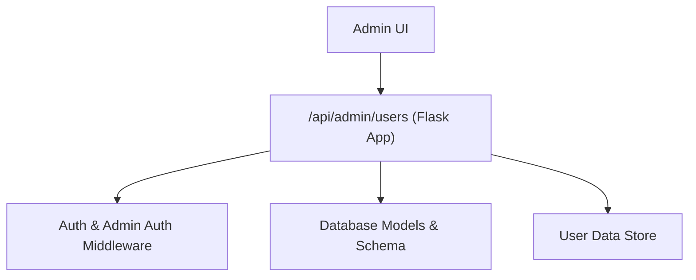
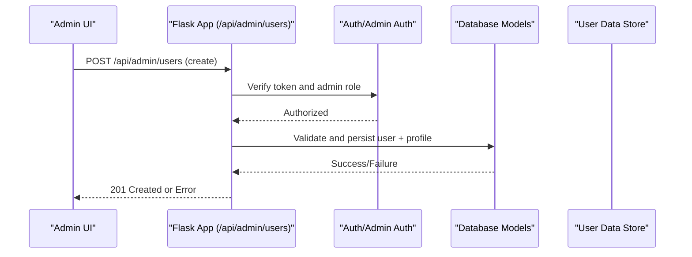
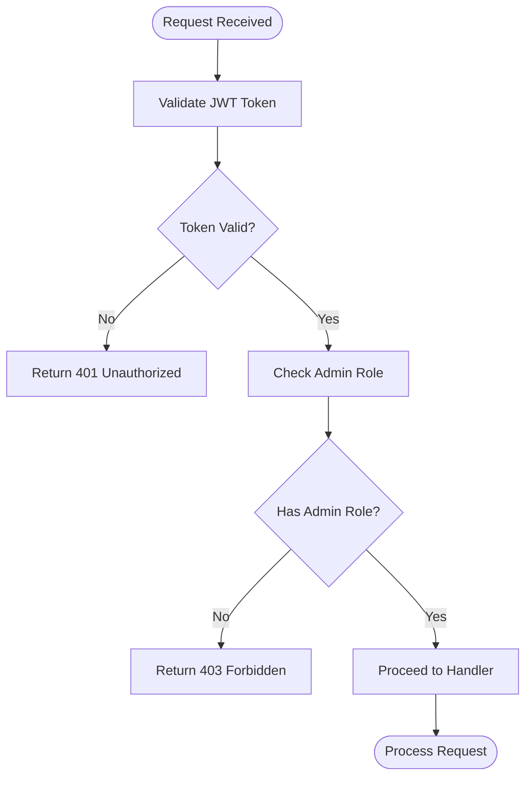
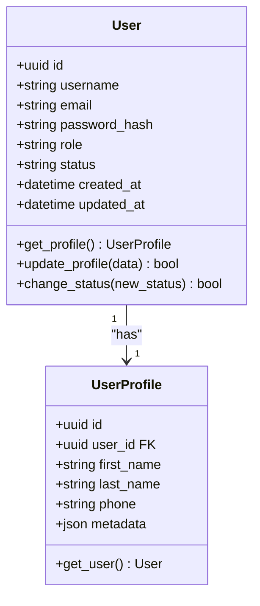
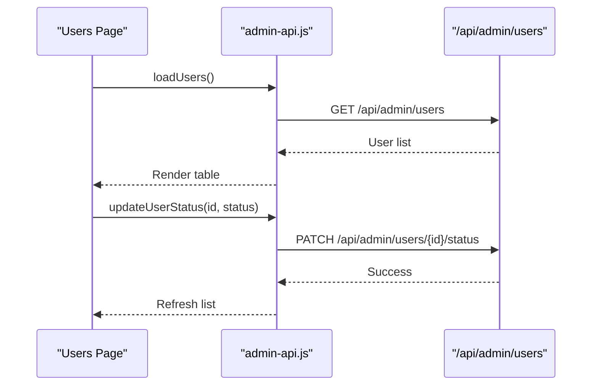
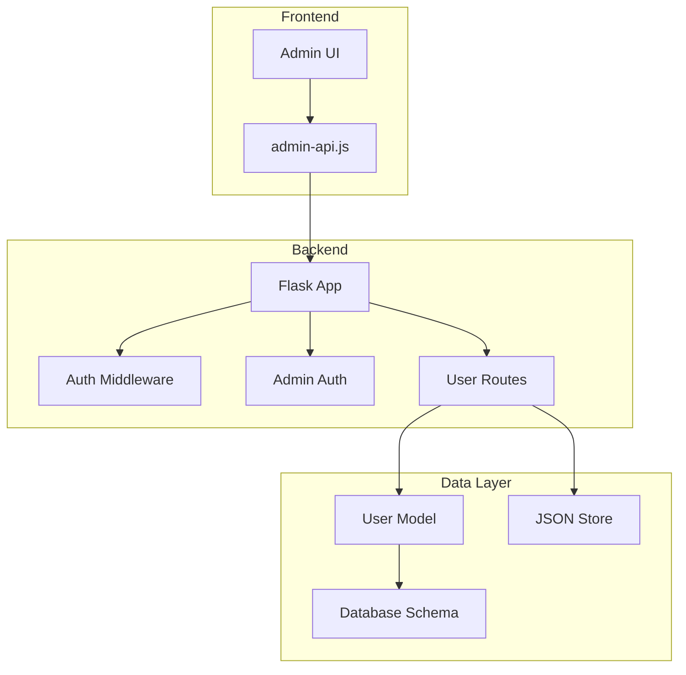

# User CRUD Operations

<cite>
**Referenced Files in This Document**
- [app.py](file://backend/app.py)
- [auth.py](file://backend/auth.py)
- [admin_auth.py](file://backend/admin_auth.py)
- [database/models.py](file://backend/database/models.py)
- [database/schema.sql](file://backend/database/schema.sql)
- [users/users.json](file://backend/users/users.json)
- [web/admin/js/admin-api.js](file://web/admin/js/admin-api.js)
- [web/admin/users.html](file://web/admin/users.html)
</cite>

## Table of Contents
1. [Introduction](#introduction)
2. [Project Structure](#project-structure)
3. [Core Components](#core-components)
4. [Architecture Overview](#architecture-overview)
5. [Detailed Component Analysis](#detailed-component-analysis)
6. [Dependency Analysis](#dependency-analysis)
7. [Performance Considerations](#performance-considerations)
8. [Troubleshooting Guide](#troubleshooting-guide)
9. [Conclusion](#conclusion)

## Introduction
This document provides detailed API documentation for user CRUD operations exposed under the /api/admin/users endpoint. It covers creating users with profile data, reading and searching users, updating profiles, deleting accounts, bulk operations, and status management. It also includes validation rules, error responses, and audit logging considerations for administrative tasks such as approval, profile updates, and account deletion.

## Project Structure
The backend is a Python application that exposes REST endpoints for admin operations. The relevant files include:
- Application entry point and route registration
- Authentication and authorization middleware
- Database models and schema definitions
- Admin frontend JavaScript that calls the API
- Sample user data storage

**Diagram sources**
- [app.py](file://backend/app.py)
- [auth.py](file://backend/auth.py)
- [admin_auth.py](file://backend/admin_auth.py)
- [database/models.py](file://backend/database/models.py)
- [database/schema.sql](file://backend/database/schema.sql)
- [users/users.json](file://backend/users/users.json)

**Section sources**
- [app.py](file://backend/app.py)
- [auth.py](file://backend/auth.py)
- [admin_auth.py](file://backend/admin_auth.py)
- [database/models.py](file://backend/database/models.py)
- [database/schema.sql](file://backend/database/schema.sql)
- [users/users.json](file://backend/users/users.json)

## Core Components
- API Routes: Endpoints for user CRUD are registered in the application file under /api/admin/users.
- Authentication: Standard auth middleware protects routes; admin-specific middleware enforces admin privileges.
- Data Layer: Database models define user entities and relationships; schema defines tables and constraints.
- Storage: A JSON-based store may be used for sample or auxiliary user data.
- Admin Frontend: JavaScript utilities call the API to perform administrative tasks.

Key responsibilities:
- Validate requests and enforce business rules
- Authenticate and authorize admin access
- Persist changes to the database or storage
- Return consistent success/error responses
- Log modifications for audit purposes

**Section sources**
- [app.py](file://backend/app.py)
- [auth.py](file://backend/auth.py)
- [admin_auth.py](file://backend/admin_auth.py)
- [database/models.py](file://backend/database/models.py)
- [database/schema.sql](file://backend/database/schema.sql)
- [users/users.json](file://backend/users/users.json)
- [web/admin/js/admin-api.js](file://web/admin/js/admin-api.js)

## Architecture Overview
The admin user management flow involves the following steps:
- Admin UI sends HTTP requests to /api/admin/users
- Request passes through authentication and admin authorization middleware
- Route handler validates input and performs business logic
- Data layer interacts with the database or storage
- Response is returned with appropriate status codes and payloads

**Diagram sources**
- [app.py](file://backend/app.py)
- [auth.py](file://backend/auth.py)
- [admin_auth.py](file://backend/admin_auth.py)
- [database/models.py](file://backend/database/models.py)
- [users/users.json](file://backend/users/users.json)

## Detailed Component Analysis

### API Endpoints: /api/admin/users
Endpoints available for user management:
- Create User: POST /api/admin/users
- Read Users: GET /api/admin/users
- Update User: PUT /api/admin/users/{id}
- Delete User: DELETE /api/admin/users/{id}
- Search/Filter Users: GET /api/admin/users?query=&status=&role=
- Bulk Operations: POST /api/admin/users/bulk (e.g., approve, deactivate)
- Status Management: PATCH /api/admin/users/{id}/status

Request and response schemas:
- Create User Request
  - Required fields: username, email, password
  - Optional profile fields: first_name, last_name, phone, role, status
  - Example payload structure:
    {
      "username": "string",
      "email": "string",
      "password": "string",
      "profile": {
        "first_name": "string",
        "last_name": "string",
        "phone": "string",
        "role": "string",
        "status": "string"
      }
    }
- Create User Response
  - On success: 201 Created with created user object including id and profile
  - On error: 400 Bad Request with validation errors, 409 Conflict if duplicate email/username

- Read Users Response
  - Array of user objects with basic info and profile summary
  - Pagination fields: total, page, per_page

- Update User Request
  - Fields to update: profile fields and optional metadata
  - Partial updates supported

- Delete User Response
  - On success: 204 No Content
  - On error: 404 Not Found

- Search/Filter Parameters
  - query: string search across name/email
  - status: filter by account status
  - role: filter by role

- Bulk Operations Request
  - Action: approve, deactivate, delete
  - ids: array of user IDs
  - Returns: summary of successes and failures

- Status Management Request
  - status: new status value

Validation rules:
- Username: unique, alphanumeric, min length 3
- Email: valid format, unique
- Password: minimum length, complexity requirements
- Profile fields: optional but validated when present
- Role: allowed values (user, moderator, admin)
- Status: allowed values (active, inactive, pending, banned)

Error responses:
- 400 Bad Request: invalid input, missing required fields
- 401 Unauthorized: missing or invalid token
- 403 Forbidden: insufficient permissions
- 404 Not Found: user not found
- 409 Conflict: duplicate username/email
- 500 Internal Server Error: unexpected server issues

Audit logging:
- All modifications should log:
  - Actor (admin ID)
  - Action (create, update, delete, status change)
  - Target (user ID)
  - Timestamp
  - Changes (before/after state)

Common administrative tasks:
- User Registration Approval
  - Endpoint: PATCH /api/admin/users/{id}/status
  - Payload: {"status": "active"}
  - Validates user exists and transitions from pending to active
- Profile Updates
  - Endpoint: PUT /api/admin/users/{id}
  - Payload: partial profile fields
  - Validates only provided fields
- Account Deletion
  - Endpoint: DELETE /api/admin/users/{id}
  - Removes user and associated profile data
  - Logs deletion event

**Section sources**
- [app.py](file://backend/app.py)
- [auth.py](file://backend/auth.py)
- [admin_auth.py](file://backend/admin_auth.py)
- [database/models.py](file://backend/database/models.py)
- [database/schema.sql](file://backend/database/schema.sql)
- [users/users.json](file://backend/users/users.json)
- [web/admin/js/admin-api.js](file://web/admin/js/admin-api.js)

### Authentication and Authorization
Authentication ensures valid tokens are present, while admin authorization verifies the user has administrative privileges.

**Diagram sources**
- [auth.py](file://backend/auth.py)
- [admin_auth.py](file://backend/admin_auth.py)

**Section sources**
- [auth.py](file://backend/auth.py)
- [admin_auth.py](file://backend/admin_auth.py)

### Database Models and Schema
User model defines the core entity with profile information and status fields.

**Diagram sources**
- [database/models.py](file://backend/database/models.py)
- [database/schema.sql](file://backend/database/schema.sql)

**Section sources**
- [database/models.py](file://backend/database/models.py)
- [database/schema.sql](file://backend/database/schema.sql)

### Admin Frontend Integration
The admin interface uses JavaScript to interact with the user management API.

**Diagram sources**
- [web/admin/js/admin-api.js](file://web/admin/js/admin-api.js)
- [web/admin/users.html](file://web/admin/users.html)

**Section sources**
- [web/admin/js/admin-api.js](file://web/admin/js/admin-api.js)
- [web/admin/users.html](file://web/admin/users.html)

## Dependency Analysis
The user management system has clear dependencies between components:

**Diagram sources**
- [web/admin/js/admin-api.js](file://web/admin/js/admin-api.js)
- [app.py](file://backend/app.py)
- [auth.py](file://backend/auth.py)
- [admin_auth.py](file://backend/admin_auth.py)
- [database/models.py](file://backend/database/models.py)
- [database/schema.sql](file://backend/database/schema.sql)
- [users/users.json](file://backend/users/users.json)

**Section sources**
- [web/admin/js/admin-api.js](file://web/admin/js/admin-api.js)
- [app.py](file://backend/app.py)
- [auth.py](file://backend/auth.py)
- [admin_auth.py](file://backend/admin_auth.py)
- [database/models.py](file://backend/database/models.py)
- [database/schema.sql](file://backend/database/schema.sql)
- [users/users.json](file://backend/users/users.json)

## Performance Considerations
- Use pagination for large user lists to reduce memory usage
- Implement caching for frequently accessed user data
- Optimize database queries with proper indexing on email, username, and status fields
- Batch operations for bulk updates to minimize database round trips
- Use connection pooling for database connections
- Implement rate limiting for admin endpoints to prevent abuse

## Troubleshooting Guide
Common issues and solutions:
- Authentication failures: Check JWT token validity and expiration
- Permission errors: Verify admin role assignment
- Validation errors: Review request payload against schema requirements
- Database connectivity: Ensure proper database configuration and credentials
- Duplicate entries: Check for existing usernames or emails before creation
- Audit log gaps: Verify logging configuration and permissions

Debugging steps:
- Enable detailed logging for API endpoints
- Check database query logs for performance issues
- Validate request/response formats with API testing tools
- Monitor error rates and response times

**Section sources**
- [auth.py](file://backend/auth.py)
- [admin_auth.py](file://backend/admin_auth.py)
- [app.py](file://backend/app.py)

## Conclusion
The user CRUD operations provide comprehensive administrative capabilities for managing user accounts. The system follows RESTful principles with proper authentication, validation, and error handling. The modular architecture allows for easy maintenance and extension. Proper audit logging ensures accountability for all user modifications. Future enhancements could include advanced search capabilities, role-based permissions, and enhanced security measures.