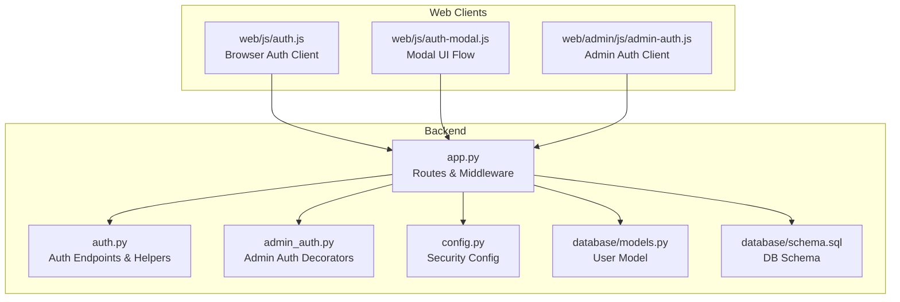
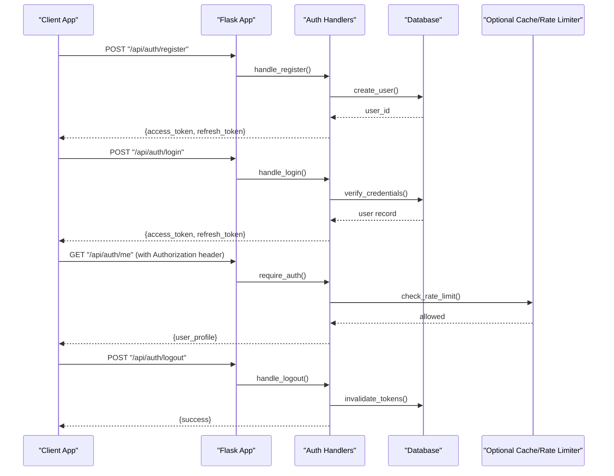
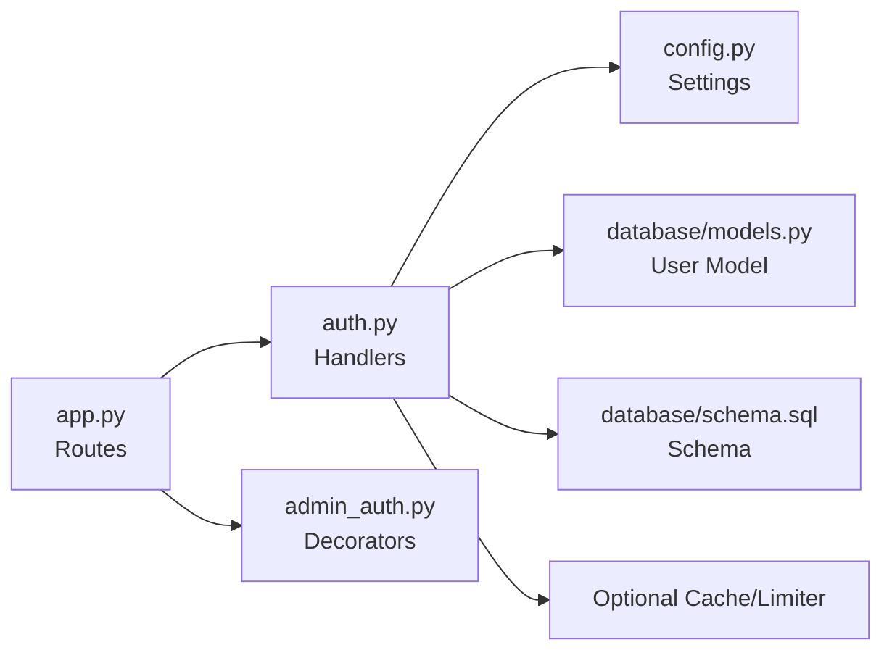

# Authentication API

<cite>
**Referenced Files in This Document**
- [auth.py](file://backend/auth.py)
- [app.py](file://backend/app.py)
- [admin_auth.py](file://backend/admin_auth.py)
- [config.py](file://backend/config.py)
- [database/models.py](file://backend/database/models.py)
- [database/schema.sql](file://backend/database/schema.sql)
- [tests/integration/test_api_auth.py](file://backend/tests/integration/test_api_auth.py)
- [web/js/auth.js](file://web/js/auth.js)
- [web/js/auth-modal.js](file://web/js/auth-modal.js)
- [web/admin/js/admin-auth.js](file://web/admin/js/admin-auth.js)
</cite>

## Table of Contents
1. [Introduction](#introduction)
2. [Project Structure](#project-structure)
3. [Core Components](#core-components)
4. [Architecture Overview](#architecture-overview)
5. [Detailed Component Analysis](#detailed-component-analysis)
6. [Dependency Analysis](#dependency-analysis)
7. [Performance Considerations](#performance-considerations)
8. [Troubleshooting Guide](#troubleshooting-guide)
9. [Conclusion](#conclusion)
10. [Appendices](#appendices)

## Introduction
This document provides comprehensive authentication API documentation for the XSYY Edu platform. It covers user registration, login, logout, token management, password reset operations, and related security mechanisms such as JWT usage, rate limiting, session handling, and admin access controls. The goal is to enable developers to integrate with the authentication system reliably and securely across multiple client platforms.

## Project Structure
The authentication functionality is implemented primarily in the backend Python application and consumed by web clients. Key areas include:
- Authentication routes and middleware
- Configuration for tokens and security settings
- Database models and schema for users and sessions
- Integration tests validating authentication flows
- Web client libraries for browser-based interactions

**Diagram sources**
- [app.py](file://backend/app.py)
- [auth.py](file://backend/auth.py)
- [admin_auth.py](file://backend/admin_auth.py)
- [config.py](file://backend/config.py)
- [database/models.py](file://backend/database/models.py)
- [database/schema.sql](file://backend/database/schema.sql)
- [web/js/auth.js](file://web/js/auth.js)
- [web/js/auth-modal.js](file://web/js/auth-modal.js)
- [web/admin/js/admin-auth.js](file://web/admin/js/admin-auth.js)

**Section sources**
- [app.py](file://backend/app.py)
- [auth.py](file://backend/auth.py)
- [admin_auth.py](file://backend/admin_auth.py)
- [config.py](file://backend/config.py)
- [database/models.py](file://backend/database/models.py)
- [database/schema.sql](file://backend/database/schema.sql)
- [web/js/auth.js](file://web/js/auth.js)
- [web/js/auth-modal.js](file://web/js/auth-modal.js)
- [web/admin/js/admin-auth.js](file://web/admin/js/admin-auth.js)

## Core Components
- Authentication endpoints: Registration, login, logout, email verification, password reset, token refresh, and profile updates are exposed via RESTful routes under /api/auth.
- JWT-based stateless authentication: Access tokens (and optionally refresh tokens) are issued upon successful authentication and validated on protected routes.
- Admin authorization: Separate decorators enforce admin-only access for administrative endpoints.
- Security configuration: Token secrets, expiration times, and rate limiting policies are configured centrally.
- Data persistence: User records and optional session or token blacklist entries are stored in the relational database.

Key responsibilities:
- Route handlers validate inputs, manage credentials, issue tokens, and return standardized responses.
- Middleware enforces authentication and authorization checks.
- Configuration centralizes cryptographic parameters and policy values.
- Tests ensure correctness of authentication flows and error conditions.

**Section sources**
- [auth.py](file://backend/auth.py)
- [admin_auth.py](file://backend/admin_auth.py)
- [config.py](file://backend/config.py)
- [database/models.py](file://backend/database/models.py)
- [database/schema.sql](file://backend/database/schema.sql)
- [tests/integration/test_api_auth.py](file://backend/tests/integration/test_api_auth.py)

## Architecture Overview
The authentication architecture follows a layered approach:
- Client layer (web JS) sends HTTP requests to /api/auth endpoints.
- Application layer (Flask app) routes requests to auth handlers.
- Authorization layer validates tokens and roles using decorators/middleware.
- Data layer persists user data and optional session/token state.

**Diagram sources**
- [app.py](file://backend/app.py)
- [auth.py](file://backend/auth.py)
- [database/models.py](file://backend/database/models.py)

## Detailed Component Analysis

### Authentication Endpoints
All authentication endpoints are mounted under the base path /api/auth. Typical endpoints include:
- POST /api/auth/register
- POST /api/auth/login
- POST /api/auth/logout
- GET /api/auth/me
- POST /api/auth/refresh-token
- POST /api/auth/forgot-password
- POST /api/auth/reset-password
- POST /api/auth/verify-email
- POST /api/auth/resend-verification-code

Request/response patterns:
- Requests typically use JSON payloads; some endpoints may accept form-encoded data where indicated.
- Responses follow a consistent envelope with status codes and structured messages.
- Protected endpoints require an Authorization header with a bearer token.

Security requirements:
- HTTPS must be used in production.
- Tokens must be transmitted only over secure channels.
- Passwords must be hashed server-side before storage.
- Rate limiting applies to sensitive endpoints (login, password reset).

Parameter validation rules:
- Email addresses must be valid and unique for registration.
- Passwords must meet complexity requirements enforced by the server.
- Verification codes have limited validity windows and attempt limits.

Error codes:
- 400 Bad Request: Invalid input or missing fields.
- 401 Unauthorized: Missing or invalid token, expired session.
- 403 Forbidden: Insufficient permissions (e.g., non-admin accessing admin routes).
- 404 Not Found: Resource not found.
- 409 Conflict: Duplicate registration (email already exists).
- 429 Too Many Requests: Rate limit exceeded.

Rate limiting policies:
- Login attempts: limited per IP and per account within short time windows.
- Password reset: limited per IP and per email address.
- Registration: limited per IP to prevent abuse.

Session management:
- Stateless JWT access tokens are used for most operations.
- Optional refresh tokens can be issued to extend sessions without re-authentication.
- Logout may invalidate tokens or clear client-side storage.

OAuth integration:
- If enabled, OAuth providers are configured via environment variables and integrated through dedicated handlers.
- Standard OAuth flows redirect to provider, exchange code for tokens, and link accounts.

Multi-factor authentication (MFA):
- MFA setup and verification can be supported via additional endpoints and TOTP or SMS/email codes.
- MFA enrollment requires identity verification and secure secret provisioning.

Example request/response formats:
- JSON: Content-Type application/json with structured payloads.
- Form data: Content-Type application/x-www-form-urlencoded for simple login forms.

Client implementation examples:
- JavaScript fetch calls for register, login, and protected resource access.
- Axios examples with interceptors for automatic token injection.
- cURL examples for testing endpoints directly.

**Section sources**
- [auth.py](file://backend/auth.py)
- [app.py](file://backend/app.py)
- [tests/integration/test_api_auth.py](file://backend/tests/integration/test_api_auth.py)
- [web/js/auth.js](file://web/js/auth.js)
- [web/js/auth-modal.js](file://web/js/auth-modal.js)

### JWT Token Structure
Token format:
- Access token: Short-lived bearer token included in Authorization header.
- Refresh token: Longer-lived token used to obtain new access tokens.

Claims typically include:
- Sub (subject): Unique user identifier.
- Issued at and expiration timestamps.
- Role or permission scopes.
- Optional device or session identifiers.

Validation:
- Server verifies signature and claims on each protected request.
- Expired tokens result in 401 responses.
- Blacklisted tokens (after logout) are rejected.

Best practices:
- Store tokens securely in client memory or httpOnly cookies.
- Rotate refresh tokens periodically.
- Enforce minimal scopes in access tokens.

**Section sources**
- [auth.py](file://backend/auth.py)
- [config.py](file://backend/config.py)

### Admin Authorization
Admin-only endpoints are protected by decorators that check user roles:
- Require admin role to access administrative functions.
- Non-admin users receive 403 Forbidden responses.

Integration points:
- Admin routes are separate from standard user routes.
- Admin clients inject appropriate tokens and handle errors accordingly.

**Section sources**
- [admin_auth.py](file://backend/admin_auth.py)
- [app.py](file://backend/app.py)

### Database Models and Schema
User model:
- Fields include unique email, hashed password, verification status, and timestamps.
- Optional fields for MFA secrets and last login metadata.

Schema considerations:
- Indexes on email and verification-related columns for performance.
- Constraints to ensure data integrity and uniqueness.

**Section sources**
- [database/models.py](file://backend/database/models.py)
- [database/schema.sql](file://backend/database/schema.sql)

### Web Client Integration
Browser clients interact with authentication endpoints:
- auth.js handles core flows like login, registration, and token management.
- auth-modal.js manages modal UI interactions and redirects.
- admin-auth.js manages admin-specific flows and error handling.

Implementation tips:
- Use fetch or axios with proper headers and error handling.
- Persist tokens securely and refresh automatically when needed.
- Handle 401/403 responses by prompting re-authentication or showing permission errors.

**Section sources**
- [web/js/auth.js](file://web/js/auth.js)
- [web/js/auth-modal.js](file://web/js/auth-modal.js)
- [web/admin/js/admin-auth.js](file://web/admin/js/admin-auth.js)

## Dependency Analysis
Authentication components depend on:
- Flask routing and middleware for request processing.
- Database ORM and schema for user data persistence.
- Configuration module for cryptographic keys and policy values.
- Optional caching layer for rate limiting and token blacklists.

**Diagram sources**
- [app.py](file://backend/app.py)
- [auth.py](file://backend/auth.py)
- [admin_auth.py](file://backend/admin_auth.py)
- [config.py](file://backend/config.py)
- [database/models.py](file://backend/database/models.py)
- [database/schema.sql](file://backend/database/schema.sql)

**Section sources**
- [app.py](file://backend/app.py)
- [auth.py](file://backend/auth.py)
- [admin_auth.py](file://backend/admin_auth.py)
- [config.py](file://backend/config.py)
- [database/models.py](file://backend/database/models.py)
- [database/schema.sql](file://backend/database/schema.sql)

## Performance Considerations
- Minimize database queries by batching operations where possible.
- Use indexes on frequently queried fields (email, verification status).
- Implement efficient token validation with minimal overhead.
- Apply rate limiting at the gateway or application level to protect against brute-force attacks.
- Cache frequent read operations (e.g., public profiles) if applicable.

[No sources needed since this section provides general guidance]

## Troubleshooting Guide
Common issues and resolutions:
- 401 Unauthorized: Ensure Authorization header includes a valid bearer token; check token expiration and revocation.
- 403 Forbidden: Verify user has required roles (e.g., admin); confirm route permissions.
- 429 Too Many Requests: Reduce request frequency; implement exponential backoff; review rate limit thresholds.
- Validation errors: Check input formats (email, password complexity); ensure required fields are present.
- Session problems: Clear client-side tokens; re-authenticate; verify refresh token flow.

Debugging steps:
- Enable detailed logging for authentication endpoints.
- Validate token signatures and claims locally during development.
- Review database constraints and indexes for performance bottlenecks.
- Inspect client-side network requests for missing headers or incorrect payloads.

**Section sources**
- [tests/integration/test_api_auth.py](file://backend/tests/integration/test_api_auth.py)
- [auth.py](file://backend/auth.py)

## Conclusion
The XSYY Edu authentication system provides robust, secure, and scalable APIs for user management and access control. By following the documented endpoints, token structures, and security best practices, developers can integrate seamlessly while maintaining high standards for safety and performance.

[No sources needed since this section summarizes without analyzing specific files]

## Appendices

### Endpoint Reference Summary
- POST /api/auth/register
  - Purpose: Create a new user account.
  - Inputs: JSON with email, password, and optional profile fields.
  - Outputs: Access token and refresh token on success.
  - Errors: 400 (validation), 409 (duplicate email).

- POST /api/auth/login
  - Purpose: Authenticate user and issue tokens.
  - Inputs: JSON or form data with email and password.
  - Outputs: Access token and refresh token on success.
  - Errors: 401 (invalid credentials), 429 (rate limit).

- POST /api/auth/logout
  - Purpose: Invalidate current session or tokens.
  - Inputs: Authorization header with bearer token.
  - Outputs: Success confirmation.
  - Errors: 401 (missing/invalid token).

- GET /api/auth/me
  - Purpose: Retrieve authenticated user profile.
  - Inputs: Authorization header with bearer token.
  - Outputs: User profile data.
  - Errors: 401 (unauthorized), 403 (forbidden if restricted).

- POST /api/auth/refresh-token
  - Purpose: Obtain a new access token using a refresh token.
  - Inputs: JSON with refresh token.
  - Outputs: New access token.
  - Errors: 401 (invalid/expired refresh token).

- POST /api/auth/forgot-password
  - Purpose: Initiate password reset via email verification code.
  - Inputs: JSON with email.
  - Outputs: Confirmation message.
  - Errors: 404 (user not found), 429 (rate limit).

- POST /api/auth/reset-password
  - Purpose: Reset password using verification code.
  - Inputs: JSON with email, verification code, and new password.
  - Outputs: Success confirmation.
  - Errors: 400 (invalid code), 401 (expired code), 429 (rate limit).

- POST /api/auth/verify-email
  - Purpose: Verify email address using a verification code.
  - Inputs: JSON with email and verification code.
  - Outputs: Success confirmation.
  - Errors: 400 (invalid code), 401 (expired code).

- POST /api/auth/resend-verification-code
  - Purpose: Resend verification code to email.
  - Inputs: JSON with email.
  - Outputs: Confirmation message.
  - Errors: 404 (user not found), 429 (rate limit).

**Section sources**
- [auth.py](file://backend/auth.py)
- [app.py](file://backend/app.py)

### Security Best Practices
- Enforce HTTPS everywhere.
- Hash passwords with strong algorithms (e.g., bcrypt).
- Set short-lived access tokens and rotate refresh tokens.
- Implement strict input validation and sanitization.
- Apply rate limiting and CAPTCHA for sensitive endpoints.
- Log authentication events securely without exposing sensitive data.
- Use least-privilege principles for admin roles.

[No sources needed since this section provides general guidance]

### Example Client Implementations
- JavaScript (fetch):
  - Register: POST /api/auth/register with JSON payload.
  - Login: POST /api/auth/login with JSON or form data.
  - Protected call: Include Authorization: Bearer <token>.

- Axios:
  - Configure interceptors to attach tokens automatically.
  - Handle 401/403 responses by redirecting to login or showing errors.

- cURL:
  - Test registration and login endpoints.
  - Use -H "Authorization: Bearer ..." for protected resources.

**Section sources**
- [web/js/auth.js](file://web/js/auth.js)
- [web/js/auth-modal.js](file://web/js/auth-modal.js)
- [web/admin/js/admin-auth.js](file://web/admin/js/admin-auth.js)