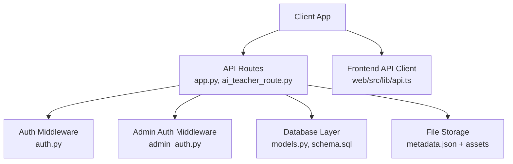
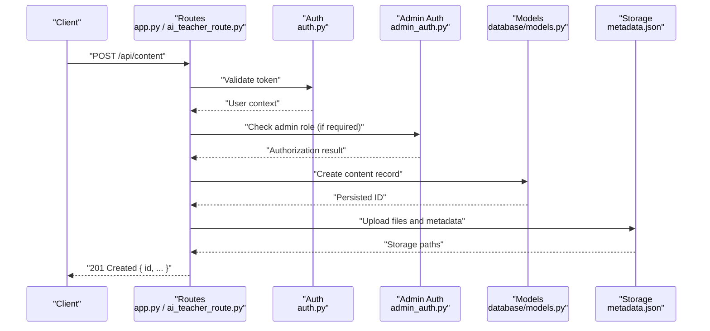
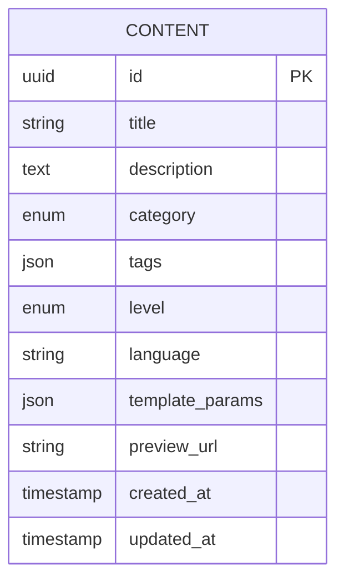
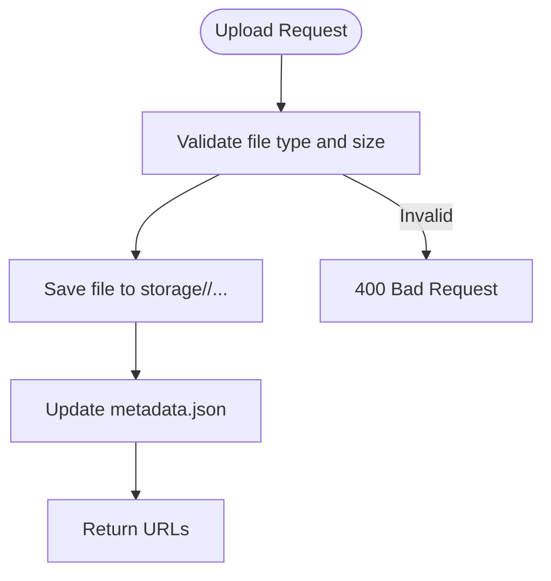
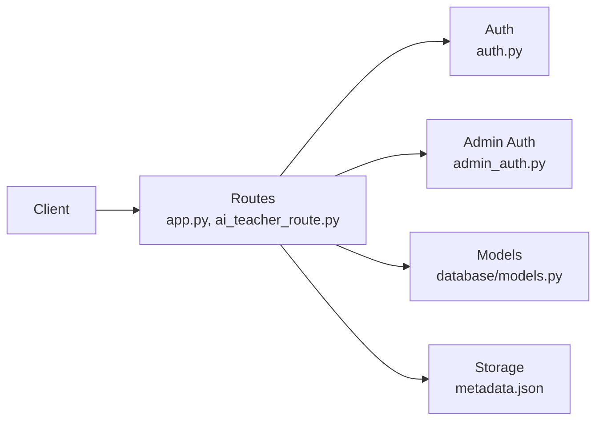

# Content CRUD Operations

<cite>
**Referenced Files in This Document**
- [app.py](file://backend/app.py)
- [auth.py](file://backend/auth.py)
- [admin_auth.py](file://backend/admin_auth.py)
- [ai_teacher_route.py](file://backend/ai_teacher_route.py)
- [database/models.py](file://backend/database/models.py)
- [database/schema.sql](file://backend/database/schema.sql)
- [storage/metadata.json](file://storage/02f5efec-416c-4a17-9bf2-7ebea80cf178/metadata.json)
- [web/src/lib/api.ts](file://web/src/lib/api.ts)
</cite>

## Table of Contents
1. [Introduction](#introduction)
2. [Project Structure](#project-structure)
3. [Core Components](#core-components)
4. [Architecture Overview](#architecture-overview)
5. [Detailed Component Analysis](#detailed-component-analysis)
6. [Dependency Analysis](#dependency-analysis)
7. [Performance Considerations](#performance-considerations)
8. [Troubleshooting Guide](#troubleshooting-guide)
9. [Conclusion](#conclusion)

## Introduction
This document specifies the content Create, Read, Update, and Delete (CRUD) operations for teaching materials in the XSYY Edu platform. It covers HTTP endpoints, request/response schemas, authentication and authorization requirements, error handling patterns, batch/bulk operations, validation rules, lifecycle states, status codes, and response formats. The goal is to provide a clear, actionable reference for frontend and backend developers integrating with the content APIs.

## Project Structure
The content management functionality spans several modules:
- API routes and controllers are defined in the backend application entrypoint and specialized route files.
- Authentication and admin authorization are handled by dedicated modules.
- Data models and database schema define the structure of content entities.
- Storage contains material artifacts and metadata per item.
- Frontend API client code demonstrates usage patterns.

**Diagram sources**
- [app.py](file://backend/app.py)
- [ai_teacher_route.py](file://backend/ai_teacher_route.py)
- [auth.py](file://backend/auth.py)
- [admin_auth.py](file://backend/admin_auth.py)
- [database/models.py](file://backend/database/models.py)
- [database/schema.sql](file://backend/database/schema.sql)
- [storage/metadata.json](file://storage/02f5efec-416c-4a17-9bf2-7ebea80cf178/metadata.json)
- [web/src/lib/api.ts](file://web/src/lib/api.ts)

**Section sources**
- [app.py](file://backend/app.py)
- [ai_teacher_route.py](file://backend/ai_teacher_route.py)
- [auth.py](file://backend/auth.py)
- [admin_auth.py](file://backend/admin_auth.py)
- [database/models.py](file://backend/database/models.py)
- [database/schema.sql](file://backend/database/schema.sql)
- [storage/metadata.json](file://storage/02f5efec-416c-4a17-9bf2-7ebea80cf178/metadata.json)
- [web/src/lib/api.ts](file://web/src/lib/api.ts)

## Core Components
- API Controllers: Route handlers for content endpoints (create, read, update, delete), search, and bulk operations.
- Authentication: Token-based access control for authenticated users.
- Authorization: Role-based checks for administrative actions on content.
- Data Models: ORM or model definitions for content entities and relationships.
- Storage: File system storage for teaching materials and associated metadata.
- Frontend API Client: Typed helpers for calling content endpoints from the web app.

Key responsibilities:
- Validate incoming requests and enforce business rules.
- Persist content metadata and manage file uploads.
- Enforce user permissions and role-based access.
- Return consistent JSON responses with standardized error structures.

**Section sources**
- [app.py](file://backend/app.py)
- [ai_teacher_route.py](file://backend/ai_teacher_route.py)
- [auth.py](file://backend/auth.py)
- [admin_auth.py](file://backend/admin_auth.py)
- [database/models.py](file://backend/database/models.py)
- [database/schema.sql](file://backend/database/schema.sql)
- [web/src/lib/api.ts](file://web/src/lib/api.ts)

## Architecture Overview
The content CRUD flow involves the client invoking REST endpoints protected by authentication and optional admin authorization. Controllers orchestrate validation, call data models for persistence, and interact with storage for file operations. Responses follow a consistent JSON envelope.

**Diagram sources**
- [app.py](file://backend/app.py)
- [ai_teacher_route.py](file://backend/ai_teacher_route.py)
- [auth.py](file://backend/auth.py)
- [admin_auth.py](file://backend/admin_auth.py)
- [database/models.py](file://backend/database/models.py)
- [storage/metadata.json](file://storage/02f5efec-416c-4a17-9bf2-7ebea80cf178/metadata.json)

## Detailed Component Analysis

### Content Endpoints
The following endpoints implement content CRUD and related operations. Replace placeholders with actual values when testing.

- Create Teaching Material
  - Method: POST
  - Path: /api/content
  - Auth: Required (Bearer token)
  - Admin-only: Yes
  - Request body (JSON):
    - title: string (required)
    - description: string (optional)
    - category: string (enum; required)
    - tags: array of strings (optional)
    - level: string (enum; optional)
    - language: string (ISO code; optional)
    - template_params: object (optional; key-value pairs for rendering)
    - preview_url: string (optional; link to preview asset)
    - files: array of objects (optional; see Uploads section)
  - Response: 201 Created
    - id: string (UUID)
    - title: string
    - description: string
    - category: string
    - tags: array of strings
    - level: string
    - language: string
    - template_params: object
    - preview_url: string
    - created_at: timestamp
    - updated_at: timestamp
  - Errors:
    - 400 Bad Request: Validation errors
    - 401 Unauthorized: Missing or invalid token
    - 403 Forbidden: Insufficient privileges
    - 422 Unprocessable Entity: Semantic validation failures

- Get Content by ID
  - Method: GET
  - Path: /api/content/{id}
  - Auth: Optional (public if allowed by policy)
  - Response: 200 OK
    - id: string
    - title: string
    - description: string
    - category: string
    - tags: array of strings
    - level: string
    - language: string
    - template_params: object
    - preview_url: string
    - created_at: timestamp
    - updated_at: timestamp
  - Errors:
    - 404 Not Found: Content does not exist

- Search Content
  - Method: GET
  - Path: /api/content/search
  - Query parameters:
    - q: string (optional; full-text or keyword)
    - category: string (optional)
    - level: string (optional)
    - language: string (optional)
    - tags: string (comma-separated; optional)
    - page: integer (default 1)
    - limit: integer (default 20; max 100)
  - Response: 200 OK
    - items: array of content summaries
    - total: integer
    - page: integer
    - limit: integer
  - Errors:
    - 400 Bad Request: Invalid query parameters

- Update Content
  - Method: PUT
  - Path: /api/content/{id}
  - Auth: Required (Bearer token)
  - Admin-only: Yes
  - Request body (JSON): Same fields as create; only provided fields are updated
  - Response: 200 OK
    - Updated content object
  - Errors:
    - 404 Not Found
    - 400 Bad Request
    - 401 Unauthorized
    - 403 Forbidden

- Delete Content
  - Method: DELETE
  - Path: /api/content/{id}
  - Auth: Required (Bearer token)
  - Admin-only: Yes
  - Response: 204 No Content
  - Errors:
    - 404 Not Found
    - 401 Unauthorized
    - 403 Forbidden

- Batch Create
  - Method: POST
  - Path: /api/content/batch
  - Auth: Required (Bearer token)
  - Admin-only: Yes
  - Request body (JSON):
    - items: array of content creation payloads (same as create)
  - Response: 201 Created
    - results: array of created items with ids and statuses
    - errors: array of per-item error details
  - Errors:
    - 400 Bad Request: Malformed payload
    - 401 Unauthorized
    - 403 Forbidden

- Bulk Update
  - Method: PATCH
  - Path: /api/content/bulk-update
  - Auth: Required (Bearer token)
  - Admin-only: Yes
  - Request body (JSON):
    - filter: object (e.g., category, level, tags)
    - updates: object (fields to update)
  - Response: 200 OK
    - updated_count: integer
    - failed_ids: array of ids that could not be updated
  - Errors:
    - 400 Bad Request
    - 401 Unauthorized
    - 403 Forbidden

- Upload Files
  - Method: POST
  - Path: /api/content/{id}/files
  - Auth: Required (Bearer token)
  - Admin-only: Yes
  - Content-Type: multipart/form-data
  - Form fields:
    - file: binary (required; one or multiple)
    - type: string (enum; e.g., "preview", "attachment")
  - Response: 201 Created
    - urls: array of storage URLs
  - Errors:
    - 400 Bad Request: Invalid file type or size
    - 404 Not Found: Content not found
    - 401 Unauthorized
    - 403 Forbidden

Notes:
- All timestamps use ISO 8601 format.
- IDs are UUID strings.
- Pagination defaults apply unless overridden.

**Section sources**
- [app.py](file://backend/app.py)
- [ai_teacher_route.py](file://backend/ai_teacher_route.py)
- [auth.py](file://backend/auth.py)
- [admin_auth.py](file://backend/admin_auth.py)
- [database/models.py](file://backend/database/models.py)
- [database/schema.sql](file://backend/database/schema.sql)

### Authentication and Authorization
- Authentication:
  - Bearer token via Authorization header.
  - Tokens validated by middleware before reaching route handlers.
- Authorization:
  - Admin-only endpoints require an admin role claim.
  - Public reads may be allowed depending on configuration.

Error responses:
- 401 Unauthorized: Missing or invalid token.
- 403 Forbidden: Valid token but insufficient privileges.

**Section sources**
- [auth.py](file://backend/auth.py)
- [admin_auth.py](file://backend/admin_auth.py)

### Data Model and Schema
Content entities include fields such as title, description, category, tags, level, language, template parameters, and timestamps. Relationships and constraints are defined in the schema.

**Diagram sources**
- [database/models.py](file://backend/database/models.py)
- [database/schema.sql](file://backend/database/schema.sql)

**Section sources**
- [database/models.py](file://backend/database/models.py)
- [database/schema.sql](file://backend/database/schema.sql)

### Storage and Metadata
Each content item has a unique directory under storage containing:
- metadata.json: Structured metadata for the item.
- teaching.html: Generated teaching material.
- Additional assets referenced by preview_url or attachments.

**Diagram sources**
- [storage/metadata.json](file://storage/02f5efec-416c-4a17-9bf2-7ebea80cf178/metadata.json)

**Section sources**
- [storage/metadata.json](file://storage/02f5efec-416c-4a17-9bf2-7ebea80cf178/metadata.json)

### Frontend Integration
The frontend API client provides typed methods for content operations, including pagination and error handling. Use these helpers to ensure consistent request formatting and response parsing.

Example usage patterns:
- Fetch content list with filters and pagination.
- Create content with metadata and optional files.
- Update and delete content with proper auth headers.

**Section sources**
- [web/src/lib/api.ts](file://web/src/lib/api.ts)

## Dependency Analysis
The content API depends on authentication, authorization, data models, and storage. The diagram below shows how components relate during a typical request.

**Diagram sources**
- [app.py](file://backend/app.py)
- [ai_teacher_route.py](file://backend/ai_teacher_route.py)
- [auth.py](file://backend/auth.py)
- [admin_auth.py](file://backend/admin_auth.py)
- [database/models.py](file://backend/database/models.py)
- [storage/metadata.json](file://storage/02f5efec-416c-4a17-9bf2-7ebea80cf178/metadata.json)

**Section sources**
- [app.py](file://backend/app.py)
- [ai_teacher_route.py](file://backend/ai_teacher_route.py)
- [auth.py](file://backend/auth.py)
- [admin_auth.py](file://backend/admin_auth.py)
- [database/models.py](file://backend/database/models.py)
- [storage/metadata.json](file://storage/02f5efec-416c-4a17-9bf2-7ebea80cf178/metadata.json)

## Performance Considerations
- Pagination: Always use page and limit for list/search endpoints to avoid large payloads.
- Indexing: Ensure database indexes on frequently filtered fields (category, level, language).
- Caching: Cache public read responses where appropriate with short TTLs.
- File Uploads: Stream large files and validate types/sizes server-side.
- Batch/Bulk: Prefer batch endpoints for multiple operations to reduce round trips.

[No sources needed since this section provides general guidance]

## Troubleshooting Guide
Common issues and resolutions:
- 401 Unauthorized: Verify Authorization header includes a valid Bearer token.
- 403 Forbidden: Confirm the user has admin privileges for write operations.
- 400 Bad Request: Check required fields and enums; review validation error messages.
- 404 Not Found: Ensure the content ID exists and is accessible.
- 422 Unprocessable Entity: Review semantic validation rules (e.g., incompatible template parameters).
- Storage Errors: Validate file types and sizes; check storage permissions and disk space.

Operational tips:
- Log request IDs for tracing across services.
- Include structured error responses with field-level details for clients.
- Monitor storage growth and clean up orphaned files.

**Section sources**
- [auth.py](file://backend/auth.py)
- [admin_auth.py](file://backend/admin_auth.py)
- [app.py](file://backend/app.py)

## Conclusion
The XSYY Edu content APIs provide robust CRUD capabilities for teaching materials with strong authentication and authorization controls. By adhering to the specified schemas, validation rules, and error handling patterns, integrators can reliably create, retrieve, update, and delete content while supporting batch and bulk operations. Proper indexing, caching, and storage practices will help maintain performance at scale.

[No sources needed since this section summarizes without analyzing specific files]