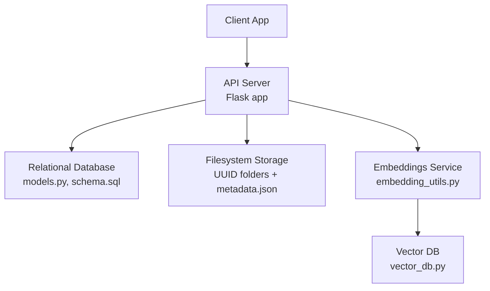
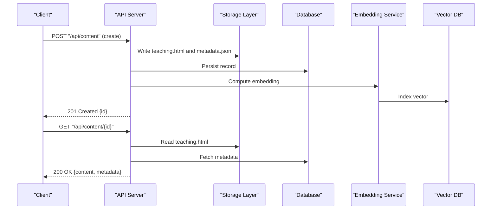
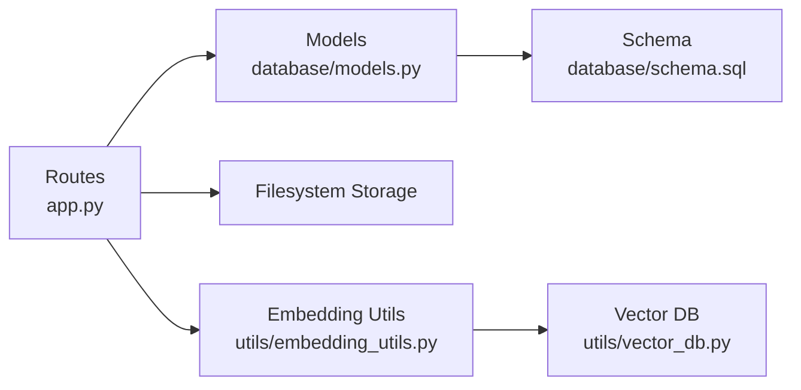

# Content Management API

<cite>
**Referenced Files in This Document**
- [app.py](file://backend/app.py)
- [config.py](file://backend/config.py)
- [database/models.py](file://backend/database/models.py)
- [storage/.../metadata.json](file://storage/02f5efec-416c-4a17-9bf2-7ebea80cf178/metadata.json)
- [storage/.../teaching.html](file://storage/02f5efec-416c-4a17-9bf2-7ebea80cf178/teaching.html)
- [prompt/teaching_template.html](file://backend/prompt/teaching_template.html)
- [utils/embedding_utils.py](file://backend/utils/embedding_utils.py)
- [utils/vector_db.py](file://backend/utils/vector_db.py)
- [database/schema.sql](file://backend/database/schema.sql)
</cite>

## Table of Contents
1. [Introduction](#introduction)
2. [Project Structure](#project-structure)
3. [Core Components](#core-components)
4. [Architecture Overview](#architecture-overview)
5. [Detailed Component Analysis](#detailed-component-analysis)
6. [Dependency Analysis](#dependency-analysis)
7. [Performance Considerations](#performance-considerations)
8. [Troubleshooting Guide](#troubleshooting-guide)
9. [Conclusion](#conclusion)
10. [Appendices](#appendices)

## Introduction
This document provides a comprehensive Content Management API reference for the XSYY Edu platform. It covers teaching materials CRUD, file upload/download, metadata management, search and filtering, versioning strategies, and bulk operations. The API is organized under /api/content/* and /api/storage/*. It also describes storage architecture, metadata structure, content lifecycle states, and practical workflows such as template-based generation and retrieval patterns.

## Project Structure
The backend exposes REST endpoints that coordinate with a relational database and a filesystem-based object store. Teaching materials are persisted as HTML documents alongside JSON metadata files within UUID-named directories. Vector embeddings are maintained separately to support semantic search.

**Diagram sources**
- [app.py](file://backend/app.py)
- [database/models.py](file://backend/database/models.py)
- [database/schema.sql](file://backend/database/schema.sql)
- [utils/embedding_utils.py](file://backend/utils/embedding_utils.py)
- [utils/vector_db.py](file://backend/utils/vector_db.py)

**Section sources**
- [app.py](file://backend/app.py)
- [config.py](file://backend/config.py)
- [database/models.py](file://backend/database/models.py)
- [database/schema.sql](file://backend/database/schema.sql)

## Core Components
- API server: Flask application wiring routes for content and storage operations.
- Data models: ORM definitions and SQL schema for teaching materials and related entities.
- Filesystem storage: UUID-scoped directories containing teaching.html and metadata.json.
- Search and indexing: Embedding utilities and vector database integration for semantic search.
- Templates: HTML templates used for AI-assisted content generation.

Key responsibilities:
- Route handlers orchestrate request validation, business logic, and persistence.
- Storage layer manages file I/O and metadata synchronization.
- Search pipeline computes embeddings and indexes content for retrieval.

**Section sources**
- [app.py](file://backend/app.py)
- [database/models.py](file://backend/database/models.py)
- [utils/embedding_utils.py](file://backend/utils/embedding_utils.py)
- [utils/vector_db.py](file://backend/utils/vector_db.py)
- [prompt/teaching_template.html](file://backend/prompt/teaching_template.html)

## Architecture Overview
The content management system follows a layered architecture:
- Presentation: HTTP endpoints under /api/content/* and /api/storage/*.
- Application: Controllers handle requests, validate inputs, and coordinate services.
- Domain: Business rules enforce content lifecycle and versioning.
- Infrastructure: Database and filesystem storage provide persistence; vector DB supports search.

**Diagram sources**
- [app.py](file://backend/app.py)
- [database/models.py](file://backend/database/models.py)
- [utils/embedding_utils.py](file://backend/utils/embedding_utils.py)
- [utils/vector_db.py](file://backend/utils/vector_db.py)

## Detailed Component Analysis

### Content Endpoints (/api/content/*)
- Create teaching material
  - Method: POST
  - URL: /api/content
  - Request body: JSON payload including title, description, tags, category, authorId, and optional templateId or prompt fields for AI generation.
  - Response: 201 Created with created resource id and metadata link.
  - Behavior: Persists teaching.html and metadata.json, creates DB record, computes embedding, indexes vector.
- List and search
  - Method: GET
  - URL: /api/content
  - Query parameters:
    - q: free-text search (semantic if supported)
    - category, tags, authorId: filters
    - sort: field name (e.g., createdAt, updatedAt)
    - order: asc|desc
    - page, pageSize: pagination
  - Response: Paginated list with items and total count.
- Get by ID
  - Method: GET
  - URL: /api/content/{id}
  - Response: Full content and metadata.
- Update
  - Method: PUT
  - URL: /api/content/{id}
  - Request body: Partial or full update fields.
  - Response: Updated resource.
- Delete
  - Method: DELETE
  - URL: /api/content/{id}
  - Response: 204 No Content on success.
- Versioning
  - Method: POST
  - URL: /api/content/{id}/versions
  - Request body: Optional note describing change.
  - Response: New version id and links to previous/latest.
- Bulk operations
  - Method: POST
  - URL: /api/content/bulk
  - Request body: Array of operations (create, update, delete) with payloads per item.
  - Response: Summary with successes and failures.

Notes:
- All write endpoints require authentication.
- Search may leverage vector index when q is provided.

**Section sources**
- [app.py](file://backend/app.py)
- [database/models.py](file://backend/database/models.py)

### Storage Endpoints (/api/storage/*)
- Upload file
  - Method: POST
  - URL: /api/storage/upload
  - Form fields:
    - file: binary file
    - contentType: MIME type hint
    - parentId: optional parent content id
  - Response: 201 Created with storage path and checksum.
- Download file
  - Method: GET
  - URL: /api/storage/{path}
  - Response: Binary stream with appropriate Content-Type.
- Delete file
  - Method: DELETE
  - URL: /api/storage/{path}
  - Response: 204 No Content on success.
- List directory
  - Method: GET
  - URL: /api/storage/list?prefix={folder}
  - Response: Directory listing with names and sizes.

Security:
- Path traversal protection enforced.
- Access control tied to content ownership.

**Section sources**
- [app.py](file://backend/app.py)
- [config.py](file://backend/config.py)

### Metadata Management
Metadata is stored as JSON alongside each teaching material. Typical fields include:
- id: unique identifier
- title: human-readable title
- description: summary text
- tags: array of strings
- category: classification label
- authorId: creator identifier
- versions: array of version descriptors
- createdAt, updatedAt: timestamps
- status: lifecycle state

Lifecycle states:
- draft: initial creation
- published: visible to users
- archived: hidden from normal listings
- deleted: soft-deleted or removed

Versioning strategy:
- Each update can create a new version entry referencing the prior version.
- Latest version is marked explicitly.
- Rollback to a specific version is supported via dedicated endpoint.

Example metadata location:
- storage/<uuid>/metadata.json

**Section sources**
- [storage/02f5efec-416c-4a17-9bf2-7ebea80cf178/metadata.json](file://storage/02f5efec-416c-4a17-9bf2-7ebea80cf178/metadata.json)
- [database/models.py](file://backend/database/models.py)

### Search and Filtering
- Text search:
  - Parameter q supports keyword matching and, when enabled, semantic search using embeddings.
- Filters:
  - category, tags, authorId, status, date ranges.
- Sorting:
  - sort=createdAt|updatedAt|title
  - order=asc|desc
- Pagination:
  - page (default 1), pageSize (default 20, max configurable).

Semantic search flow:
- Client sends q.
- Server computes embedding via embedding service.
- Vector DB returns top-k results.
- Results merged with DB filters and paginated.

**Section sources**
- [utils/embedding_utils.py](file://backend/utils/embedding_utils.py)
- [utils/vector_db.py](file://backend/utils/vector_db.py)
- [database/models.py](file://backend/database/models.py)

### Template-Based Generation
- Endpoint: POST /api/content/generate
- Request body:
  - templateId: references an HTML template
  - variables: key-value pairs injected into template
  - prompt: optional natural language instructions
- Response:
  - 201 Created with generated content id and preview link.

Template file example:
- backend/prompt/teaching_template.html

Workflow:
- Validate template and variables.
- Render template to HTML.
- Persist teaching.html and metadata.json.
- Compute embedding and index.

**Section sources**
- [prompt/teaching_template.html](file://backend/prompt/teaching_template.html)
- [app.py](file://backend/app.py)

### Retrieval Patterns
- Single item: GET /api/content/{id}
- List with filters: GET /api/content?category=&tags=&authorId=&status=&sort=&order=&page=&pageSize=
- Semantic search: GET /api/content?q=<query>&topK=10
- Versioned retrieval: GET /api/content/{id}?version=<versionId>
- Bulk read: Not exposed directly; use list with filters.

**Section sources**
- [app.py](file://backend/app.py)

## Dependency Analysis
High-level dependencies between components:

**Diagram sources**
- [app.py](file://backend/app.py)
- [database/models.py](file://backend/database/models.py)
- [database/schema.sql](file://backend/database/schema.sql)
- [utils/embedding_utils.py](file://backend/utils/embedding_utils.py)
- [utils/vector_db.py](file://backend/utils/vector_db.py)

**Section sources**
- [app.py](file://backend/app.py)
- [database/models.py](file://backend/database/models.py)
- [database/schema.sql](file://backend/database/schema.sql)
- [utils/embedding_utils.py](file://backend/utils/embedding_utils.py)
- [utils/vector_db.py](file://backend/utils/vector_db.py)

## Performance Considerations
- Pagination: Always use page and pageSize to limit response size.
- Indexing: Ensure DB indexes exist for frequently filtered columns (category, tags, authorId, status).
- Vector search: Cache embeddings for repeated queries; tune topK to balance accuracy and latency.
- File I/O: Stream large downloads; avoid loading entire files into memory.
- Concurrency: Use connection pooling for DB and async tasks for embedding computation where possible.

[No sources needed since this section provides general guidance]

## Troubleshooting Guide
Common issues and resolutions:
- Authentication failures: Verify token presence and permissions for write endpoints.
- File not found: Confirm UUID folder exists and teaching.html/metadata.json are present.
- Search returns no results: Check q parameter and whether semantic search is enabled; verify vector index consistency.
- Version rollback errors: Ensure target version exists and is not already latest.
- Bulk operation partial failures: Inspect response summary for failed items and retry individually.

Operational checks:
- Validate storage paths and permissions.
- Confirm DB connectivity and schema migrations applied.
- Monitor embedding service health and vector DB availability.

**Section sources**
- [app.py](file://backend/app.py)
- [config.py](file://backend/config.py)

## Conclusion
The XSYY Edu Content Management API provides robust capabilities for creating, managing, searching, and versioning teaching materials. Its design separates concerns across API, storage, and search layers, enabling scalability and maintainability. By following the documented endpoints, schemas, and best practices, clients can integrate seamlessly with the platform’s content ecosystem.

[No sources needed since this section summarizes without analyzing specific files]

## Appendices

### Request/Response Examples (Conceptual)
- Create content:
  - Request: JSON with title, description, tags, category, authorId, optional templateId/prompt.
  - Response: 201 with id and metadata link.
- Update content:
  - Request: JSON with fields to update.
  - Response: 200 with updated resource.
- Search:
  - Request: GET /api/content?q=...&category=...&tags=...&sort=createdAt&order=desc&page=1&pageSize=20.
  - Response: Paginated list with items and total.

[No sources needed since this section provides conceptual examples]