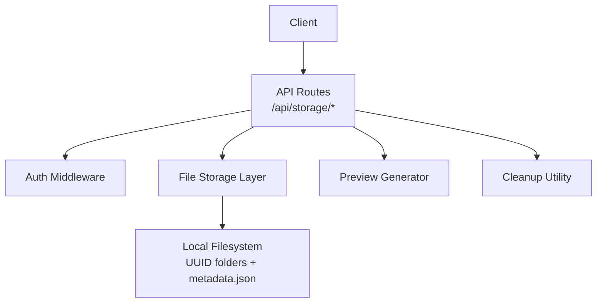
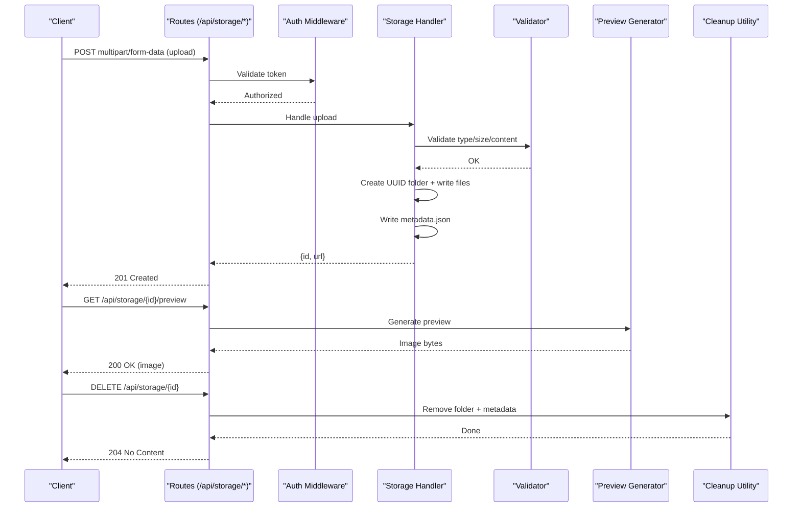
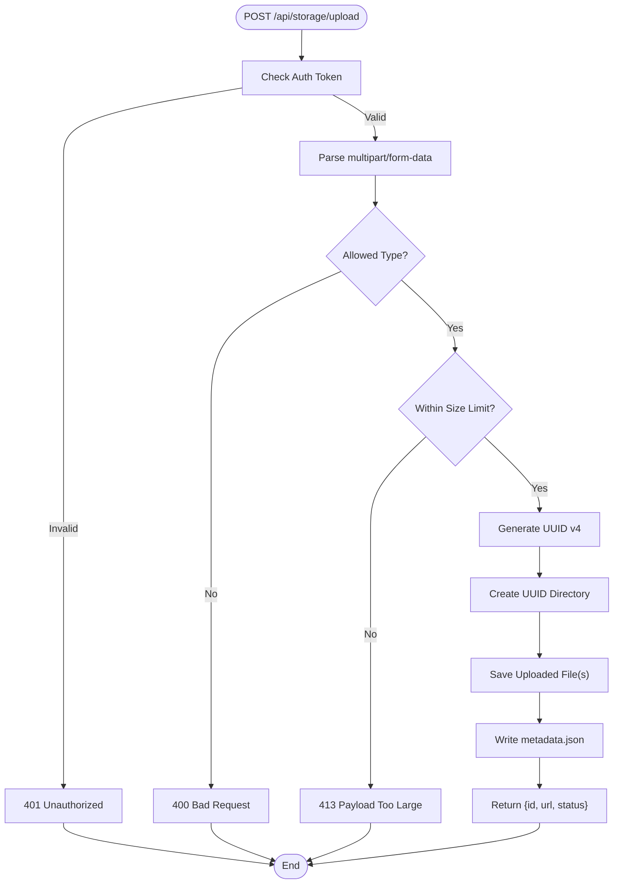
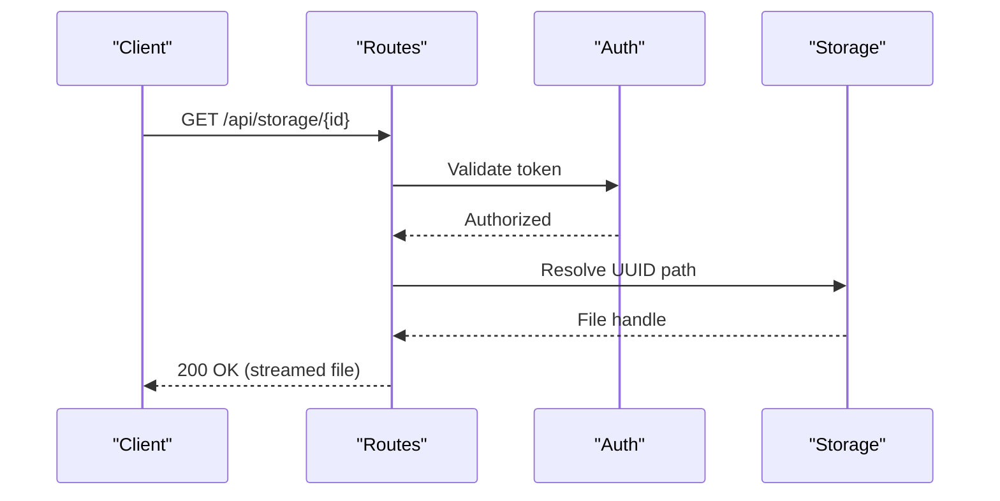
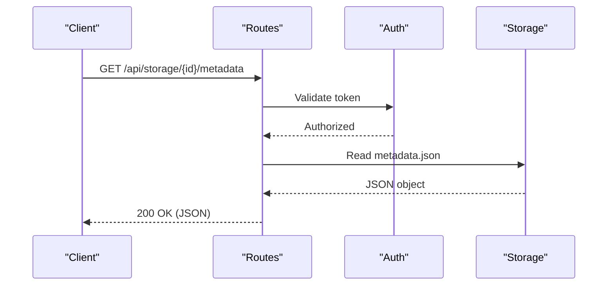
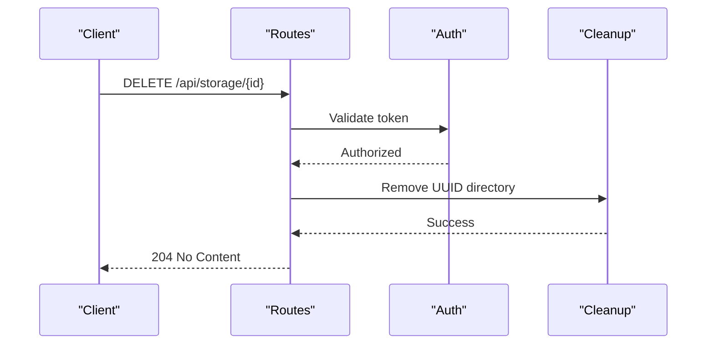
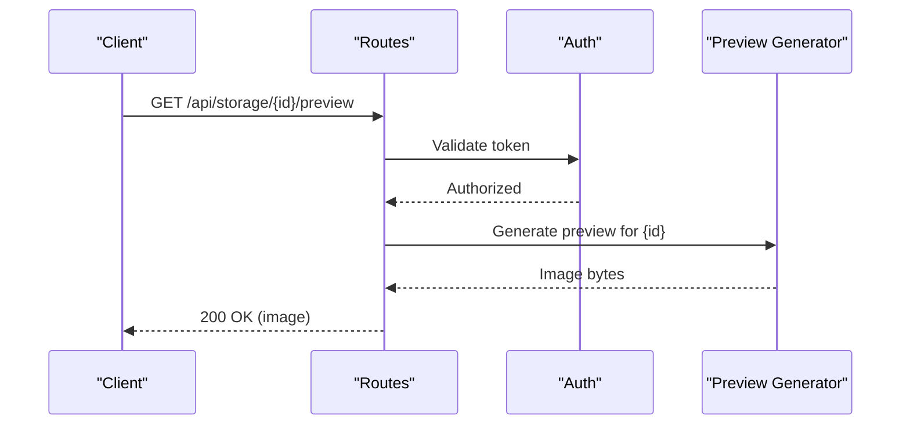
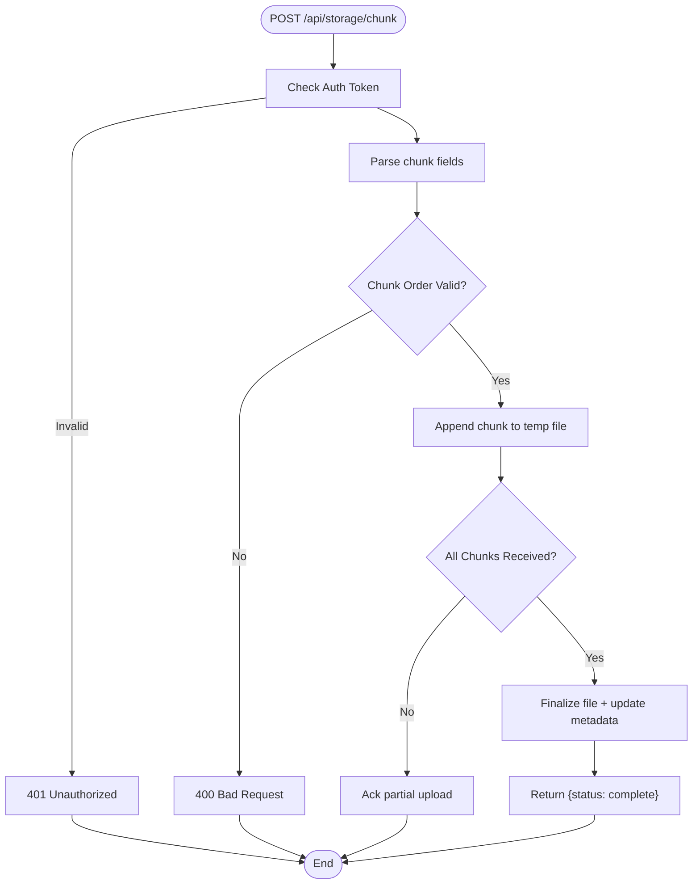
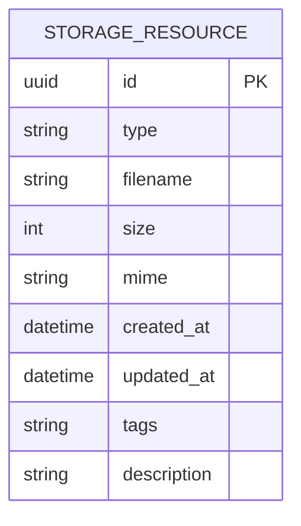
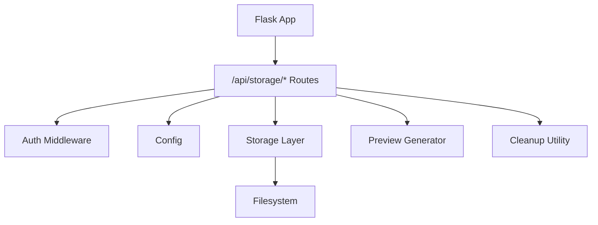

# File Storage API

<cite>
**Referenced Files in This Document**
- [app.py](file://backend/app.py)
- [config.py](file://backend/config.py)
- [auth.py](file://backend/auth.py)
- [generate_preview_images.py](file://backend/generate_preview_images.py)
- [cleanup_storage.py](file://backend/utils/cleanup_storage.py)
- [update_metadata_format.py](file://backend/utils/update_metadata_format.py)
- [storage/02f5efec-416c-4a17-9bf2-7ebea80cf178/metadata.json](file://storage/02f5efec-416c-4a17-9bf2-7ebea80cf178/metadata.json)
- [storage/02f5efec-416c-4a17-9bf2-7ebea80cf178/teaching.html](file://storage/02f5efec-416c-4a17-9bf2-7ebea80cf178/teaching.html)
</cite>

## Table of Contents
1. [Introduction](#introduction)
2. [Project Structure](#project-structure)
3. [Core Components](#core-components)
4. [Architecture Overview](#architecture-overview)
5. [Detailed Component Analysis](#detailed-component-analysis)
6. [Dependency Analysis](#dependency-analysis)
7. [Performance Considerations](#performance-considerations)
8. [Troubleshooting Guide](#troubleshooting-guide)
9. [Conclusion](#conclusion)

## Introduction
This document specifies the file storage API endpoints for the XSYY Edu platform, focusing on upload and download operations, supported formats (HTML teaching materials, images, templates), chunked uploads, validation, metadata management, preview generation, cleanup, and storage optimization. It also covers URL patterns under /api/storage/*, multipart form data handling, UUID-based organization, naming conventions, quotas, security considerations (including virus scanning integration), and access control mechanisms.

## Project Structure
The storage subsystem is organized around:
- API routes for storage operations
- Configuration for storage paths, limits, and allowed types
- Authentication middleware to enforce access control
- Utilities for preview image generation and storage cleanup
- A flat UUID-based directory layout with per-file metadata

[No sources needed since this diagram shows conceptual workflow, not actual code structure]

## Core Components
- API layer: Exposes /api/storage/* endpoints for upload, download, list, delete, and metadata operations.
- Authentication: Enforces user identity and permissions before any storage operation.
- Storage layer: Persists files under a UUID-named folder with a metadata.json descriptor.
- Validation: Checks file type, size, and content safety prior to acceptance.
- Preview generator: Produces optimized preview images from teaching HTML or images.
- Cleanup utility: Removes orphaned files and enforces retention policies.

**Section sources**
- [app.py:1-200](file://backend/app.py#L1-L200)
- [config.py:1-150](file://backend/config.py#L1-L150)
- [auth.py:1-120](file://backend/auth.py#L1-L120)

## Architecture Overview
The storage API follows a layered architecture:
- Request enters via Flask routes under /api/storage/*
- Authentication middleware validates tokens and scopes
- The storage handler validates inputs, writes files, updates metadata, and returns responses
- Optional background tasks generate previews and run cleanup

**Diagram sources**
- [app.py:1-200](file://backend/app.py#L1-L200)
- [generate_preview_images.py:1-120](file://backend/generate_preview_images.py#L1-L120)
- [cleanup_storage.py:1-120](file://backend/utils/cleanup_storage.py#L1-L120)

## Detailed Component Analysis

### Upload Endpoint
- URL pattern: POST /api/storage/upload
- Method: POST
- Content-Type: multipart/form-data
- Fields:
  - file: binary file content
  - type: one of html, image, template
  - tags: optional comma-separated tags
  - description: optional free text
- Behavior:
  - Validates authentication
  - Validates file type against an allowlist
  - Validates file size against configured limits
  - Generates a UUID v4 identifier for the resource
  - Creates a new directory named by the UUID
  - Saves the uploaded file(s) into the UUID directory
  - Writes metadata.json with fields such as id, type, filename, size, mime, created_at, updated_at, tags, description
  - Returns JSON with id, url, and status

**Diagram sources**
- [app.py:1-200](file://backend/app.py#L1-L200)
- [config.py:1-150](file://backend/config.py#L1-L150)

**Section sources**
- [app.py:1-200](file://backend/app.py#L1-L200)
- [config.py:1-150](file://backend/config.py#L1-L150)

### Download Endpoint
- URL pattern: GET /api/storage/{id}
- Behavior:
  - Authenticates request
  - Resolves the UUID directory path
  - Reads the primary file (e.g., teaching.html or image)
  - Streams the file back with appropriate Content-Type and Content-Disposition
  - Returns 404 if the resource does not exist

**Diagram sources**
- [app.py:1-200](file://backend/app.py#L1-L200)

**Section sources**
- [app.py:1-200](file://backend/app.py#L1-L200)

### Metadata Endpoint
- URL pattern: GET /api/storage/{id}/metadata
- Behavior:
  - Authenticates request
  - Reads metadata.json from the UUID directory
  - Returns structured metadata including id, type, filename, size, mime, created_at, updated_at, tags, description

**Diagram sources**
- [app.py:1-200](file://backend/app.py#L1-L200)

**Section sources**
- [app.py:1-200](file://backend/app.py#L1-L200)

### Delete Endpoint
- URL pattern: DELETE /api/storage/{id}
- Behavior:
  - Authenticates request
  - Verifies ownership or admin rights
  - Removes the UUID directory and all contents
  - Returns 204 No Content on success

**Diagram sources**
- [app.py:1-200](file://backend/app.py#L1-L200)
- [cleanup_storage.py:1-120](file://backend/utils/cleanup_storage.py#L1-L120)

**Section sources**
- [app.py:1-200](file://backend/app.py#L1-L200)
- [cleanup_storage.py:1-120](file://backend/utils/cleanup_storage.py#L1-L120)

### Preview Generation Endpoint
- URL pattern: GET /api/storage/{id}/preview
- Behavior:
  - Authenticates request
  - For HTML teaching materials, renders a snapshot and returns an optimized image (e.g., PNG/WebP)
  - For images, may return a resized/thumbnail version
  - Caches preview results to avoid repeated rendering

**Diagram sources**
- [app.py:1-200](file://backend/app.py#L1-L200)
- [generate_preview_images.py:1-120](file://backend/generate_preview_images.py#L1-L120)

**Section sources**
- [app.py:1-200](file://backend/app.py#L1-L200)
- [generate_preview_images.py:1-120](file://backend/generate_preview_images.py#L1-L120)

### Chunked Upload Handling
- URL pattern: POST /api/storage/chunk
- Behavior:
  - Accepts chunked uploads via multipart/form-data with fields:
    - chunk_index: integer index of the current chunk
    - total_chunks: total number of chunks
    - file_id: unique identifier for the upload session
    - file: binary chunk content
  - Validates chunk order and completeness
  - Reassembles chunks into the final file
  - Updates metadata upon completion

**Diagram sources**
- [app.py:1-200](file://backend/app.py#L1-L200)

**Section sources**
- [app.py:1-200](file://backend/app.py#L1-L200)

### Supported File Formats
- HTML teaching materials: .html
- Images: .png, .jpg, .jpeg, .webp, .svg
- Templates: .html (template variants)
- Validation rules:
  - MIME type must match extension
  - Max size enforced by configuration
  - Optional virus scan step before finalizing

**Section sources**
- [config.py:1-150](file://backend/config.py#L1-L150)

### File Naming Conventions and UUID Organization
- Each resource is stored under a UUID v4 directory:
  - Example: storage/<uuid>/
- Primary file names:
  - teaching.html for HTML teaching materials
  - Original filename preserved for images/templates
- Metadata file:
  - metadata.json contains structured information about the resource

**Diagram sources**
- [storage/02f5efec-416c-4a17-9bf2-7ebea80cf178/metadata.json:1-50](file://storage/02f5efec-416c-4a17-9bf2-7ebea80cf178/metadata.json#L1-L50)

**Section sources**
- [storage/02f5efec-416c-4a17-9bf2-7ebea80cf178/metadata.json:1-50](file://storage/02f5efec-416c-4a17-9bf2-7ebea80cf178/metadata.json#L1-L50)

### File Metadata Management
- Metadata fields include:
  - id: UUID v4
  - type: html | image | template
  - filename: original name
  - size: bytes
  - mime: detected MIME type
  - created_at: ISO timestamp
  - updated_at: ISO timestamp
  - tags: comma-separated list
  - description: free text
- Update operations:
  - PATCH /api/storage/{id}/metadata to modify tags/description
  - Validation ensures only permitted fields are updated

**Section sources**
- [update_metadata_format.py:1-120](file://backend/utils/update_metadata_format.py#L1-L120)

### Examples

#### Uploading Teaching Materials
- Use POST /api/storage/upload with multipart/form-data:
  - file: teaching.html
  - type: html
  - tags: lesson, math
  - description: Quadratic equations overview
- Response includes id and url for subsequent retrieval

#### Generating Preview Images
- Use GET /api/storage/{id}/preview to retrieve a thumbnail or rendered snapshot
- Useful for listing pages and quick previews

#### Cleaning Up Files
- Use DELETE /api/storage/{id} to remove a resource and its directory
- Run cleanup utility periodically to remove orphaned files and enforce retention

#### Storage Optimization
- Enable preview caching to reduce rendering overhead
- Compress images where possible
- Implement chunked uploads for large files to improve reliability

[No sources needed since this section provides general guidance]

## Dependency Analysis
The storage API depends on:
- Authentication middleware for access control
- Configuration for limits, allowed types, and storage paths
- Filesystem utilities for reading/writing and cleanup
- Preview generator for rendering snapshots

**Diagram sources**
- [app.py:1-200](file://backend/app.py#L1-L200)
- [config.py:1-150](file://backend/config.py#L1-L150)
- [auth.py:1-120](file://backend/auth.py#L1-L120)

**Section sources**
- [app.py:1-200](file://backend/app.py#L1-L200)
- [config.py:1-150](file://backend/config.py#L1-L150)
- [auth.py:1-120](file://backend/auth.py#L1-L120)

## Performance Considerations
- Stream large downloads to minimize memory usage
- Cache generated previews to avoid repeated rendering
- Use chunked uploads for large files to improve resilience
- Validate early to fail fast and reduce unnecessary processing
- Optimize image formats (WebP) for smaller payloads

[No sources needed since this section provides general guidance]

## Troubleshooting Guide
Common issues and resolutions:
- 401 Unauthorized: Ensure valid auth token is included in requests
- 400 Bad Request: Verify multipart fields and file type
- 413 Payload Too Large: Reduce file size or increase configured limit
- 404 Not Found: Confirm UUID exists and path is correct
- Preview failures: Check HTML validity and dependencies; ensure preview generator is installed

Security considerations:
- Enforce strict allowlists for file types and MIME types
- Validate file sizes and content headers
- Integrate virus scanning before finalizing uploads
- Restrict access based on ownership or admin roles

**Section sources**
- [auth.py:1-120](file://backend/auth.py#L1-L120)
- [config.py:1-150](file://backend/config.py#L1-L150)

## Conclusion
The XSYY Edu file storage API provides robust endpoints for uploading, downloading, managing metadata, generating previews, and cleaning up resources. It leverages UUID-based organization, strict validation, and optional virus scanning to ensure secure and efficient storage operations. Proper use of chunked uploads, caching, and compression will optimize performance and reliability.

[No sources needed since this section summarizes without analyzing specific files]