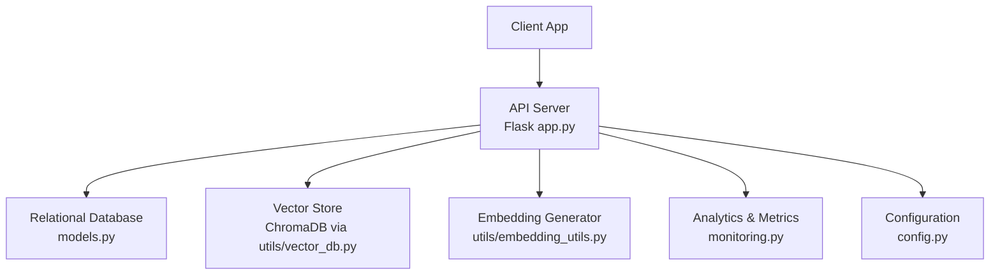
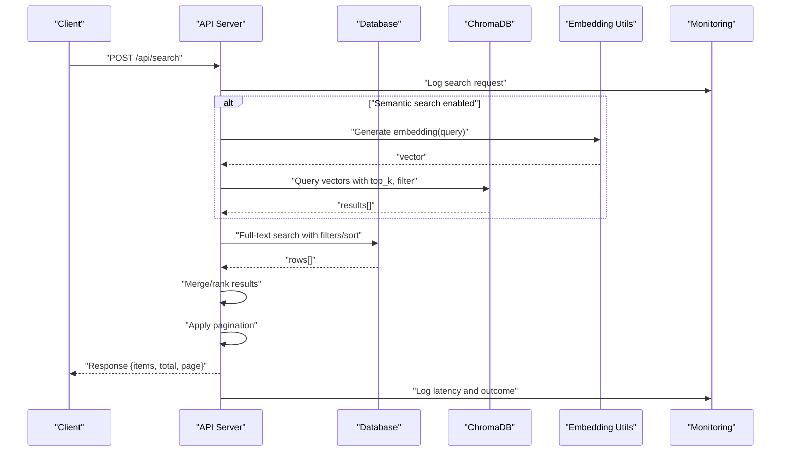
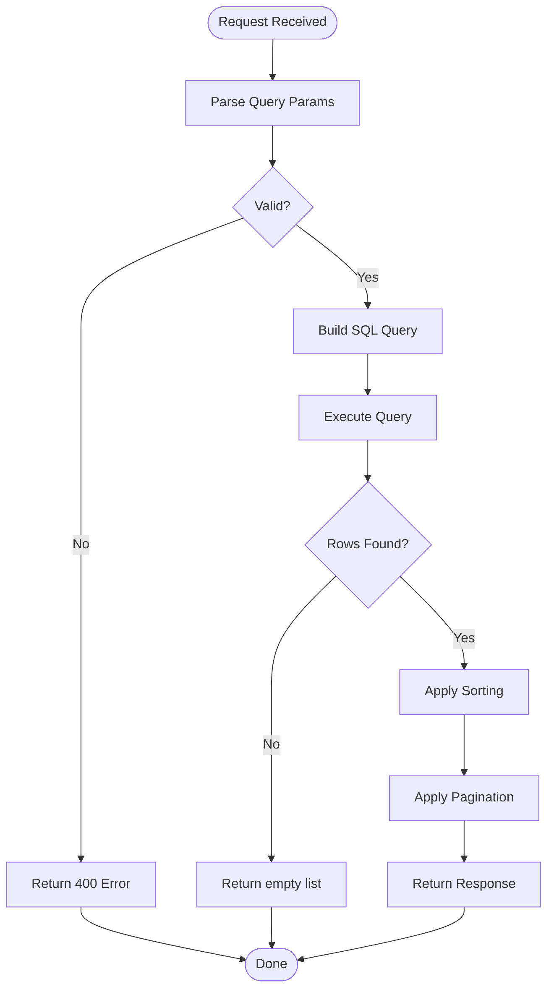
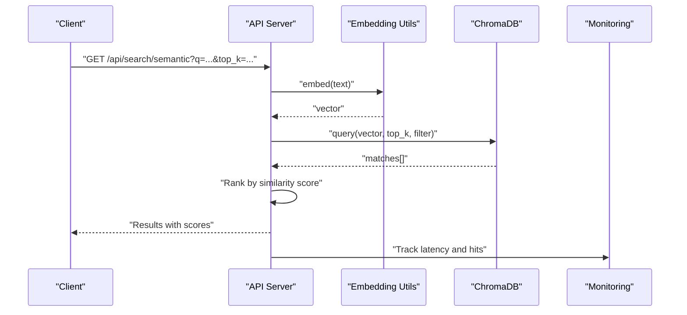
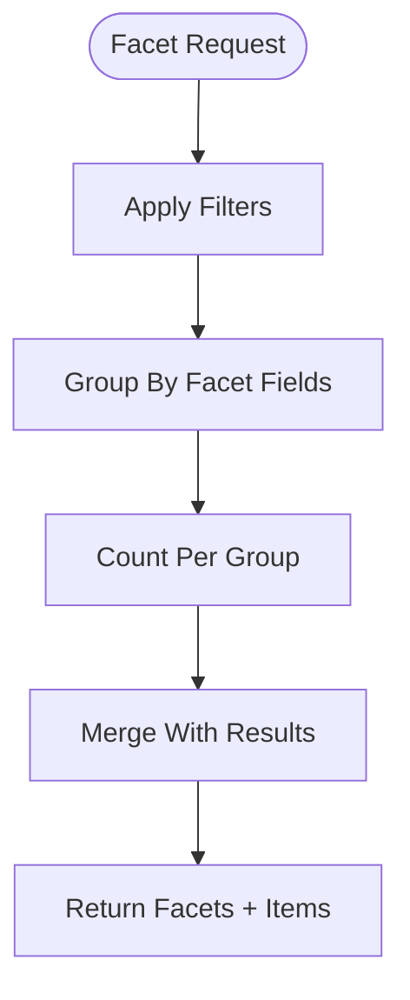
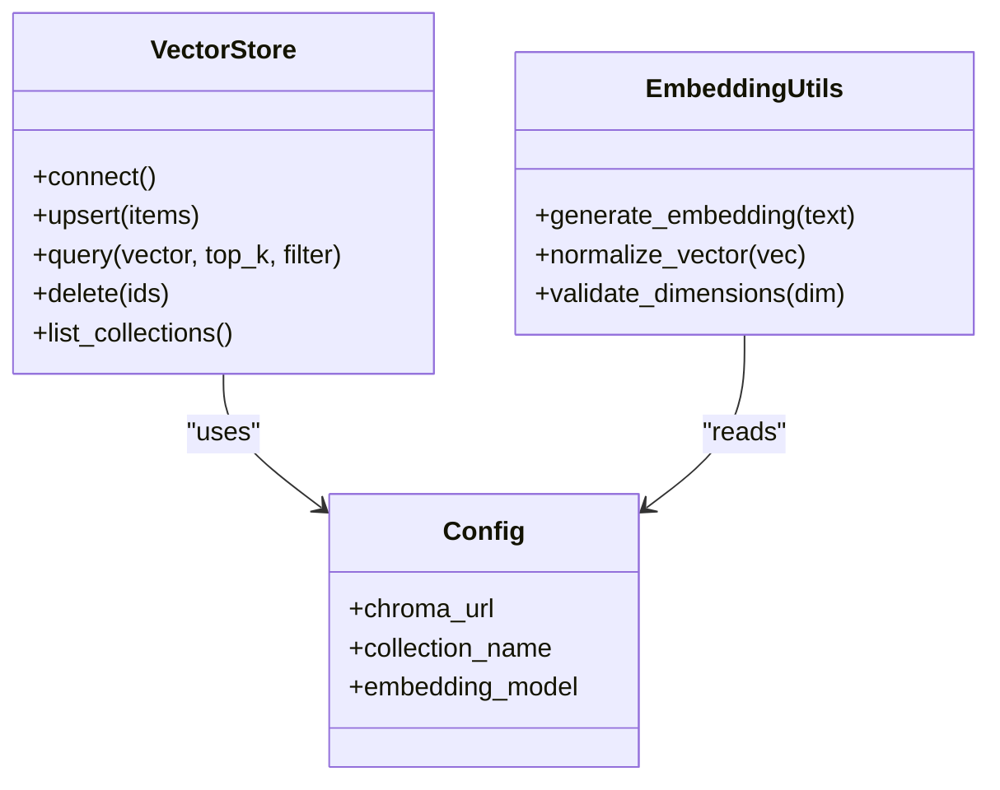
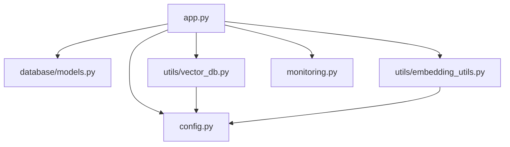

# Search & Filtering API

<cite>
**Referenced Files in This Document**
- [app.py](file://backend/app.py)
- [database/models.py](file://backend/database/models.py)
- [utils/embedding_utils.py](file://backend/utils/embedding_utils.py)
- [utils/vector_db.py](file://backend/utils/vector_db.py)
- [config.py](file://backend/config.py)
- [monitoring.py](file://backend/monitoring.py)
- [requirements.txt](file://backend/requirements.txt)
</cite>

## Table of Contents
1. [Introduction](#introduction)
2. [Project Structure](#project-structure)
3. [Core Components](#core-components)
4. [Architecture Overview](#architecture-overview)
5. [Detailed Component Analysis](#detailed-component-analysis)
6. [Dependency Analysis](#dependency-analysis)
7. [Performance Considerations](#performance-considerations)
8. [Troubleshooting Guide](#troubleshooting-guide)
9. [Conclusion](#conclusion)
10. [Appendices](#appendices)

## Introduction
This document explains the search and filtering capabilities of the Content Management API, including full-text search endpoints, semantic search using vector embeddings, advanced filtering options, and sorting mechanisms. It also covers query parameters for text searches, category filters, date ranges, user-specific content retrieval, pagination, result ranking, faceted search implementation, performance optimization techniques, ChromaDB integration for vector search, embedding generation, similarity matching, and search analytics tracking.

## Project Structure
The backend exposes REST endpoints that orchestrate:
- Full-text search against relational tables (e.g., teachings, topics).
- Semantic search via vector embeddings stored in ChromaDB.
- Advanced filtering by categories, dates, and user ownership.
- Sorting and pagination for consistent result sets.
- Analytics tracking for search events.

**Diagram sources**
- [app.py](file://backend/app.py)
- [database/models.py](file://backend/database/models.py)
- [utils/vector_db.py](file://backend/utils/vector_db.py)
- [utils/embedding_utils.py](file://backend/utils/embedding_utils.py)
- [monitoring.py](file://backend/monitoring.py)
- [config.py](file://backend/config.py)

**Section sources**
- [app.py](file://backend/app.py)
- [database/models.py](file://backend/database/models.py)
- [utils/vector_db.py](file://backend/utils/vector_db.py)
- [utils/embedding_utils.py](file://backend/utils/embedding_utils.py)
- [monitoring.py](file://backend/monitoring.py)
- [config.py](file://backend/config.py)

## Core Components
- API Endpoints: Define routes for full-text search, semantic search, filtering, sorting, and pagination.
- Database Models: Represent entities like teachings and topics with fields used for filtering and sorting.
- Vector Store Integration: ChromaDB client wrapper for storing and querying embeddings.
- Embedding Utilities: Generate embeddings from text content and manage metadata.
- Configuration: Centralized settings for database connections, ChromaDB, and feature flags.
- Monitoring: Track search queries, latencies, and errors for analytics.

Key responsibilities:
- Validate and normalize search inputs.
- Build SQL queries for full-text search and filters.
- Convert text to embeddings and perform similarity search.
- Merge or rank results from multiple sources.
- Apply pagination and return structured responses.
- Emit metrics and logs for observability.

**Section sources**
- [app.py](file://backend/app.py)
- [database/models.py](file://backend/database/models.py)
- [utils/vector_db.py](file://backend/utils/vector_db.py)
- [utils/embedding_utils.py](file://backend/utils/embedding_utils.py)
- [config.py](file://backend/config.py)
- [monitoring.py](file://backend/monitoring.py)

## Architecture Overview
The search pipeline supports two primary modes:
- Full-text search: Keyword-based queries against relational tables with filters and sorting.
- Semantic search: Vector similarity search using embeddings stored in ChromaDB.

**Diagram sources**
- [app.py](file://backend/app.py)
- [utils/vector_db.py](file://backend/utils/vector_db.py)
- [utils/embedding_utils.py](file://backend/utils/embedding_utils.py)
- [database/models.py](file://backend/database/models.py)
- [monitoring.py](file://backend/monitoring.py)

## Detailed Component Analysis

### Full-Text Search Endpoint
- Purpose: Retrieve items matching keywords with optional filters and sorting.
- Query Parameters:
  - q: Search text
  - category: Filter by category
  - start_date, end_date: Date range filters
  - user_id: Filter by owner
  - sort_by: Field name for sorting
  - order: asc/desc
  - page, per_page: Pagination
- Behavior:
  - Validates parameters and normalizes text.
  - Builds SQL with LIKE or full-text index where available.
  - Applies filters and sorting.
  - Returns paginated results.

**Diagram sources**
- [app.py](file://backend/app.py)
- [database/models.py](file://backend/database/models.py)

**Section sources**
- [app.py](file://backend/app.py)
- [database/models.py](file://backend/database/models.py)

### Semantic Search Endpoint
- Purpose: Perform vector similarity search using embeddings.
- Query Parameters:
  - q: Search text
  - top_k: Number of results
  - filter: Metadata filter (category, user_id, date range)
  - include_metadata: Boolean flag
- Behavior:
  - Generates embedding for query text.
  - Queries ChromaDB with similarity metric and filters.
  - Optionally merges with full-text results for hybrid ranking.
  - Returns ranked results with scores and metadata.

**Diagram sources**
- [app.py](file://backend/app.py)
- [utils/embedding_utils.py](file://backend/utils/embedding_utils.py)
- [utils/vector_db.py](file://backend/utils/vector_db.py)
- [monitoring.py](file://backend/monitoring.py)

**Section sources**
- [app.py](file://backend/app.py)
- [utils/embedding_utils.py](file://backend/utils/embedding_utils.py)
- [utils/vector_db.py](file://backend/utils/vector_db.py)

### Advanced Filtering and Sorting
- Filters:
  - Category: Exact match or multi-select.
  - Date Range: start_date and end_date with inclusive boundaries.
  - User-Specific: user_id to restrict to owned content.
  - Status/Visibility: Optional flags for published/archived.
- Sorting:
  - Supported fields: created_at, updated_at, view_count, relevance_score.
  - Order: asc/desc.
- Implementation:
  - Dynamic SQL construction based on provided filters.
  - Index usage for common filter fields to optimize performance.

**Section sources**
- [database/models.py](file://backend/database/models.py)
- [app.py](file://backend/app.py)

### Faceted Search Implementation
- Purpose: Provide counts for facets (categories, users, date buckets).
- Process:
  - Aggregate counts across filtered dataset.
  - Return facet values with counts alongside search results.
- Use Cases:
  - UI-driven refinement of search results.
  - Analytics dashboards for content distribution.

**Diagram sources**
- [app.py](file://backend/app.py)
- [database/models.py](file://backend/database/models.py)

**Section sources**
- [app.py](file://backend/app.py)
- [database/models.py](file://backend/database/models.py)

### ChromaDB Integration
- Responsibilities:
  - Manage collections for teachings and topics.
  - Upsert embeddings with metadata (id, title, category, user_id, timestamps).
  - Query with similarity thresholds and metadata filters.
- Configuration:
  - Connection settings and collection names via config.
  - Embedding model selection and dimension handling.

**Diagram sources**
- [utils/vector_db.py](file://backend/utils/vector_db.py)
- [utils/embedding_utils.py](file://backend/utils/embedding_utils.py)
- [config.py](file://backend/config.py)

**Section sources**
- [utils/vector_db.py](file://backend/utils/vector_db.py)
- [utils/embedding_utils.py](file://backend/utils/embedding_utils.py)
- [config.py](file://backend/config.py)

### Pagination and Result Ranking
- Pagination:
  - page: Starting page number (1-based).
  - per_page: Number of items per page.
  - Total count returned for UI navigation.
- Ranking:
  - Full-text: Relevance scoring based on keyword matches.
  - Semantic: Cosine similarity or other metric.
  - Hybrid: Weighted combination of both scores.

**Section sources**
- [app.py](file://backend/app.py)
- [database/models.py](file://backend/database/models.py)

### Search Analytics Tracking
- Tracks:
  - Query text (sanitized), timestamp, latency, result count.
  - Errors and exceptions during search execution.
- Storage:
  - In-memory counters or persistent logs depending on configuration.
- Usage:
  - Performance monitoring and search trend analysis.

**Section sources**
- [monitoring.py](file://backend/monitoring.py)
- [app.py](file://backend/app.py)

## Dependency Analysis
The search system depends on:
- Flask application layer for routing and request handling.
- Database models for schema and ORM operations.
- ChromaDB client for vector storage and queries.
- Embedding utilities for text-to-vector conversion.
- Configuration module for environment-specific settings.
- Monitoring module for analytics and metrics.

**Diagram sources**
- [app.py](file://backend/app.py)
- [database/models.py](file://backend/database/models.py)
- [utils/vector_db.py](file://backend/utils/vector_db.py)
- [utils/embedding_utils.py](file://backend/utils/embedding_utils.py)
- [config.py](file://backend/config.py)
- [monitoring.py](file://backend/monitoring.py)

**Section sources**
- [app.py](file://backend/app.py)
- [database/models.py](file://backend/database/models.py)
- [utils/vector_db.py](file://backend/utils/vector_db.py)
- [utils/embedding_utils.py](file://backend/utils/embedding_utils.py)
- [config.py](file://backend/config.py)
- [monitoring.py](file://backend/monitoring.py)

## Performance Considerations
- Indexing:
  - Add indexes on frequently filtered columns (category, user_id, timestamps).
  - Use full-text indexes where supported by the database.
- Query Optimization:
  - Limit top_k for semantic search to reduce computation.
  - Avoid deep pagination; use cursor-based pagination for large datasets.
- Caching:
  - Cache frequent queries and embeddings when appropriate.
- Concurrency:
  - Use connection pooling for database and vector store.
- Monitoring:
  - Track latency percentiles and error rates.

[No sources needed since this section provides general guidance]

## Troubleshooting Guide
Common issues and resolutions:
- Missing or invalid parameters:
  - Ensure required fields are present and correctly formatted.
- Database connectivity:
  - Verify credentials and network access.
- ChromaDB connection:
  - Check URL and collection existence.
- Embedding failures:
  - Validate input text length and encoding.
- Slow queries:
  - Review indexes and query complexity.
- Analytics gaps:
  - Confirm monitoring is enabled and logging paths are writable.

**Section sources**
- [app.py](file://backend/app.py)
- [monitoring.py](file://backend/monitoring.py)
- [config.py](file://backend/config.py)

## Conclusion
The Content Management API provides robust search and filtering capabilities through full-text and semantic search, advanced filtering, sorting, and pagination. Integration with ChromaDB enables powerful vector-based retrieval, while monitoring ensures observability and performance tuning. Proper indexing, caching, and query optimization are key to maintaining high performance at scale.

[No sources needed since this section summarizes without analyzing specific files]

## Appendices

### Example Complex Search Queries
- Full-text with filters:
  - q="machine learning", category="AI", start_date="2024-01-01", end_date="2024-12-31", user_id="123", sort_by="created_at", order="desc", page=1, per_page=20
- Semantic search with metadata filter:
  - q="neural networks", top_k=10, filter={"category":"AI","user_id":"123"}, include_metadata=true

[No sources needed since this section provides conceptual examples]

### API Endpoints Summary
- POST /api/search: Full-text search with filters and sorting.
- GET /api/search/semantic: Semantic search with vector similarity.
- GET /api/search/facets: Faceted search counts.

[No sources needed since this section provides conceptual examples]

### Dependencies
- Python packages listed in requirements.txt for Flask, database drivers, ChromaDB client, and embedding libraries.

**Section sources**
- [requirements.txt](file://backend/requirements.txt)