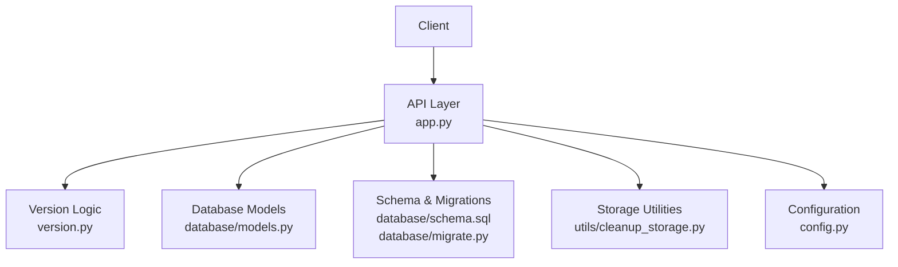
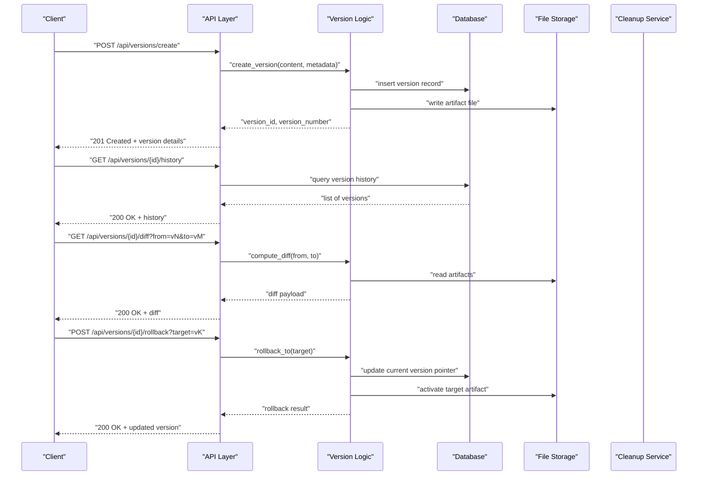
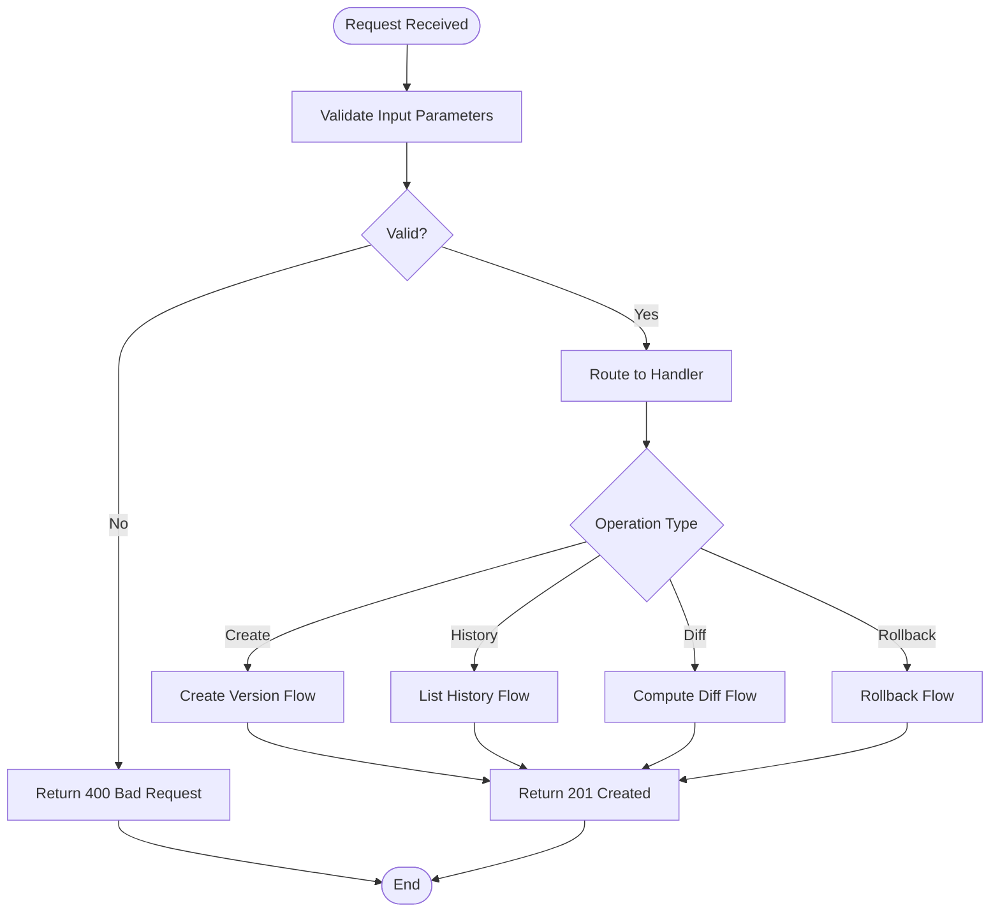
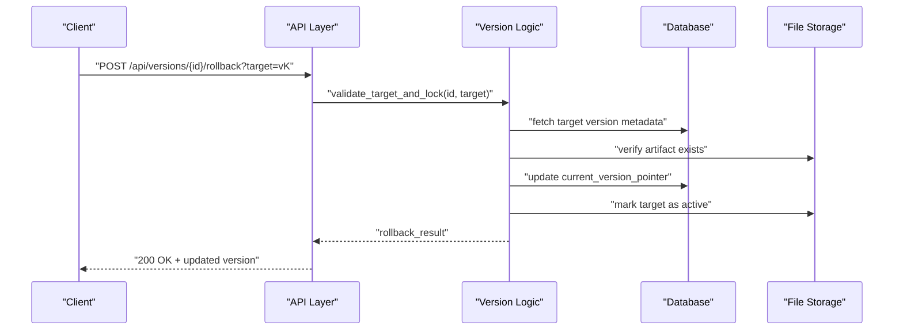
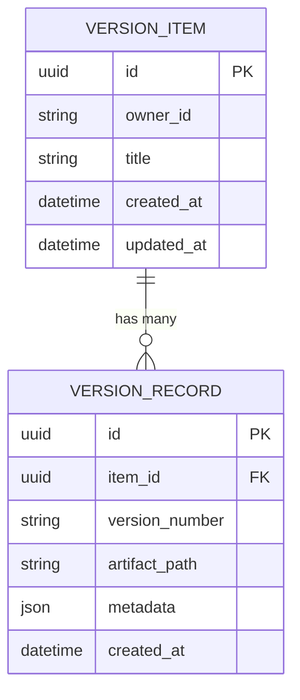
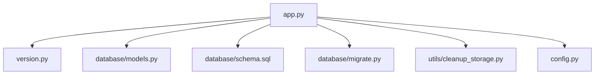

# Version Control API

<cite>
**Referenced Files in This Document**
- [app.py](file://backend/app.py)
- [version.py](file://backend/version.py)
- [models.py](file://backend/database/models.py)
- [schema.sql](file://backend/database/schema.sql)
- [migrate.py](file://backend/database/migrate.py)
- [cleanup_storage.py](file://backend/utils/cleanup_storage.py)
- [config.py](file://backend/config.py)
- [test_api.ps1](file://backend/test_api.ps1)
- [test_api.sh](file://backend/test_api.sh)
</cite>

## Table of Contents
1. [Introduction](#introduction)
2. [Project Structure](#project-structure)
3. [Core Components](#core-components)
4. [Architecture Overview](#architecture-overview)
5. [Detailed Component Analysis](#detailed-component-analysis)
6. [Dependency Analysis](#dependency-analysis)
7. [Performance Considerations](#performance-considerations)
8. [Troubleshooting Guide](#troubleshooting-guide)
9. [Conclusion](#conclusion)

## Introduction
This document specifies the version control API for managing content versions in the XSYY Edu platform. It covers endpoints for creating new versions, retrieving version history, comparing versions, and rolling back to previous versions. It also documents the version numbering scheme, metadata tracking, diff capabilities, storage structure, disk space management, retention policies, concurrent versioning scenarios, and conflict resolution strategies.

## Project Structure
The version control functionality is implemented across backend modules that expose HTTP endpoints, manage persistence, and coordinate storage operations:
- API routes and request handling are defined in the application entry point and related route modules.
- Versioning logic and utilities are encapsulated in a dedicated module.
- Database models and schema define how versions and associated metadata are stored.
- Storage utilities handle cleanup and lifecycle management of versioned artifacts.
- Configuration centralizes behavior such as retention policies and limits.
- Test scripts demonstrate usage patterns for versioning workflows.

**Diagram sources**
- [app.py](file://backend/app.py)
- [version.py](file://backend/version.py)
- [models.py](file://backend/database/models.py)
- [schema.sql](file://backend/database/schema.sql)
- [migrate.py](file://backend/database/migrate.py)
- [cleanup_storage.py](file://backend/utils/cleanup_storage.py)
- [config.py](file://backend/config.py)

**Section sources**
- [app.py](file://backend/app.py)
- [version.py](file://backend/version.py)
- [models.py](file://backend/database/models.py)
- [schema.sql](file://backend/database/schema.sql)
- [migrate.py](file://backend/database/migrate.py)
- [cleanup_storage.py](file://backend/utils/cleanup_storage.py)
- [config.py](file://backend/config.py)

## Core Components
- API Layer: Exposes REST endpoints for version creation, listing, comparison, and rollback. Validates inputs, enforces permissions, and coordinates downstream operations.
- Version Logic: Implements version numbering, metadata capture, diff computation, and rollback orchestration. Ensures idempotency and consistency.
- Data Persistence: Stores version records, references to artifact files, and metadata (author, timestamps, change summaries). Uses database tables and file-based storage.
- Storage Utilities: Manages disk space by pruning old or unused versions based on retention policies and configurable thresholds.
- Configuration: Centralizes settings like maximum versions per item, retention windows, diff engine selection, and concurrency controls.

**Section sources**
- [app.py](file://backend/app.py)
- [version.py](file://backend/version.py)
- [models.py](file://backend/database/models.py)
- [schema.sql](file://backend/database/schema.sql)
- [cleanup_storage.py](file://backend/utils/cleanup_storage.py)
- [config.py](file://backend/config.py)

## Architecture Overview
The version control system follows a layered architecture:
- Clients interact with the API layer via HTTP endpoints.
- The API layer delegates to version logic for business rules and orchestration.
- Version logic interacts with the database for persistent state and with storage for artifact files.
- Storage utilities enforce retention and cleanup policies.
- Configuration governs behavior across components.

**Diagram sources**
- [app.py](file://backend/app.py)
- [version.py](file://backend/version.py)
- [models.py](file://backend/database/models.py)
- [schema.sql](file://backend/database/schema.sql)
- [cleanup_storage.py](file://backend/utils/cleanup_storage.py)

## Detailed Component Analysis

### API Endpoints
- Create Version
  - Method: POST
  - Path: /api/versions/create
  - Request body: content payload, optional metadata (author, summary, tags)
  - Response: created version identifier, version number, timestamp
  - Behavior: validates input, persists metadata, writes artifact, returns success or error codes
- List Version History
  - Method: GET
  - Path: /api/versions/{id}/history
  - Query parameters: optional filters (date range, author)
  - Response: ordered list of versions with identifiers, numbers, timestamps, summaries
- Compare Versions
  - Method: GET
  - Path: /api/versions/{id}/diff
  - Query parameters: from, to (version numbers or identifiers)
  - Response: structured diff payload indicating added, removed, and modified sections
- Rollback to Previous Version
  - Method: POST
  - Path: /api/versions/{id}/rollback
  - Query parameters: target (version number or identifier)
  - Response: confirmation of rollback, updated current version details

**Diagram sources**
- [app.py](file://backend/app.py)
- [version.py](file://backend/version.py)

**Section sources**
- [app.py](file://backend/app.py)
- [version.py](file://backend/version.py)

### Version Numbering Scheme
- Semantic versioning is used for major/minor/patch increments when appropriate; otherwise, sequential numeric identifiers ensure uniqueness and ordering.
- Each version includes a stable identifier (UUID-like) and a human-readable version number.
- Version numbers are monotonically increasing within an item’s lifecycle.

**Section sources**
- [version.py](file://backend/version.py)
- [models.py](file://backend/database/models.py)

### Metadata Tracking
- Metadata fields include:
  - Author or actor identity
  - Timestamp of creation/update
  - Change summary or commit message
  - Tags or labels for categorization
  - Source reference or origin context
- Metadata is persisted alongside version records and exposed in history and diff responses.

**Section sources**
- [models.py](file://backend/database/models.py)
- [schema.sql](file://backend/database/schema.sql)

### Diff Capabilities
- Diff computation supports:
  - Line-level differences for text-based content
  - Section-level changes for structured content
  - Optional semantic diffs for specific formats
- Responses include:
  - Added lines/sections
  - Removed lines/sections
  - Modified segments with before/after snapshots
- Performance considerations include caching diffs for repeated comparisons and streaming large payloads.

**Section sources**
- [version.py](file://backend/version.py)

### Rollback Workflow
- Rollback selects a target version and updates the current pointer atomically.
- Artifact activation ensures the correct file is served as the current version.
- Audit trail records rollback actions with actor and reason.

**Diagram sources**
- [version.py](file://backend/version.py)
- [models.py](file://backend/database/models.py)
- [schema.sql](file://backend/database/schema.sql)

**Section sources**
- [version.py](file://backend/version.py)
- [models.py](file://backend/database/models.py)
- [schema.sql](file://backend/database/schema.sql)

### Storage Structure for Multiple Versions
- Each version corresponds to a unique directory containing:
  - Artifact file(s) representing the content snapshot
  - Metadata JSON describing version attributes
- Directories are organized under a root storage path with UUID-based naming for collision avoidance.
- Indexes map item identifiers to their latest and historical version directories.

**Diagram sources**
- [models.py](file://backend/database/models.py)
- [schema.sql](file://backend/database/schema.sql)

**Section sources**
- [models.py](file://backend/database/models.py)
- [schema.sql](file://backend/database/schema.sql)

### Disk Space Management and Retention Policies
- Retention policies define:
  - Maximum number of versions per item
  - Time-based expiration (e.g., delete versions older than N days)
  - Size-based pruning when total storage exceeds thresholds
- Cleanup service runs periodically to remove expired or redundant versions and reclaim disk space.
- Policies are configurable via environment variables or configuration files.

**Section sources**
- [cleanup_storage.py](file://backend/utils/cleanup_storage.py)
- [config.py](file://backend/config.py)

### Concurrent Versioning and Conflict Resolution
- Concurrency model uses optimistic locking on version pointers to prevent overwrites.
- Conflicts are detected when multiple clients attempt to create or update versions simultaneously.
- Resolution strategies:
  - Reject conflicting requests with retry guidance
  - Merge compatible changes where possible
  - Require explicit user intervention for incompatible merges
- Audit logs capture conflict events and resolutions.

**Section sources**
- [version.py](file://backend/version.py)
- [models.py](file://backend/database/models.py)

### Examples and Workflows
- Version Creation Workflow:
  - Submit content and metadata via the create endpoint
  - Receive version identifier and number
  - Verify presence in history endpoint
- Automated Versioning During Updates:
  - Integrate hooks in content update pipelines to trigger version creation
  - Capture automated metadata (source, pipeline ID, timestamp)
- Version Comparison Response:
  - Request diff between two versions
  - Parse structured diff payload to highlight changes

**Section sources**
- [test_api.ps1](file://backend/test_api.ps1)
- [test_api.sh](file://backend/test_api.sh)

## Dependency Analysis
The version control system depends on:
- API routing and request validation
- Version logic for business rules
- Database models and schema for persistence
- Storage utilities for lifecycle management
- Configuration for runtime behavior

**Diagram sources**
- [app.py](file://backend/app.py)
- [version.py](file://backend/version.py)
- [models.py](file://backend/database/models.py)
- [schema.sql](file://backend/database/schema.sql)
- [migrate.py](file://backend/database/migrate.py)
- [cleanup_storage.py](file://backend/utils/cleanup_storage.py)
- [config.py](file://backend/config.py)

**Section sources**
- [app.py](file://backend/app.py)
- [version.py](file://backend/version.py)
- [models.py](file://backend/database/models.py)
- [schema.sql](file://backend/database/schema.sql)
- [migrate.py](file://backend/database/migrate.py)
- [cleanup_storage.py](file://backend/utils/cleanup_storage.py)
- [config.py](file://backend/config.py)

## Performance Considerations
- Use pagination for history queries to avoid large payloads.
- Cache frequently accessed diffs and metadata.
- Stream large diff responses to reduce memory usage.
- Optimize database indexes on version identifiers and timestamps.
- Batch cleanup operations to minimize I/O overhead.

[No sources needed since this section provides general guidance]

## Troubleshooting Guide
Common issues and resolutions:
- Validation errors: Ensure request bodies conform to expected schemas.
- Missing artifacts: Verify storage paths and permissions.
- Conflicts: Retry with updated version numbers or resolve merge conflicts manually.
- Disk space warnings: Adjust retention policies and run cleanup jobs.

**Section sources**
- [cleanup_storage.py](file://backend/utils/cleanup_storage.py)
- [config.py](file://backend/config.py)

## Conclusion
The XSYY Edu platform’s version control API provides robust capabilities for managing content versions through clear endpoints, comprehensive metadata tracking, and efficient diff and rollback mechanisms. Proper storage organization, retention policies, and concurrency controls ensure reliability and scalability. Integrating automated versioning into update pipelines enhances traceability and operational efficiency.