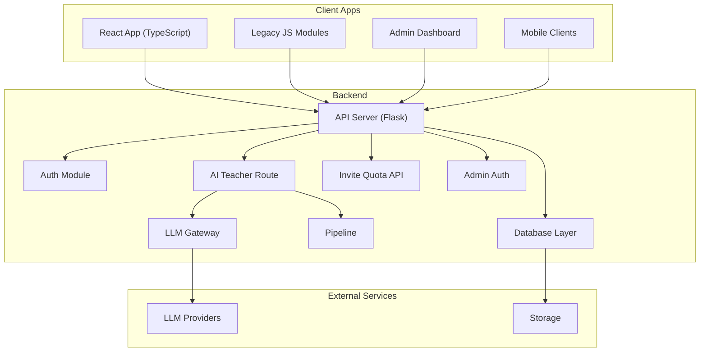
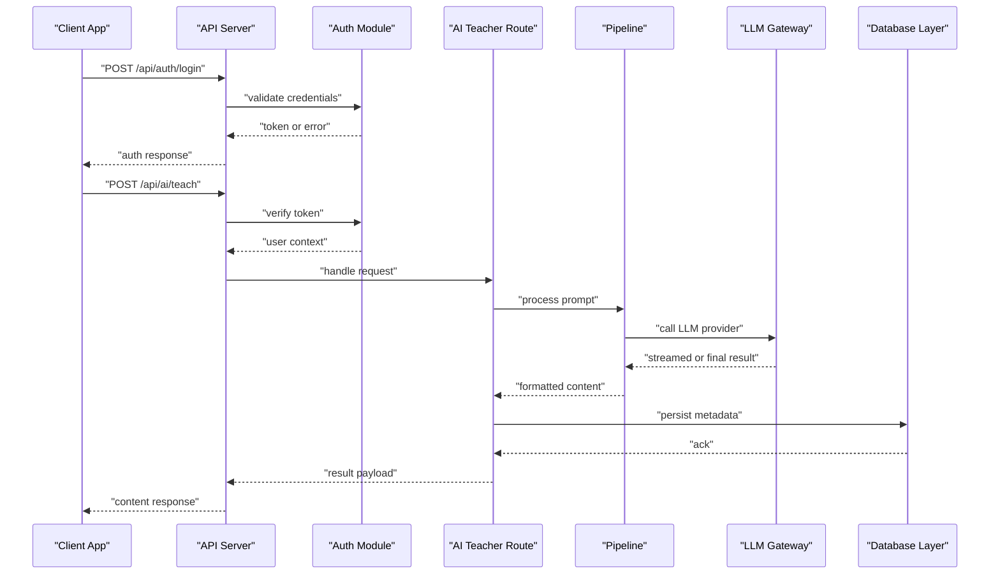
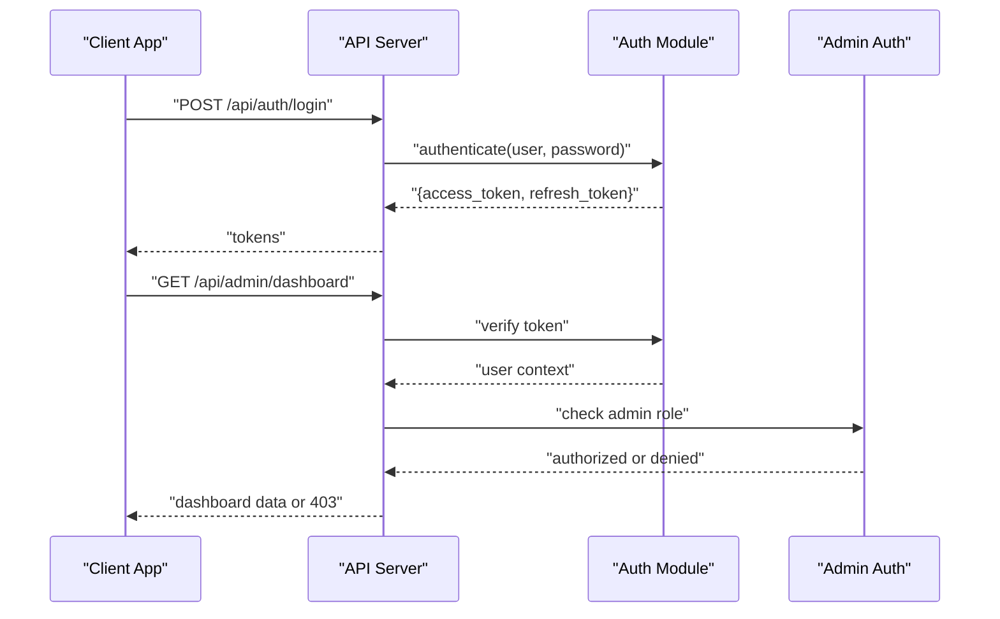
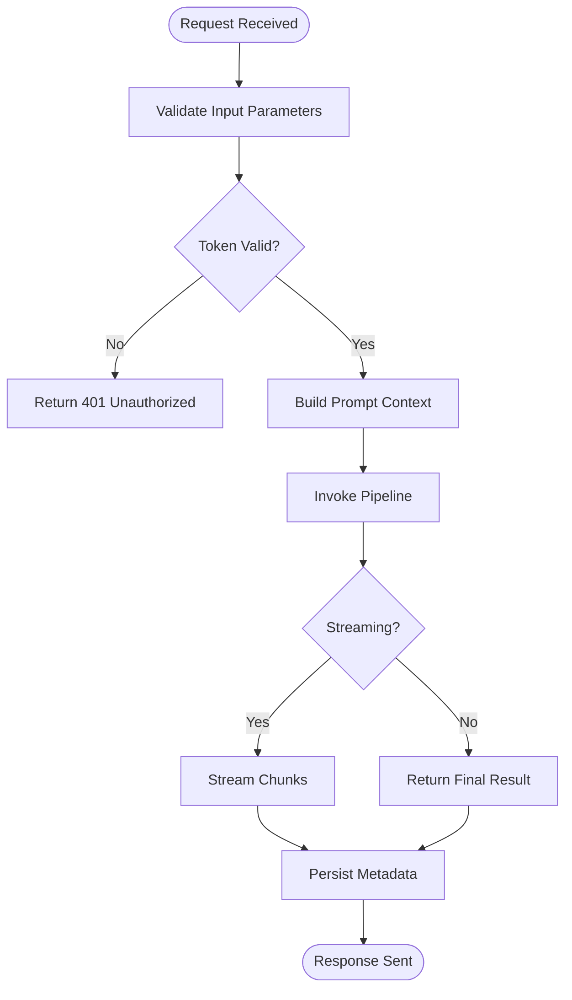
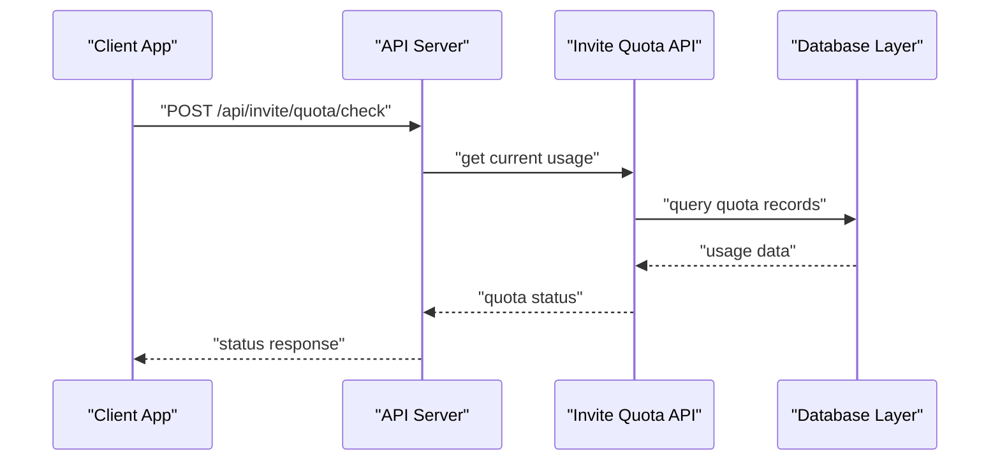
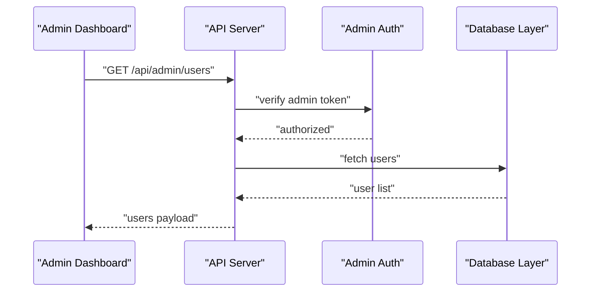
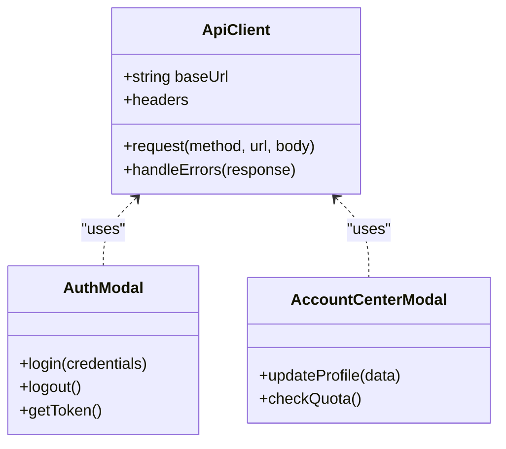
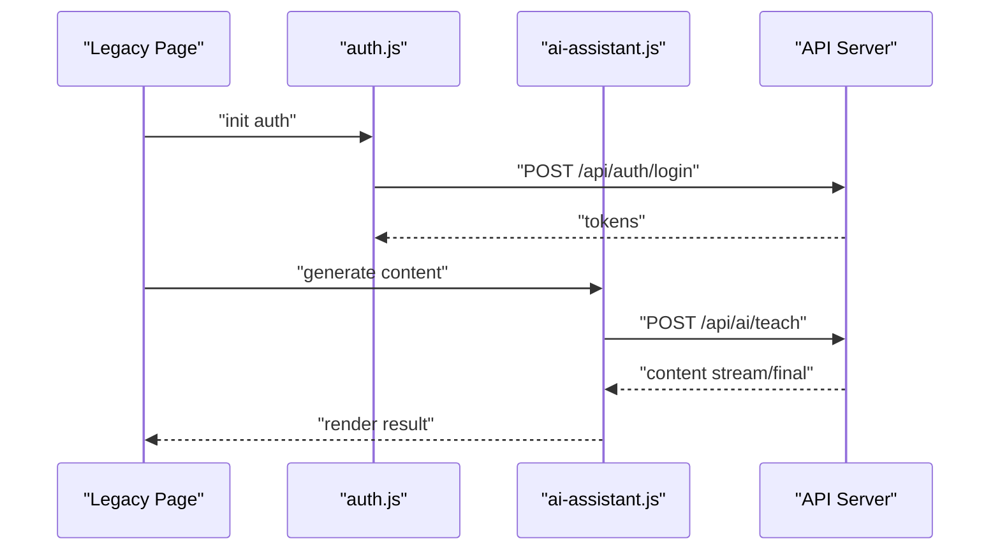
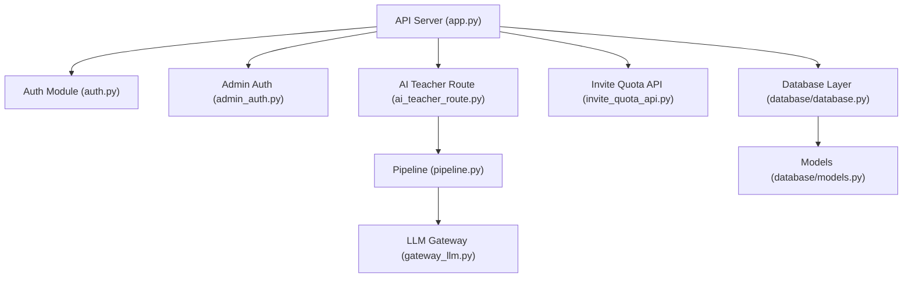

# Integration Examples

<cite>
**Referenced Files in This Document**
- [app.py](file://backend/app.py)
- [auth.py](file://backend/auth.py)
- [ai_teacher_route.py](file://backend/ai_teacher_route.py)
- [invite_quota_api.py](file://backend/invite_quota_api.py)
- [admin_auth.py](file://backend/admin_auth.py)
- [config.py](file://backend/config.py)
- [database/database.py](file://backend/database/database.py)
- [database/models.py](file://backend/database/models.py)
- [web/src/lib/api.ts](file://web/src/lib/api.ts)
- [web/src/components/AuthModal.tsx](file://web/src/components/AuthModal.tsx)
- [web/src/components/AccountCenterModal.tsx](file://web/src/components/AccountCenterModal.tsx)
- [web/js/auth.js](file://web/js/auth.js)
- [web/js/ai-assistant.js](file://web/js/ai-assistant.js)
- [web/admin/js/admin-api.js](file://web/admin/js/admin-api.js)
- [web/admin/js/admin-auth.js](file://web/admin/js/admin-auth.js)
- [web/package.json](file://web/package.json)
- [deploy/nginx.conf](file://deploy/nginx.conf)
- [backend/tests/integration/test_api_auth.py](file://backend/tests/integration/test_api_auth.py)
- [backend/tests/integration/test_api_admin.py](file://backend/tests/integration/test_api_admin.py)
- [backend/tests/integration/test_api_health.py](file://backend/tests/integration/test_api_health.py)
- [backend/tests/integration/test_api_tasks.py](file://backend/tests/integration/test_api_tasks.py)
- [backend/gateway_llm.py](file://backend/gateway_llm.py)
- [backend/pipeline.py](file://backend/pipeline.py)
</cite>

## Table of Contents
1. [Introduction](#introduction)
2. [Project Structure](#project-structure)
3. [Core Components](#core-components)
4. [Architecture Overview](#architecture-overview)
5. [Detailed Component Analysis](#detailed-component-analysis)
6. [Dependency Analysis](#dependency-analysis)
7. [Performance Considerations](#performance-considerations)
8. [Troubleshooting Guide](#troubleshooting-guide)
9. [Conclusion](#conclusion)
10. [Appendices](#appendices)

## Introduction
This document provides comprehensive integration examples for the XSYY Edu platform APIs. It covers authentication flows, API client implementations, error handling patterns, and best practices across popular programming languages and platforms: Python, JavaScript/Node.js, React (TypeScript), and mobile clients. It also documents SDK usage, webhook integrations, real-time features, third-party service connections, debugging techniques, testing strategies, performance optimization tips, CORS configuration, rate limiting handling, and production deployment considerations.

The goal is to help you integrate quickly and reliably with the platform’s backend services, including AI teaching content generation, user management, and administrative operations.

## Project Structure
At a high level, the project consists of:
- Backend API server and routes
- Database models and migrations
- Web frontend (React + TypeScript) and legacy JS modules
- Admin dashboard web app
- Deployment configurations and scripts
- Tests covering integration scenarios

[No sources needed since this diagram shows conceptual workflow, not actual code structure]

## Core Components
- Authentication module: Provides token-based authentication and session management for users and admins.
- AI teacher route: Exposes endpoints for generating educational content via an LLM pipeline.
- Invite quota API: Manages invite quotas and related user limits.
- Admin auth: Protects admin-only endpoints.
- Database layer: Encapsulates database access using SQLAlchemy models and helpers.
- LLM gateway and pipeline: Orchestrate calls to external LLM providers and process results.

Key responsibilities:
- Securely authenticate requests and enforce permissions.
- Generate and manage teaching materials through AI workflows.
- Provide robust error responses and consistent status codes.
- Integrate with storage and vector databases as needed.

**Section sources**
- [auth.py](file://backend/auth.py)
- [ai_teacher_route.py](file://backend/ai_teacher_route.py)
- [invite_quota_api.py](file://backend/invite_quota_api.py)
- [admin_auth.py](file://backend/admin_auth.py)
- [database/database.py](file://backend/database/database.py)
- [database/models.py](file://backend/database/models.py)
- [gateway_llm.py](file://backend/gateway_llm.py)
- [pipeline.py](file://backend/pipeline.py)

## Architecture Overview
The system follows a typical RESTful architecture with clear separation between client apps, API server, business logic, and data layers. Authentication is enforced at the API boundary, while AI content generation flows through a dedicated route that orchestrates the LLM gateway and processing pipeline.

**Diagram sources**
- [app.py](file://backend/app.py)
- [auth.py](file://backend/auth.py)
- [ai_teacher_route.py](file://backend/ai_teacher_route.py)
- [pipeline.py](file://backend/pipeline.py)
- [gateway_llm.py](file://backend/gateway_llm.py)
- [database/database.py](file://backend/database/database.py)

## Detailed Component Analysis

### Authentication Flow
- Login endpoint validates credentials and returns tokens.
- Protected endpoints require valid tokens; middleware verifies signatures and scopes.
- Admin endpoints are guarded by separate authorization checks.

**Diagram sources**
- [auth.py](file://backend/auth.py)
- [admin_auth.py](file://backend/admin_auth.py)
- [app.py](file://backend/app.py)

**Section sources**
- [auth.py](file://backend/auth.py)
- [admin_auth.py](file://backend/admin_auth.py)
- [web/js/auth.js](file://web/js/auth.js)
- [web/admin/js/admin-auth.js](file://web/admin/js/admin-auth.js)

### AI Teaching Content Generation
- The AI teacher route accepts prompts and parameters, then delegates to the pipeline.
- The pipeline coordinates with the LLM gateway for streaming or batch responses.
- Results are persisted with metadata and returned to the client.

**Diagram sources**
- [ai_teacher_route.py](file://backend/ai_teacher_route.py)
- [pipeline.py](file://backend/pipeline.py)
- [gateway_llm.py](file://backend/gateway_llm.py)

**Section sources**
- [ai_teacher_route.py](file://backend/ai_teacher_route.py)
- [pipeline.py](file://backend/pipeline.py)
- [gateway_llm.py](file://backend/gateway_llm.py)

### Invite Quota Management
- Endpoints manage invite quotas per user or organization.
- Enforces limits and tracks usage.

**Diagram sources**
- [invite_quota_api.py](file://backend/invite_quota_api.py)
- [database/database.py](file://backend/database/database.py)

**Section sources**
- [invite_quota_api.py](file://backend/invite_quota_api.py)
- [database/database.py](file://backend/database/database.py)

### Admin Operations
- Admin endpoints provide dashboard data, user management, and settings.
- Require admin privileges verified by admin auth module.

**Diagram sources**
- [admin_auth.py](file://backend/admin_auth.py)
- [database/database.py](file://backend/database/database.py)

**Section sources**
- [admin_auth.py](file://backend/admin_auth.py)
- [web/admin/js/admin-api.js](file://web/admin/js/admin-api.js)

### React Client Integration
- Centralized API client encapsulates base URL, headers, and error handling.
- Auth modal manages login flow and token storage.
- Account center modal handles profile updates and quota checks.

**Diagram sources**
- [web/src/lib/api.ts](file://web/src/lib/api.ts)
- [web/src/components/AuthModal.tsx](file://web/src/components/AuthModal.tsx)
- [web/src/components/AccountCenterModal.tsx](file://web/src/components/AccountCenterModal.tsx)

**Section sources**
- [web/src/lib/api.ts](file://web/src/lib/api.ts)
- [web/src/components/AuthModal.tsx](file://web/src/components/AuthModal.tsx)
- [web/src/components/AccountCenterModal.tsx](file://web/src/components/AccountCenterModal.tsx)

### Legacy JS Client Integration
- Legacy modules handle authentication and AI assistant interactions.
- Useful for non-React environments or progressive migration.

**Diagram sources**
- [web/js/auth.js](file://web/js/auth.js)
- [web/js/ai-assistant.js](file://web/js/ai-assistant.js)
- [ai_teacher_route.py](file://backend/ai_teacher_route.py)

**Section sources**
- [web/js/auth.js](file://web/js/auth.js)
- [web/js/ai-assistant.js](file://web/js/ai-assistant.js)

## Dependency Analysis
The following diagram highlights key dependencies among core components:

**Diagram sources**
- [app.py](file://backend/app.py)
- [auth.py](file://backend/auth.py)
- [admin_auth.py](file://backend/admin_auth.py)
- [ai_teacher_route.py](file://backend/ai_teacher_route.py)
- [invite_quota_api.py](file://backend/invite_quota_api.py)
- [pipeline.py](file://backend/pipeline.py)
- [gateway_llm.py](file://backend/gateway_llm.py)
- [database/database.py](file://backend/database/database.py)
- [database/models.py](file://backend/database/models.py)

**Section sources**
- [app.py](file://backend/app.py)
- [auth.py](file://backend/auth.py)
- [admin_auth.py](file://backend/admin_auth.py)
- [ai_teacher_route.py](file://backend/ai_teacher_route.py)
- [invite_quota_api.py](file://backend/invite_quota_api.py)
- [pipeline.py](file://backend/pipeline.py)
- [gateway_llm.py](file://backend/gateway_llm.py)
- [database/database.py](file://backend/database/database.py)
- [database/models.py](file://backend/database/models.py)

## Performance Considerations
- Use streaming responses for long-running AI tasks to improve perceived latency.
- Cache frequently accessed metadata and reduce redundant LLM calls.
- Implement pagination and selective field retrieval for large datasets.
- Optimize database queries with proper indexing and avoid N+1 query patterns.
- Configure connection pooling for database and HTTP clients.
- Monitor memory usage and set appropriate timeouts for external LLM calls.

[No sources needed since this section provides general guidance]

## Troubleshooting Guide
Common issues and resolutions:
- Authentication failures: Verify token validity, expiration, and scope. Check client-side header injection and CORS settings.
- Rate limiting: Handle 429 responses with exponential backoff and retry logic.
- CORS errors: Ensure allowed origins, methods, and headers are configured on the server and reverse proxy.
- LLM gateway errors: Inspect provider-specific error codes and implement fallback strategies.
- Database connectivity: Validate connection strings, credentials, and network reachability.

Use integration tests to validate critical flows:
- Authentication endpoints
- Admin operations
- Health checks
- Task processing

**Section sources**
- [backend/tests/integration/test_api_auth.py](file://backend/tests/integration/test_api_auth.py)
- [backend/tests/integration/test_api_admin.py](file://backend/tests/integration/test_api_admin.py)
- [backend/tests/integration/test_api_health.py](file://backend/tests/integration/test_api_health.py)
- [backend/tests/integration/test_api_tasks.py](file://backend/tests/integration/test_api_tasks.py)

## Conclusion
This guide provided end-to-end integration examples for the XSYY Edu platform APIs across multiple client types. You now have reference flows for authentication, AI content generation, quota management, and admin operations, along with best practices for error handling, performance, and deployment. Use the provided diagrams and source references to tailor your implementation to your environment and scale confidently.

[No sources needed since this section summarizes without analyzing specific files]

## Appendices

### CORS Configuration
- Configure allowed origins, methods, and headers on the API server and reverse proxy.
- Ensure preflight requests are handled correctly.
- For development, allow localhost origins temporarily and restrict in production.

**Section sources**
- [deploy/nginx.conf](file://deploy/nginx.conf)

### Rate Limiting Handling
- Implement client-side retries with jitter and backoff.
- Respect Retry-After headers when present.
- Log rate limit events for monitoring and alerting.

[No sources needed since this section provides general guidance]

### Production Deployment Considerations
- Use environment variables for secrets and configuration.
- Enable HTTPS and secure cookies.
- Set up health check endpoints and readiness probes.
- Configure logging and metrics collection.
- Plan for horizontal scaling and stateless sessions.

**Section sources**
- [web/package.json](file://web/package.json)
- [deploy/nginx.conf](file://deploy/nginx.conf)