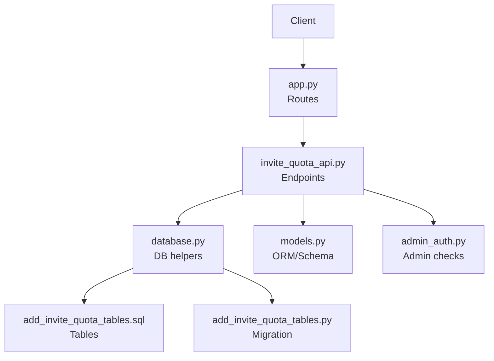
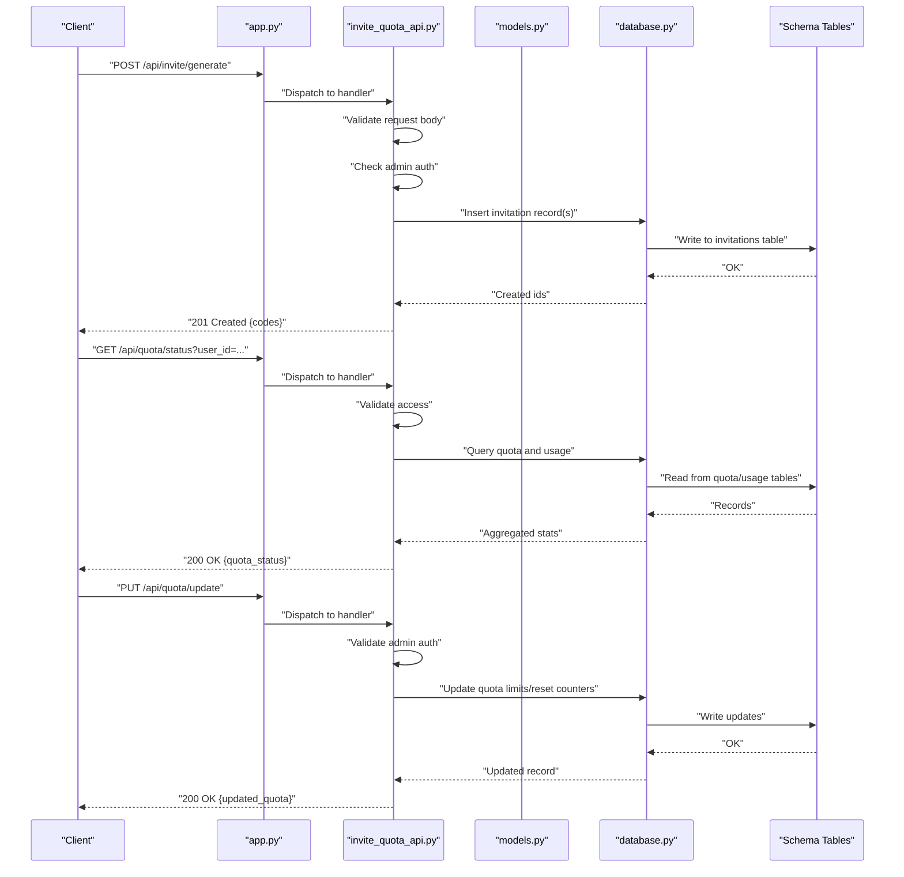
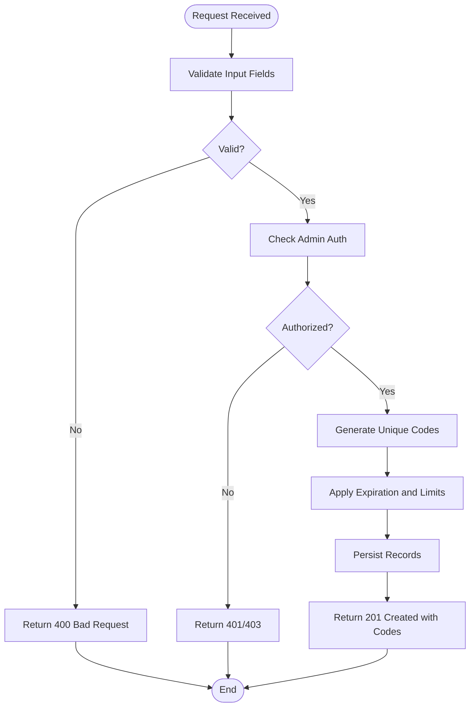
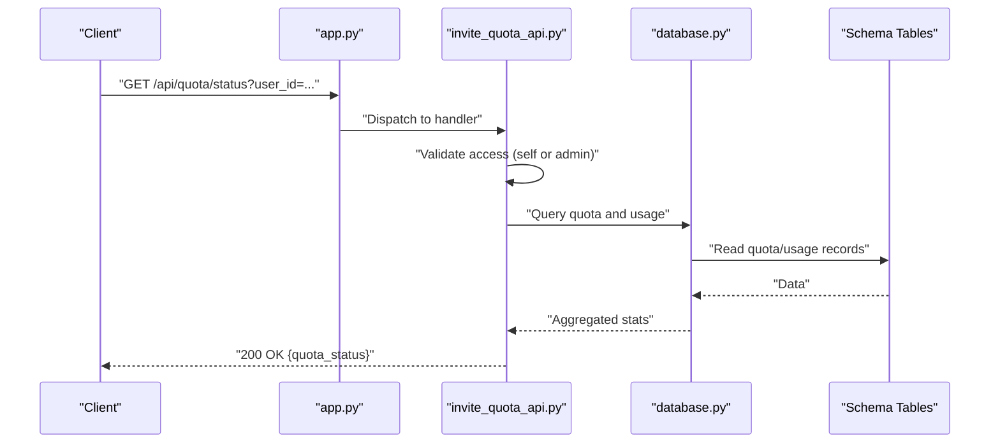
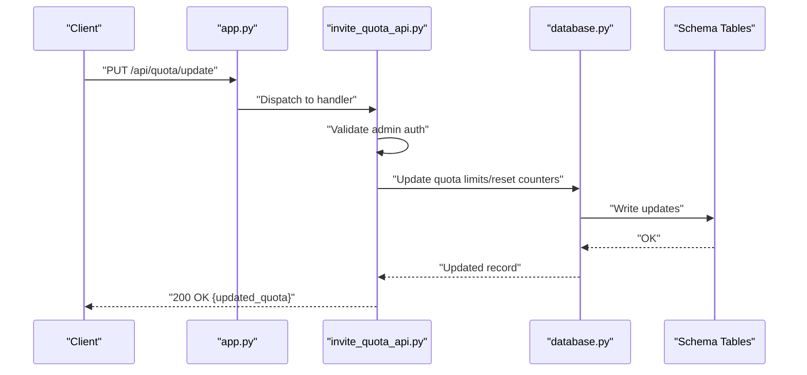
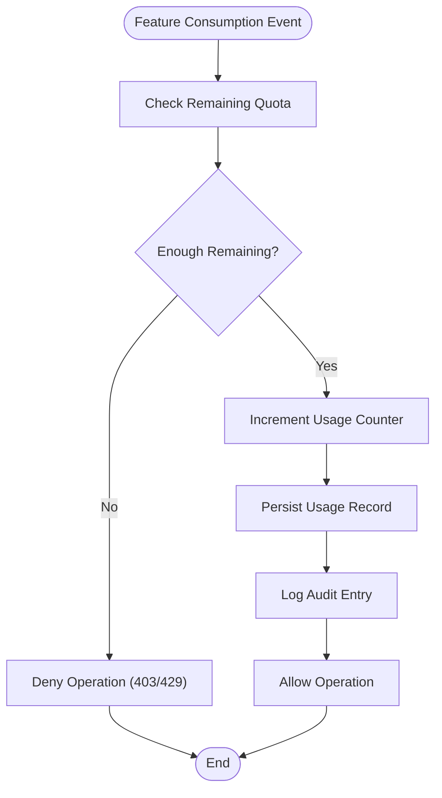
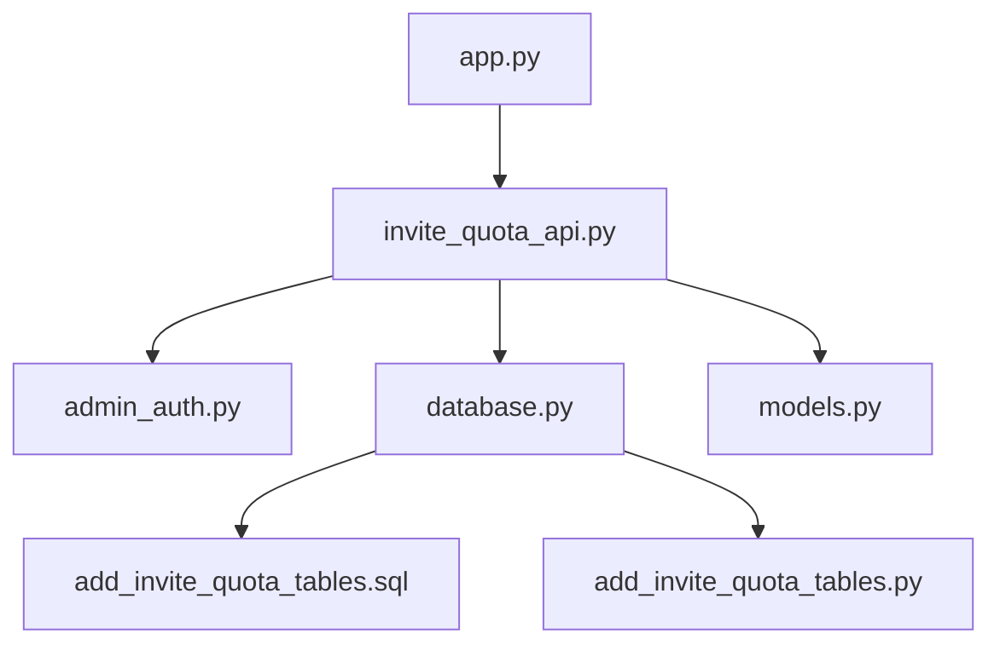

# Invitation & Quota Management API

<cite>
**Referenced Files in This Document**
- [invite_quota_api.py](file://backend/invite_quota_api.py)
- [add_invite_quota_tables.py](file://backend/database/add_invite_quota_tables.py)
- [add_invite_quota_tables.sql](file://backend/database/add_invite_quota_tables.sql)
- [models.py](file://backend/database/models.py)
- [database.py](file://backend/database/database.py)
- [app.py](file://backend/app.py)
- [admin_auth.py](file://backend/admin_auth.py)
</cite>

## Table of Contents
1. [Introduction](#introduction)
2. [Project Structure](#project-structure)
3. [Core Components](#core-components)
4. [Architecture Overview](#architecture-overview)
5. [Detailed Component Analysis](#detailed-component-analysis)
6. [Dependency Analysis](#dependency-analysis)
7. [Performance Considerations](#performance-considerations)
8. [Troubleshooting Guide](#troubleshooting-guide)
9. [Conclusion](#conclusion)
10. [Appendices](#appendices)

## Introduction
This document specifies the Invitation and Quota Management APIs for generating invitation codes, allocating quotas, tracking usage, and performing administrative controls. It covers:
- Invitation generation and redemption workflows
- Quota allocation and enforcement
- Usage monitoring and reporting
- Administrative operations with audit logging requirements
- Request/response schemas and examples

The implementation is provided by a dedicated route module integrated into the main application, backed by database tables for invitations and quota records.

## Project Structure
The relevant backend components are organized as follows:
- Route handlers for invitation and quota endpoints
- Database schema and migration scripts for invitation and quota tables
- Data models and database utilities
- Application entry point wiring routes
- Admin authentication middleware for protected endpoints

**Diagram sources**
- [app.py](file://backend/app.py)
- [invite_quota_api.py](file://backend/invite_quota_api.py)
- [database.py](file://backend/database/database.py)
- [models.py](file://backend/database/models.py)
- [add_invite_quota_tables.sql](file://backend/database/add_invite_quota_tables.sql)
- [add_invite_quota_tables.py](file://backend/database/add_invite_quota_tables.py)
- [admin_auth.py](file://backend/admin_auth.py)

**Section sources**
- [app.py](file://backend/app.py)
- [invite_quota_api.py](file://backend/invite_quota_api.py)
- [database.py](file://backend/database/database.py)
- [models.py](file://backend/database/models.py)
- [add_invite_quota_tables.sql](file://backend/database/add_invite_quota_tables.sql)
- [add_invite_quota_tables.py](file://backend/database/add_invite_quota_tables.py)
- [admin_auth.py](file://backend/admin_auth.py)

## Core Components
- Invitation Generation Endpoint: POST /api/invite/generate
  - Purpose: Create one or more invitation codes with optional expiration and per-user limits.
  - Access: Typically admin-only; requires admin authentication.
  - Key fields: code (unique), expires_at (optional), max_uses (optional), created_by (admin id).
- Quota Status Endpoint: GET /api/quota/status
  - Purpose: Retrieve current quota limits and usage for a user or tenant.
  - Access: Authenticated users can view their own quota; admins can query any user.
  - Key fields: total_limit, used_count, remaining, period_start, period_end.
- Quota Update Endpoint: PUT /api/quota/update
  - Purpose: Adjust quota limits or reset counters administratively.
  - Access: Admin-only.
  - Key fields: target_user_id, new_total_limit, reset_usage (boolean), effective_from (timestamp).
- Usage Monitoring:
  - Usage increments on successful feature consumption events.
  - Aggregated views support dashboards and alerts.

Administrative Controls:
- Bulk operations for invite generation and quota adjustments.
- Audit logging for all admin actions.

**Section sources**
- [invite_quota_api.py](file://backend/invite_quota_api.py)
- [admin_auth.py](file://backend/admin_auth.py)
- [models.py](file://backend/database/models.py)
- [database.py](file://backend/database/database.py)

## Architecture Overview
The API layer exposes REST endpoints that validate requests, enforce permissions, interact with the database, and return structured JSON responses. Admin endpoints are guarded by an admin authentication check.

**Diagram sources**
- [app.py](file://backend/app.py)
- [invite_quota_api.py](file://backend/invite_quota_api.py)
- [models.py](file://backend/database/models.py)
- [database.py](file://backend/database/database.py)
- [add_invite_quota_tables.sql](file://backend/database/add_invite_quota_tables.sql)

## Detailed Component Analysis

### Invitation Generation: POST /api/invite/generate
- Description: Creates invitation codes with optional constraints such as expiration time and maximum uses. Supports bulk creation.
- Authentication: Admin required.
- Request Body:
  - count: integer (number of codes to generate)
  - expires_at: string (ISO-8601 timestamp, optional)
  - max_uses: integer (optional)
  - metadata: object (optional, free-form tags)
- Response:
  - status: 201 Created
  - body: array of generated codes with identifiers and timestamps
- Error Responses:
  - 400 Bad Request: invalid parameters
  - 401 Unauthorized: missing or invalid admin credentials
  - 403 Forbidden: insufficient privileges
  - 409 Conflict: duplicate code detected (should not occur if generator ensures uniqueness)
  - 500 Internal Server Error: database or system failure

**Diagram sources**
- [invite_quota_api.py](file://backend/invite_quota_api.py)
- [admin_auth.py](file://backend/admin_auth.py)
- [models.py](file://backend/database/models.py)
- [database.py](file://backend/database/database.py)

**Section sources**
- [invite_quota_api.py](file://backend/invite_quota_api.py)
- [admin_auth.py](file://backend/admin_auth.py)
- [models.py](file://backend/database/models.py)
- [database.py](file://backend/database/database.py)

### Quota Status: GET /api/quota/status
- Description: Retrieves quota limits and usage statistics for a specified user or tenant.
- Authentication:
  - User: can only access own quota
  - Admin: can access any user’s quota
- Query Parameters:
  - user_id: string (required)
  - period_start: string (ISO-8601, optional)
  - period_end: string (ISO-8601, optional)
- Response:
  - status: 200 OK
  - body:
    - user_id: string
    - total_limit: integer
    - used_count: integer
    - remaining: integer
    - period_start: string
    - period_end: string
- Error Responses:
  - 400 Bad Request: invalid parameters
  - 401 Unauthorized: missing or invalid credentials
  - 403 Forbidden: unauthorized access to another user’s quota
  - 404 Not Found: user not found
  - 500 Internal Server Error: database or system failure

**Diagram sources**
- [invite_quota_api.py](file://backend/invite_quota_api.py)
- [database.py](file://backend/database/database.py)
- [add_invite_quota_tables.sql](file://backend/database/add_invite_quota_tables.sql)

**Section sources**
- [invite_quota_api.py](file://backend/invite_quota_api.py)
- [database.py](file://backend/database/database.py)
- [models.py](file://backend/database/models.py)

### Quota Update: PUT /api/quota/update
- Description: Administratively adjusts quota limits or resets usage counters for a user or tenant.
- Authentication: Admin required.
- Request Body:
  - target_user_id: string (required)
  - new_total_limit: integer (optional)
  - reset_usage: boolean (optional)
  - effective_from: string (ISO-8601, optional)
- Response:
  - status: 200 OK
  - body: updated quota details including new limit and usage state
- Error Responses:
  - 400 Bad Request: invalid parameters
  - 401 Unauthorized: missing or invalid admin credentials
  - 403 Forbidden: insufficient privileges
  - 404 Not Found: target user not found
  - 500 Internal Server Error: database or system failure

**Diagram sources**
- [invite_quota_api.py](file://backend/invite_quota_api.py)
- [database.py](file://backend/database/database.py)
- [add_invite_quota_tables.sql](file://backend/database/add_invite_quota_tables.sql)

**Section sources**
- [invite_quota_api.py](file://backend/invite_quota_api.py)
- [admin_auth.py](file://backend/admin_auth.py)
- [database.py](file://backend/database/database.py)
- [models.py](file://backend/database/models.py)

### Usage Tracking and Monitoring
- Usage Increment:
  - Triggered upon successful feature consumption.
  - Increments used_count atomically and enforces remaining > 0 before allowing operation.
- Monitoring Views:
  - Daily/weekly/monthly aggregates for dashboards.
  - Alerts when approaching limits.
- Audit Logging:
  - All administrative changes to quotas and invitations are logged with actor, action, timestamp, and affected entities.

**Diagram sources**
- [invite_quota_api.py](file://backend/invite_quota_api.py)
- [database.py](file://backend/database/database.py)
- [models.py](file://backend/database/models.py)

**Section sources**
- [invite_quota_api.py](file://backend/invite_quota_api.py)
- [database.py](file://backend/database/database.py)
- [models.py](file://backend/database/models.py)

### Administrative Controls and Bulk Operations
- Bulk Invitation Generation:
  - Accepts count parameter to create multiple codes in one call.
  - Ensures uniqueness and applies consistent policies.
- Bulk Quota Adjustments:
  - Supports updating multiple users via list of target_user_ids.
  - Requires explicit confirmation flags for destructive actions.
- Audit Requirements:
  - Every admin action must be recorded with actor identity, action type, parameters, and result.

**Section sources**
- [invite_quota_api.py](file://backend/invite_quota_api.py)
- [admin_auth.py](file://backend/admin_auth.py)
- [database.py](file://backend/database/database.py)

## Dependency Analysis
The API depends on:
- Route registration in the application entry point
- Admin authentication middleware
- Database utilities for queries and writes
- Data models defining schema structures
- Migration scripts ensuring table existence

**Diagram sources**
- [app.py](file://backend/app.py)
- [invite_quota_api.py](file://backend/invite_quota_api.py)
- [admin_auth.py](file://backend/admin_auth.py)
- [database.py](file://backend/database/database.py)
- [models.py](file://backend/database/models.py)
- [add_invite_quota_tables.sql](file://backend/database/add_invite_quota_tables.sql)
- [add_invite_quota_tables.py](file://backend/database/add_invite_quota_tables.py)

**Section sources**
- [app.py](file://backend/app.py)
- [invite_quota_api.py](file://backend/invite_quota_api.py)
- [admin_auth.py](file://backend/admin_auth.py)
- [database.py](file://backend/database/database.py)
- [models.py](file://backend/database/models.py)
- [add_invite_quota_tables.sql](file://backend/database/add_invite_quota_tables.sql)
- [add_invite_quota_tables.py](file://backend/database/add_invite_quota_tables.py)

## Performance Considerations
- Use batch inserts for bulk invitation generation to reduce round-trips.
- Index frequently queried fields (e.g., user_id, expires_at) to optimize lookups.
- Implement atomic increments for usage counters to avoid race conditions under concurrency.
- Cache quota status for short periods to reduce database load, with invalidation on updates.
- Paginate large usage reports and provide time-range filters.

[No sources needed since this section provides general guidance]

## Troubleshooting Guide
Common issues and resolutions:
- 401/403 Errors:
  - Ensure admin credentials are valid and have sufficient privileges.
  - Verify token scopes include administrative actions.
- 400 Bad Request:
  - Validate request body fields and types.
  - Confirm ISO-8601 timestamps and integer ranges.
- 404 Not Found:
  - Confirm user_id exists before querying or updating quotas.
- 500 Internal Server Error:
  - Check database connectivity and schema migrations.
  - Review logs for constraint violations or deadlock errors.

Operational checks:
- Confirm migration scripts have been executed to create invitation and quota tables.
- Validate indexes exist for performance-critical queries.
- Ensure audit log entries are being written for compliance.

**Section sources**
- [invite_quota_api.py](file://backend/invite_quota_api.py)
- [admin_auth.py](file://backend/admin_auth.py)
- [database.py](file://backend/database/database.py)
- [add_invite_quota_tables.py](file://backend/database/add_invite_quota_tables.py)
- [add_invite_quota_tables.sql](file://backend/database/add_invite_quota_tables.sql)

## Conclusion
The Invitation and Quota Management API provides robust capabilities for secure invitation generation, precise quota control, comprehensive usage tracking, and administrative oversight. With clear request/response schemas, strong authentication guards, and audit logging, it supports scalable and compliant operations across user cohorts.

[No sources needed since this section summarizes without analyzing specific files]

## Appendices

### Request/Response Schemas

- Invitation Code Object
  - id: string (unique identifier)
  - code: string (invitation code)
  - expires_at: string (ISO-8601, nullable)
  - max_uses: integer (nullable)
  - created_by: string (admin id)
  - created_at: string (ISO-8601)
  - status: enum ("active", "expired", "used_up")

- Quota Status Object
  - user_id: string
  - total_limit: integer
  - used_count: integer
  - remaining: integer
  - period_start: string (ISO-8601)
  - period_end: string (ISO-8601)

- Usage Record Object
  - id: string
  - user_id: string
  - event_type: string
  - consumed_units: integer
  - occurred_at: string (ISO-8601)

- Audit Log Object
  - id: string
  - actor_id: string (admin id)
  - action: string
  - entity_type: string
  - entity_id: string
  - payload: object
  - occurred_at: string (ISO-8601)

**Section sources**
- [models.py](file://backend/database/models.py)
- [add_invite_quota_tables.sql](file://backend/database/add_invite_quota_tables.sql)

### Example Workflows

- Invitation Workflow
  - Admin generates N codes with expiration and max uses.
  - System persists codes and returns identifiers.
  - Users redeem codes; system validates expiration and remaining uses.
  - On successful redemption, mark code as used and increment user quota if applicable.

- Quota Enforcement
  - Before processing a feature request, check remaining quota.
  - If insufficient, deny operation and return appropriate error.
  - Otherwise, increment usage and allow operation.

- Usage Reporting
  - Aggregate usage by user and time window.
  - Provide dashboard endpoints for real-time metrics.
  - Export reports for auditing and billing.

- Bulk Operations
  - Generate invitations in batches.
  - Apply quota adjustments to multiple users with confirmation flags.
  - Log each action for traceability.

**Section sources**
- [invite_quota_api.py](file://backend/invite_quota_api.py)
- [database.py](file://backend/database/database.py)
- [models.py](file://backend/database/models.py)