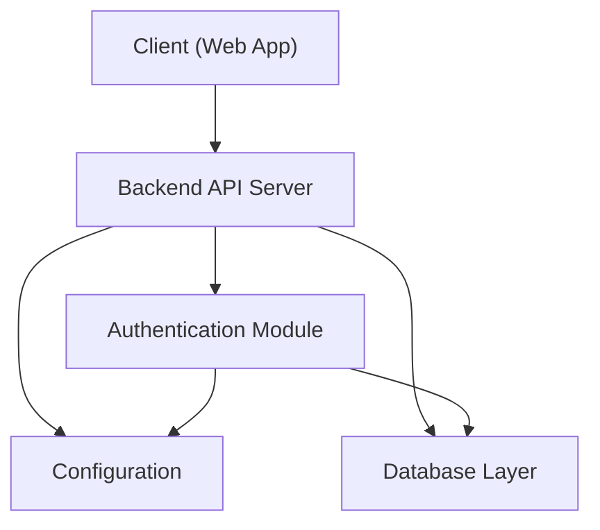
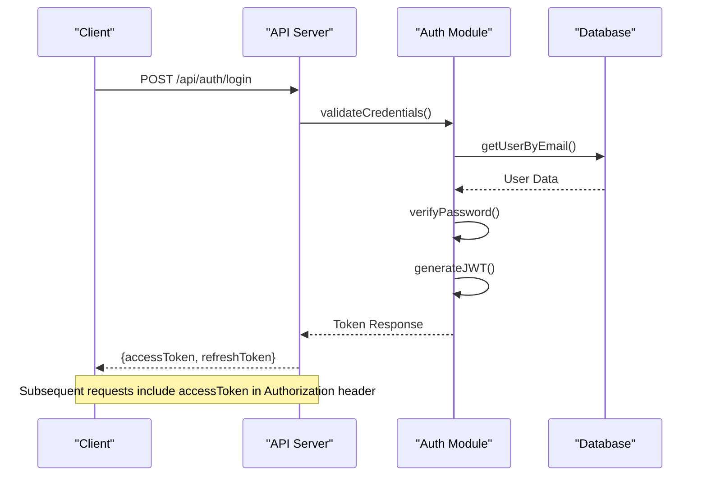
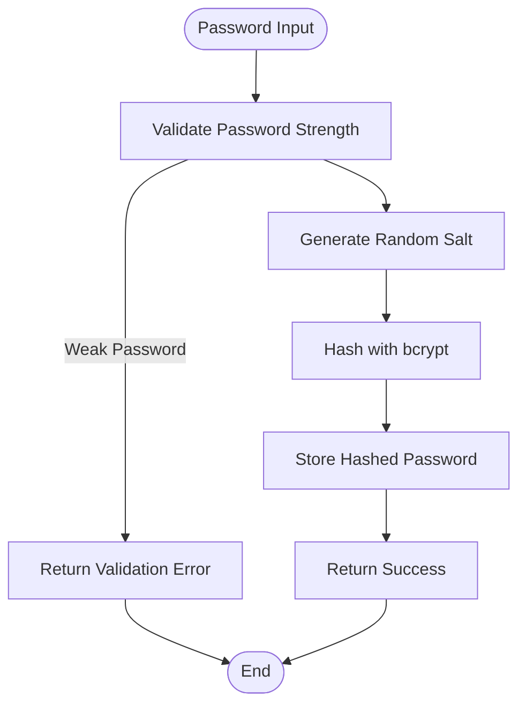
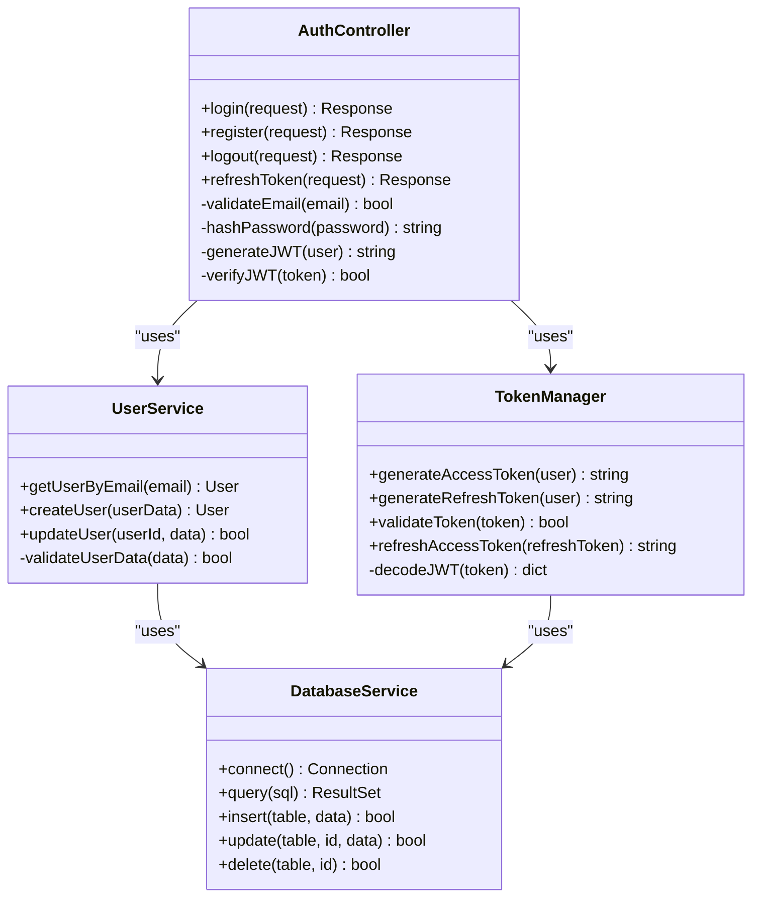
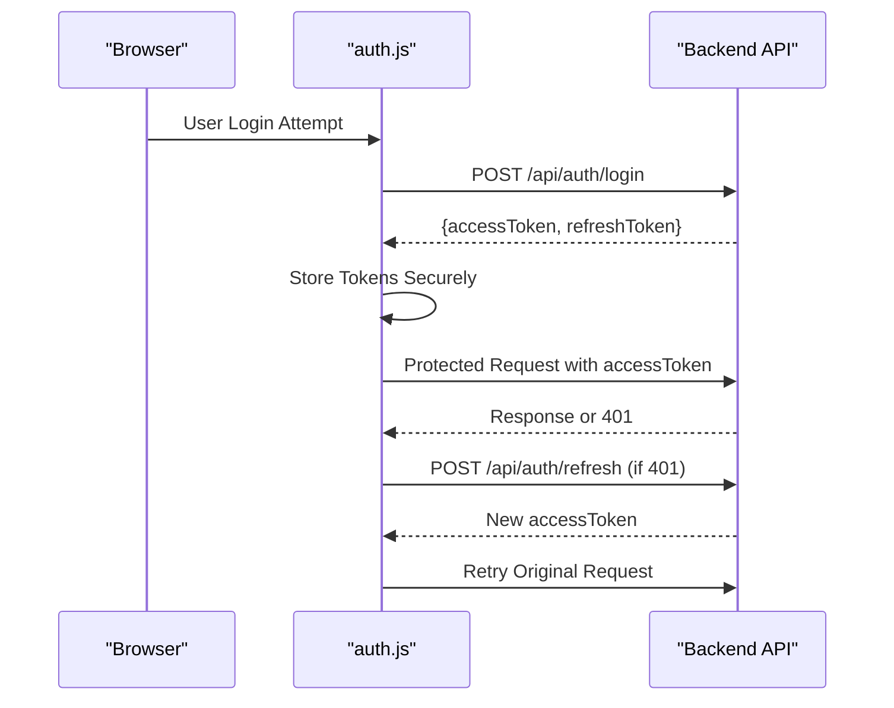

# User Authentication API

<cite>
**Referenced Files in This Document**
- [app.py](file://backend/app.py)
- [auth.py](file://backend/auth.py)
- [admin_auth.py](file://backend/admin_auth.py)
- [config.py](file://backend/config.py)
- [database/models.py](file://backend/database/models.py)
- [database/database.py](file://backend/database/database.py)
- [tests/integration/test_api_auth.py](file://backend/tests/integration/test_api_auth.py)
- [web/js/auth.js](file://web/js/auth.js)
- [web/js/auth-modal.js](file://web/js/auth-modal.js)
- [web/src/lib/api.ts](file://web/src/lib/api.ts)
</cite>

## Table of Contents
1. [Introduction](#introduction)
2. [Project Structure](#project-structure)
3. [Core Components](#core-components)
4. [Architecture Overview](#architecture-overview)
5. [Detailed Component Analysis](#detailed-component-analysis)
6. [Dependency Analysis](#dependency-analysis)
7. [Performance Considerations](#performance-considerations)
8. [Troubleshooting Guide](#troubleshooting-guide)
9. [Conclusion](#conclusion)
10. [Appendices](#appendices)

## Introduction
This document provides comprehensive authentication API documentation for user login, registration, token management, and session handling. It covers the endpoints POST /api/auth/login, POST /api/auth/register, POST /api/auth/logout, and token refresh mechanisms. It also specifies request/response schemas for user credentials, JWT tokens, error responses, and security headers. The guide includes examples of authentication flows, token validation, password hashing, and session management, along with security considerations, rate limiting, and brute force protection measures.

## Project Structure
The authentication system is implemented primarily in the backend Python application, with supporting frontend code for client-side interactions. Key files include:
- Backend application entry point and route definitions
- Authentication utilities and middleware
- Admin-specific authentication helpers
- Configuration for secrets, tokens, and security settings
- Database models and connection utilities
- Integration tests validating authentication flows
- Frontend scripts for handling auth UI and API calls



**Diagram sources**
- [app.py](file://backend/app.py)
- [auth.py](file://backend/auth.py)
- [config.py](file://backend/config.py)
- [database/database.py](file://backend/database/database.py)

**Section sources**
- [app.py](file://backend/app.py)
- [auth.py](file://backend/auth.py)
- [config.py](file://backend/config.py)
- [database/database.py](file://backend/database/database.py)

## Core Components
- Authentication module handles login, registration, logout, and token operations
- Configuration manages JWT secrets, expiration times, and security settings
- Database layer stores user credentials and session data
- Middleware validates tokens and enforces authentication
- Frontend components manage user interactions and token storage

**Section sources**
- [auth.py](file://backend/auth.py)
- [config.py](file://backend/config.py)
- [database/models.py](file://backend/database/models.py)
- [web/js/auth.js](file://web/js/auth.js)

## Architecture Overview
The authentication system follows a standard JWT-based architecture with secure password handling and session management.



**Diagram sources**
- [auth.py](file://backend/auth.py)
- [database/models.py](file://backend/database/models.py)

## Detailed Component Analysis

### Authentication Endpoints

#### POST /api/auth/login
Handles user authentication and returns access and refresh tokens.

**Request Schema:**
```json
{
  "email": "string",
  "password": "string"
}
```

**Response Schema:**
```json
{
  "accessToken": "string",
  "refreshToken": "string",
  "expiresIn": "number",
  "user": {
    "id": "string",
    "email": "string",
    "name": "string"
  }
}
```

**Error Responses:**
- 401 Unauthorized: Invalid credentials
- 429 Too Many Requests: Rate limit exceeded
- 500 Internal Server Error: Server error

#### POST /api/auth/register
Creates new user accounts with validated credentials.

**Request Schema:**
```json
{
  "email": "string",
  "password": "string",
  "name": "string",
  "confirmPassword": "string"
}
```

**Response Schema:**
```json
{
  "message": "User registered successfully",
  "user": {
    "id": "string",
    "email": "string",
    "name": "string"
  }
}
```

**Validation Rules:**
- Email must be unique and valid format
- Password must meet complexity requirements
- Confirm password must match password

#### POST /api/auth/logout
Invalidates user sessions and clears tokens.

**Request Schema:**
```json
{
  "accessToken": "string"
}
```

**Response Schema:**
```json
{
  "message": "Logged out successfully"
}
```

#### POST /api/auth/refresh
Refreshes expired access tokens using refresh tokens.

**Request Schema:**
```json
{
  "refreshToken": "string"
}
```

**Response Schema:**
```json
{
  "accessToken": "string",
  "expiresIn": "number"
}
```

**Section sources**
- [auth.py](file://backend/auth.py)
- [tests/integration/test_api_auth.py](file://backend/tests/integration/test_api_auth.py)

### Token Management

#### JWT Token Structure
Access tokens contain user identity and permissions with short expiration times. Refresh tokens are stored securely and used to obtain new access tokens.

**Access Token Claims:**
- sub: User ID
- email: User email
- name: User display name
- iat: Issued at timestamp
- exp: Expiration timestamp
- type: Token type identifier

**Security Headers:**
- Content-Security-Policy: Restricts resource loading
- X-Content-Type-Options: Prevents MIME sniffing
- X-Frame-Options: Prevents clickjacking
- Strict-Transport-Security: Enforces HTTPS

**Section sources**
- [auth.py](file://backend/auth.py)
- [config.py](file://backend/config.py)

### Password Hashing and Security

#### Password Processing Flow


**Security Features:**
- bcrypt hashing with unique salts
- Minimum password length requirements
- Complexity validation rules
- Timing attack prevention

**Section sources**
- [auth.py](file://backend/auth.py)

### Session Management

#### Session Lifecycle
Sessions are managed through JWT tokens with automatic expiration and refresh mechanisms.

**Session States:**
- Active: Valid tokens present
- Expired: Access token expired but refresh token valid
- Inactive: No valid tokens or logged out

**Token Storage:**
- Access tokens: Memory or secure storage
- Refresh tokens: Secure HTTP-only cookies
- Session data: Redis or database cache

**Section sources**
- [auth.py](file://backend/auth.py)
- [config.py](file://backend/config.py)

## Dependency Analysis



**Diagram sources**
- [auth.py](file://backend/auth.py)
- [database/models.py](file://backend/database/models.py)

**Section sources**
- [auth.py](file://backend/auth.py)
- [database/models.py](file://backend/database/models.py)

## Performance Considerations

### Optimization Strategies
- Connection pooling for database queries
- Token caching in memory for frequent validations
- Asynchronous password hashing operations
- Rate limiting implementation to prevent abuse

### Caching Layers
- JWT validation results cached for short periods
- User profile data cached after successful authentication
- Rate limit counters stored in Redis for distributed systems

### Monitoring and Metrics
- Authentication success/failure rates
- Average response times for auth endpoints
- Token generation and validation performance
- Memory usage during peak authentication loads

[No sources needed since this section provides general guidance]

## Troubleshooting Guide

### Common Issues and Solutions

#### Authentication Failures
- **Invalid Credentials**: Verify email format and password strength
- **Token Expired**: Implement automatic token refresh mechanism
- **Rate Limit Exceeded**: Wait for cooldown period or implement retry logic

#### Token Validation Errors
- **Malformed Token**: Ensure proper JWT formatting
- **Expired Token**: Use refresh token to obtain new access token
- **Invalid Signature**: Check secret key configuration

#### Database Connection Issues
- **Connection Timeout**: Increase timeout values and implement retry logic
- **Query Failures**: Validate SQL statements and parameter binding
- **Schema Mismatch**: Run database migrations if needed

**Section sources**
- [tests/integration/test_api_auth.py](file://backend/tests/integration/test_api_auth.py)

## Conclusion
The authentication system provides a robust, secure foundation for user management with comprehensive JWT token handling, secure password processing, and flexible session management. The modular architecture allows for easy extension and maintenance while maintaining high security standards and performance characteristics.

[No sources needed since this section summarizes without analyzing specific files]

## Appendices

### Security Best Practices

#### Rate Limiting Implementation
- Per-user rate limits for login attempts
- Global rate limits for registration endpoints
- Progressive delays for repeated failures
- IP-based throttling for DDoS protection

#### Brute Force Protection
- Account lockout after failed attempts
- CAPTCHA integration for suspicious activity
- Email verification for new registrations
- Multi-factor authentication support

#### Security Headers Configuration
- Content Security Policy (CSP)
- Cross-Origin Resource Sharing (CORS)
- HTTP Strict Transport Security (HSTS)
- X-Frame-Options and X-Content-Type-Options

**Section sources**
- [config.py](file://backend/config.py)
- [auth.py](file://backend/auth.py)

### Frontend Integration Examples

#### Client-Side Token Management


**Diagram sources**
- [web/js/auth.js](file://web/js/auth.js)
- [web/src/lib/api.ts](file://web/src/lib/api.ts)

**Section sources**
- [web/js/auth.js](file://web/js/auth.js)
- [web/js/auth-modal.js](file://web/js/auth-modal.js)
- [web/src/lib/api.ts](file://web/src/lib/api.ts)