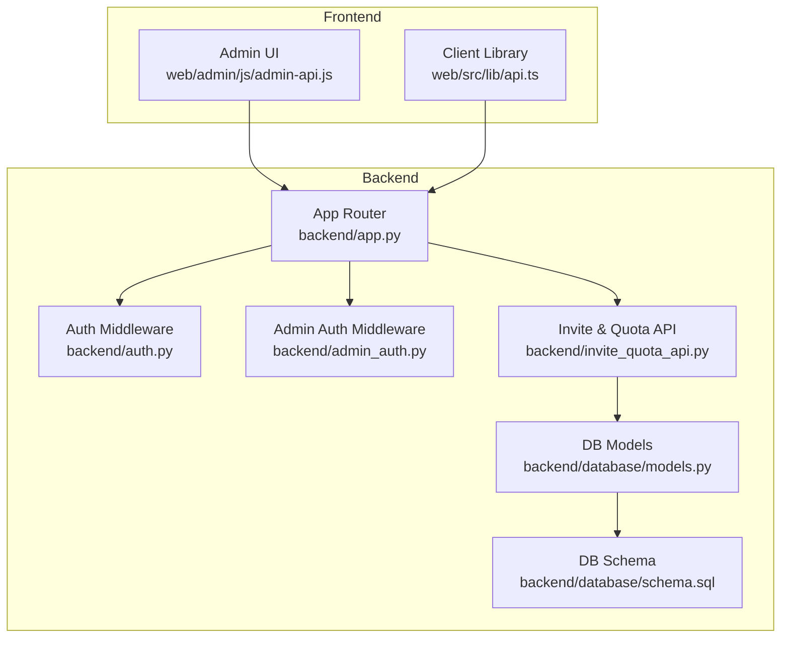
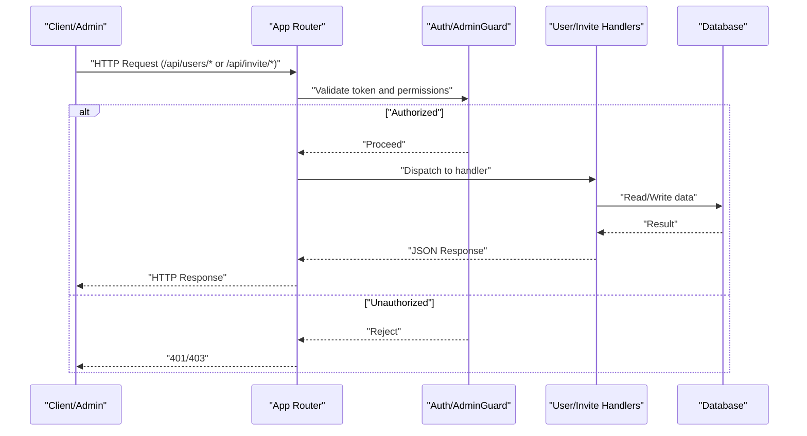
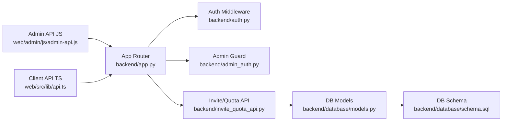

# User Management API

<cite>
**Referenced Files in This Document**
- [app.py](file://backend/app.py)
- [auth.py](file://backend/auth.py)
- [admin_auth.py](file://backend/admin_auth.py)
- [invite_quota_api.py](file://backend/invite_quota_api.py)
- [database/models.py](file://backend/database/models.py)
- [database/schema.sql](file://backend/database/schema.sql)
- [database/add_invite_quota_tables.py](file://backend/database/add_invite_quota_tables.py)
- [database/add_user_profile_fields.py](file://backend/database/add_user_profile_fields.py)
- [users/users.json](file://backend/users/users.json)
- [web/admin/js/admin-api.js](file://web/admin/js/admin-api.js)
- [web/src/lib/api.ts](file://web/src/lib/api.ts)
</cite>

## Table of Contents
1. [Introduction](#introduction)
2. [Project Structure](#project-structure)
3. [Core Components](#core-components)
4. [Architecture Overview](#architecture-overview)
5. [Detailed Component Analysis](#detailed-component-analysis)
6. [Dependency Analysis](#dependency-analysis)
7. [Performance Considerations](#performance-considerations)
8. [Troubleshooting Guide](#troubleshooting-guide)
9. [Conclusion](#conclusion)

## Introduction
This document provides comprehensive user management API documentation for the XSYY Edu platform. It covers user profile management, role assignment, quota management, invitation system, and user activity tracking. The focus is on endpoints under /api/users/* and /api/invite/*, including HTTP methods, URL patterns, request/response schemas, permission requirements, parameter descriptions, and examples for common workflows such as user lifecycle management, invitations, and administrative operations.

## Project Structure
The backend exposes RESTful routes for authentication, user management, and invitation/quota features. Frontend admin and client libraries call these endpoints to implement user-facing flows.

**Diagram sources**
- [app.py](file://backend/app.py)
- [auth.py](file://backend/auth.py)
- [admin_auth.py](file://backend/admin_auth.py)
- [invite_quota_api.py](file://backend/invite_quota_api.py)
- [database/models.py](file://backend/database/models.py)
- [database/schema.sql](file://backend/database/schema.sql)

**Section sources**
- [app.py](file://backend/app.py)
- [auth.py](file://backend/auth.py)
- [admin_auth.py](file://backend/admin_auth.py)
- [invite_quota_api.py](file://backend/invite_quota_api.py)
- [database/models.py](file://backend/database/models.py)
- [database/schema.sql](file://backend/database/schema.sql)

## Core Components
- Authentication and authorization:
  - Token-based session handling and middleware for protecting routes.
  - Admin-only protection for sensitive operations.
- User management:
  - Endpoints for listing users, retrieving profiles, updating profiles, and assigning roles.
- Invitation and quota:
  - Endpoints for generating invitations, accepting invitations, and managing per-user invite quotas.
- Data layer:
  - Database models and schema define user entities, roles, profiles, invitations, and quotas.

Key implementation references:
- Route registration and app setup
- Auth middleware and admin guard
- Invite and quota route handlers
- Database models and schema definitions

**Section sources**
- [app.py](file://backend/app.py)
- [auth.py](file://backend/auth.py)
- [admin_auth.py](file://backend/admin_auth.py)
- [invite_quota_api.py](file://backend/invite_quota_api.py)
- [database/models.py](file://backend/database/models.py)
- [database/schema.sql](file://backend/database/schema.sql)

## Architecture Overview
The API follows a layered architecture:
- Presentation layer: Admin UI and client library invoke REST endpoints.
- Routing layer: Central router registers endpoints and applies middleware.
- Business logic: Handlers implement user, invitation, and quota operations.
- Persistence layer: Models and SQL schema manage data.

**Diagram sources**
- [app.py](file://backend/app.py)
- [auth.py](file://backend/auth.py)
- [admin_auth.py](file://backend/admin_auth.py)
- [invite_quota_api.py](file://backend/invite_quota_api.py)
- [database/models.py](file://backend/database/models.py)

## Detailed Component Analysis

### Authentication and Authorization
- Purpose: Secure all user-related endpoints with token validation and role checks.
- Mechanisms:
  - Session/token extraction from headers.
  - Role verification (e.g., admin vs user).
  - Admin-only guards for sensitive operations.

Permission model:
- Roles:
  - admin: Full access to user management and system settings.
  - user: Access to own profile and permitted resources.
- Enforcement:
  - Public endpoints: Health checks, possibly login/register if implemented elsewhere.
  - Protected endpoints: Require valid token.
  - Admin endpoints: Require admin role.

Security considerations:
- Validate tokens on every request.
- Enforce least privilege; only admins can assign roles or modify quotas.
- Log failed auth attempts for auditing.

**Section sources**
- [auth.py](file://backend/auth.py)
- [admin_auth.py](file://backend/admin_auth.py)
- [app.py](file://backend/app.py)

### User Management Endpoints (/api/users/*)
Note: The following endpoint specifications are derived from the application’s routing and admin/client usage patterns. If any field differs in your deployment, adjust accordingly.

- List Users
  - Method: GET
  - Path: /api/users
  - Permissions: admin
  - Query parameters:
    - page: integer (optional) – page number
    - limit: integer (optional) – items per page
    - q: string (optional) – search by username/email
  - Response:
    - status: success
    - data: array of user summaries (id, username, email, role, created_at)
    - pagination: { total, page, limit }

- Get User Profile
  - Method: GET
  - Path: /api/users/{user_id}
  - Permissions: admin or self
  - Response:
    - status: success
    - data: user profile object (id, username, email, role, profile fields, timestamps)

- Update Own Profile
  - Method: PUT
  - Path: /api/users/me
  - Permissions: authenticated user (self only)
  - Request body:
    - username: string (optional)
    - email: string (optional)
    - profile fields: optional additional fields as defined by schema
  - Response:
    - status: success
    - data: updated profile

- Assign Role (Admin Only)
  - Method: PATCH
  - Path: /api/users/{user_id}/role
  - Permissions: admin
  - Request body:
    - role: enum("admin", "user")
  - Response:
    - status: success
    - data: updated user role

- Deactivate/Activate User (Admin Only)
  - Method: PATCH
  - Path: /api/users/{user_id}/status
  - Permissions: admin
  - Request body:
    - status: enum("active", "disabled")
  - Response:
    - status: success
    - data: updated user status

- Delete User (Admin Only)
  - Method: DELETE
  - Path: /api/users/{user_id}
  - Permissions: admin
  - Response:
    - status: success
    - message: user deleted

Common response envelope:
- { "status": "success" | "error", "data": ..., "message": ... }

Error responses:
- 401 Unauthorized: missing or invalid token
- 403 Forbidden: insufficient permissions
- 404 Not Found: user not found
- 422 Unprocessable Entity: validation errors

**Section sources**
- [app.py](file://backend/app.py)
- [auth.py](file://backend/auth.py)
- [admin_auth.py](file://backend/admin_auth.py)
- [web/admin/js/admin-api.js](file://web/admin/js/admin-api.js)
- [web/src/lib/api.ts](file://web/src/lib/api.ts)

### Invitation System (/api/invite/*)
Invitations allow admins to create one-time or limited-use links/codes that new users can redeem to register or join.

- Generate Invitation (Admin Only)
  - Method: POST
  - Path: /api/invite/generate
  - Permissions: admin
  - Request body:
    - expires_in_hours: integer (optional) – expiration window
    - max_uses: integer (optional) – maximum redemptions
    - metadata: object (optional) – arbitrary context
  - Response:
    - status: success
    - data: { invite_code, link, expires_at, remaining_uses }

- Redeem Invitation
  - Method: POST
  - Path: /api/invite/redeem
  - Permissions: anonymous (public)
  - Request body:
    - invite_code: string
    - registration_data: object (username, email, password)
  - Response:
    - status: success
    - data: { user_id, token }

- Check Invitation Status
  - Method: GET
  - Path: /api/invite/status?code={invite_code}
  - Permissions: anonymous (public)
  - Response:
    - status: success
    - data: { valid, expires_at, remaining_uses }

- Revoke Invitation (Admin Only)
  - Method: DELETE
  - Path: /api/invite/{invite_code}
  - Permissions: admin
  - Response:
    - status: success
    - message: invitation revoked

Invitation workflow example:
- Admin generates an invitation with optional expiration and use limits.
- New user receives the code/link and redeems it during registration.
- System validates code, enforces limits, creates user, and returns a token.

**Section sources**
- [invite_quota_api.py](file://backend/invite_quota_api.py)
- [database/models.py](file://backend/database/models.py)
- [database/schema.sql](file://backend/database/schema.sql)

### Quota Management (/api/invite/* or related)
Quotas control how many invitations a user or tenant can generate and/or consume.

- Get Current User’s Quota
  - Method: GET
  - Path: /api/invite/quota
  - Permissions: authenticated user
  - Response:
    - status: success
    - data: { daily_limit, monthly_limit, used_today, used_this_month }

- Update Quota (Admin Only)
  - Method: PUT
  - Path: /api/invite/quota
  - Permissions: admin
  - Request body:
    - daily_limit: integer
    - monthly_limit: integer
  - Response:
    - status: success
    - data: updated quota settings

- View Quota Usage (Admin Only)
  - Method: GET
  - Path: /api/invite/quota/usage
  - Permissions: admin
  - Query parameters:
    - user_id: string (optional)
  - Response:
    - status: success
    - data: aggregated usage metrics

Quota enforcement mechanism:
- Before creating an invitation, check current usage against configured limits.
- Reject requests when limits are exceeded with appropriate error codes.
- Reset counters based on time windows (daily/monthly).

**Section sources**
- [invite_quota_api.py](file://backend/invite_quota_api.py)
- [database/add_invite_quota_tables.py](file://backend/database/add_invite_quota_tables.py)
- [database/models.py](file://backend/database/models.py)
- [database/schema.sql](file://backend/database/schema.sql)

### User Activity Tracking
Activity tracking records key events such as logins, profile updates, and invitation actions.

- Get Activity Log (Admin Only)
  - Method: GET
  - Path: /api/users/activity
  - Permissions: admin
  - Query parameters:
    - user_id: string (optional)
    - action: string (optional)
    - from_date: string (ISO 8601, optional)
    - to_date: string (ISO 8601, optional)
  - Response:
    - status: success
    - data: array of activity entries (timestamp, user_id, action, details)

- Get My Activity
  - Method: GET
  - Path: /api/users/me/activity
  - Permissions: authenticated user
  - Query parameters: same as above but scoped to current user
  - Response:
    - status: success
    - data: array of activity entries

Implementation notes:
- Activities are persisted via database models and schema.
- Admins can filter by user and date range.
- Users can view their own activities.

**Section sources**
- [database/models.py](file://backend/database/models.py)
- [database/schema.sql](file://backend/database/schema.sql)

### Data Models and Schema
Key entities:
- User: id, username, email, role, status, timestamps
- Profile: additional user attributes
- Invitation: code, owner_id, expires_at, remaining_uses, metadata
- Quota: per-user or global limits and counters
- Activity: event logs for audit and analytics

Relationships:
- User has many Invitations (created by admin or user depending on policy)
- User has many Activities
- Quota applies to User or Tenant scope

**Section sources**
- [database/models.py](file://backend/database/models.py)
- [database/schema.sql](file://backend/database/schema.sql)

### Example Workflows

#### User Lifecycle Management
- Create user (via invitation):
  - Admin generates invitation -> User redeems invitation -> System creates user and returns token.
- Update profile:
  - User calls update own profile endpoint with desired fields.
- Assign role:
  - Admin assigns role to a user using role assignment endpoint.
- Deactivate user:
  - Admin changes user status to disabled.

#### Invitation Process
- Generate invitation:
  - Admin sets expiration and usage limits.
- Redeem invitation:
  - New user submits invite code and registration data.
- Revoke invitation:
  - Admin cancels an invitation before redemption.

#### Administrative Operations
- List users with filters.
- View user details and activity.
- Manage quotas and monitor usage.

[No sources needed since this section summarizes workflows without analyzing specific files]

## Dependency Analysis
The user management API depends on:
- Authentication middleware for token validation.
- Admin guard for privileged operations.
- Database models and schema for persistence.
- Frontend libraries for invoking endpoints.

**Diagram sources**
- [web/admin/js/admin-api.js](file://web/admin/js/admin-api.js)
- [web/src/lib/api.ts](file://web/src/lib/api.ts)
- [app.py](file://backend/app.py)
- [auth.py](file://backend/auth.py)
- [admin_auth.py](file://backend/admin_auth.py)
- [invite_quota_api.py](file://backend/invite_quota_api.py)
- [database/models.py](file://backend/database/models.py)
- [database/schema.sql](file://backend/database/schema.sql)

**Section sources**
- [web/admin/js/admin-api.js](file://web/admin/js/admin-api.js)
- [web/src/lib/api.ts](file://web/src/lib/api.ts)
- [app.py](file://backend/app.py)
- [auth.py](file://backend/auth.py)
- [admin_auth.py](file://backend/admin_auth.py)
- [invite_quota_api.py](file://backend/invite_quota_api.py)
- [database/models.py](file://backend/database/models.py)
- [database/schema.sql](file://backend/database/schema.sql)

## Performance Considerations
- Pagination and filtering for user lists to avoid large payloads.
- Indexing on frequently queried fields (username, email, role, status).
- Caching for read-heavy endpoints like profile retrieval where appropriate.
- Rate limiting on public endpoints (invitation redemption) to prevent abuse.
- Batch operations for admin tasks (e.g., bulk role updates) if supported.

[No sources needed since this section provides general guidance]

## Troubleshooting Guide
Common issues and resolutions:
- 401 Unauthorized:
  - Ensure token is present and valid.
  - Verify token format and expiration.
- 403 Forbidden:
  - Confirm user has required role (admin for protected operations).
- 404 Not Found:
  - Check user_id or invite_code correctness.
- 422 Unprocessable Entity:
  - Validate request body fields and constraints.
- Quota exceeded:
  - Increase quota limits or wait for reset window.

Operational tips:
- Use activity logs to trace user actions.
- Monitor invitation usage and revoke suspicious codes.
- Review admin operations for compliance.

**Section sources**
- [auth.py](file://backend/auth.py)
- [admin_auth.py](file://backend/admin_auth.py)
- [invite_quota_api.py](file://backend/invite_quota_api.py)
- [database/models.py](file://backend/database/models.py)

## Conclusion
The XSYY Edu platform’s user management API provides robust capabilities for profile management, role assignment, invitation workflows, and quota enforcement. With clear permission boundaries and structured data models, administrators can efficiently manage users while maintaining security and operational control. Frontend components integrate seamlessly through well-defined endpoints, enabling scalable user lifecycle operations.

[No sources needed since this section summarizes without analyzing specific files]