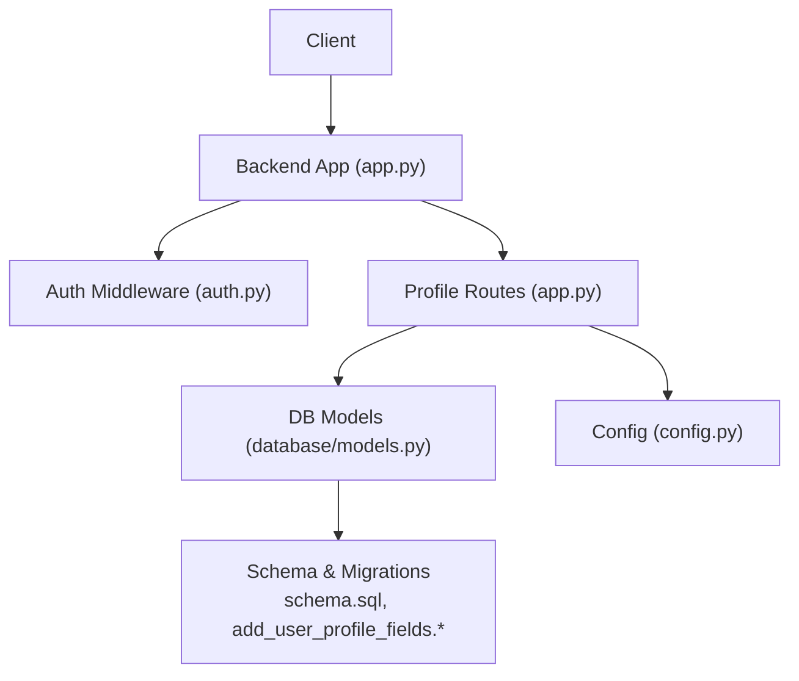
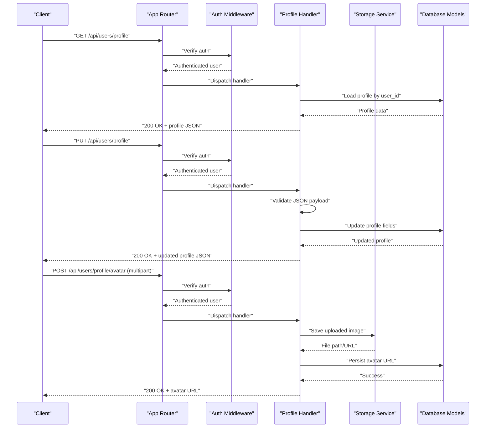
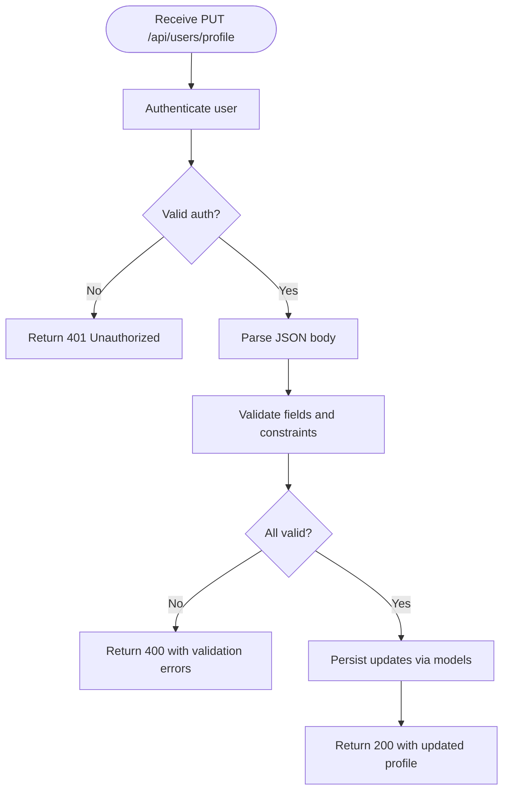
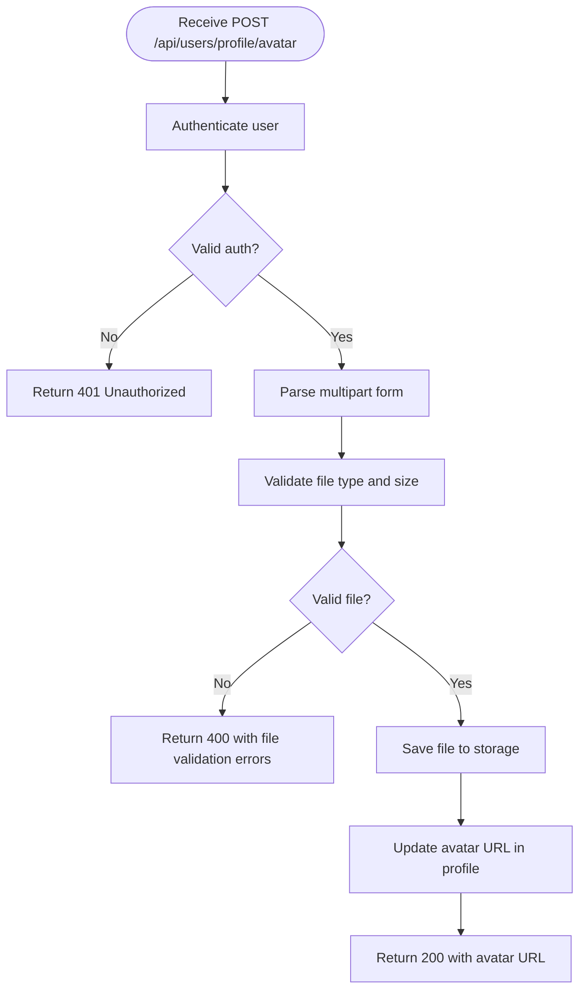
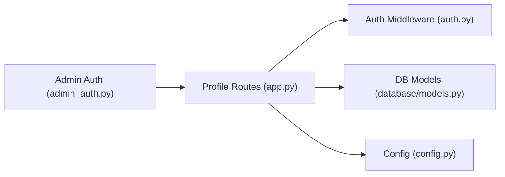

# User Profile Management API

<cite>
**Referenced Files in This Document**
- [app.py](file://backend/app.py)
- [auth.py](file://backend/auth.py)
- [database/models.py](file://backend/database/models.py)
- [database/schema.sql](file://backend/database/schema.sql)
- [database/add_user_profile_fields.py](file://backend/database/add_user_profile_fields.py)
- [database/add_user_profile_fields.sql](file://backend/database/add_user_profile_fields.sql)
- [config.py](file://backend/config.py)
- [admin_auth.py](file://backend/admin_auth.py)
</cite>

## Table of Contents
1. [Introduction](#introduction)
2. [Project Structure](#project-structure)
3. [Core Components](#core-components)
4. [Architecture Overview](#architecture-overview)
5. [Detailed Component Analysis](#detailed-component-analysis)
6. [Dependency Analysis](#dependency-analysis)
7. [Performance Considerations](#performance-considerations)
8. [Troubleshooting Guide](#troubleshooting-guide)
9. [Conclusion](#conclusion)

## Introduction
This document specifies the User Profile Management API for creating, reading, updating, and managing user profile data and avatars. It covers:
- Endpoints for GET/PUT /api/users/profile
- Avatar upload handling
- Request/response schemas for user profile fields
- Validation rules and error responses
- File size limits and supported formats
- Data privacy considerations

The goal is to provide clear guidance for clients integrating with the backend’s user profile features.

## Project Structure
User profile functionality spans several backend modules:
- Application entrypoint and route registration
- Authentication middleware
- Database models and schema definitions
- Migration scripts that add profile-related columns
- Configuration for storage and security settings

**Diagram sources**
- [app.py](file://backend/app.py)
- [auth.py](file://backend/auth.py)
- [database/models.py](file://backend/database/models.py)
- [database/schema.sql](file://backend/database/schema.sql)
- [database/add_user_profile_fields.py](file://backend/database/add_user_profile_fields.py)
- [database/add_user_profile_fields.sql](file://backend/database/add_user_profile_fields.sql)
- [config.py](file://backend/config.py)

**Section sources**
- [app.py](file://backend/app.py)
- [auth.py](file://backend/auth.py)
- [database/models.py](file://backend/database/models.py)
- [database/schema.sql](file://backend/database/schema.sql)
- [database/add_user_profile_fields.py](file://backend/database/add_user_profile_fields.py)
- [database/add_user_profile_fields.sql](file://backend/database/add_user_profile_fields.sql)
- [config.py](file://backend/config.py)

## Core Components
- Route handlers for profile endpoints under /api/users/profile
- Authentication checks ensuring requests are tied to a valid user session or token
- Database model accessors for user profile fields
- Storage configuration for avatar files
- Validation logic for request payloads and file uploads

Key responsibilities:
- Validate authenticated context
- Parse and validate JSON body for profile updates
- Handle multipart/form-data for avatar uploads
- Persist changes to the database via models
- Return standardized success/error responses

**Section sources**
- [app.py](file://backend/app.py)
- [auth.py](file://backend/auth.py)
- [database/models.py](file://backend/database/models.py)
- [config.py](file://backend/config.py)

## Architecture Overview
The profile management flow integrates authentication, routing, validation, storage, and persistence.

**Diagram sources**
- [app.py](file://backend/app.py)
- [auth.py](file://backend/auth.py)
- [database/models.py](file://backend/database/models.py)
- [config.py](file://backend/config.py)

## Detailed Component Analysis

### Endpoints

#### GET /api/users/profile
- Purpose: Retrieve the authenticated user’s profile
- Authentication: Required
- Success Response: 200 OK with profile JSON
- Error Responses:
  - 401 Unauthorized if not authenticated
  - 404 Not Found if profile does not exist
  - 500 Internal Server Error on unexpected failures

Response fields include core identity and optional profile attributes such as display name, bio, avatar URL, and preference settings.

**Section sources**
- [app.py](file://backend/app.py)
- [auth.py](file://backend/auth.py)
- [database/models.py](file://backend/database/models.py)

#### PUT /api/users/profile
- Purpose: Update the authenticated user’s profile
- Authentication: Required
- Content-Type: application/json
- Success Response: 200 OK with updated profile JSON
- Error Responses:
  - 400 Bad Request with validation errors
  - 401 Unauthorized if not authenticated
  - 404 Not Found if profile does not exist
  - 500 Internal Server Error on unexpected failures

Request body fields:
- display_name: string, optional
- bio: string, optional
- preferences: object, optional
- Any other profile fields defined in the database schema

Validation:
- Field presence and types validated server-side
- Length constraints enforced where applicable
- Unknown fields ignored or rejected depending on implementation

**Section sources**
- [app.py](file://backend/app.py)
- [database/models.py](file://backend/database/models.py)
- [database/add_user_profile_fields.sql](file://backend/database/add_user_profile_fields.sql)

#### POST /api/users/profile/avatar
- Purpose: Upload an avatar image for the authenticated user
- Authentication: Required
- Content-Type: multipart/form-data
- Form field: file (image)
- Success Response: 200 OK with avatar URL
- Error Responses:
  - 400 Bad Request for invalid file type or size
  - 401 Unauthorized if not authenticated
  - 500 Internal Server Error on unexpected failures

Supported formats: JPEG, PNG, WebP
Maximum file size: see configuration section

**Section sources**
- [app.py](file://backend/app.py)
- [config.py](file://backend/config.py)

### Request and Response Schemas

#### User Profile Fields
- id: integer or UUID (read-only)
- username: string (read-only)
- email: string (read-only)
- display_name: string (optional, up to configured length)
- bio: string (optional, up to configured length)
- avatar_url: string (read-only; set via avatar upload)
- preferences: object (optional; key-value pairs for user settings)

Notes:
- Only authenticated users can read/update their own profile
- Some fields may be immutable (e.g., username, email) depending on policy

**Section sources**
- [database/models.py](file://backend/database/models.py)
- [database/add_user_profile_fields.sql](file://backend/database/add_user_profile_fields.sql)

#### Validation Errors
Error response structure:
- code: string error code
- message: human-readable description
- details: array of field-specific errors

Example detail item:
- field: string field name
- constraint: string describing violated rule
- value: provided value (if applicable)

**Section sources**
- [app.py](file://backend/app.py)

#### Avatar Upload Constraints
- Allowed MIME types: image/jpeg, image/png, image/webp
- Maximum file size: configured via environment variable or config module
- Filename sanitization and safe storage path generation

**Section sources**
- [config.py](file://backend/config.py)
- [app.py](file://backend/app.py)

### Processing Logic

#### Profile Update Flow

**Diagram sources**
- [app.py](file://backend/app.py)
- [database/models.py](file://backend/database/models.py)

#### Avatar Upload Flow

**Diagram sources**
- [app.py](file://backend/app.py)
- [config.py](file://backend/config.py)

### Data Privacy Considerations
- Enforce per-user access: clients must only read/update their own profile
- Avoid returning sensitive fields unless explicitly requested and authorized
- Sanitize and validate all inputs to prevent injection and malformed data
- Store minimal personal data necessary for operation
- Ensure secure transmission (HTTPS) and proper error messages that do not leak internal details

[No sources needed since this section provides general guidance]

## Dependency Analysis
The profile endpoints depend on:
- Authentication middleware to ensure user context
- Database models for persistence
- Configuration for storage paths and limits
- Optional admin authorization for administrative operations

**Diagram sources**
- [app.py](file://backend/app.py)
- [auth.py](file://backend/auth.py)
- [database/models.py](file://backend/database/models.py)
- [config.py](file://backend/config.py)
- [admin_auth.py](file://backend/admin_auth.py)

**Section sources**
- [app.py](file://backend/app.py)
- [auth.py](file://backend/auth.py)
- [database/models.py](file://backend/database/models.py)
- [config.py](file://backend/config.py)
- [admin_auth.py](file://backend/admin_auth.py)

## Performance Considerations
- Use efficient queries to fetch only required profile fields
- Cache frequently accessed profile data at the application layer when appropriate
- Stream large avatar files during upload and store optimized formats (WebP preferred)
- Implement rate limiting on avatar upload endpoints to prevent abuse
- Avoid unnecessary re-computation or re-encoding of images

[No sources needed since this section provides general guidance]

## Troubleshooting Guide
Common issues and resolutions:
- 401 Unauthorized: Verify client includes valid credentials/session
- 400 Bad Request: Check request body schema and file constraints; review validation error details
- 404 Not Found: Confirm profile exists for the authenticated user
- 500 Internal Server Error: Inspect server logs for stack traces; verify database connectivity and storage permissions

Operational checks:
- Ensure database migrations have been applied to add profile fields
- Confirm storage directory has write permissions
- Validate environment variables for max file size and allowed MIME types

**Section sources**
- [database/add_user_profile_fields.py](file://backend/database/add_user_profile_fields.py)
- [database/add_user_profile_fields.sql](file://backend/database/add_user_profile_fields.sql)
- [config.py](file://backend/config.py)

## Conclusion
The User Profile Management API provides secure and validated endpoints for retrieving and updating user profiles, along with avatar upload capabilities. By adhering to the documented schemas, constraints, and best practices, clients can reliably integrate profile management features while maintaining data integrity and privacy.

[No sources needed since this section summarizes without analyzing specific files]