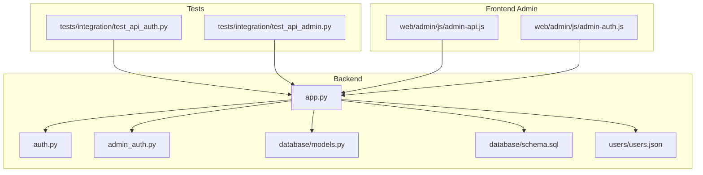
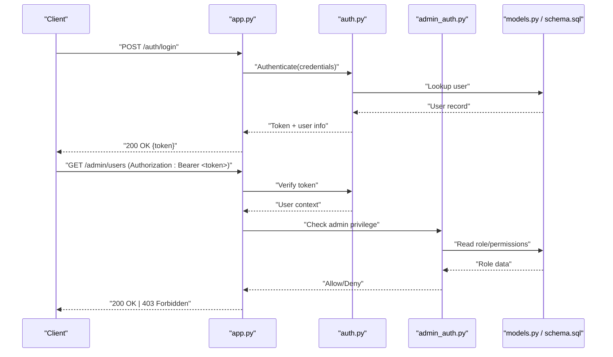
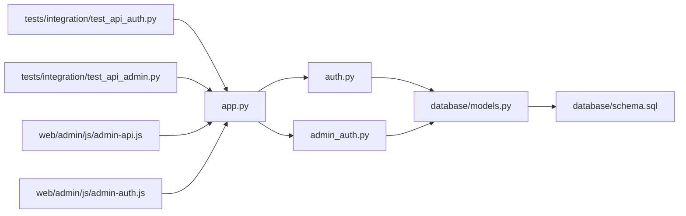
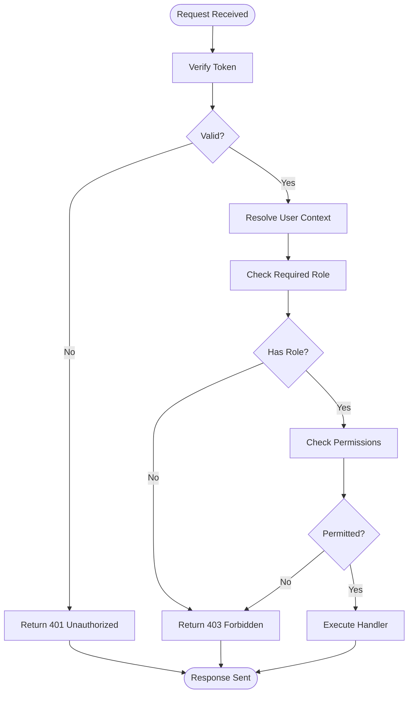
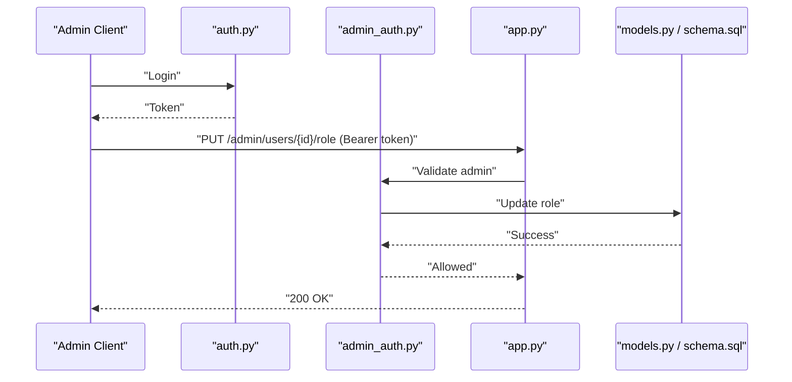
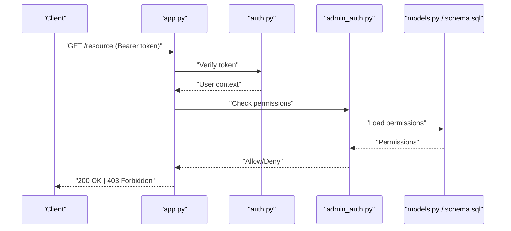

# User Roles & Permissions API

<cite>
**Referenced Files in This Document**
- [app.py](file://backend/app.py)
- [auth.py](file://backend/auth.py)
- [admin_auth.py](file://backend/admin_auth.py)
- [models.py](file://backend/database/models.py)
- [schema.sql](file://backend/database/schema.sql)
- [users.json](file://backend/users/users.json)
- [test_api_admin.py](file://backend/tests/integration/test_api_admin.py)
- [test_api_auth.py](file://backend/tests/integration/test_api_auth.py)
- [admin-api.js](file://web/admin/js/admin-api.js)
- [admin-auth.js](file://web/admin/js/admin-auth.js)
</cite>

## Table of Contents
1. [Introduction](#introduction)
2. [Project Structure](#project-structure)
3. [Core Components](#core-components)
4. [Architecture Overview](#architecture-overview)
5. [Detailed Component Analysis](#detailed-component-analysis)
6. [Dependency Analysis](#dependency-analysis)
7. [Performance Considerations](#performance-considerations)
8. [Troubleshooting Guide](#troubleshooting-guide)
9. [Conclusion](#conclusion)
10. [Appendices](#appendices)

## Introduction
This document describes the roles and permissions API for role-based access control (RBAC), permission validation, access control, and administrative user management. It covers:
- Role assignment workflows
- Permission checking and authorization middleware
- Administrative operations for users and privileges
- Request/response schemas for roles, permissions, tokens, and authorization checks
- Security middleware integration patterns

The backend is a Python application with authentication and admin authorization modules, database models and schema, and tests that demonstrate usage. The frontend includes admin utilities for interacting with these endpoints.

## Project Structure
Key areas relevant to roles and permissions:
- Backend entrypoint and route registration
- Authentication and admin authorization modules
- Database models and schema for users and roles
- Integration tests exercising auth and admin flows
- Admin web client utilities calling protected endpoints

**Diagram sources**
- [app.py](file://backend/app.py)
- [auth.py](file://backend/auth.py)
- [admin_auth.py](file://backend/admin_auth.py)
- [models.py](file://backend/database/models.py)
- [schema.sql](file://backend/database/schema.sql)
- [users.json](file://backend/users/users.json)
- [test_api_auth.py](file://backend/tests/integration/test_api_auth.py)
- [test_api_admin.py](file://backend/tests/integration/test_api_admin.py)
- [admin-api.js](file://web/admin/js/admin-api.js)
- [admin-auth.js](file://web/admin/js/admin-auth.js)

**Section sources**
- [app.py](file://backend/app.py)
- [auth.py](file://backend/auth.py)
- [admin_auth.py](file://backend/admin_auth.py)
- [models.py](file://backend/database/models.py)
- [schema.sql](file://backend/database/schema.sql)
- [users.json](file://backend/users/users.json)
- [test_api_auth.py](file://backend/tests/integration/test_api_auth.py)
- [test_api_admin.py](file://backend/tests/integration/test_api_admin.py)
- [admin-api.js](file://web/admin/js/admin-api.js)
- [admin-auth.js](file://web/admin/js/admin-auth.js)

## Core Components
- Authentication module: Provides login, token issuance, and request identity resolution.
- Admin authorization module: Enforces admin-only access on privileged routes.
- Database models and schema: Define users, roles, and related fields used by RBAC.
- Route registration: Attaches protected endpoints using decorators or middleware from auth/admin modules.
- Tests: Validate authentication and admin authorization behaviors.
- Admin client utilities: Demonstrate how clients attach tokens and call admin endpoints.

**Section sources**
- [auth.py](file://backend/auth.py)
- [admin_auth.py](file://backend/admin_auth.py)
- [models.py](file://backend/database/models.py)
- [schema.sql](file://backend/database/schema.sql)
- [test_api_auth.py](file://backend/tests/integration/test_api_auth.py)
- [test_api_admin.py](file://backend/tests/integration/test_api_admin.py)
- [admin-api.js](file://web/admin/js/admin-api.js)
- [admin-auth.js](file://web/admin/js/admin-auth.js)

## Architecture Overview
High-level flow for protected requests:
- Client sends request with credentials or token.
- Auth layer validates credentials and issues/verifies tokens.
- Admin layer enforces admin-only constraints.
- Route handlers execute business logic with resolved user context.

**Diagram sources**
- [app.py](file://backend/app.py)
- [auth.py](file://backend/auth.py)
- [admin_auth.py](file://backend/admin_auth.py)
- [models.py](file://backend/database/models.py)
- [schema.sql](file://backend/database/schema.sql)

## Detailed Component Analysis

### Authentication Module
Responsibilities:
- Login endpoint: Accepts credentials, validates against stored users, returns an access token.
- Token verification: Extracts and validates tokens from incoming requests.
- Identity injection: Populates request context with authenticated user information.

Typical request/response patterns:
- Login request: Contains username/email and password.
- Login response: Returns a token and minimal user profile.
- Protected request header: Authorization: Bearer <token>.

Security considerations:
- Tokens should be short-lived and securely transmitted over HTTPS.
- Passwords must be hashed; never log or return secrets.

**Section sources**
- [auth.py](file://backend/auth.py)
- [test_api_auth.py](file://backend/tests/integration/test_api_auth.py)

### Admin Authorization Module
Responsibilities:
- Enforce admin-only access on designated routes.
- Check current user’s role/privileges before allowing execution.
- Return appropriate error codes when unauthorized.

Access control pattern:
- Middleware/decorator inspects token, resolves user, then verifies admin status.
- If not admin, respond with forbidden error without invoking handler.

**Section sources**
- [admin_auth.py](file://backend/admin_auth.py)
- [test_api_admin.py](file://backend/tests/integration/test_api_admin.py)

### Database Models and Schema
Responsibilities:
- Define user entities and role-related fields.
- Provide tables/columns for roles, permissions, and user-role mappings if implemented.

Data model highlights:
- Users table with identifiers and role attributes.
- Optional roles/permissions tables for fine-grained RBAC.
- Indexes for efficient lookups during auth and authorization.

**Section sources**
- [models.py](file://backend/database/models.py)
- [schema.sql](file://backend/database/schema.sql)

### Route Registration and Protected Endpoints
Responsibilities:
- Register public endpoints (e.g., login).
- Wrap admin endpoints with admin authorization.
- Ensure consistent error responses for auth failures.

Protected endpoint examples:
- GET /admin/users
- POST /admin/users/{id}/role
- PUT /admin/users/{id}/permissions

Error handling:
- 401 Unauthorized for missing/invalid tokens.
- 403 Forbidden for insufficient privileges.
- 404 Not Found for unknown resources.

**Section sources**
- [app.py](file://backend/app.py)
- [admin_auth.py](file://backend/admin_auth.py)
- [auth.py](file://backend/auth.py)

### Admin Web Client Utilities
Responsibilities:
- Attach Authorization headers to requests.
- Call admin endpoints for user management and role assignment.
- Handle errors and display feedback.

Usage patterns:
- Store token after login.
- Include token in subsequent admin calls.
- Retry or refresh token on 401 responses.

**Section sources**
- [admin-api.js](file://web/admin/js/admin-api.js)
- [admin-auth.js](file://web/admin/js/admin-auth.js)

## Dependency Analysis
Component relationships:
- app.py depends on auth.py and admin_auth.py for security.
- auth.py and admin_auth.py depend on database models/schema for user and role data.
- Tests exercise both auth and admin flows.
- Admin client utilities call protected endpoints via HTTP.

**Diagram sources**
- [app.py](file://backend/app.py)
- [auth.py](file://backend/auth.py)
- [admin_auth.py](file://backend/admin_auth.py)
- [models.py](file://backend/database/models.py)
- [schema.sql](file://backend/database/schema.sql)
- [test_api_auth.py](file://backend/tests/integration/test_api_auth.py)
- [test_api_admin.py](file://backend/tests/integration/test_api_admin.py)
- [admin-api.js](file://web/admin/js/admin-api.js)
- [admin-auth.js](file://web/admin/js/admin-auth.js)

**Section sources**
- [app.py](file://backend/app.py)
- [auth.py](file://backend/auth.py)
- [admin_auth.py](file://backend/admin_auth.py)
- [models.py](file://backend/database/models.py)
- [schema.sql](file://backend/database/schema.sql)
- [test_api_auth.py](file://backend/tests/integration/test_api_auth.py)
- [test_api_admin.py](file://backend/tests/integration/test_api_admin.py)
- [admin-api.js](file://web/admin/js/admin-api.js)
- [admin-auth.js](file://web/admin/js/admin-auth.js)

## Performance Considerations
- Cache frequently accessed role/permission data where safe to do so.
- Use indexes on user identifiers and role columns to speed up lookups.
- Keep tokens small and avoid heavy payload serialization.
- Prefer stateless token verification to reduce server-side session storage.

[No sources needed since this section provides general guidance]

## Troubleshooting Guide
Common issues and resolutions:
- 401 Unauthorized: Missing or invalid token; ensure Authorization header format and token validity.
- 403 Forbidden: Insufficient privileges; verify user role and required permissions.
- 404 Not Found: Resource does not exist; check IDs and endpoint paths.
- CORS or network errors: Confirm origin allowlists and HTTPS configuration.

Operational checks:
- Verify database connectivity and schema migrations.
- Confirm environment variables for secrets and token signing.
- Review logs around auth and admin middleware for detailed stack traces.

**Section sources**
- [test_api_auth.py](file://backend/tests/integration/test_api_auth.py)
- [test_api_admin.py](file://backend/tests/integration/test_api_admin.py)

## Conclusion
The RBAC system integrates authentication, admin authorization, and database-backed user/role definitions to secure endpoints. Clients obtain tokens via login and include them in requests. Admin operations are guarded by explicit authorization checks. Proper error handling and performance practices ensure a robust and scalable access control layer.

[No sources needed since this section summarizes without analyzing specific files]

## Appendices

### API Reference: Authentication
- POST /auth/login
  - Request body: username/email, password
  - Response: token, minimal user info
  - Errors: 400 Bad Request, 401 Unauthorized

- GET /auth/me
  - Headers: Authorization: Bearer <token>
  - Response: current user profile
  - Errors: 401 Unauthorized

**Section sources**
- [auth.py](file://backend/auth.py)
- [test_api_auth.py](file://backend/tests/integration/test_api_auth.py)

### API Reference: Admin Operations
- GET /admin/users
  - Headers: Authorization: Bearer <token>
  - Response: list of users with roles
  - Errors: 401 Unauthorized, 403 Forbidden

- POST /admin/users
  - Headers: Authorization: Bearer <token>
  - Request body: user details, initial role
  - Response: created user
  - Errors: 400 Bad Request, 401 Unauthorized, 403 Forbidden

- PUT /admin/users/{id}/role
  - Headers: Authorization: Bearer <token>
  - Request body: new role
  - Response: updated user
  - Errors: 400 Bad Request, 401 Unauthorized, 403 Forbidden, 404 Not Found

- PUT /admin/users/{id}/permissions
  - Headers: Authorization: Bearer <token>
  - Request body: permissions array
  - Response: updated user
  - Errors: 400 Bad Request, 401 Unauthorized, 403 Forbidden, 404 Not Found

**Section sources**
- [app.py](file://backend/app.py)
- [admin_auth.py](file://backend/admin_auth.py)
- [test_api_admin.py](file://backend/tests/integration/test_api_admin.py)

### Data Models: Users and Roles
- Users
  - id: unique identifier
  - username/email: login identifiers
  - password_hash: secure hash
  - role: primary role (e.g., admin, user)
  - permissions: optional granular permissions set
  - timestamps: created_at, updated_at

- Roles and Permissions
  - role: predefined role names
  - permissions: set of actions/resources allowed per role
  - hierarchy: admin supersedes user; custom roles can extend permissions

**Section sources**
- [models.py](file://backend/database/models.py)
- [schema.sql](file://backend/database/schema.sql)

### Access Control Patterns
- Role-based checks: Require specific role for endpoints.
- Permission-based checks: Validate action/resource pairs.
- Hierarchical roles: Admin inherits all permissions; user has limited scope.
- Least privilege: Assign minimum necessary permissions.

[No sources needed since this diagram shows conceptual workflow, not actual code structure]

### Example Workflows

#### Role Assignment Workflow
- Admin authenticates and obtains token.
- Admin calls role update endpoint for a user.
- System validates admin privileges and updates user role.
- Subsequent requests use the new role for access decisions.

**Diagram sources**
- [auth.py](file://backend/auth.py)
- [admin_auth.py](file://backend/admin_auth.py)
- [app.py](file://backend/app.py)
- [models.py](file://backend/database/models.py)
- [schema.sql](file://backend/database/schema.sql)

#### Permission Validation Flow
- Client invokes a resource-specific endpoint.
- Middleware checks user’s permissions for the requested action.
- If permitted, handler executes; otherwise, returns forbidden.

**Diagram sources**
- [auth.py](file://backend/auth.py)
- [admin_auth.py](file://backend/admin_auth.py)
- [app.py](file://backend/app.py)
- [models.py](file://backend/database/models.py)
- [schema.sql](file://backend/database/schema.sql)

### Security Middleware Integration
- Attach token verification to all protected routes.
- Apply admin-only decorator/middleware to administrative endpoints.
- Standardize error responses for consistent client handling.
- Log security events for auditability.

**Section sources**
- [auth.py](file://backend/auth.py)
- [admin_auth.py](file://backend/admin_auth.py)
- [app.py](file://backend/app.py)

### Frontend Admin Usage
- After login, store token securely.
- Include Authorization header in every admin request.
- Handle 401 by prompting re-login; handle 403 by showing insufficient privileges.

**Section sources**
- [admin-api.js](file://web/admin/js/admin-api.js)
- [admin-auth.js](file://web/admin/js/admin-auth.js)