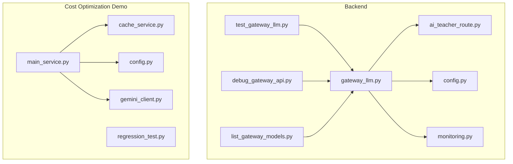
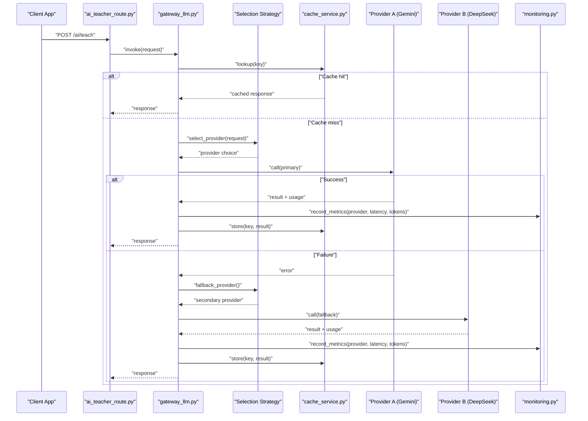
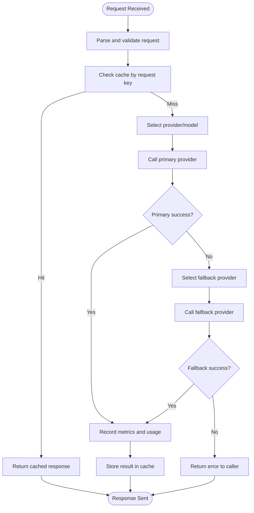
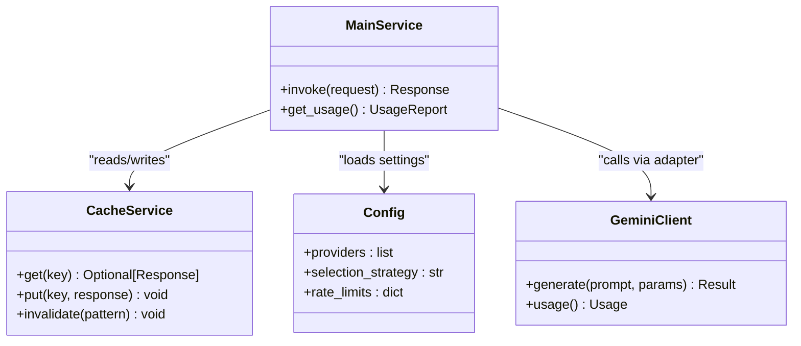
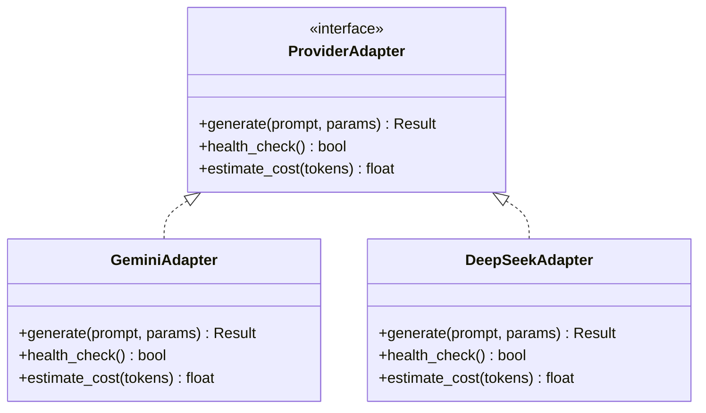
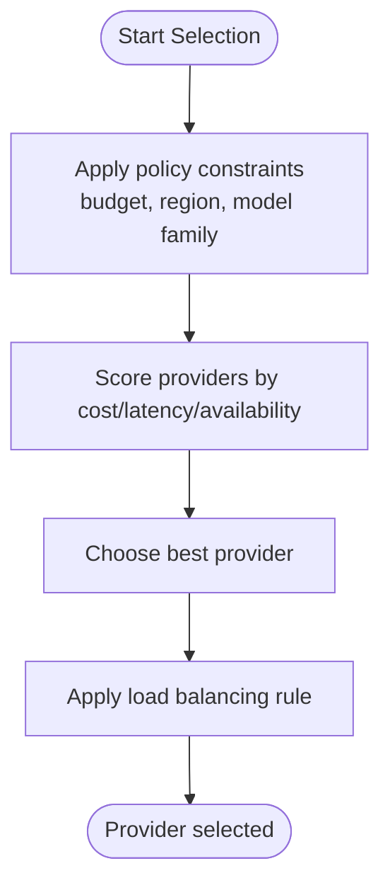
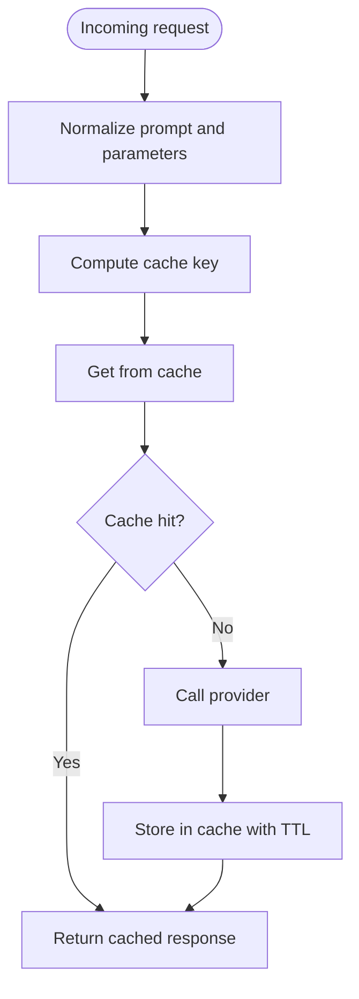
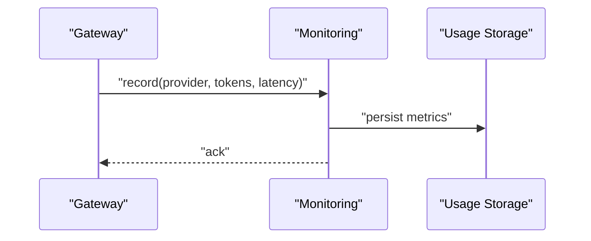
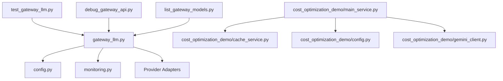

# AI Model Gateway

<cite>
**Referenced Files in This Document**
- [gateway_llm.py](file://backend/gateway_llm.py)
- [ai_teacher_route.py](file://backend/ai_teacher_route.py)
- [config.py](file://backend/config.py)
- [monitoring.py](file://backend/monitoring.py)
- [cost_optimization_demo/main_service.py](file://backend/cost_optimization_demo/main_service.py)
- [cost_optimization_demo/cache_service.py](file://backend/cost_optimization_demo/cache_service.py)
- [cost_optimization_demo/config.py](file://backend/cost_optimization_demo/config.py)
- [cost_optimization_demo/gemini_client.py](file://backend/cost_optimization_demo/gemini_client.py)
- [cost_optimization_demo/regression_test.py](file://backend/cost_optimization_demo/regression_test.py)
- [test_gateway_llm.py](file://backend/test_gateway_llm.py)
- [debug_gateway_api.py](file://backend/debug_gateway_api.py)
- [list_gateway_models.py](file://backend/list_gateway_models.py)
</cite>

## Table of Contents
1. [Introduction](#introduction)
2. [Project Structure](#project-structure)
3. [Core Components](#core-components)
4. [Architecture Overview](#architecture-overview)
5. [Detailed Component Analysis](#detailed-component-analysis)
6. [Dependency Analysis](#dependency-analysis)
7. [Performance Considerations](#performance-considerations)
8. [Troubleshooting Guide](#troubleshooting-guide)
9. [Conclusion](#conclusion)
10. [Appendices](#appendices)

## Introduction
This document describes the AI model gateway system that provides a multi-provider abstraction layer for large language models (LLMs). It covers intelligent model selection, cost optimization strategies, caching mechanisms, request routing, load balancing between providers, fallback mechanisms, and performance monitoring. It also documents the cache service implementation, cost tracking, usage analytics, and how to add new AI providers with provider-specific settings and custom selection strategies.

## Project Structure
The AI gateway is implemented primarily under the backend directory. Key areas include:
- Gateway core and routing logic
- Cost optimization demo module with cache service and client adapters
- Monitoring utilities
- Tests and debug utilities

**Diagram sources**
- [gateway_llm.py](file://backend/gateway_llm.py)
- [ai_teacher_route.py](file://backend/ai_teacher_route.py)
- [config.py](file://backend/config.py)
- [monitoring.py](file://backend/monitoring.py)
- [test_gateway_llm.py](file://backend/test_gateway_llm.py)
- [debug_gateway_api.py](file://backend/debug_gateway_api.py)
- [list_gateway_models.py](file://backend/list_gateway_models.py)
- [cost_optimization_demo/main_service.py](file://backend/cost_optimization_demo/main_service.py)
- [cost_optimization_demo/cache_service.py](file://backend/cost_optimization_demo/cache_service.py)
- [cost_optimization_demo/config.py](file://backend/cost_optimization_demo/config.py)
- [cost_optimization_demo/gemini_client.py](file://backend/cost_optimization_demo/gemini_client.py)
- [cost_optimization_demo/regression_test.py](file://backend/cost_optimization_demo/regression_test.py)

**Section sources**
- [gateway_llm.py](file://backend/gateway_llm.py)
- [ai_teacher_route.py](file://backend/ai_teacher_route.py)
- [config.py](file://backend/config.py)
- [monitoring.py](file://backend/monitoring.py)
- [cost_optimization_demo/main_service.py](file://backend/cost_optimization_demo/main_service.py)
- [cost_optimization_demo/cache_service.py](file://backend/cost_optimization_demo/cache_service.py)
- [cost_optimization_demo/config.py](file://backend/cost_optimization_demo/config.py)
- [cost_optimization_demo/gemini_client.py](file://backend/cost_optimization_demo/gemini_client.py)
- [cost_optimization_demo/regression_test.py](file://backend/cost_optimization_demo/regression_test.py)
- [test_gateway_llm.py](file://backend/test_gateway_llm.py)
- [debug_gateway_api.py](file://backend/debug_gateway_api.py)
- [list_gateway_models.py](file://backend/list_gateway_models.py)

## Core Components
- Multi-provider abstraction layer: Provides a unified interface to call different LLM backends (e.g., Gemini, DeepSeek). The gateway selects an appropriate provider based on configuration and strategy.
- Intelligent model selection: Applies rules or algorithms to choose the best provider/model per request considering cost, latency, availability, and policy constraints.
- Request routing and load balancing: Routes requests across available providers, supports round-robin or weighted distribution, and enforces per-provider limits.
- Fallback mechanisms: Automatically retries failed requests on alternative providers when primary ones fail or are rate-limited.
- Caching: Reuses previous responses for identical or near-duplicate requests to reduce cost and latency.
- Cost tracking and analytics: Records usage metrics, costs, and provider performance for reporting and optimization.
- Monitoring: Exposes health checks, metrics, and logs for observability.

**Section sources**
- [gateway_llm.py](file://backend/gateway_llm.py)
- [ai_teacher_route.py](file://backend/ai_teacher_route.py)
- [monitoring.py](file://backend/monitoring.py)
- [cost_optimization_demo/main_service.py](file://backend/cost_optimization_demo/main_service.py)
- [cost_optimization_demo/cache_service.py](file://backend/cost_optimization_demo/cache_service.py)
- [cost_optimization_demo/config.py](file://backend/cost_optimization_demo/config.py)
- [cost_optimization_demo/gemini_client.py](file://backend/cost_optimization_demo/gemini_client.py)

## Architecture Overview
The gateway sits between application routes and multiple LLM clients. It normalizes inputs, applies selection and caching, routes to providers, handles failures and retries, and records metrics.

**Diagram sources**
- [ai_teacher_route.py](file://backend/ai_teacher_route.py)
- [gateway_llm.py](file://backend/gateway_llm.py)
- [cost_optimization_demo/cache_service.py](file://backend/cost_optimization_demo/cache_service.py)
- [cost_optimization_demo/gemini_client.py](file://backend/cost_optimization_demo/gemini_client.py)
- [monitoring.py](file://backend/monitoring.py)

## Detailed Component Analysis

### Gateway Core and Routing
- Entry points expose HTTP endpoints that delegate to the gateway for LLM calls.
- The gateway encapsulates provider selection, caching, retry/fallback, and metrics recording.
- Configuration is centralized and consumed by both gateway and demo services.

**Diagram sources**
- [gateway_llm.py](file://backend/gateway_llm.py)
- [ai_teacher_route.py](file://backend/ai_teacher_route.py)
- [cost_optimization_demo/cache_service.py](file://backend/cost_optimization_demo/cache_service.py)
- [monitoring.py](file://backend/monitoring.py)

**Section sources**
- [gateway_llm.py](file://backend/gateway_llm.py)
- [ai_teacher_route.py](file://backend/ai_teacher_route.py)
- [config.py](file://backend/config.py)
- [monitoring.py](file://backend/monitoring.py)

### Cost Optimization Demo Module
The demo module demonstrates practical integration patterns:
- main_service.py orchestrates requests through the gateway and integrates with cache and providers.
- cache_service.py implements in-memory or file-backed caching keyed by normalized request content.
- config.py centralizes provider credentials, model names, and selection policies.
- gemini_client.py adapts calls to the Gemini API and returns standardized results and usage metadata.
- regression_test.py validates behavior across providers and caches.

**Diagram sources**
- [cost_optimization_demo/main_service.py](file://backend/cost_optimization_demo/main_service.py)
- [cost_optimization_demo/cache_service.py](file://backend/cost_optimization_demo/cache_service.py)
- [cost_optimization_demo/config.py](file://backend/cost_optimization_demo/config.py)
- [cost_optimization_demo/gemini_client.py](file://backend/cost_optimization_demo/gemini_client.py)

**Section sources**
- [cost_optimization_demo/main_service.py](file://backend/cost_optimization_demo/main_service.py)
- [cost_optimization_demo/cache_service.py](file://backend/cost_optimization_demo/cache_service.py)
- [cost_optimization_demo/config.py](file://backend/cost_optimization_demo/config.py)
- [cost_optimization_demo/gemini_client.py](file://backend/cost_optimization_demo/gemini_client.py)
- [cost_optimization_demo/regression_test.py](file://backend/cost_optimization_demo/regression_test.py)

### Provider Abstraction Layer
- Unified interface abstracts differences between providers (authentication, request format, streaming, token accounting).
- Each provider is implemented as an adapter that conforms to the gateway’s expected contract.
- Selection strategies can be configured to prefer specific providers based on cost, latency, or capability tags.

**Diagram sources**
- [gateway_llm.py](file://backend/gateway_llm.py)
- [cost_optimization_demo/gemini_client.py](file://backend/cost_optimization_demo/gemini_client.py)

**Section sources**
- [gateway_llm.py](file://backend/gateway_llm.py)
- [cost_optimization_demo/gemini_client.py](file://backend/cost_optimization_demo/gemini_client.py)

### Intelligent Model Selection and Load Balancing
- Selection considers provider capabilities, current load, historical latency, and cost targets.
- Load balancing distributes traffic across providers using configurable weights or round-robin.
- Fallback triggers when primary provider errors exceed thresholds or returns rate-limit signals.

**Diagram sources**
- [gateway_llm.py](file://backend/gateway_llm.py)
- [config.py](file://backend/config.py)

**Section sources**
- [gateway_llm.py](file://backend/gateway_llm.py)
- [config.py](file://backend/config.py)

### Caching Mechanism
- Cache keys are derived from normalized request content to ensure hits for semantically identical prompts.
- TTL and invalidation policies control freshness and memory usage.
- Cache misses trigger full provider calls; hits bypass external calls entirely.

**Diagram sources**
- [cost_optimization_demo/cache_service.py](file://backend/cost_optimization_demo/cache_service.py)

**Section sources**
- [cost_optimization_demo/cache_service.py](file://backend/cost_optimization_demo/cache_service.py)

### Cost Tracking and Usage Analytics
- Metrics include provider name, model, latency, tokens, and estimated cost.
- Aggregations support daily totals, per-user usage, and per-provider spend.
- Integration with monitoring exposes dashboards and alerts.

**Diagram sources**
- [monitoring.py](file://backend/monitoring.py)
- [gateway_llm.py](file://backend/gateway_llm.py)

**Section sources**
- [monitoring.py](file://backend/monitoring.py)
- [gateway_llm.py](file://backend/gateway_llm.py)

### Adding New AI Providers
To integrate a new provider:
- Implement a provider adapter conforming to the gateway’s interface.
- Register the adapter in the configuration and update selection policies if needed.
- Add tests to verify correctness and fallback behavior.

Steps:
1. Create a new adapter file implementing generate, health_check, and estimate_cost.
2. Update provider registry and configuration to include credentials and model mapping.
3. Extend selection strategy to consider the new provider’s attributes.
4. Add unit/integration tests covering success, failure, and fallback paths.

**Section sources**
- [gateway_llm.py](file://backend/gateway_llm.py)
- [config.py](file://backend/config.py)
- [cost_optimization_demo/gemini_client.py](file://backend/cost_optimization_demo/gemini_client.py)
- [test_gateway_llm.py](file://backend/test_gateway_llm.py)

### Configuring Provider-Specific Settings
- Credentials, base URLs, model names, and timeouts are defined centrally.
- Per-provider options such as temperature, max tokens, and safety filters can be included.
- Rate limits and budget caps are enforced by the gateway and monitoring layers.

**Section sources**
- [config.py](file://backend/config.py)
- [cost_optimization_demo/config.py](file://backend/cost_optimization_demo/config.py)

### Implementing Custom Selection Strategies
- Selection strategies are pluggable functions or classes evaluated at runtime.
- Inputs include request context, provider scores, and current metrics.
- Outputs determine the chosen provider and any routing hints.

**Section sources**
- [gateway_llm.py](file://backend/gateway_llm.py)
- [config.py](file://backend/config.py)

## Dependency Analysis
The gateway depends on configuration, monitoring, and provider adapters. The demo module adds cache and client adapters.

**Diagram sources**
- [gateway_llm.py](file://backend/gateway_llm.py)
- [config.py](file://backend/config.py)
- [monitoring.py](file://backend/monitoring.py)
- [cost_optimization_demo/main_service.py](file://backend/cost_optimization_demo/main_service.py)
- [cost_optimization_demo/cache_service.py](file://backend/cost_optimization_demo/cache_service.py)
- [cost_optimization_demo/config.py](file://backend/cost_optimization_demo/config.py)
- [cost_optimization_demo/gemini_client.py](file://backend/cost_optimization_demo/gemini_client.py)
- [test_gateway_llm.py](file://backend/test_gateway_llm.py)
- [debug_gateway_api.py](file://backend/debug_gateway_api.py)
- [list_gateway_models.py](file://backend/list_gateway_models.py)

**Section sources**
- [gateway_llm.py](file://backend/gateway_llm.py)
- [config.py](file://backend/config.py)
- [monitoring.py](file://backend/monitoring.py)
- [cost_optimization_demo/main_service.py](file://backend/cost_optimization_demo/main_service.py)
- [cost_optimization_demo/cache_service.py](file://backend/cost_optimization_demo/cache_service.py)
- [cost_optimization_demo/config.py](file://backend/cost_optimization_demo/config.py)
- [cost_optimization_demo/gemini_client.py](file://backend/cost_optimization_demo/gemini_client.py)
- [test_gateway_llm.py](file://backend/test_gateway_llm.py)
- [debug_gateway_api.py](file://backend/debug_gateway_api.py)
- [list_gateway_models.py](file://backend/list_gateway_models.py)

## Performance Considerations
- Prefer cache hits by normalizing prompts and parameters consistently.
- Use connection pooling and timeouts tuned per provider.
- Monitor latency distributions and adjust selection weights accordingly.
- Avoid excessive retries; implement exponential backoff and circuit breaking where applicable.
- Batch metrics updates to reduce overhead.

## Troubleshooting Guide
Common issues and diagnostics:
- Provider connectivity failures: check credentials, base URLs, and network reachability.
- Rate limiting: review per-provider quotas and adjust selection weights or budgets.
- Cache inconsistencies: verify normalization logic and TTL settings.
- High latency: analyze provider performance metrics and consider switching strategies.

Useful utilities:
- Debug gateway API endpoint for inspecting routing decisions and metrics.
- List available gateway models and their statuses.
- Regression tests to validate end-to-end flows across providers and caches.

**Section sources**
- [debug_gateway_api.py](file://backend/debug_gateway_api.py)
- [list_gateway_models.py](file://backend/list_gateway_models.py)
- [cost_optimization_demo/regression_test.py](file://backend/cost_optimization_demo/regression_test.py)
- [test_gateway_llm.py](file://backend/test_gateway_llm.py)

## Conclusion
The AI model gateway provides a robust, extensible foundation for integrating multiple LLM providers. Its design emphasizes intelligent selection, cost optimization, caching, and observability. By following the documented patterns, teams can add new providers, customize selection strategies, and maintain high reliability and efficiency across diverse workloads.

## Appendices

### Example: Adding a New Provider
- Implement adapter methods for generation, health checks, and cost estimation.
- Register provider details in configuration and update selection policies.
- Validate with targeted tests and monitor initial performance.

**Section sources**
- [gateway_llm.py](file://backend/gateway_llm.py)
- [config.py](file://backend/config.py)
- [test_gateway_llm.py](file://backend/test_gateway_llm.py)

### Example: Configuring Provider-Specific Settings
- Define credentials, model mappings, and operational parameters in configuration files.
- Set rate limits and budget caps to enforce cost controls.
- Adjust selection strategy parameters to reflect business priorities.

**Section sources**
- [config.py](file://backend/config.py)
- [cost_optimization_demo/config.py](file://backend/cost_optimization_demo/config.py)

### Example: Implementing Custom Selection Strategies
- Provide a function or class that evaluates provider scores and returns the chosen provider.
- Incorporate real-time metrics and policy constraints into scoring.
- Test strategy changes with regression suites and monitor outcomes.

**Section sources**
- [gateway_llm.py](file://backend/gateway_llm.py)
- [config.py](file://backend/config.py)