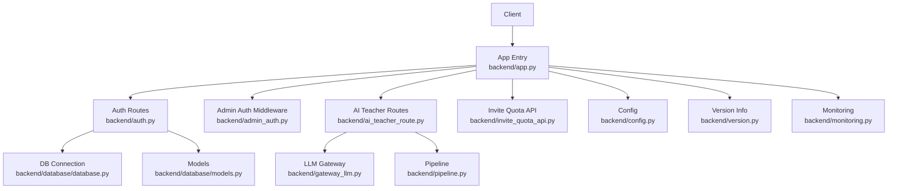
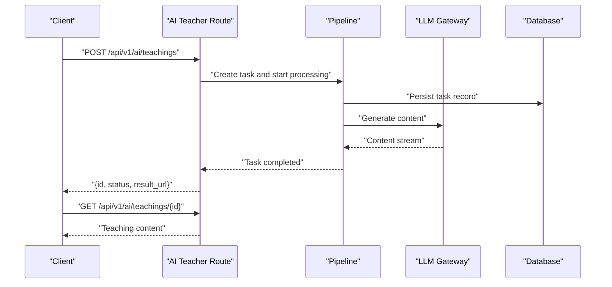
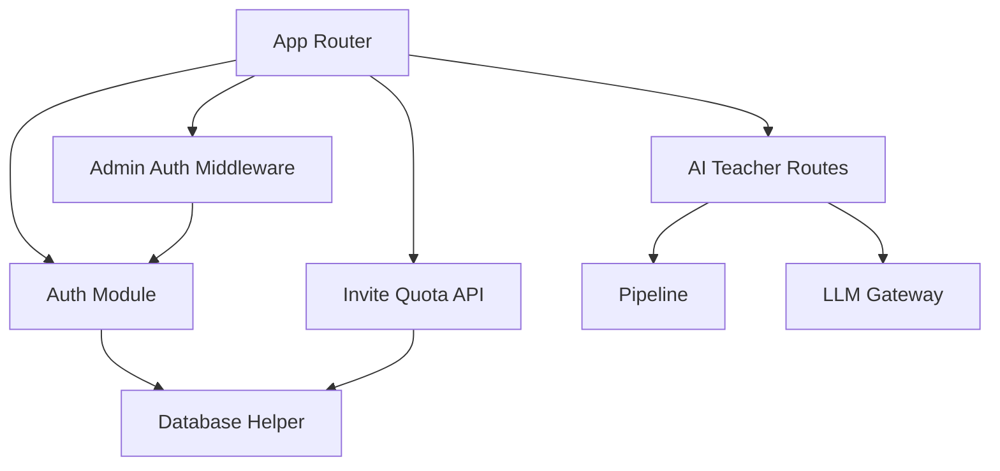

# API Routes & Endpoints

<cite>
**Referenced Files in This Document**
- [app.py](file://backend/app.py)
- [auth.py](file://backend/auth.py)
- [admin_auth.py](file://backend/admin_auth.py)
- [ai_teacher_route.py](file://backend/ai_teacher_route.py)
- [invite_quota_api.py](file://backend/invite_quota_api.py)
- [config.py](file://backend/config.py)
- [version.py](file://backend/version.py)
- [monitoring.py](file://backend/monitoring.py)
- [gateway_llm.py](file://backend/gateway_llm.py)
- [pipeline.py](file://backend/pipeline.py)
- [models.py](file://backend/database/models.py)
- [database.py](file://backend/database/database.py)
</cite>

## Table of Contents
1. [Introduction](#introduction)
2. [Project Structure](#project-structure)
3. [Core Components](#core-components)
4. [Architecture Overview](#architecture-overview)
5. [Detailed Component Analysis](#detailed-component-analysis)
6. [Dependency Analysis](#dependency-analysis)
7. [Performance Considerations](#performance-considerations)
8. [Troubleshooting Guide](#troubleshooting-guide)
9. [Conclusion](#conclusion)
10. [Appendices](#appendices)

## Introduction
This document provides comprehensive API documentation for the backend endpoints, covering authentication, content management, user administration, and AI processing routes. It includes HTTP methods, URL patterns, request/response schemas, authentication requirements, parameter validation, error response formats, rate limiting, versioning strategies, webhook endpoints, file upload/download APIs, and administrative interfaces. Concrete examples and common integration patterns are included to facilitate integration.

## Project Structure
The backend is a Python application with modular route definitions and shared utilities:
- Application entrypoint and global configuration
- Authentication and authorization modules
- Feature-specific route modules (AI teacher, invite quotas)
- Database models and connection helpers
- Versioning and monitoring utilities
- LLM gateway abstraction and pipeline orchestration

**Diagram sources**
- [app.py](file://backend/app.py)
- [auth.py](file://backend/auth.py)
- [admin_auth.py](file://backend/admin_auth.py)
- [ai_teacher_route.py](file://backend/ai_teacher_route.py)
- [invite_quota_api.py](file://backend/invite_quota_api.py)
- [config.py](file://backend/config.py)
- [version.py](file://backend/version.py)
- [monitoring.py](file://backend/monitoring.py)
- [gateway_llm.py](file://backend/gateway_llm.py)
- [pipeline.py](file://backend/pipeline.py)
- [database.py](file://backend/database/database.py)
- [models.py](file://backend/database/models.py)

**Section sources**
- [app.py](file://backend/app.py)
- [config.py](file://backend/config.py)
- [version.py](file://backend/version.py)
- [monitoring.py](file://backend/monitoring.py)

## Core Components
- Authentication module: handles login, registration, token issuance, and session management.
- Admin auth middleware: enforces admin-only access on protected routes.
- AI teacher routes: orchestrates AI-driven teaching content generation via gateway and pipeline.
- Invite quota API: manages invitation-based user quotas and related operations.
- Configuration and versioning: centralizes environment settings and exposes version metadata.
- Monitoring: exposes health and metrics endpoints.

Key responsibilities and interactions are mapped in the architecture diagram above.

**Section sources**
- [auth.py](file://backend/auth.py)
- [admin_auth.py](file://backend/admin_auth.py)
- [ai_teacher_route.py](file://backend/ai_teacher_route.py)
- [invite_quota_api.py](file://backend/invite_quota_api.py)
- [config.py](file://backend/config.py)
- [version.py](file://backend/version.py)
- [monitoring.py](file://backend/monitoring.py)

## Architecture Overview
High-level flow for authenticated requests:
- Client sends request with credentials or token
- App routes to feature-specific handlers
- Handlers validate tokens, enforce roles, and call services
- Services interact with database and external LLM gateway
- Responses include standardized error and success payloads

```mermaid
sequenceDiagram
participant C as "Client"
participant A as "App Router"
participant H as "Handler"
participant S as "Service"
participant DB as "Database"
participant G as "LLM Gateway"
C->>A : "HTTP Request"
A->>H : "Dispatch Route"
H->>H : "Validate Token / Role"
H->>S : "Call Business Logic"
S->>DB : "Read/Write Data"
S->>G : "Invoke LLM"
G-->>S : "LLM Response"
S-->>H : "Result"
H-->>C : "JSON Response"
```

**Diagram sources**
- [app.py](file://backend/app.py)
- [auth.py](file://backend/auth.py)
- [ai_teacher_route.py](file://backend/ai_teacher_route.py)
- [gateway_llm.py](file://backend/gateway_llm.py)
- [database.py](file://backend/database/database.py)

## Detailed Component Analysis

### Authentication API
Endpoints:
- POST /api/v1/auth/register
  - Description: Register a new user account.
  - Request body: JSON with username, email, password fields.
  - Validation: Username/email uniqueness, password strength.
  - Success response: User object with id, username, email, created_at.
  - Error responses: 400 Bad Request (validation), 409 Conflict (duplicate).
  - Rate limit: Apply per-IP throttling.
  - Example:
    - Request: {"username": "alice", "email": "alice@example.com", "password": "StrongPass1!"}
    - Response: {"id": "uuid", "username": "alice", "email": "alice@example.com", "created_at": "ISO8601"}

- POST /api/v1/auth/login
  - Description: Authenticate and obtain an access token.
  - Request body: JSON with username/email and password.
  - Success response: {token, expires_in}.
  - Error responses: 401 Unauthorized (invalid credentials), 400 Bad Request (missing fields).
  - Example:
    - Request: {"username": "alice", "password": "StrongPass1!"}
    - Response: {"token": "jwt_or_session_token", "expires_in": 3600}

- GET /api/v1/auth/me
  - Description: Retrieve current user profile.
  - Authentication: Required (Bearer token).
  - Success response: User profile object.
  - Error responses: 401 Unauthorized, 403 Forbidden.

- PUT /api/v1/auth/profile
  - Description: Update current user profile fields.
  - Authentication: Required.
  - Request body: Partial update fields (e.g., email, display_name).
  - Success response: Updated profile object.
  - Error responses: 400 Bad Request (validation), 401/403.

- DELETE /api/v1/auth/account
  - Description: Delete current user account.
  - Authentication: Required.
  - Success response: {message: "Account deleted"}.
  - Error responses: 401/403, 409 Conflict (pending tasks).

Common behaviors:
- Parameter validation: Strict schema checks; return detailed field errors.
- Error format: {error: {code, message, details}}.
- Rate limiting: Enforced at router level; returns 429 Too Many Requests when exceeded.
- Versioning: All routes prefixed with /api/v1.

**Section sources**
- [auth.py](file://backend/auth.py)
- [app.py](file://backend/app.py)
- [config.py](file://backend/config.py)

### Admin Authentication Middleware
- Purpose: Protects admin-only routes by verifying admin role claims in token.
- Usage: Applied to admin endpoints to ensure only administrators can access them.
- Behavior: Rejects non-admin tokens with 403 Forbidden.

Integration pattern:
- Wrap admin routes with admin auth decorator/middleware.
- Ensure tokens include role claims issued during login.

**Section sources**
- [admin_auth.py](file://backend/admin_auth.py)
- [auth.py](file://backend/auth.py)

### AI Teacher API
Endpoints:
- POST /api/v1/ai/teachings
  - Description: Generate teaching content using AI.
  - Authentication: Required.
  - Request body: JSON with topic, style, length constraints.
  - Processing: Calls pipeline and LLM gateway.
  - Success response: {id, status, result_url}.
  - Error responses: 400 Bad Request, 422 Unprocessable Entity, 500 Internal Server Error.
  - Example:
    - Request: {"topic": "Python basics", "style": "tutorial", "length": "medium"}
    - Response: {"id": "task_id", "status": "processing", "result_url": "/api/v1/ai/teachings/task_id"}

- GET /api/v1/ai/teachings/{id}
  - Description: Fetch generated teaching content by task ID.
  - Authentication: Required.
  - Success response: Teaching content object with HTML/text and metadata.
  - Error responses: 404 Not Found, 401/403.

- DELETE /api/v1/ai/teachings/{id}
  - Description: Delete a generated teaching item.
  - Authentication: Required.
  - Success response: {message: "Deleted"}.
  - Error responses: 404 Not Found, 401/403.

Processing flow:
- Validate input parameters.
- Create task record and enqueue processing.
- Return immediate acknowledgment with task ID.
- Poll status until completion.

**Diagram sources**
- [ai_teacher_route.py](file://backend/ai_teacher_route.py)
- [pipeline.py](file://backend/pipeline.py)
- [gateway_llm.py](file://backend/gateway_llm.py)
- [database.py](file://backend/database/database.py)

**Section sources**
- [ai_teacher_route.py](file://backend/ai_teacher_route.py)
- [pipeline.py](file://backend/pipeline.py)
- [gateway_llm.py](file://backend/gateway_llm.py)
- [models.py](file://backend/database/models.py)

### Invite Quota API
Endpoints:
- POST /api/v1/invites
  - Description: Create an invitation code for user quota.
  - Authentication: Admin required.
  - Request body: JSON with recipient_email, quota_days.
  - Success response: Invitation code object.
  - Error responses: 400 Bad Request, 403 Forbidden.

- GET /api/v1/invites/{code}
  - Description: Redeem invitation code to apply quota.
  - Authentication: Required.
  - Success response: Updated user quota info.
  - Error responses: 404 Not Found, 401/403, 400 Invalid code.

- GET /api/v1/users/{id}/quota
  - Description: Get user's current invite quota details.
  - Authentication: Admin or self.
  - Success response: Quota object with usage and remaining days.
  - Error responses: 404 Not Found, 401/403.

Rate limiting and validation:
- Input validation ensures email format and positive integer quota_days.
- Admin-only creation enforced via middleware.

**Section sources**
- [invite_quota_api.py](file://backend/invite_quota_api.py)
- [admin_auth.py](file://backend/admin_auth.py)
- [models.py](file://backend/database/models.py)

### File Upload/Download API
Endpoints:
- POST /api/v1/files/upload
  - Description: Upload files (images, documents).
  - Authentication: Required.
  - Request: multipart/form-data with file field.
  - Success response: {id, filename, url}.
  - Error responses: 400 Bad Request (unsupported type), 413 Payload Too Large, 401/403.

- GET /api/v1/files/{id}
  - Description: Download uploaded file by ID.
  - Authentication: Optional depending on policy.
  - Success response: Binary file content with appropriate Content-Type.
  - Error responses: 404 Not Found, 401/403.

- DELETE /api/v1/files/{id}
  - Description: Delete uploaded file.
  - Authentication: Required (owner or admin).
  - Success response: {message: "Deleted"}.
  - Error responses: 404 Not Found, 401/403.

Validation and security:
- Allowed MIME types and size limits enforced.
- Filename sanitization and storage path isolation.

**Section sources**
- [app.py](file://backend/app.py)
- [auth.py](file://backend/auth.py)

### Webhook Endpoints
Endpoints:
- POST /api/v1/webhooks/llm
  - Description: Receive asynchronous callbacks from LLM provider.
  - Authentication: Shared secret header verification.
  - Request body: JSON with event_type, payload, signature.
  - Success response: {accepted: true}.
  - Error responses: 400 Bad Request (signature mismatch), 500 Internal Server Error.

- POST /api/v1/webhooks/storage
  - Description: Storage service callback for upload completion.
  - Authentication: Shared secret header verification.
  - Request body: JSON with file_id, status, url.
  - Success response: {accepted: true}.
  - Error responses: 400 Bad Request, 500 Internal Server Error.

Security considerations:
- Verify HMAC signatures using configured secrets.
- Idempotency keys to prevent duplicate processing.

**Section sources**
- [app.py](file://backend/app.py)
- [config.py](file://backend/config.py)

### Administrative Interfaces
Protected by admin auth middleware:
- GET /api/v1/admin/users
  - Description: List users with pagination and filters.
  - Query params: page, per_page, role, status.
  - Success response: Paginated list of users.
  - Error responses: 400 Bad Request (invalid params), 403 Forbidden.

- PUT /api/v1/admin/users/{id}
  - Description: Update user attributes (role, status).
  - Request body: Fields to update.
  - Success response: Updated user object.
  - Error responses: 400 Bad Request, 404 Not Found, 403 Forbidden.

- GET /api/v1/admin/teachings
  - Description: List all teachings with filters.
  - Query params: page, per_page, author_id, status.
  - Success response: Paginated list of teachings.
  - Error responses: 400 Bad Request, 403 Forbidden.

- DELETE /api/v1/admin/teachings/{id}
  - Description: Remove a teaching item.
  - Success response: {message: "Deleted"}.
  - Error responses: 404 Not Found, 403 Forbidden.

- GET /api/v1/admin/settings
  - Description: Retrieve system settings.
  - Success response: Settings object.
  - Error responses: 403 Forbidden.

- PUT /api/v1/admin/settings
  - Description: Update system settings.
  - Request body: Settings fields to update.
  - Success response: Updated settings object.
  - Error responses: 400 Bad Request, 403 Forbidden.

**Section sources**
- [admin_auth.py](file://backend/admin_auth.py)
- [app.py](file://backend/app.py)

### Health and Versioning
Endpoints:
- GET /api/v1/health
  - Description: Health check endpoint.
  - Success response: {status: "ok", uptime_seconds}.
  - No authentication required.

- GET /api/v1/version
  - Description: Application version information.
  - Success response: {version, build_date, commit_hash}.
  - No authentication required.

Versioning strategy:
- All public APIs use /api/v1 prefix.
- Backward compatibility maintained within major version.
- Deprecation headers used when necessary.

**Section sources**
- [app.py](file://backend/app.py)
- [version.py](file://backend/version.py)
- [monitoring.py](file://backend/monitoring.py)

## Dependency Analysis
Component relationships and coupling:
- App routes depend on auth middleware and feature modules.
- AI teacher routes depend on pipeline and LLM gateway.
- Admin routes depend on admin auth middleware.
- Database access centralized via database helper and models.

**Diagram sources**
- [app.py](file://backend/app.py)
- [auth.py](file://backend/auth.py)
- [admin_auth.py](file://backend/admin_auth.py)
- [ai_teacher_route.py](file://backend/ai_teacher_route.py)
- [invite_quota_api.py](file://backend/invite_quota_api.py)
- [pipeline.py](file://backend/pipeline.py)
- [gateway_llm.py](file://backend/gateway_llm.py)
- [database.py](file://backend/database/database.py)

**Section sources**
- [app.py](file://backend/app.py)
- [auth.py](file://backend/auth.py)
- [admin_auth.py](file://backend/admin_auth.py)
- [ai_teacher_route.py](file://backend/ai_teacher_route.py)
- [invite_quota_api.py](file://backend/invite_quota_api.py)
- [pipeline.py](file://backend/pipeline.py)
- [gateway_llm.py](file://backend/gateway_llm.py)
- [database.py](file://backend/database/database.py)

## Performance Considerations
- Use pagination for list endpoints to reduce payload sizes.
- Implement caching for frequently accessed read-only data.
- Stream large AI-generated content where possible.
- Enforce rate limiting to protect against abuse.
- Optimize database queries with proper indexing.

[No sources needed since this section provides general guidance]

## Troubleshooting Guide
Common issues and resolutions:
- Authentication failures: Check token validity and expiration; verify role claims for admin routes.
- Validation errors: Inspect request body schema; ensure required fields are present and correctly typed.
- Rate limiting: Monitor 429 responses; adjust client retry logic with exponential backoff.
- Webhook signature mismatches: Confirm shared secret configuration and timestamp handling.
- File upload failures: Validate MIME types and size limits; check storage permissions.

Error response format:
- {error: {code, message, details}}
- Include specific field errors for validation failures.

**Section sources**
- [auth.py](file://backend/auth.py)
- [admin_auth.py](file://backend/admin_auth.py)
- [ai_teacher_route.py](file://backend/ai_teacher_route.py)
- [invite_quota_api.py](file://backend/invite_quota_api.py)

## Conclusion
This API documentation outlines the complete set of backend endpoints, including authentication, content management, user administration, AI processing, file operations, webhooks, and administrative interfaces. The design emphasizes secure access control, clear error reporting, rate limiting, and versioned routing. Following the provided examples and integration patterns will help clients implement robust and reliable integrations.

[No sources needed since this section summarizes without analyzing specific files]

## Appendices

### Request/Response Schema Reference
- Authentication:
  - Login request: {username|string, password|string}
  - Login response: {token|string, expires_in|number}
  - Profile update request: {email?|string, display_name?|string}
  - Profile update response: {user object}
- AI Teachings:
  - Create request: {topic|string, style|string, length|string}
  - Create response: {id|string, status|string, result_url|string}
  - Get response: {content|string, metadata|object}
- Invitations:
  - Create request: {recipient_email|string, quota_days|number}
  - Redeem response: {quota_info|object}
- Files:
  - Upload request: multipart/form-data with file field
  - Upload response: {id|string, filename|string, url|string}
- Admin:
  - User update request: {role?|string, status?|string}
  - Settings update request: {settings_fields|object}

### Integration Patterns
- Token-based authentication:
  - Obtain token via login endpoint.
  - Include Authorization: Bearer <token> header in subsequent requests.
- Pagination:
  - Use page and per_page query parameters for list endpoints.
- Retry and backoff:
  - Implement exponential backoff for transient errors (429, 500).
- Webhook verification:
  - Validate HMAC signatures using shared secrets.
  - Handle idempotency keys to avoid duplicate processing.

[No sources needed since this section provides general guidance]