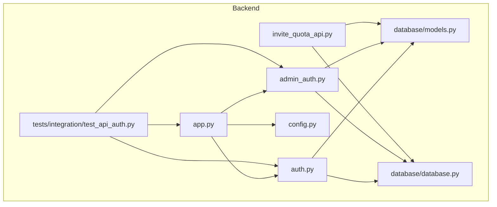
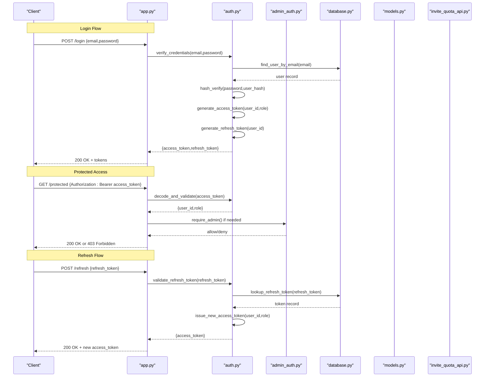
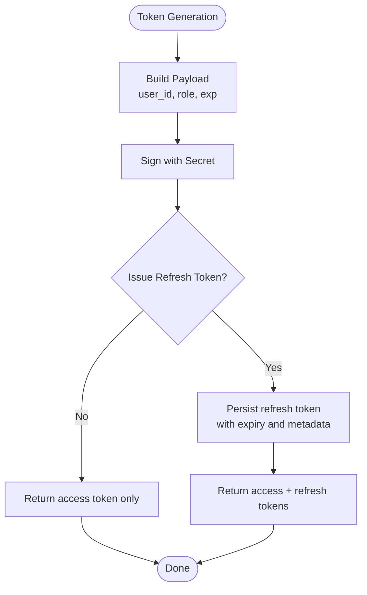
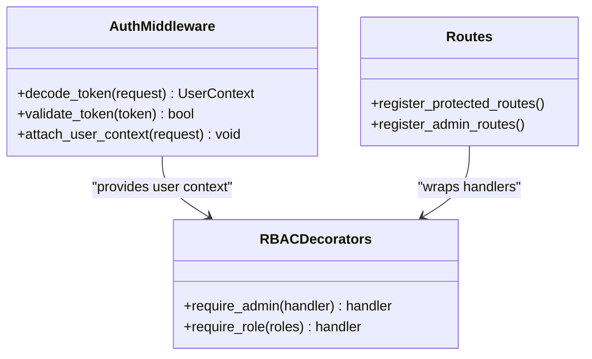
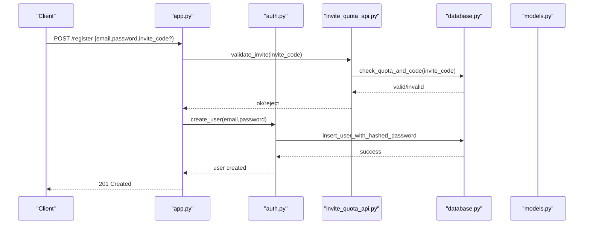
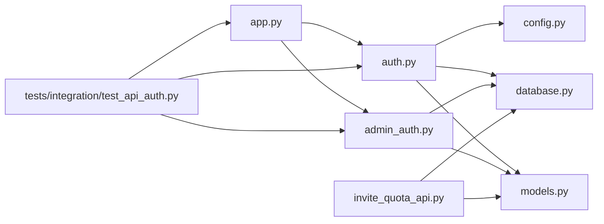

# Authentication & Authorization

<cite>
**Referenced Files in This Document**
- [auth.py](file://backend/auth.py)
- [admin_auth.py](file://backend/admin_auth.py)
- [app.py](file://backend/app.py)
- [config.py](file://backend/config.py)
- [models.py](file://backend/database/models.py)
- [database.py](file://backend/database/database.py)
- [invite_quota_api.py](file://backend/invite_quota_api.py)
- [test_api_auth.py](file://backend/tests/integration/test_api_auth.py)
</cite>

## Table of Contents
1. [Introduction](#introduction)
2. [Project Structure](#project-structure)
3. [Core Components](#core-components)
4. [Architecture Overview](#architecture-overview)
5. [Detailed Component Analysis](#detailed-component-analysis)
6. [Dependency Analysis](#dependency-analysis)
7. [Performance Considerations](#performance-considerations)
8. [Troubleshooting Guide](#troubleshooting-guide)
9. [Conclusion](#conclusion)
10. [Appendices](#appendices)

## Introduction
This document explains the authentication and authorization system implemented in the backend. It covers JWT token lifecycle (generation, validation, refresh), role-based access control (RBAC) for admin and regular users, decorator-based authorization patterns, session management, user registration and login flows, password hashing, invitation system integration, security best practices, token expiration handling, and audit logging. It also provides guidance on implementing custom auth decorators and integrating with external authentication providers.

## Project Structure
The authentication and authorization features are primarily implemented in the backend module:
- Token and RBAC utilities live in dedicated modules.
- The application registers routes and middleware in the main app entrypoint.
- Data models and database helpers support user storage and operations.
- Integration tests validate end-to-end flows for authentication endpoints.

**Diagram sources**
- [app.py](file://backend/app.py)
- [auth.py](file://backend/auth.py)
- [admin_auth.py](file://backend/admin_auth.py)
- [config.py](file://backend/config.py)
- [models.py](file://backend/database/models.py)
- [database.py](file://backend/database/database.py)
- [invite_quota_api.py](file://backend/invite_quota_api.py)
- [test_api_auth.py](file://backend/tests/integration/test_api_auth.py)

**Section sources**
- [app.py](file://backend/app.py)
- [auth.py](file://backend/auth.py)
- [admin_auth.py](file://backend/admin_auth.py)
- [config.py](file://backend/config.py)
- [models.py](file://backend/database/models.py)
- [database.py](file://backend/database/database.py)
- [invite_quota_api.py](file://backend/invite_quota_api.py)
- [test_api_auth.py](file://backend/tests/integration/test_api_auth.py)

## Core Components
- JWT token implementation: generation, payload composition, signing, verification, and refresh flow.
- RBAC decorators: enforce admin-only or role-based access at route level.
- Session management: stateless tokens with optional server-side revocation/blacklist.
- User registration and login: credential validation, password hashing, token issuance.
- Invitation system integration: invite code validation and quota enforcement during registration.
- Audit logging: record authentication events and authorization decisions.

Key responsibilities by file:
- Token and RBAC logic: [auth.py](file://backend/auth.py), [admin_auth.py](file://backend/admin_auth.py)
- App wiring and route registration: [app.py](file://backend/app.py)
- Configuration (secrets, token lifetimes): [config.py](file://backend/config.py)
- Data layer (users, invites, quotas): [models.py](file://backend/database/models.py), [database.py](file://backend/database/database.py)
- Invite API surface: [invite_quota_api.py](file://backend/invite_quota_api.py)
- Auth integration tests: [test_api_auth.py](file://backend/tests/integration/test_api_auth.py)

**Section sources**
- [auth.py](file://backend/auth.py)
- [admin_auth.py](file://backend/admin_auth.py)
- [app.py](file://backend/app.py)
- [config.py](file://backend/config.py)
- [models.py](file://backend/database/models.py)
- [database.py](file://backend/database/database.py)
- [invite_quota_api.py](file://backend/invite_quota_api.py)
- [test_api_auth.py](file://backend/tests/integration/test_api_auth.py)

## Architecture Overview
High-level flow:
- Clients authenticate via login endpoint to receive a short-lived access token and optionally a refresh token.
- Protected routes require a valid access token; RBAC decorators check roles before allowing access.
- Refresh endpoint exchanges a valid refresh token for a new access token without re-authentication.
- Registration may require an invite code validated against quota rules.
- All auth-related actions are logged for auditing.

**Diagram sources**
- [app.py](file://backend/app.py)
- [auth.py](file://backend/auth.py)
- [admin_auth.py](file://backend/admin_auth.py)
- [database.py](file://backend/database/database.py)
- [models.py](file://backend/database/models.py)
- [invite_quota_api.py](file://backend/invite_quota_api.py)

## Detailed Component Analysis

### JWT Token Implementation
Responsibilities:
- Generate access tokens with minimal claims (e.g., user identifier, role).
- Sign tokens using a secret configured securely.
- Validate tokens on each request, checking signature, expiry, and optional blacklist.
- Issue refresh tokens stored server-side for secure rotation.
- Provide a refresh endpoint that issues new access tokens upon successful validation.

Security considerations:
- Use strong secrets and rotate periodically.
- Keep payloads small and avoid sensitive data.
- Enforce short access token lifetimes and longer refresh token lifetimes.
- Implement token revocation via a blacklist or versioning strategy.

**Diagram sources**
- [auth.py](file://backend/auth.py)
- [config.py](file://backend/config.py)
- [database.py](file://backend/database/database.py)
- [models.py](file://backend/database/models.py)

**Section sources**
- [auth.py](file://backend/auth.py)
- [config.py](file://backend/config.py)
- [database.py](file://backend/database/database.py)
- [models.py](file://backend/database/models.py)

### Role-Based Access Control (RBAC)
RBAC design:
- Roles include at least admin and regular user.
- Decorators wrap route handlers to enforce permissions.
- Admin-only routes reject non-admin users.
- Optional fine-grained checks can be added per resource.

Decorator patterns:
- require_admin: ensures current user has admin role.
- require_role: allows specifying allowed roles dynamically.
- Optional context injection: attach authenticated user info to request context for downstream use.

**Diagram sources**
- [auth.py](file://backend/auth.py)
- [admin_auth.py](file://backend/admin_auth.py)
- [app.py](file://backend/app.py)

**Section sources**
- [auth.py](file://backend/auth.py)
- [admin_auth.py](file://backend/admin_auth.py)
- [app.py](file://backend/app.py)

### Session Management
Approach:
- Stateless access tokens for fast, scalable requests.
- Server-side refresh token store for revocation and rotation.
- Optional client-side secure storage (HttpOnly cookies) to mitigate XSS risks.
- Expiration policies:
  - Short-lived access tokens (minutes).
  - Longer-lived refresh tokens (days), rotated on use.

Revocation strategies:
- Blacklist expired or revoked tokens.
- Increment user token version to invalidate all prior tokens.

**Section sources**
- [auth.py](file://backend/auth.py)
- [database.py](file://backend/database/database.py)
- [models.py](file://backend/database/models.py)

### User Registration and Login Flows
Registration:
- Accept email and password.
- Hash password securely before storing.
- Optionally validate invite code and enforce quota limits.
- Create user record with default role.

Login:
- Verify credentials against stored hash.
- Issue access and refresh tokens.
- Log successful and failed attempts.

Password hashing:
- Use a modern algorithm with salt and configurable cost factor.
- Never store plaintext passwords.

Invite system integration:
- Validate invite codes and decrement quotas when used.
- Reject registration if quotas are exhausted or codes invalid.

**Diagram sources**
- [app.py](file://backend/app.py)
- [auth.py](file://backend/auth.py)
- [invite_quota_api.py](file://backend/invite_quota_api.py)
- [database.py](file://backend/database/database.py)
- [models.py](file://backend/database/models.py)

**Section sources**
- [app.py](file://backend/app.py)
- [auth.py](file://backend/auth.py)
- [invite_quota_api.py](file://backend/invite_quota_api.py)
- [database.py](file://backend/database/database.py)
- [models.py](file://backend/database/models.py)

### Audit Logging
Scope:
- Record login successes/failures, registration attempts, token refreshes, and authorization denials.
- Include timestamps, client identifiers, and outcome details.
- Ensure logs do not contain sensitive data like passwords or full tokens.

Implementation tips:
- Centralized logger with structured JSON output.
- Separate log streams for security events.
- Retention policies aligned with compliance requirements.

**Section sources**
- [auth.py](file://backend/auth.py)
- [admin_auth.py](file://backend/admin_auth.py)
- [app.py](file://backend/app.py)

### Security Best Practices
- Secrets management: load JWT secret from environment variables; never hardcode.
- Token lifetimes: keep access tokens short; rotate refresh tokens.
- Input validation: sanitize and validate all inputs; enforce length/format constraints.
- Rate limiting: protect login and registration endpoints against brute force.
- HTTPS only: enforce TLS for all endpoints; set secure cookie flags if using cookies.
- Error handling: return generic messages for auth failures; avoid leaking internals.
- Password policy: enforce complexity and history checks where applicable.
- Audit trails: persist security-relevant events with tamper-evident storage.

**Section sources**
- [config.py](file://backend/config.py)
- [auth.py](file://backend/auth.py)
- [admin_auth.py](file://backend/admin_auth.py)

### Custom Auth Decorators and External Provider Integration
Custom decorators:
- Extend existing RBAC decorators to add resource-level checks (e.g., ownership).
- Compose multiple decorators for layered authorization.
- Inject user context into request scope for downstream services.

External authentication providers:
- Add provider-specific login handlers that exchange provider tokens for internal tokens.
- Map external identities to internal user records and roles.
- Support linking multiple providers to a single account.

Example patterns:
- require_resource_owner(resource_id): ensure the authenticated user owns the requested resource.
- oauth_callback(provider): handle provider callback, validate token, and issue internal tokens.

[No sources needed since this section provides general guidance]

## Dependency Analysis
Component relationships:
- app.py wires routes and applies decorators from auth.py and admin_auth.py.
- auth.py depends on config.py for secrets and lifetimes, and on database layer for user and token persistence.
- admin_auth.py extends RBAC capabilities for admin-only routes.
- invite_quota_api.py integrates with database models to enforce invite quotas.
- Integration tests exercise login, protected access, and refresh flows.

**Diagram sources**
- [app.py](file://backend/app.py)
- [auth.py](file://backend/auth.py)
- [admin_auth.py](file://backend/admin_auth.py)
- [config.py](file://backend/config.py)
- [database.py](file://backend/database/database.py)
- [models.py](file://backend/database/models.py)
- [invite_quota_api.py](file://backend/invite_quota_api.py)
- [test_api_auth.py](file://backend/tests/integration/test_api_auth.py)

**Section sources**
- [app.py](file://backend/app.py)
- [auth.py](file://backend/auth.py)
- [admin_auth.py](file://backend/admin_auth.py)
- [config.py](file://backend/config.py)
- [database.py](file://backend/database/database.py)
- [models.py](file://backend/database/models.py)
- [invite_quota_api.py](file://backend/invite_quota_api.py)
- [test_api_auth.py](file://backend/tests/integration/test_api_auth.py)

## Performance Considerations
- Prefer stateless access tokens to minimize server state.
- Cache frequently accessed user profiles behind a short TTL cache.
- Use efficient hashing parameters balancing security and latency.
- Batch token revocation updates and use background jobs for cleanup.
- Monitor token validation overhead and optimize I/O paths.

[No sources needed since this section provides general guidance]

## Troubleshooting Guide
Common issues:
- Invalid token errors: check signature, expiry, and issuer configuration.
- Refresh token reuse: ensure rotation and revoke old refresh tokens after use.
- RBAC denials: verify user roles and decorator usage on routes.
- Invite failures: confirm invite codes exist and quotas are available.
- Login failures: inspect password hashing and input validation.

Diagnostic steps:
- Enable detailed auth logs for failed attempts.
- Validate configuration values (secret, lifetimes).
- Inspect database records for user and refresh tokens.
- Reproduce flows using integration tests.

**Section sources**
- [auth.py](file://backend/auth.py)
- [admin_auth.py](file://backend/admin_auth.py)
- [invite_quota_api.py](file://backend/invite_quota_api.py)
- [test_api_auth.py](file://backend/tests/integration/test_api_auth.py)

## Conclusion
The authentication and authorization system combines JWT-based stateless access with server-side refresh tokens and RBAC decorators to provide secure, scalable access control. Registration supports invite codes and quota enforcement, while comprehensive logging supports auditing and troubleshooting. Following the recommended security practices and performance optimizations will help maintain a robust and resilient system.

[No sources needed since this section summarizes without analyzing specific files]

## Appendices

### API Endpoints Summary
- POST /login: Authenticate and return access and refresh tokens.
- POST /refresh: Exchange refresh token for a new access token.
- POST /register: Register a new user, optionally with an invite code.
- Protected routes: Require valid access token; admin routes require admin role.

[No sources needed since this section provides general guidance]