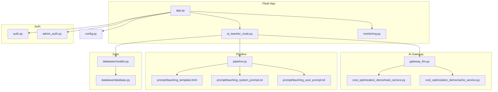
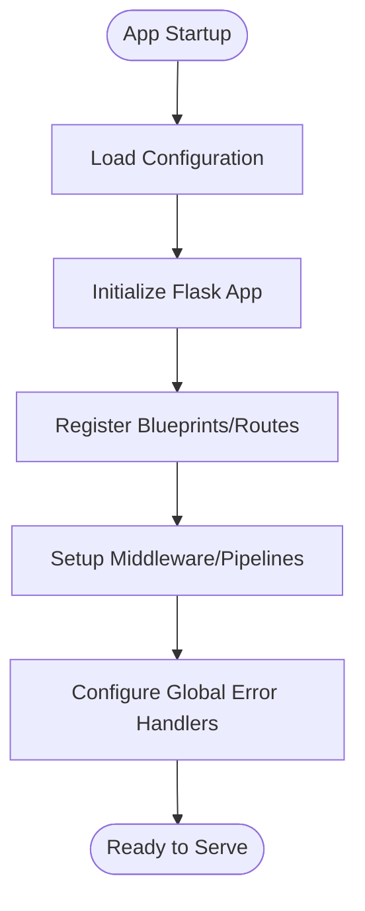
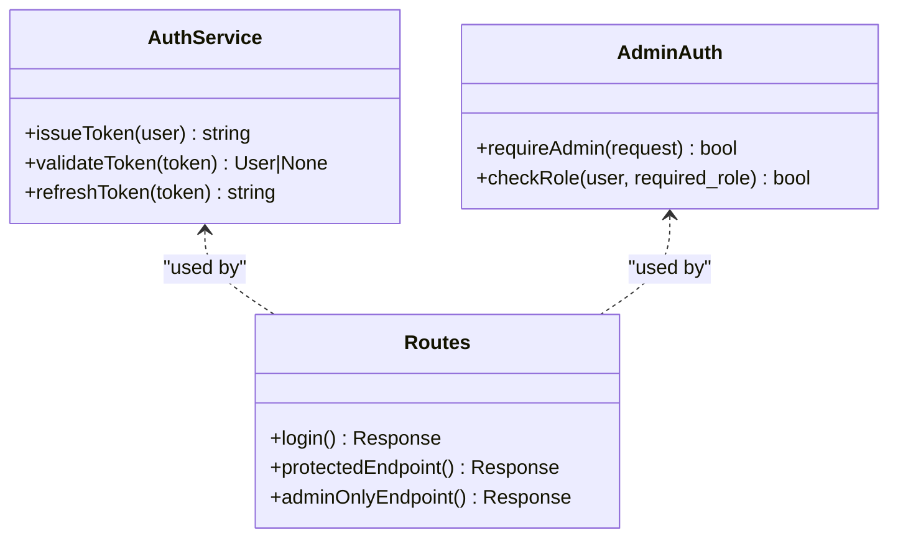
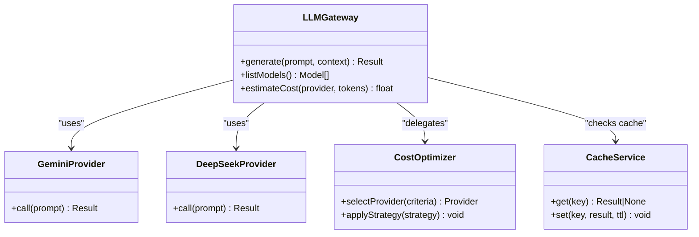
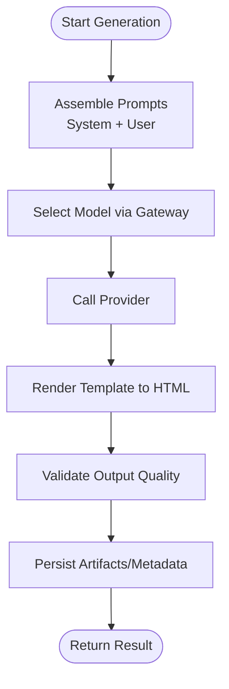
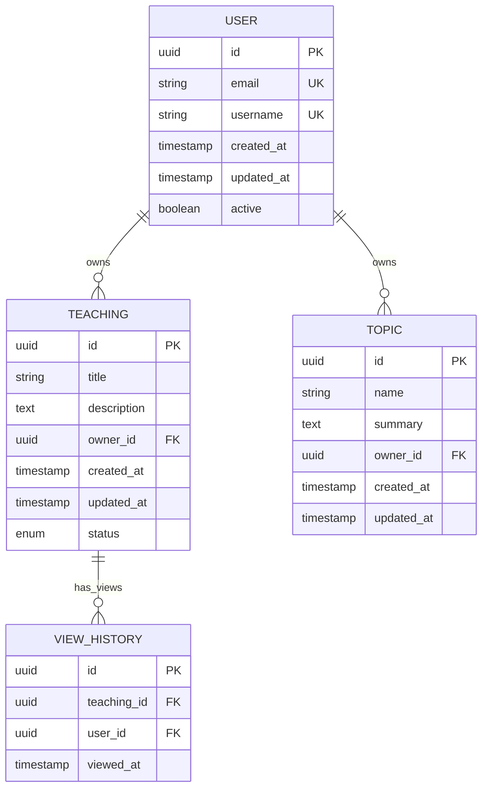
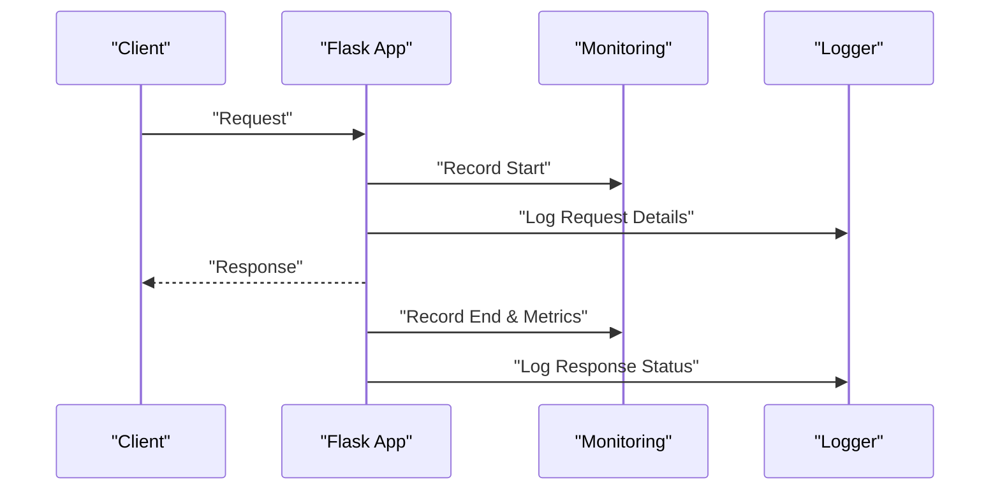
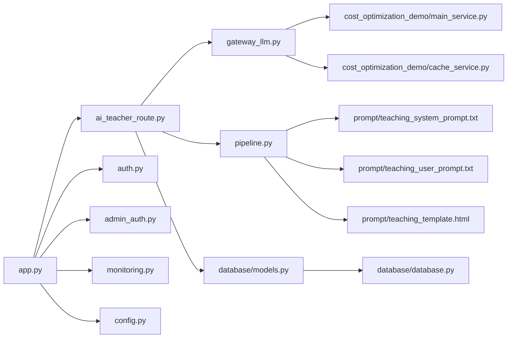

# Backend Services

<cite>
**Referenced Files in This Document**
- [app.py](file://backend/app.py)
- [config.py](file://backend/config.py)
- [auth.py](file://backend/auth.py)
- [admin_auth.py](file://backend/admin_auth.py)
- [gateway_llm.py](file://backend/gateway_llm.py)
- [ai_teacher_route.py](file://backend/ai_teacher_route.py)
- [pipeline.py](file://backend/pipeline.py)
- [monitoring.py](file://backend/monitoring.py)
- [database/models.py](file://backend/database/models.py)
- [database/database.py](file://backend/database/database.py)
- [cost_optimization_demo/main_service.py](file://backend/cost_optimization_demo/main_service.py)
- [cost_optimization_demo/cache_service.py](file://backend/cost_optimization_demo/cache_service.py)
- [prompt/teaching_system_prompt.txt](file://backend/prompt/teaching_system_prompt.txt)
- [prompt/teaching_user_prompt.txt](file://backend/prompt/teaching_user_prompt.txt)
- [prompt/teaching_template.html](file://backend/prompt/teaching_template.html)
</cite>

## Table of Contents
1. [Introduction](#introduction)
2. [Project Structure](#project-structure)
3. [Core Components](#core-components)
4. [Architecture Overview](#architecture-overview)
5. [Detailed Component Analysis](#detailed-component-analysis)
6. [Dependency Analysis](#dependency-analysis)
7. [Performance Considerations](#performance-considerations)
8. [Troubleshooting Guide](#troubleshooting-guide)
9. [Conclusion](#conclusion)
10. [Appendices](#appendices)

## Introduction
This document provides comprehensive backend services documentation for the XSYY Edu platform. It explains the Flask application architecture, route organization, middleware pipeline, and service layer design. It also documents the authentication system with JWT-based access control, role-based permissions for admin and regular users, and session management. The AI model gateway abstracts multiple LLM providers (Gemini, DeepSeek) with intelligent model selection and cost optimization strategies. Finally, it covers the content generation pipeline from prompt processing to HTML output, including template rendering and quality validation, as well as configuration management, error handling, logging, and performance monitoring.

## Project Structure
The backend is organized into modular components:
- Application entrypoint and routing
- Authentication and authorization
- AI model gateway and provider abstraction
- Content generation pipeline and templates
- Database models and persistence
- Monitoring and observability
- Cost optimization utilities and caching



**Diagram sources**
- [app.py](file://backend/app.py)
- [ai_teacher_route.py](file://backend/ai_teacher_route.py)
- [monitoring.py](file://backend/monitoring.py)
- [auth.py](file://backend/auth.py)
- [admin_auth.py](file://backend/admin_auth.py)
- [gateway_llm.py](file://backend/gateway_llm.py)
- [cost_optimization_demo/main_service.py](file://backend/cost_optimization_demo/main_service.py)
- [cost_optimization_demo/cache_service.py](file://backend/cost_optimization_demo/cache_service.py)
- [pipeline.py](file://backend/pipeline.py)
- [prompt/teaching_template.html](file://backend/prompt/teaching_template.html)
- [prompt/teaching_system_prompt.txt](file://backend/prompt/teaching_system_prompt.txt)
- [prompt/teaching_user_prompt.txt](file://backend/prompt/teaching_user_prompt.txt)
- [database/models.py](file://backend/database/models.py)
- [database/database.py](file://backend/database/database.py)
- [config.py](file://backend/config.py)

**Section sources**
- [app.py](file://backend/app.py)
- [config.py](file://backend/config.py)

## Core Components
- Flask application bootstrap and configuration
- Route modules for API endpoints
- Authentication and authorization decorators
- AI model gateway with provider abstraction
- Content generation pipeline orchestrating prompts, templates, and storage
- Database models and connection helpers
- Monitoring and metrics collection
- Cost optimization and caching utilities

Key responsibilities:
- app.py: initializes Flask, registers blueprints/routes, configures middleware, and sets up global error handlers.
- auth.py and admin_auth.py: implement JWT issuance/validation and role-based access control.
- gateway_llm.py: selects and calls LLM providers (Gemini, DeepSeek), normalizes responses, and tracks costs.
- ai_teacher_route.py: exposes teaching/content generation endpoints and coordinates pipeline execution.
- pipeline.py: orchestrates prompt assembly, template rendering, and post-processing/validation.
- database/models.py and database/database.py: define ORM-like models and provide DB operations.
- monitoring.py: collects request metrics, latency, and error rates.
- cost_optimization_demo/*: implements caching and cost-aware model selection logic.

**Section sources**
- [app.py](file://backend/app.py)
- [auth.py](file://backend/auth.py)
- [admin_auth.py](file://backend/admin_auth.py)
- [gateway_llm.py](file://backend/gateway_llm.py)
- [ai_teacher_route.py](file://backend/ai_teacher_route.py)
- [pipeline.py](file://backend/pipeline.py)
- [database/models.py](file://backend/database/models.py)
- [database/database.py](file://backend/database/database.py)
- [monitoring.py](file://backend/monitoring.py)
- [cost_optimization_demo/main_service.py](file://backend/cost_optimization_demo/main_service.py)
- [cost_optimization_demo/cache_service.py](file://backend/cost_optimization_demo/cache_service.py)

## Architecture Overview
The backend follows a layered architecture:
- Presentation layer: Flask routes/blueprints handle HTTP requests/responses.
- Service layer: business logic for authentication, AI orchestration, and content generation.
- Data layer: database models and persistence helpers.
- Cross-cutting concerns: monitoring, configuration, error handling, and cost optimization.

```mermaid
sequenceDiagram
participant Client as "Client"
participant Flask as "Flask App"
participant Auth as "Auth Middleware"
participant Route as "AI Teacher Route"
participant GW as "LLM Gateway"
participant Opt as "Cost Optimizer"
participant Cache as "Cache Service"
participant DB as "Database"
Client->>Flask : "HTTP Request"
Flask->>Auth : "Validate JWT / Role"
Auth-->>Flask : "Access Granted/Denied"
Flask->>Route : "Dispatch Endpoint"
Route->>DB : "Load Context/User Data"
Route->>GW : "Generate Content"
GW->>Opt : "Select Model/Cost Strategy"
Opt-->>GW : "Provider Choice"
GW->>Cache : "Check Cache"
alt "Cache Hit"
Cache-->>GW : "Cached Result"
else "Cache Miss"
GW->>GW : "Call Provider (Gemini/DeepSeek)"
GW-->>Route : "Normalized Output"
end
Route->>DB : "Persist Artifacts/Metadata"
Route-->>Client : "Response (HTML/JSON)"
```

**Diagram sources**
- [app.py](file://backend/app.py)
- [auth.py](file://backend/auth.py)
- [ai_teacher_route.py](file://backend/ai_teacher_route.py)
- [gateway_llm.py](file://backend/gateway_llm.py)
- [cost_optimization_demo/main_service.py](file://backend/cost_optimization_demo/main_service.py)
- [cost_optimization_demo/cache_service.py](file://backend/cost_optimization_demo/cache_service.py)
- [database/models.py](file://backend/database/models.py)
- [database/database.py](file://backend/database/database.py)

## Detailed Component Analysis

### Flask Application and Routing
- Initializes the Flask app and loads configuration.
- Registers route blueprints for AI teacher features and other APIs.
- Configures global error handlers and middleware hooks.
- Integrates monitoring for request lifecycle metrics.



**Diagram sources**
- [app.py](file://backend/app.py)
- [config.py](file://backend/config.py)
- [monitoring.py](file://backend/monitoring.py)

**Section sources**
- [app.py](file://backend/app.py)
- [config.py](file://backend/config.py)
- [monitoring.py](file://backend/monitoring.py)

### Authentication and Authorization
- JWT-based authentication issues tokens upon successful login.
- Decorators protect routes by validating tokens and checking roles (admin vs regular user).
- Session management integrates with token storage and optional server-side session state.



**Diagram sources**
- [auth.py](file://backend/auth.py)
- [admin_auth.py](file://backend/admin_auth.py)
- [ai_teacher_route.py](file://backend/ai_teacher_route.py)

**Section sources**
- [auth.py](file://backend/auth.py)
- [admin_auth.py](file://backend/admin_auth.py)
- [ai_teacher_route.py](file://backend/ai_teacher_route.py)

### AI Model Gateway and Provider Abstraction
- Abstracts multiple LLM providers behind a unified interface.
- Supports Gemini and DeepSeek with normalized request/response formats.
- Implements intelligent model selection based on cost, latency, and capability heuristics.
- Integrates caching to reduce redundant calls and optimize costs.



**Diagram sources**
- [gateway_llm.py](file://backend/gateway_llm.py)
- [cost_optimization_demo/main_service.py](file://backend/cost_optimization_demo/main_service.py)
- [cost_optimization_demo/cache_service.py](file://backend/cost_optimization_demo/cache_service.py)

**Section sources**
- [gateway_llm.py](file://backend/gateway_llm.py)
- [cost_optimization_demo/main_service.py](file://backend/cost_optimization_demo/main_service.py)
- [cost_optimization_demo/cache_service.py](file://backend/cost_optimization_demo/cache_service.py)

### Content Generation Pipeline
- Orchestrates prompt assembly using system and user prompts.
- Renders HTML via a template engine and validates output quality.
- Persists artifacts and metadata to storage or database.



**Diagram sources**
- [pipeline.py](file://backend/pipeline.py)
- [prompt/teaching_system_prompt.txt](file://backend/prompt/teaching_system_prompt.txt)
- [prompt/teaching_user_prompt.txt](file://backend/prompt/teaching_user_prompt.txt)
- [prompt/teaching_template.html](file://backend/prompt/teaching_template.html)
- [gateway_llm.py](file://backend/gateway_llm.py)

**Section sources**
- [pipeline.py](file://backend/pipeline.py)
- [prompt/teaching_system_prompt.txt](file://backend/prompt/teaching_system_prompt.txt)
- [prompt/teaching_user_prompt.txt](file://backend/prompt/teaching_user_prompt.txt)
- [prompt/teaching_template.html](file://backend/prompt/teaching_template.html)

### Database Models and Persistence
- Defines data structures for teachings, topics, view history, and user profiles.
- Provides helper functions for CRUD operations and migrations.



**Diagram sources**
- [database/models.py](file://backend/database/models.py)
- [database/database.py](file://backend/database/database.py)

**Section sources**
- [database/models.py](file://backend/database/models.py)
- [database/database.py](file://backend/database/database.py)

### Monitoring and Observability
- Collects request metrics (latency, throughput, errors).
- Exposes health checks and internal diagnostics.
- Integrates with logging for structured traceability.



**Diagram sources**
- [monitoring.py](file://backend/monitoring.py)
- [app.py](file://backend/app.py)

**Section sources**
- [monitoring.py](file://backend/monitoring.py)
- [app.py](file://backend/app.py)

## Dependency Analysis
The following diagram shows key dependencies between core modules:



**Diagram sources**
- [app.py](file://backend/app.py)
- [ai_teacher_route.py](file://backend/ai_teacher_route.py)
- [auth.py](file://backend/auth.py)
- [admin_auth.py](file://backend/admin_auth.py)
- [monitoring.py](file://backend/monitoring.py)
- [gateway_llm.py](file://backend/gateway_llm.py)
- [pipeline.py](file://backend/pipeline.py)
- [cost_optimization_demo/main_service.py](file://backend/cost_optimization_demo/main_service.py)
- [cost_optimization_demo/cache_service.py](file://backend/cost_optimization_demo/cache_service.py)
- [prompt/teaching_system_prompt.txt](file://backend/prompt/teaching_system_prompt.txt)
- [prompt/teaching_user_prompt.txt](file://backend/prompt/teaching_user_prompt.txt)
- [prompt/teaching_template.html](file://backend/prompt/teaching_template.html)
- [database/models.py](file://backend/database/models.py)
- [database/database.py](file://backend/database/database.py)
- [config.py](file://backend/config.py)

**Section sources**
- [app.py](file://backend/app.py)
- [ai_teacher_route.py](file://backend/ai_teacher_route.py)
- [auth.py](file://backend/auth.py)
- [admin_auth.py](file://backend/admin_auth.py)
- [monitoring.py](file://backend/monitoring.py)
- [gateway_llm.py](file://backend/gateway_llm.py)
- [pipeline.py](file://backend/pipeline.py)
- [cost_optimization_demo/main_service.py](file://backend/cost_optimization_demo/main_service.py)
- [cost_optimization_demo/cache_service.py](file://backend/cost_optimization_demo/cache_service.py)
- [prompt/teaching_system_prompt.txt](file://backend/prompt/teaching_system_prompt.txt)
- [prompt/teaching_user_prompt.txt](file://backend/prompt/teaching_user_prompt.txt)
- [prompt/teaching_template.html](file://backend/prompt/teaching_template.html)
- [database/models.py](file://backend/database/models.py)
- [database/database.py](file://backend/database/database.py)
- [config.py](file://backend/config.py)

## Performance Considerations
- Use caching for repeated prompts and outputs to reduce provider calls and costs.
- Implement intelligent model selection to balance cost, latency, and quality.
- Stream large responses when possible to improve perceived performance.
- Monitor request latency and error rates; set alerts for anomalies.
- Optimize database queries and indexes for frequent reads/writes.
- Apply rate limiting and backoff strategies for external provider calls.

[No sources needed since this section provides general guidance]

## Troubleshooting Guide
Common issues and resolutions:
- Authentication failures: verify JWT validity, expiration, and role claims.
- Provider errors: check API keys, quotas, and network connectivity; use fallback providers.
- Template rendering errors: validate template syntax and input data; log detailed context.
- Database connectivity: ensure credentials and schema are correct; run migration scripts if needed.
- Monitoring gaps: confirm metrics collection is enabled and logs are being written.

**Section sources**
- [auth.py](file://backend/auth.py)
- [admin_auth.py](file://backend/admin_auth.py)
- [gateway_llm.py](file://backend/gateway_llm.py)
- [pipeline.py](file://backend/pipeline.py)
- [monitoring.py](file://backend/monitoring.py)

## Conclusion
The XSYY Edu backend provides a robust, modular Flask architecture with clear separation of concerns across routing, authentication, AI orchestration, content generation, and data persistence. The AI model gateway abstracts multiple providers and integrates cost optimization and caching to deliver efficient, scalable content generation. Comprehensive monitoring and error handling support operational reliability and maintainability.

[No sources needed since this section summarizes without analyzing specific files]

## Appendices

### API Endpoint Usage Examples
- Authentication
  - Login: POST /api/auth/login with credentials to receive a JWT.
  - Protected endpoint: GET /api/teachings with Authorization header containing the JWT.
  - Admin-only endpoint: POST /api/admin/settings requires admin role.
- AI Content Generation
  - Generate teaching: POST /api/ai/teach with prompt and options; returns HTML and metadata.
  - List available models: GET /api/ai/models to inspect provider capabilities.

For exact request/response schemas and headers, refer to the route definitions.

**Section sources**
- [ai_teacher_route.py](file://backend/ai_teacher_route.py)
- [auth.py](file://backend/auth.py)
- [admin_auth.py](file://backend/admin_auth.py)

### Custom Middleware Development
- Create a middleware function that inspects/modifies requests and responses.
- Register the middleware during app initialization to apply globally or per blueprint.
- Integrate with monitoring to record timing and error metrics.

**Section sources**
- [app.py](file://backend/app.py)
- [monitoring.py](file://backend/monitoring.py)

### AI Provider Integration Patterns
- Implement a provider adapter with a standardized call interface.
- Register the provider with the gateway and configure cost/latency parameters.
- Enable caching keys based on prompt hashes to avoid redundant calls.

**Section sources**
- [gateway_llm.py](file://backend/gateway_llm.py)
- [cost_optimization_demo/main_service.py](file://backend/cost_optimization_demo/main_service.py)
- [cost_optimization_demo/cache_service.py](file://backend/cost_optimization_demo/cache_service.py)