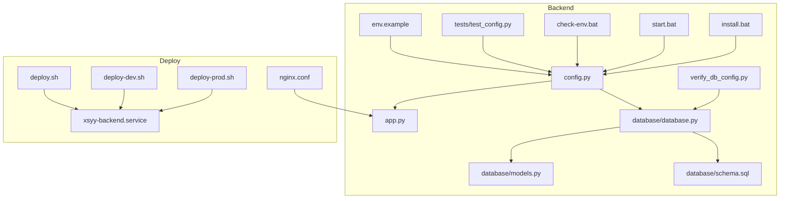
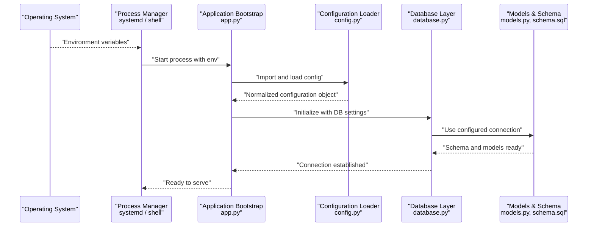
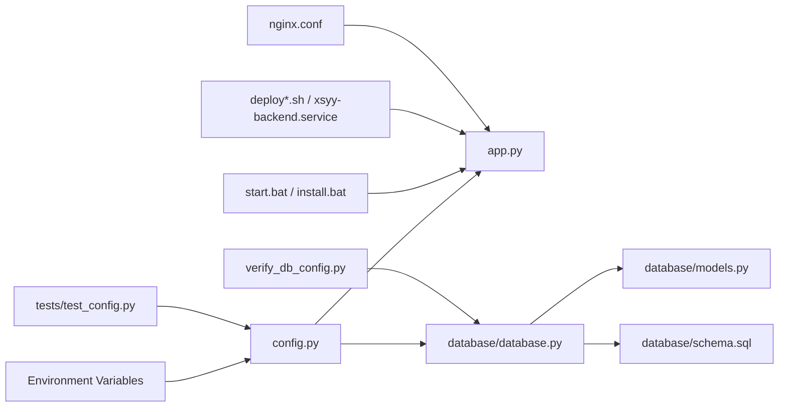

# Configuration Management

<cite>
**Referenced Files in This Document**
- [config.py](file://backend/config.py)
- [env.example](file://backend/env.example)
- [app.py](file://backend/app.py)
- [database.py](file://backend/database/database.py)
- [models.py](file://backend/database/models.py)
- [schema.sql](file://backend/database/schema.sql)
- [check-env.bat](file://backend/check-env.bat)
- [verify_db_config.py](file://backend/verify_db_config.py)
- [start.bat](file://backend/start.bat)
- [install.bat](file://backend/install.bat)
- [deploy.sh](file://deploy/deploy.sh)
- [deploy-dev.sh](file://deploy/deploy-dev.sh)
- [deploy-prod.sh](file://deploy/deploy-prod.sh)
- [nginx.conf](file://deploy/nginx.conf)
- [xsyy-backend.service](file://deploy/xsyy-backend.service)
- [test_config.py](file://backend/tests/test_config.py)
</cite>

## Table of Contents
1. [Introduction](#introduction)
2. [Project Structure](#project-structure)
3. [Core Components](#core-components)
4. [Architecture Overview](#architecture-overview)
5. [Detailed Component Analysis](#detailed-component-analysis)
6. [Dependency Analysis](#dependency-analysis)
7. [Performance Considerations](#performance-considerations)
8. [Troubleshooting Guide](#troubleshooting-guide)
9. [Conclusion](#conclusion)
10. [Appendices](#appendices)

## Introduction
This document explains the configuration management system for the XSYY Edu platform. It covers environment variable management, configuration file structures, runtime overrides, database connection settings, AI provider configurations, storage paths, and feature flags. It also documents environment-specific configurations for development, testing, and production deployments, including validation, defaults, secure handling of sensitive information, setup examples, and troubleshooting guidance.

## Project Structure
Configuration-related assets are primarily located under backend and deploy directories:
- Backend configuration loader and example environment template
- Database schema and models referencing configuration values
- Startup scripts that load environment variables
- Deployment scripts and service definitions that inject environment into the process
- Tests validating configuration behavior

**Diagram sources**
- [config.py](file://backend/config.py)
- [env.example](file://backend/env.example)
- [app.py](file://backend/app.py)
- [database.py](file://backend/database/database.py)
- [models.py](file://backend/database/models.py)
- [schema.sql](file://backend/database/schema.sql)
- [test_config.py](file://backend/tests/test_config.py)
- [verify_db_config.py](file://backend/verify_db_config.py)
- [check-env.bat](file://backend/check-env.bat)
- [start.bat](file://backend/start.bat)
- [install.bat](file://backend/install.bat)
- [deploy.sh](file://deploy/deploy.sh)
- [deploy-dev.sh](file://deploy/deploy-dev.sh)
- [deploy-prod.sh](file://deploy/deploy-prod.sh)
- [nginx.conf](file://deploy/nginx.conf)
- [xsyy-backend.service](file://deploy/xsyy-backend.service)

**Section sources**
- [config.py](file://backend/config.py)
- [env.example](file://backend/env.example)
- [app.py](file://backend/app.py)
- [database.py](file://backend/database/database.py)
- [models.py](file://backend/database/models.py)
- [schema.sql](file://backend/database/schema.sql)
- [test_config.py](file://backend/tests/test_config.py)
- [verify_db_config.py](file://backend/verify_db_config.py)
- [check-env.bat](file://backend/check-env.bat)
- [start.bat](file://backend/start.bat)
- [install.bat](file://backend/install.bat)
- [deploy.sh](file://deploy/deploy.sh)
- [deploy-dev.sh](file://deploy/deploy-dev.sh)
- [deploy-prod.sh](file://deploy/deploy-prod.sh)
- [nginx.conf](file://deploy/nginx.conf)
- [xsyy-backend.service](file://deploy/xsyy-backend.service)

## Core Components
- Configuration loader: centralizes reading environment variables, applying defaults, and exposing typed accessors.
- Example environment template: documents required and optional keys with comments describing purpose and constraints.
- Application bootstrap: imports configuration at startup to initialize services (e.g., database, storage).
- Database layer: reads connection parameters from configuration and initializes connections.
- Models and schema: depend on configured database connectivity; some constants may be derived from configuration.
- Validation utilities: scripts and tests to verify configuration correctness before or during startup.
- Deployment artifacts: shell scripts and systemd service files that set environment variables for the running process.

Key responsibilities:
- Provide a single source of truth for configuration via environment variables.
- Enforce defaults for non-sensitive options.
- Validate presence and format of critical settings.
- Expose configuration to modules through importable objects or functions.

**Section sources**
- [config.py](file://backend/config.py)
- [env.example](file://backend/env.example)
- [app.py](file://backend/app.py)
- [database.py](file://backend/database/database.py)
- [models.py](file://backend/database/models.py)
- [test_config.py](file://backend/tests/test_config.py)
- [verify_db_config.py](file://backend/verify_db_config.py)
- [xsyy-backend.service](file://deploy/xsyy-backend.service)

## Architecture Overview
The configuration architecture follows a standard pattern:
- Environment variables are the primary configuration mechanism.
- The configuration module loads and normalizes these variables at application start.
- Services consume configuration via imports rather than direct environment reads.
- Deployment scripts and service managers ensure the correct environment is present.

**Diagram sources**
- [app.py](file://backend/app.py)
- [config.py](file://backend/config.py)
- [database.py](file://backend/database/database.py)
- [models.py](file://backend/database/models.py)
- [schema.sql](file://backend/database/schema.sql)
- [xsyy-backend.service](file://deploy/xsyy-backend.service)

## Detailed Component Analysis

### Configuration Loader
Responsibilities:
- Read environment variables using a consistent naming convention.
- Apply default values for non-sensitive settings.
- Parse and validate types (strings, booleans, integers, lists).
- Provide helper methods to access grouped settings (e.g., database, AI providers, storage).
- Centralize error messages for missing or invalid configuration.

Typical categories exposed:
- General app settings (host, port, debug flag, logging level).
- Database connection parameters (driver, host, port, user, password, database name, pool size).
- AI provider credentials and endpoints (API keys, base URLs, model names, timeouts).
- Storage paths (local root, upload limits, allowed extensions).
- Feature flags (enable/disable features per environment).

Runtime override behavior:
- Values from environment variables always take precedence over defaults.
- Optional configuration files can be supported by the loader if implemented; otherwise, only environment variables are authoritative.

Validation strategy:
- Presence checks for required keys.
- Type coercion with informative errors.
- Range checks for numeric settings (e.g., ports, timeouts).
- URL and path validation where applicable.

Security considerations:
- Avoid logging secrets.
- Mask sensitive values in diagnostics.
- Prefer loading secrets from secure stores (e.g., OS keychain, secret managers) via environment variables.

**Section sources**
- [config.py](file://backend/config.py)
- [env.example](file://backend/env.example)

### Example Environment Template
Purpose:
- Documents all supported environment variables.
- Provides safe defaults for non-sensitive keys.
- Includes comments explaining each variable’s role and expected format.

Usage:
- Copy the template to an active .env or export it in the deployment environment.
- Fill in required values for your target environment.

Best practices:
- Do not commit secrets to version control.
- Keep the template free of real secrets.
- Use different templates or overlays for dev/test/prod.

**Section sources**
- [env.example](file://backend/env.example)

### Application Bootstrap
Responsibilities:
- Import configuration early to initialize subsystems.
- Configure logging based on configuration.
- Initialize database connections and other external clients.
- Start HTTP server with configured host/port.

Integration points:
- Reads configuration from the configuration loader.
- Passes configuration to database initialization.
- Optionally exposes health/readiness endpoints that reflect configuration state.

**Section sources**
- [app.py](file://backend/app.py)

### Database Layer
Responsibilities:
- Build connection strings or connection objects from configuration.
- Manage connection pooling and lifecycle.
- Execute migrations or schema creation when needed.

Configuration dependencies:
- Driver selection and connection parameters.
- Pool sizes and timeouts.
- SSL/TLS options if enabled.

Operational notes:
- Validate connectivity at startup.
- Fail fast if required database settings are missing.
- Provide clear error messages indicating which setting is incorrect.

**Section sources**
- [database.py](file://backend/database/database.py)
- [models.py](file://backend/database/models.py)
- [schema.sql](file://backend/database/schema.sql)

### Validation Utilities
Types:
- Pre-flight checks executed before starting the main server.
- Runtime verification scripts to test connectivity and configuration integrity.
- Unit/integration tests asserting configuration behavior.

Examples:
- A script that verifies database connectivity using current configuration.
- A batch utility that checks required environment variables exist.
- Test cases that assert defaults and parsing rules.

**Section sources**
- [verify_db_config.py](file://backend/verify_db_config.py)
- [check-env.bat](file://backend/check-env.bat)
- [test_config.py](file://backend/tests/test_config.py)

### Startup and Installation Scripts
Responsibilities:
- Load environment variables from local files or system environment.
- Invoke the application entry point with the correct configuration context.
- Perform initial setup tasks such as database migration or seed data.

Environments:
- Windows batch scripts for local development.
- Shell scripts for Linux-based deployments.

**Section sources**
- [start.bat](file://backend/start.bat)
- [install.bat](file://backend/install.bat)
- [check-env.bat](file://backend/check-env.bat)

### Deployment Artifacts
Responsibilities:
- Set environment variables for the running process.
- Define service manager integration (systemd).
- Configure reverse proxy (nginx) to forward requests to the application.

Environment-specific behavior:
- Development: enable debug mode, verbose logging, local storage.
- Testing: use isolated databases, mock AI providers if available.
- Production: enforce strict security, connection pooling, and monitoring.

**Section sources**
- [deploy.sh](file://deploy/deploy.sh)
- [deploy-dev.sh](file://deploy/deploy-dev.sh)
- [deploy-prod.sh](file://deploy/deploy-prod.sh)
- [nginx.conf](file://deploy/nginx.conf)
- [xsyy-backend.service](file://deploy/xsyy-backend.service)

## Dependency Analysis
High-level dependency relationships among configuration-related components:

**Diagram sources**
- [config.py](file://backend/config.py)
- [app.py](file://backend/app.py)
- [database.py](file://backend/database/database.py)
- [models.py](file://backend/database/models.py)
- [schema.sql](file://backend/database/schema.sql)
- [test_config.py](file://backend/tests/test_config.py)
- [verify_db_config.py](file://backend/verify_db_config.py)
- [start.bat](file://backend/start.bat)
- [install.bat](file://backend/install.bat)
- [deploy.sh](file://deploy/deploy.sh)
- [deploy-dev.sh](file://deploy/deploy-dev.sh)
- [deploy-prod.sh](file://deploy/deploy-prod.sh)
- [nginx.conf](file://deploy/nginx.conf)
- [xsyy-backend.service](file://deploy/xsyy-backend.service)

**Section sources**
- [config.py](file://backend/config.py)
- [app.py](file://backend/app.py)
- [database.py](file://backend/database/database.py)
- [models.py](file://backend/database/models.py)
- [schema.sql](file://backend/database/schema.sql)
- [test_config.py](file://backend/tests/test_config.py)
- [verify_db_config.py](file://backend/verify_db_config.py)
- [start.bat](file://backend/start.bat)
- [install.bat](file://backend/install.bat)
- [deploy.sh](file://deploy/deploy.sh)
- [deploy-dev.sh](file://deploy/deploy-dev.sh)
- [deploy-prod.sh](file://deploy/deploy-prod.sh)
- [nginx.conf](file://deploy/nginx.conf)
- [xsyy-backend.service](file://deploy/xsyy-backend.service)

## Performance Considerations
- Connection pooling: tune pool sizes based on workload and database capacity.
- Timeouts: set appropriate request and I/O timeouts to avoid resource exhaustion.
- Logging levels: reduce verbosity in production to minimize overhead.
- Feature flags: disable expensive features in constrained environments.
- Storage paths: ensure adequate disk space and I/O performance for uploads and caches.

[No sources needed since this section provides general guidance]

## Troubleshooting Guide
Common issues and resolutions:
- Missing environment variables: run pre-flight checks and ensure all required keys are present.
- Invalid database credentials: verify host, port, user, password, and database name; confirm network reachability.
- Incorrect storage paths: check absolute vs relative paths and permissions.
- AI provider failures: validate API keys, base URLs, and model names; inspect rate limits and quotas.
- Port conflicts: ensure the configured host/port is available and not bound by another process.
- Reverse proxy misconfiguration: confirm nginx forwards to the correct upstream and respects timeouts.

Diagnostic tools:
- Environment checker utility to list and validate required variables.
- Database connectivity verifier to test connection and basic queries.
- Unit tests for configuration parsing and defaults.

**Section sources**
- [check-env.bat](file://backend/check-env.bat)
- [verify_db_config.py](file://backend/verify_db_config.py)
- [test_config.py](file://backend/tests/test_config.py)
- [nginx.conf](file://deploy/nginx.conf)

## Conclusion
The XSYY Edu platform uses a robust, environment-driven configuration system centered around a single configuration loader. By adhering to the documented variables, leveraging the example template, and using provided validation and deployment artifacts, teams can reliably configure development, testing, and production environments while maintaining security and operational stability.

[No sources needed since this section summarizes without analyzing specific files]

## Appendices

### Environment-Specific Setup Examples
- Development:
  - Enable debug mode and verbose logging.
  - Use local database and storage paths.
  - Ensure all required variables are exported or loaded via startup scripts.
- Testing:
  - Isolate database instances.
  - Mock or limit AI provider calls.
  - Run configuration tests to catch issues early.
- Production:
  - Use strong credentials and secure secret management.
  - Tune connection pools and timeouts.
  - Restrict logging to warn/error levels.
  - Configure reverse proxy with proper timeouts and headers.

[No sources needed since this section provides general guidance]

### Secure Handling of Sensitive Information
- Store secrets in environment variables managed by the OS or secret manager.
- Never log secrets or include them in stack traces.
- Rotate credentials regularly and audit access.
- Use separate configuration sets per environment.

[No sources needed since this section provides general guidance]