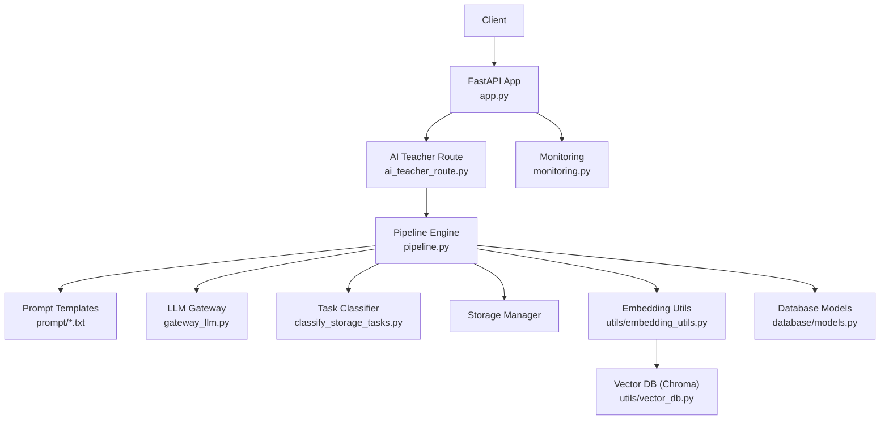
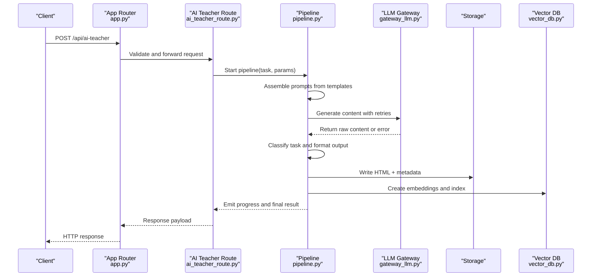
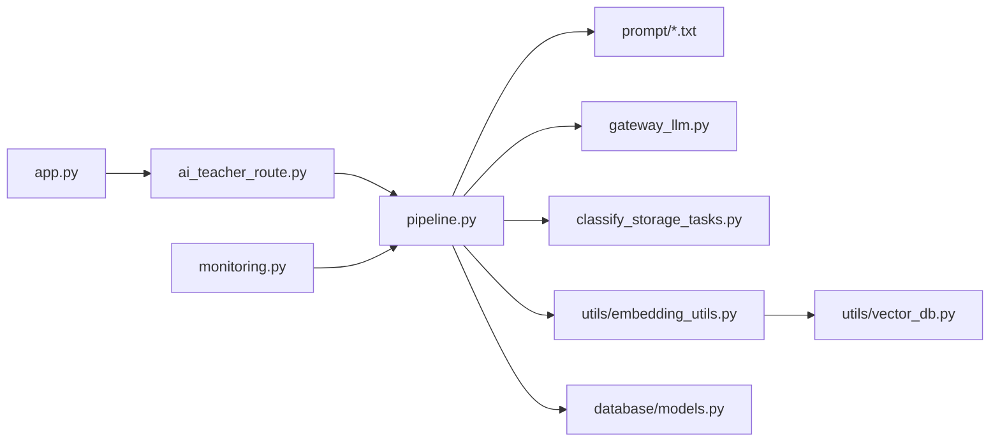

# Content Generation Pipeline

<cite>
**Referenced Files in This Document**
- [pipeline.py](file://backend/pipeline.py)
- [ai_teacher_route.py](file://backend/ai_teacher_route.py)
- [app.py](file://backend/app.py)
- [config.py](file://backend/config.py)
- [gateway_llm.py](file://backend/gateway_llm.py)
- [embedding_utils.py](file://backend/utils/embedding_utils.py)
- [vector_db.py](file://backend/utils/vector_db.py)
- [classify_storage_tasks.py](file://backend/classify_storage_tasks.py)
- [teaching_system_prompt.txt](file://backend/prompt/teaching_system_prompt.txt)
- [teaching_user_prompt.txt](file://backend/prompt/teaching_user_prompt.txt)
- [classification_user_prompt.txt](file://backend/prompt/classification_user_prompt.txt)
- [extract_user_prompt.txt](file://backend/prompt/extract_user_prompt.txt)
- [classi_pic_system_prompt.txt](file://backend/prompt/classi_pic_system_prompt.txt)
- [classi_pic_user_prompt.txt](file://backend/prompt/classi_pic_user_prompt.txt)
- [teaching_template.html](file://backend/prompt/teaching_template.html)
- [models.py](file://backend/database/models.py)
- [database.py](file://backend/database/database.py)
- [monitoring.py](file://backend/monitoring.py)
</cite>

## Table of Contents
1. [Introduction](#introduction)
2. [Project Structure](#project-structure)
3. [Core Components](#core-components)
4. [Architecture Overview](#architecture-overview)
5. [Detailed Component Analysis](#detailed-component-analysis)
6. [Dependency Analysis](#dependency-analysis)
7. [Performance Considerations](#performance-considerations)
8. [Troubleshooting Guide](#troubleshooting-guide)
9. [Conclusion](#conclusion)
10. [Appendices](#appendices)

## Introduction
This document explains the end-to-end content generation pipeline that transforms user prompts into structured HTML teaching materials, with AI-driven classification, template rendering, storage organization, and vector embedding for retrieval. It covers the AI teacher route handling, task classification, storage layout, prompt engineering patterns, quality validation, error handling, retry mechanisms, progress tracking, and guidance for extending the pipeline with new steps or formats.

## Project Structure
The pipeline spans several backend modules:
- API routing and orchestration (FastAPI app and AI teacher route)
- Prompt templates and system/user prompts
- LLM gateway abstraction
- Pipeline execution engine
- Storage classification and organization
- Vector embedding and Chroma integration
- Database models and persistence
- Monitoring and observability

**Diagram sources**
- [app.py](file://backend/app.py)
- [ai_teacher_route.py](file://backend/ai_teacher_route.py)
- [pipeline.py](file://backend/pipeline.py)
- [gateway_llm.py](file://backend/gateway_llm.py)
- [classify_storage_tasks.py](file://backend/classify_storage_tasks.py)
- [embedding_utils.py](file://backend/utils/embedding_utils.py)
- [vector_db.py](file://backend/utils/vector_db.py)
- [models.py](file://backend/database/models.py)
- [monitoring.py](file://backend/monitoring.py)

**Section sources**
- [app.py](file://backend/app.py)
- [ai_teacher_route.py](file://backend/ai_teacher_route.py)
- [pipeline.py](file://backend/pipeline.py)
- [config.py](file://backend/config.py)

## Core Components
- AI Teacher Route: Accepts requests, validates inputs, and dispatches to the pipeline with appropriate context.
- Pipeline Engine: Orchestrates prompt assembly, LLM calls, classification, template rendering, storage, and embeddings.
- Prompt System: Manages system and user prompts for generation, classification, extraction, and image classification.
- LLM Gateway: Abstracts provider-specific calls, retries, and streaming where applicable.
- Task Classifier: Determines storage layout and metadata based on task type and content.
- Storage Manager: Persists generated HTML and metadata under organized directories.
- Embedding Utilities: Generates vectors for content chunks and stores them in a vector database.
- Database Models: Defines persistent entities for teachings, topics, users, and related data.
- Monitoring: Tracks metrics, errors, and progress events across the pipeline.

**Section sources**
- [ai_teacher_route.py](file://backend/ai_teacher_route.py)
- [pipeline.py](file://backend/pipeline.py)
- [gateway_llm.py](file://backend/gateway_llm.py)
- [classify_storage_tasks.py](file://backend/classify_storage_tasks.py)
- [embedding_utils.py](file://backend/utils/embedding_utils.py)
- [vector_db.py](file://backend/utils/vector_db.py)
- [models.py](file://backend/database/models.py)
- [monitoring.py](file://backend/monitoring.py)

## Architecture Overview
The pipeline follows a staged workflow:
1. Request ingestion and validation at the API layer.
2. Prompt assembly using templates and contextual parameters.
3. LLM invocation via the gateway with retry and fallback strategies.
4. Post-processing: classification, content validation, and formatting.
5. Storage: write HTML and metadata; index with vector embeddings.
6. Progress and error reporting back to the client.

**Diagram sources**
- [app.py](file://backend/app.py)
- [ai_teacher_route.py](file://backend/ai_teacher_route.py)
- [pipeline.py](file://backend/pipeline.py)
- [gateway_llm.py](file://backend/gateway_llm.py)
- [vector_db.py](file://backend/utils/vector_db.py)

## Detailed Component Analysis

### AI Teacher Route Handling
Responsibilities:
- Input validation and normalization
- Context enrichment (user, session, quotas)
- Dispatch to pipeline with task-specific parameters
- Stream or poll-based progress updates
- Error mapping and standardized responses

Key behaviors:
- Enforces authentication and authorization checks before processing.
- Maps input schemas to internal task descriptors.
- Emits progress events during long-running operations.

**Section sources**
- [ai_teacher_route.py](file://backend/ai_teacher_route.py)
- [app.py](file://backend/app.py)

### Pipeline Engine
Responsibilities:
- Orchestrate multi-step generation: prompt assembly, LLM calls, classification, formatting, storage, embeddings.
- Manage retry policies and timeouts.
- Maintain progress state and emit events.
- Coordinate with storage and vector indexing.

Processing stages:
- Prompt Assembly: Combine system and user prompts with dynamic variables.
- LLM Invocation: Call gateway with configured model and parameters.
- Classification: Determine task type and storage strategy.
- Formatting: Apply template rules and validate structure.
- Storage: Persist HTML and metadata.
- Embedding: Chunk content, generate vectors, and index.

Error handling:
- Retry on transient failures with exponential backoff.
- Fallback prompts or models when available.
- Capture failure samples for diagnostics.

Progress tracking:
- Emit stage transitions and partial outputs.
- Provide completion status and artifacts.

**Section sources**
- [pipeline.py](file://backend/pipeline.py)
- [monitoring.py](file://backend/monitoring.py)

### Template System Architecture
Components:
- Template files: HTML base structures and sections.
- Prompt templates: System and user prompts for generation and classification.
- Rendering logic: Injects dynamic content into templates and validates output.

Patterns:
- Separation of concerns between prompts and presentation.
- Parameterized templates for consistent formatting.
- Validation hooks to ensure structural integrity.

Extensibility:
- Add new templates by following naming conventions and schema contracts.
- Integrate custom formatters for additional content types.

**Section sources**
- [teaching_template.html](file://backend/prompt/teaching_template.html)
- [teaching_system_prompt.txt](file://backend/prompt/teaching_system_prompt.txt)
- [teaching_user_prompt.txt](file://backend/prompt/teaching_user_prompt.txt)
- [classification_user_prompt.txt](file://backend/prompt/classification_user_prompt.txt)
- [extract_user_prompt.txt](file://backend/prompt/extract_user_prompt.txt)
- [classi_pic_system_prompt.txt](file://backend/prompt/classi_pic_system_prompt.txt)
- [classi_pic_user_prompt.txt](file://backend/prompt/classi_pic_user_prompt.txt)

### Prompt Engineering Patterns
- System prompts define role, constraints, and output schema.
- User prompts provide task-specific instructions and examples.
- Classification prompts guide model decisions for storage and formatting.
- Extraction prompts isolate key fields for metadata.
- Image classification prompts handle visual content categorization.

Best practices:
- Keep prompts concise and deterministic.
- Use explicit output formats and validation rules.
- Version prompts alongside code changes.

**Section sources**
- [teaching_system_prompt.txt](file://backend/prompt/teaching_system_prompt.txt)
- [teaching_user_prompt.txt](file://backend/prompt/teaching_user_prompt.txt)
- [classification_user_prompt.txt](file://backend/prompt/classification_user_prompt.txt)
- [extract_user_prompt.txt](file://backend/prompt/extract_user_prompt.txt)
- [classi_pic_system_prompt.txt](file://backend/prompt/classi_pic_system_prompt.txt)
- [classi_pic_user_prompt.txt](file://backend/prompt/classi_pic_user_prompt.txt)

### Task Classification and Storage Organization
Classification:
- Determines task category (e.g., lesson, quiz, explanation).
- Selects storage path and metadata schema.
- Guides template selection and formatting rules.

Storage organization:
- UUID-based directories per artifact.
- Consistent file layout: HTML content and metadata JSON.
- Failure samples isolated for debugging.

Rules:
- Atomic writes with temporary directories.
- Metadata includes versioning, timestamps, and provenance.

**Section sources**
- [classify_storage_tasks.py](file://backend/classify_storage_tasks.py)

### Vector Embedding Generation
Steps:
- Chunk content into semantically coherent segments.
- Generate embeddings via configured provider.
- Store vectors in Chroma with metadata for retrieval.
- Index by topic, tags, and content type.

Quality controls:
- Validate chunk sizes and token limits.
- Handle provider rate limits and errors.
- Ensure idempotent indexing.

**Section sources**
- [embedding_utils.py](file://backend/utils/embedding_utils.py)
- [vector_db.py](file://backend/utils/vector_db.py)

### Quality Validation Mechanisms
- Structural validation of HTML against template schema.
- Field presence checks in metadata.
- Content length and token budget enforcement.
- Optional post-generation review flags.

Failure handling:
- Capture invalid outputs for reprocessing.
- Log detailed diagnostics and sample artifacts.

**Section sources**
- [pipeline.py](file://backend/pipeline.py)
- [monitoring.py](file://backend/monitoring.py)

### Database Integration
Models:
- Teachings, topics, users, view history, and invite quotas.
- Relationships defined via foreign keys and indexes.

Operations:
- CRUD endpoints for management and analytics.
- Migration scripts for schema evolution.

**Section sources**
- [models.py](file://backend/database/models.py)
- [database.py](file://backend/database/database.py)

## Dependency Analysis
Internal dependencies:
- Route depends on app router and pipeline.
- Pipeline depends on prompts, gateway, classifier, storage, and embedding utilities.
- Embedding utilities depend on vector DB configuration.
- Monitoring integrates across components for telemetry.

External dependencies:
- LLM providers via gateway abstraction.
- Chroma for vector storage.
- Database driver for persistence.

Potential coupling:
- Tight coupling between pipeline stages can be mitigated by interfaces.
- Decouple prompt versions from runtime logic.

**Diagram sources**
- [ai_teacher_route.py](file://backend/ai_teacher_route.py)
- [pipeline.py](file://backend/pipeline.py)
- [gateway_llm.py](file://backend/gateway_llm.py)
- [classify_storage_tasks.py](file://backend/classify_storage_tasks.py)
- [embedding_utils.py](file://backend/utils/embedding_utils.py)
- [vector_db.py](file://backend/utils/vector_db.py)
- [models.py](file://backend/database/models.py)
- [app.py](file://backend/app.py)
- [monitoring.py](file://backend/monitoring.py)

**Section sources**
- [config.py](file://backend/config.py)

## Performance Considerations
- Batch embedding generation for large contents.
- Cache frequent prompts and template renders.
- Use streaming responses for long-running tasks.
- Tune retry backoff and concurrency limits.
- Optimize database queries with proper indexes.

[No sources needed since this section provides general guidance]

## Troubleshooting Guide
Common issues:
- LLM provider errors: Check gateway logs and retry settings.
- Template rendering failures: Inspect failure samples and schema mismatches.
- Vector indexing errors: Validate chunking and provider quotas.
- Storage write failures: Verify permissions and atomicity.

Debugging steps:
- Enable monitoring and capture progress events.
- Review failure samples in storage directories.
- Validate prompts and templates against expected schemas.
- Test gateway connectivity and model availability.

**Section sources**
- [monitoring.py](file://backend/monitoring.py)
- [pipeline.py](file://backend/pipeline.py)

## Conclusion
The content generation pipeline provides a robust, extensible framework for transforming prompts into high-quality HTML teaching materials. With clear separation of concerns, strong error handling, and comprehensive monitoring, it supports scalable content production and retrieval through vector embeddings. Extending the pipeline involves adding new prompts, templates, and processing steps while maintaining consistency and quality.

[No sources needed since this section summarizes without analyzing specific files]

## Appendices

### Creating Custom Templates
- Follow existing naming conventions and place templates under prompt directory.
- Define placeholders for dynamic content injection.
- Implement validation rules to ensure output integrity.
- Register templates in pipeline configuration.

**Section sources**
- [teaching_template.html](file://backend/prompt/teaching_template.html)

### Extending the Pipeline with New Processing Steps
- Insert new stages between prompt assembly and storage.
- Implement progress emission and error propagation.
- Update monitoring to track new step metrics.
- Add tests for validation and edge cases.

**Section sources**
- [pipeline.py](file://backend/pipeline.py)
- [monitoring.py](file://backend/monitoring.py)

### Integrating Additional Content Formats
- Extend template system to support new formats (e.g., Markdown, PDF).
- Add converters for intermediate representations.
- Update storage schema to accommodate new artifacts.
- Adjust embedding chunking for format-specific semantics.

**Section sources**
- [pipeline.py](file://backend/pipeline.py)
- [classify_storage_tasks.py](file://backend/classify_storage_tasks.py)