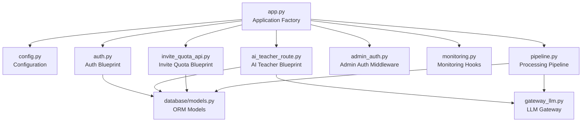
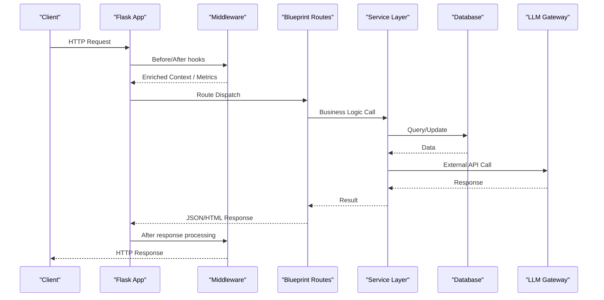
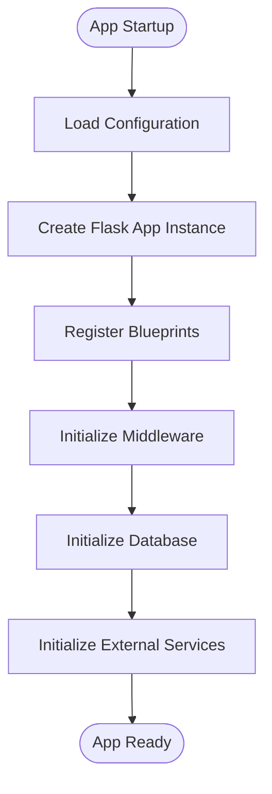
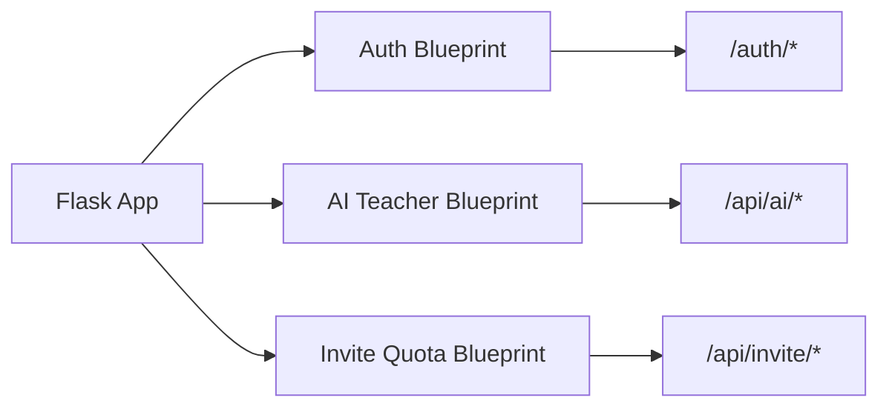
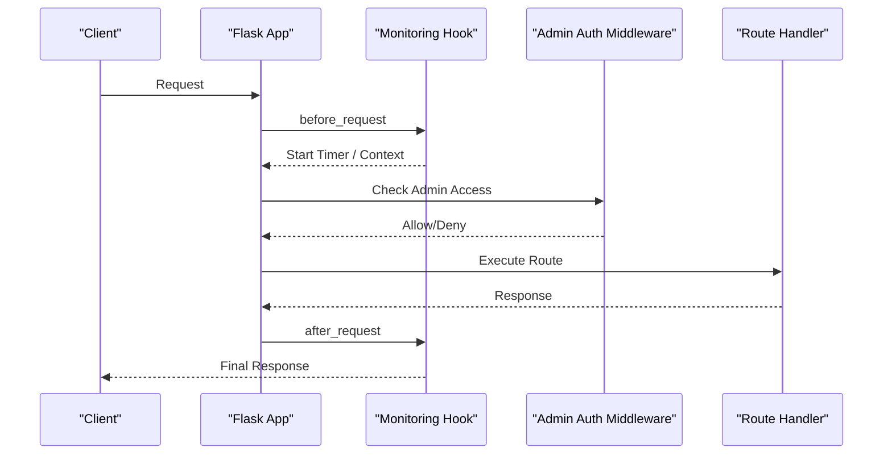
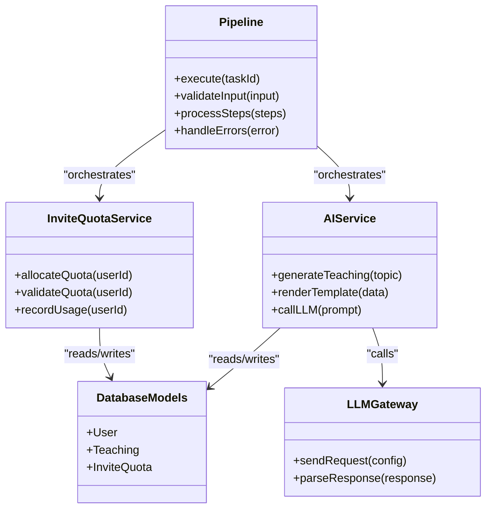
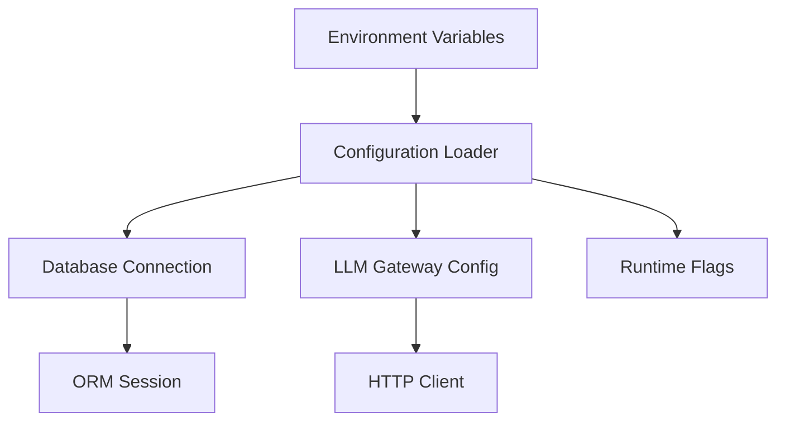
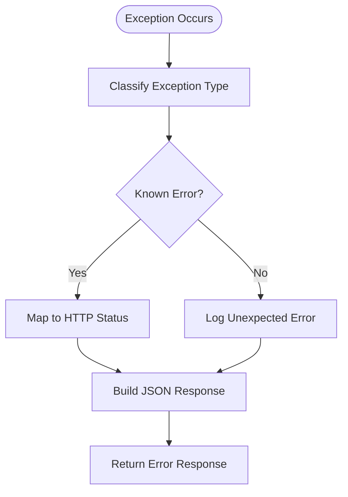
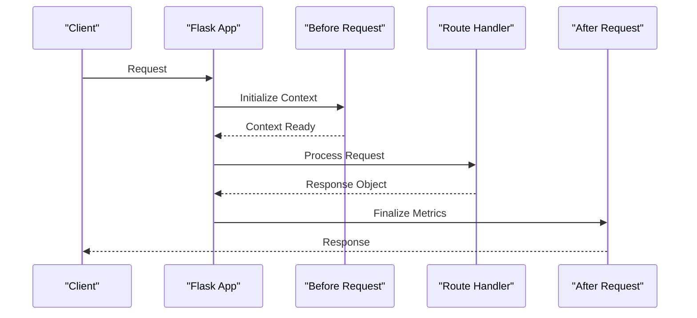
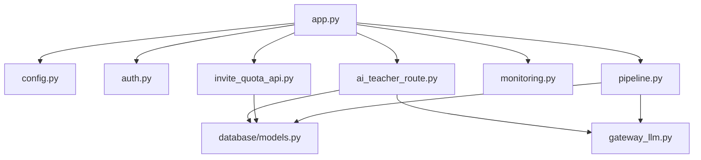

# Flask Application Architecture

<cite>
**Referenced Files in This Document**
- [app.py](file://backend/app.py)
- [config.py](file://backend/config.py)
- [auth.py](file://backend/auth.py)
- [ai_teacher_route.py](file://backend/ai_teacher_route.py)
- [invite_quota_api.py](file://backend/invite_quota_api.py)
- [database/__init__.py](file://backend/database/__init__.py)
- [database/models.py](file://backend/database/models.py)
- [gateway_llm.py](file://backend/gateway_llm.py)
- [monitoring.py](file://backend/monitoring.py)
- [pipeline.py](file://backend/pipeline.py)
- [admin_auth.py](file://backend/admin_auth.py)
</cite>

## Table of Contents
1. [Introduction](#introduction)
2. [Project Structure](#project-structure)
3. [Core Components](#core-components)
4. [Architecture Overview](#architecture-overview)
5. [Detailed Component Analysis](#detailed-component-analysis)
6. [Dependency Analysis](#dependency-analysis)
7. [Performance Considerations](#performance-considerations)
8. [Troubleshooting Guide](#troubleshooting-guide)
9. [Conclusion](#conclusion)

## Introduction
This document explains the Flask application architecture for the backend service. It covers the main entry point, route organization using blueprints, middleware pipeline configuration, service layer design, initialization process, error handling, request/response lifecycle, and configuration management across environments. It also provides guidance on custom middleware development, route registration patterns, and usage of the application context.

## Project Structure
The backend is organized into feature-oriented modules:
- Entry point and application factory
- Configuration and environment setup
- Authentication and authorization
- API routes grouped by domain (AI teaching, invite quotas)
- Database models and migrations
- External integrations (LLM gateway)
- Monitoring and observability
- Processing pipelines

**Diagram sources**
- [app.py](file://backend/app.py)
- [config.py](file://backend/config.py)
- [auth.py](file://backend/auth.py)
- [ai_teacher_route.py](file://backend/ai_teacher_route.py)
- [invite_quota_api.py](file://backend/invite_quota_api.py)
- [admin_auth.py](file://backend/admin_auth.py)
- [monitoring.py](file://backend/monitoring.py)
- [pipeline.py](file://backend/pipeline.py)
- [database/models.py](file://backend/database/models.py)
- [gateway_llm.py](file://backend/gateway_llm.py)

**Section sources**
- [app.py](file://backend/app.py)
- [config.py](file://backend/config.py)

## Core Components
- Application factory: Creates and configures the Flask app instance, registers blueprints, sets up middleware, and initializes extensions.
- Configuration module: Loads environment variables and provides typed settings for database, external services, and runtime flags.
- Authentication blueprint: Defines auth endpoints and integrates with session/token-based authentication.
- Feature blueprints: Group routes by domain (e.g., AI teaching, invite quotas).
- Database layer: ORM models and connection management.
- LLM gateway: Encapsulates calls to external AI services.
- Monitoring: Request hooks, metrics, and health checks.
- Pipeline: Orchestrates multi-step processing tasks.

**Section sources**
- [app.py](file://backend/app.py)
- [config.py](file://backend/config.py)
- [auth.py](file://backend/auth.py)
- [ai_teacher_route.py](file://backend/ai_teacher_route.py)
- [invite_quota_api.py](file://backend/invite_quota_api.py)
- [database/models.py](file://backend/database/models.py)
- [gateway_llm.py](file://backend/gateway_llm.py)
- [monitoring.py](file://backend/monitoring.py)
- [pipeline.py](file://backend/pipeline.py)

## Architecture Overview
The application follows a modular Flask architecture:
- Centralized application factory initializes dependencies and wires components.
- Blueprints encapsulate domain-specific routes and logic.
- Middleware handles cross-cutting concerns like logging, metrics, and admin access control.
- Service layers abstract business logic and external integrations.
- Database models represent persistent entities.

**Diagram sources**
- [app.py](file://backend/app.py)
- [monitoring.py](file://backend/monitoring.py)
- [auth.py](file://backend/auth.py)
- [ai_teacher_route.py](file://backend/ai_teacher_route.py)
- [invite_quota_api.py](file://backend/invite_quota_api.py)
- [database/models.py](file://backend/database/models.py)
- [gateway_llm.py](file://backend/gateway_llm.py)

## Detailed Component Analysis

### Application Factory and Initialization
- Creates the Flask app instance with configuration from the configuration module.
- Registers blueprints for modular routing.
- Configures middleware (logging, monitoring, error handlers).
- Initializes database connections and ORM metadata.
- Sets up external service clients (e.g., LLM gateway).

**Diagram sources**
- [app.py](file://backend/app.py)
- [config.py](file://backend/config.py)
- [database/__init__.py](file://backend/database/__init__.py)
- [gateway_llm.py](file://backend/gateway_llm.py)

**Section sources**
- [app.py](file://backend/app.py)
- [config.py](file://backend/config.py)
- [database/__init__.py](file://backend/database/__init__.py)

### Route Organization Patterns
- Blueprints group related endpoints by domain:
  - Authentication endpoints under an auth blueprint.
  - AI teaching endpoints under a dedicated blueprint.
  - Invite quota management endpoints under another blueprint.
- Each blueprint defines its own URL prefixes and route handlers.
- Shared utilities and decorators are applied via blueprint-level middleware or before_request hooks.

**Diagram sources**
- [auth.py](file://backend/auth.py)
- [ai_teacher_route.py](file://backend/ai_teacher_route.py)
- [invite_quota_api.py](file://backend/invite_quota_api.py)

**Section sources**
- [auth.py](file://backend/auth.py)
- [ai_teacher_route.py](file://backend/ai_teacher_route.py)
- [invite_quota_api.py](file://backend/invite_quota_api.py)

### Middleware Pipeline Configuration
- Global middleware can be implemented via Flask’s before_request/after_request hooks or WSGI middleware.
- Monitoring hooks record request timing, status codes, and errors.
- Admin authentication middleware enforces role-based access for administrative endpoints.
- Error handlers centralize exception responses and logging.

**Diagram sources**
- [monitoring.py](file://backend/monitoring.py)
- [admin_auth.py](file://backend/admin_auth.py)
- [app.py](file://backend/app.py)

**Section sources**
- [monitoring.py](file://backend/monitoring.py)
- [admin_auth.py](file://backend/admin_auth.py)
- [app.py](file://backend/app.py)

### Service Layer Design
- Service modules encapsulate business logic and orchestrate interactions with databases and external APIs.
- The AI teacher service coordinates prompt generation, template rendering, and LLM calls.
- The invite quota service manages quota allocation and validation.
- The pipeline orchestrates multi-step workflows, integrating caching, validation, and external calls.

**Diagram sources**
- [ai_teacher_route.py](file://backend/ai_teacher_route.py)
- [invite_quota_api.py](file://backend/invite_quota_api.py)
- [pipeline.py](file://backend/pipeline.py)
- [database/models.py](file://backend/database/models.py)
- [gateway_llm.py](file://backend/gateway_llm.py)

**Section sources**
- [ai_teacher_route.py](file://backend/ai_teacher_route.py)
- [invite_quota_api.py](file://backend/invite_quota_api.py)
- [pipeline.py](file://backend/pipeline.py)
- [database/models.py](file://backend/database/models.py)
- [gateway_llm.py](file://backend/gateway_llm.py)

### Configuration Management
- Environment variables drive configuration for database connections, external service credentials, and runtime toggles.
- Configuration module loads defaults and overrides from environment files.
- Database connections are initialized based on configured drivers and connection strings.
- External service integrations use configured endpoints and keys.

**Diagram sources**
- [config.py](file://backend/config.py)
- [database/__init__.py](file://backend/database/__init__.py)
- [gateway_llm.py](file://backend/gateway_llm.py)

**Section sources**
- [config.py](file://backend/config.py)
- [database/__init__.py](file://backend/database/__init__.py)
- [gateway_llm.py](file://backend/gateway_llm.py)

### Error Handling Middleware
- Centralized error handlers convert exceptions into standardized HTTP responses.
- Logging captures stack traces and contextual information for debugging.
- Graceful degradation ensures partial failures do not crash the entire request.

**Diagram sources**
- [app.py](file://backend/app.py)
- [monitoring.py](file://backend/monitoring.py)

**Section sources**
- [app.py](file://backend/app.py)
- [monitoring.py](file://backend/monitoring.py)

### Request/Response Lifecycle
- Before request hooks initialize context, measure start time, and parse headers.
- Route handlers execute business logic and return responses.
- After request hooks finalize metrics, flush logs, and handle cleanup.

**Diagram sources**
- [app.py](file://backend/app.py)
- [monitoring.py](file://backend/monitoring.py)

**Section sources**
- [app.py](file://backend/app.py)
- [monitoring.py](file://backend/monitoring.py)

## Dependency Analysis
The application exhibits clear separation between routing, services, data, and external integrations:
- Blueprints depend on services for business logic.
- Services depend on database models and external gateways.
- Middleware depends on monitoring and configuration modules.
- The application factory wires all components together.

**Diagram sources**
- [app.py](file://backend/app.py)
- [config.py](file://backend/config.py)
- [auth.py](file://backend/auth.py)
- [ai_teacher_route.py](file://backend/ai_teacher_route.py)
- [invite_quota_api.py](file://backend/invite_quota_api.py)
- [monitoring.py](file://backend/monitoring.py)
- [pipeline.py](file://backend/pipeline.py)
- [database/models.py](file://backend/database/models.py)
- [gateway_llm.py](file://backend/gateway_llm.py)

**Section sources**
- [app.py](file://backend/app.py)
- [config.py](file://backend/config.py)
- [auth.py](file://backend/auth.py)
- [ai_teacher_route.py](file://backend/ai_teacher_route.py)
- [invite_quota_api.py](file://backend/invite_quota_api.py)
- [monitoring.py](file://backend/monitoring.py)
- [pipeline.py](file://backend/pipeline.py)
- [database/models.py](file://backend/database/models.py)
- [gateway_llm.py](file://backend/gateway_llm.py)

## Performance Considerations
- Use connection pooling for database operations to reduce latency.
- Cache frequently accessed data where appropriate.
- Implement rate limiting for external API calls to avoid throttling.
- Profile critical paths in the pipeline to identify bottlenecks.
- Enable asynchronous processing for long-running tasks.

[No sources needed since this section provides general guidance]

## Troubleshooting Guide
- Verify environment variables and configuration loading at startup.
- Check database connectivity and migration status.
- Inspect monitoring logs for request timing and error rates.
- Validate external service credentials and endpoint availability.
- Use centralized error handlers to capture detailed exception information.

**Section sources**
- [config.py](file://backend/config.py)
- [database/__init__.py](file://backend/database/__init__.py)
- [monitoring.py](file://backend/monitoring.py)
- [app.py](file://backend/app.py)

## Conclusion
The Flask application follows a modular, service-oriented architecture with clear separation of concerns. Blueprints organize routes by domain, middleware handles cross-cutting concerns, and services encapsulate business logic. Configuration is environment-driven, and external integrations are abstracted behind dedicated gateways. This structure supports scalability, maintainability, and observability.

[No sources needed since this section summarizes without analyzing specific files]