# Classification & Organization

<cite>
**Referenced Files in This Document**
- [database/models.py](file://backend/database/models.py)
- [database/schema.sql](file://backend/database/schema.sql)
- [database/add_topics_table.py](file://backend/database/add_topics_table.py)
- [database/add_topics_table.sql](file://backend/database/add_topics_table.sql)
- [database/add_topic_share_fields.py](file://backend/database/add_topic_share_fields.py)
- [database/add_topic_share_fields.sql](file://backend/database/add_topic_share_fields.sql)
- [database/TOPIC_SHARE_MIGRATION.md](file://backend/database/TOPIC_SHARE_MIGRATION.md)
- [prompt/classification_user_prompt.txt](file://backend/prompt/classification_user_prompt.txt)
- [prompt/classi_pic_system_prompt.txt](file://backend/prompt/classi_pic_system_prompt.txt)
- [prompt/classi_pic_user_prompt.txt](file://backend/prompt/classi_pic_user_prompt.txt)
- [classify_storage_tasks.py](file://backend/classify_storage_tasks.py)
- [pipeline.py](file://backend/pipeline.py)
- [utils/embedding_utils.py](file://backend/utils/embedding_utils.py)
- [utils/vector_db.py](file://backend/utils/vector_db.py)
- [admin_auth.py](file://backend/admin_auth.py)
- [web/admin/js/admin-api.js](file://web/admin/js/admin-api.js)
- [web/admin/dashboard.html](file://web/admin/dashboard.html)
- [web/admin/teachings.html](file://web/admin/teachings.html)
</cite>

## Table of Contents
1. [Introduction](#introduction)
2. [Project Structure](#project-structure)
3. [Core Components](#core-components)
4. [Architecture Overview](#architecture-overview)
5. [Detailed Component Analysis](#detailed-component-analysis)
6. [Dependency Analysis](#dependency-analysis)
7. [Performance Considerations](#performance-considerations)
8. [Troubleshooting Guide](#troubleshooting-guide)
9. [Conclusion](#conclusion)
10. [Appendices](#appendices)

## Introduction
This document explains the content classification and organization system used to categorize teaching materials into hierarchical topics, subtopics, and categories. It covers:
- Topic-based categorization model and database schema
- Manual classification via admin interfaces
- Automatic classification using prompts and vector similarity
- Bulk reorganization operations
- Search optimization through categorization
- Examples of workflows, hierarchies, and custom schemes

The system supports both rule-based and AI-assisted classification, with a clear separation between storage metadata, topic taxonomy, and search indexing.

## Project Structure
The classification and organization features span backend services, database migrations, prompt templates, and admin UI components:
- Backend models and schema define topics, teachings, and sharing fields
- Migration scripts add topic tables and share-related fields
- Prompt templates guide AI classification for text and images
- A background task orchestrates classification and tagging
- Vector utilities support semantic search and similarity-based suggestions
- Admin UI provides manual classification and bulk operations

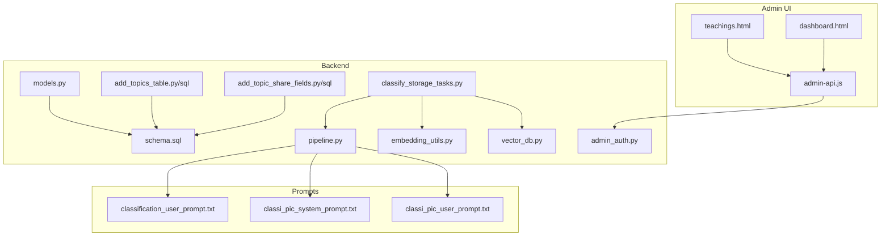

**Diagram sources**
- [database/models.py](file://backend/database/models.py)
- [database/schema.sql](file://backend/database/schema.sql)
- [database/add_topics_table.py](file://backend/database/add_topics_table.py)
- [database/add_topics_table.sql](file://backend/database/add_topics_table.sql)
- [database/add_topic_share_fields.py](file://backend/database/add_topic_share_fields.py)
- [database/add_topic_share_fields.sql](file://backend/database/add_topic_share_fields.sql)
- [pipeline.py](file://backend/pipeline.py)
- [classify_storage_tasks.py](file://backend/classify_storage_tasks.py)
- [utils/embedding_utils.py](file://backend/utils/embedding_utils.py)
- [utils/vector_db.py](file://backend/utils/vector_db.py)
- [prompt/classification_user_prompt.txt](file://backend/prompt/classification_user_prompt.txt)
- [prompt/classi_pic_system_prompt.txt](file://backend/prompt/classi_pic_system_prompt.txt)
- [prompt/classi_pic_user_prompt.txt](file://backend/prompt/classi_pic_user_prompt.txt)
- [web/admin/js/admin-api.js](file://web/admin/js/admin-api.js)
- [web/admin/dashboard.html](file://web/admin/dashboard.html)
- [web/admin/teachings.html](file://web/admin/teachings.html)

**Section sources**
- [database/models.py](file://backend/database/models.py)
- [database/schema.sql](file://backend/database/schema.sql)
- [database/add_topics_table.py](file://backend/database/add_topics_table.py)
- [database/add_topics_table.sql](file://backend/database/add_topics_table.sql)
- [database/add_topic_share_fields.py](file://backend/database/add_topic_share_fields.py)
- [database/add_topic_share_fields.sql](file://backend/database/add_topic_share_fields.sql)
- [pipeline.py](file://backend/pipeline.py)
- [classify_storage_tasks.py](file://backend/classify_storage_tasks.py)
- [utils/embedding_utils.py](file://backend/utils/embedding_utils.py)
- [utils/vector_db.py](file://backend/utils/vector_db.py)
- [prompt/classification_user_prompt.txt](file://backend/prompt/classification_user_prompt.txt)
- [prompt/classi_pic_system_prompt.txt](file://backend/prompt/classi_pic_system_prompt.txt)
- [prompt/classi_pic_user_prompt.txt](file://backend/prompt/classi_pic_user_prompt.txt)
- [web/admin/js/admin-api.js](file://web/admin/js/admin-api.js)
- [web/admin/dashboard.html](file://web/admin/dashboard.html)
- [web/admin/teachings.html](file://web/admin/teachings.html)

## Core Components
- Topic taxonomy and teaching associations are modeled in the database layer (models and schema).
- Migration scripts introduce topic tables and share-related fields for topics.
- The classification pipeline uses prompt templates to generate tags and category assignments.
- Background tasks orchestrate batch processing of storage items for classification and tagging.
- Vector utilities provide embeddings and similarity search to enhance classification accuracy and discoverability.
- Admin authentication and UI enable manual curation and bulk operations.

Key responsibilities:
- Data modeling: Define topics, teachings, and relationships
- Schema evolution: Add topic tables and share fields
- Classification engine: Apply rules and AI prompts to assign categories/tags
- Vector search: Embed content for semantic retrieval
- Admin workflow: Manual editing, validation, and bulk updates

**Section sources**
- [database/models.py](file://backend/database/models.py)
- [database/schema.sql](file://backend/database/schema.sql)
- [database/add_topics_table.py](file://backend/database/add_topics_table.py)
- [database/add_topics_table.sql](file://backend/database/add_topics_table.sql)
- [database/add_topic_share_fields.py](file://backend/database/add_topic_share_fields.py)
- [database/add_topic_share_fields.sql](file://backend/database/add_topic_share_fields.sql)
- [pipeline.py](file://backend/pipeline.py)
- [classify_storage_tasks.py](file://backend/classify_storage_tasks.py)
- [utils/embedding_utils.py](file://backend/utils/embedding_utils.py)
- [utils/vector_db.py](file://backend/utils/vector_db.py)
- [admin_auth.py](file://backend/admin_auth.py)
- [web/admin/js/admin-api.js](file://web/admin/js/admin-api.js)
- [web/admin/dashboard.html](file://web/admin/dashboard.html)
- [web/admin/teachings.html](file://web/admin/teachings.html)

## Architecture Overview
The classification architecture integrates data persistence, AI-driven prompts, vector search, and admin workflows:

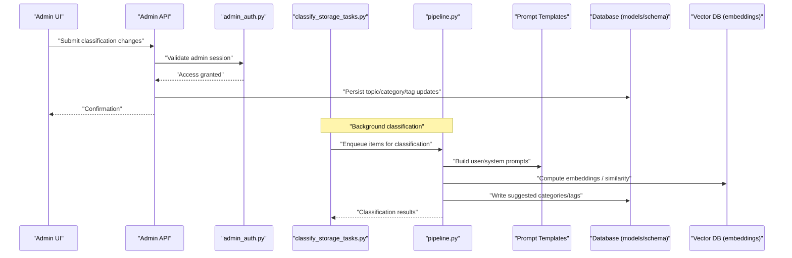

**Diagram sources**
- [web/admin/js/admin-api.js](file://web/admin/js/admin-api.js)
- [admin_auth.py](file://backend/admin_auth.py)
- [classify_storage_tasks.py](file://backend/classify_storage_tasks.py)
- [pipeline.py](file://backend/pipeline.py)
- [prompt/classification_user_prompt.txt](file://backend/prompt/classification_user_prompt.txt)
- [prompt/classi_pic_system_prompt.txt](file://backend/prompt/classi_pic_system_prompt.txt)
- [prompt/classi_pic_user_prompt.txt](file://backend/prompt/classi_pic_user_prompt.txt)
- [database/models.py](file://backend/database/models.py)
- [database/schema.sql](file://backend/database/schema.sql)
- [utils/embedding_utils.py](file://backend/utils/embedding_utils.py)
- [utils/vector_db.py](file://backend/utils/vector_db.py)

## Detailed Component Analysis

### Topic Database Schema and Models
- The schema defines core entities for topics, teachings, and their relationships.
- Migration scripts add topic tables and share-related fields to support topic sharing and visibility.
- Models encapsulate table structures and relationships for programmatic access.

Highlights:
- Topic hierarchy: parent-child relationships for categories and subcategories
- Teaching-topic mapping: many-to-many or one-to-many links depending on design
- Share fields: flags or references enabling topic sharing across contexts

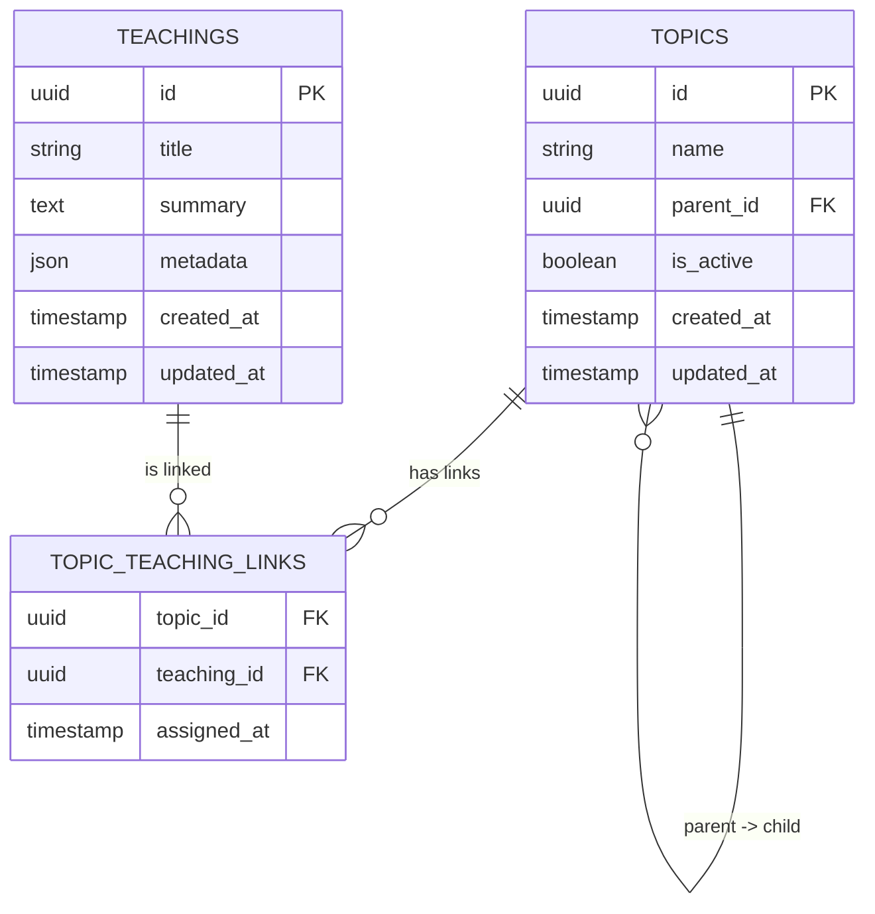

**Diagram sources**
- [database/schema.sql](file://backend/database/schema.sql)
- [database/add_topics_table.sql](file://backend/database/add_topics_table.sql)
- [database/add_topic_share_fields.sql](file://backend/database/add_topic_share_fields.sql)
- [database/models.py](file://backend/database/models.py)

**Section sources**
- [database/schema.sql](file://backend/database/schema.sql)
- [database/add_topics_table.py](file://backend/database/add_topics_table.py)
- [database/add_topics_table.sql](file://backend/database/add_topics_table.sql)
- [database/add_topic_share_fields.py](file://backend/database/add_topic_share_fields.py)
- [database/add_topic_share_fields.sql](file://backend/database/add_topic_share_fields.sql)
- [database/models.py](file://backend/database/models.py)

### Classification Rules Engine and Prompts
- The classification engine combines rule-based logic with AI prompts to assign categories and tags.
- Text classification uses a dedicated user prompt template; image classification uses system and user prompts tailored for visual content.
- The pipeline coordinates prompt construction, LLM calls, and result parsing.

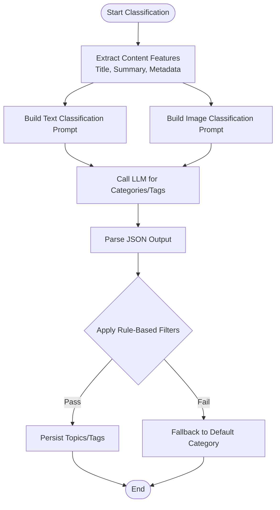

**Diagram sources**
- [pipeline.py](file://backend/pipeline.py)
- [prompt/classification_user_prompt.txt](file://backend/prompt/classification_user_prompt.txt)
- [prompt/classi_pic_system_prompt.txt](file://backend/prompt/classi_pic_system_prompt.txt)
- [prompt/classi_pic_user_prompt.txt](file://backend/prompt/classi_pic_user_prompt.txt)

**Section sources**
- [pipeline.py](file://backend/pipeline.py)
- [prompt/classification_user_prompt.txt](file://backend/prompt/classification_user_prompt.txt)
- [prompt/classi_pic_system_prompt.txt](file://backend/prompt/classi_pic_system_prompt.txt)
- [prompt/classi_pic_user_prompt.txt](file://backend/prompt/classi_pic_user_prompt.txt)

### Automated Tagging and Vector Similarity
- Embeddings are generated from content to support semantic search and similarity-based tag suggestions.
- Vector database stores embeddings and enables fast nearest-neighbor queries.
- Classification can leverage similar items’ topics/tags to improve accuracy.

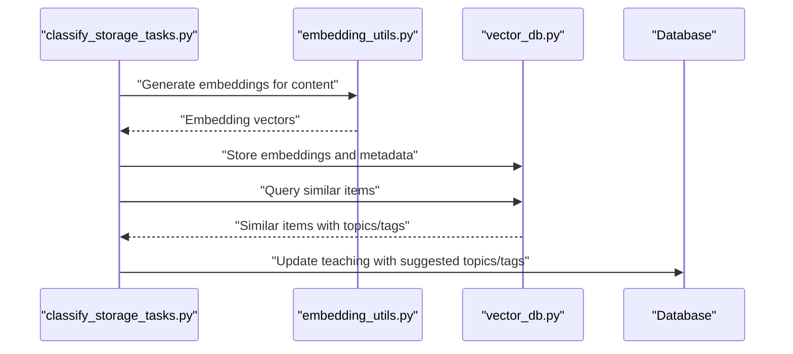

**Diagram sources**
- [classify_storage_tasks.py](file://backend/classify_storage_tasks.py)
- [utils/embedding_utils.py](file://backend/utils/embedding_utils.py)
- [utils/vector_db.py](file://backend/utils/vector_db.py)
- [database/models.py](file://backend/database/models.py)

**Section sources**
- [classify_storage_tasks.py](file://backend/classify_storage_tasks.py)
- [utils/embedding_utils.py](file://backend/utils/embedding_utils.py)
- [utils/vector_db.py](file://backend/utils/vector_db.py)
- [database/models.py](file://backend/database/models.py)

### Manual Classification via Admin Interfaces
- Admin authentication validates operator permissions before allowing classification changes.
- Admin UI pages expose controls to edit topics, assign categories, and manage tags.
- JavaScript API helpers wrap backend endpoints for CRUD operations and bulk actions.

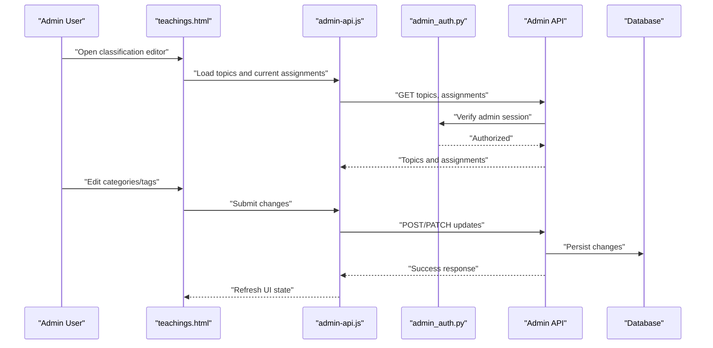

**Diagram sources**
- [web/admin/teachings.html](file://web/admin/teachings.html)
- [web/admin/js/admin-api.js](file://web/admin/js/admin-api.js)
- [admin_auth.py](file://backend/admin_auth.py)
- [database/models.py](file://backend/database/models.py)

**Section sources**
- [web/admin/teachings.html](file://web/admin/teachings.html)
- [web/admin/js/admin-api.js](file://web/admin/js/admin-api.js)
- [admin_auth.py](file://backend/admin_auth.py)
- [database/models.py](file://backend/database/models.py)

### Bulk Reorganization Operations
- Background tasks process batches of storage items to apply classification and tagging at scale.
- The pipeline coordinates prompt generation, embedding computation, and database updates.
- Results are persisted and can be reviewed or adjusted via admin interfaces.

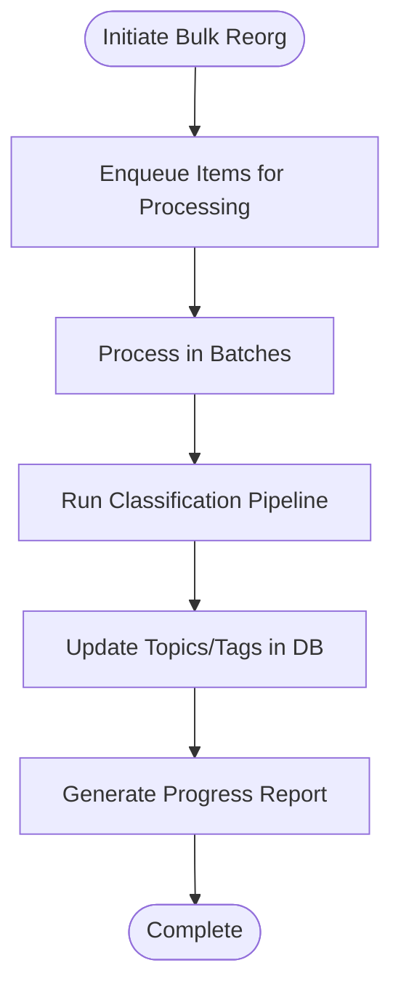

**Diagram sources**
- [classify_storage_tasks.py](file://backend/classify_storage_tasks.py)
- [pipeline.py](file://backend/pipeline.py)
- [database/models.py](file://backend/database/models.py)

**Section sources**
- [classify_storage_tasks.py](file://backend/classify_storage_tasks.py)
- [pipeline.py](file://backend/pipeline.py)
- [database/models.py](file://backend/database/models.py)

### Topic Sharing and Visibility
- Topic share fields enable controlled distribution of topics across contexts or users.
- Migration scripts add necessary columns and constraints to support sharing semantics.
- Documentation outlines migration steps and expected behavior.

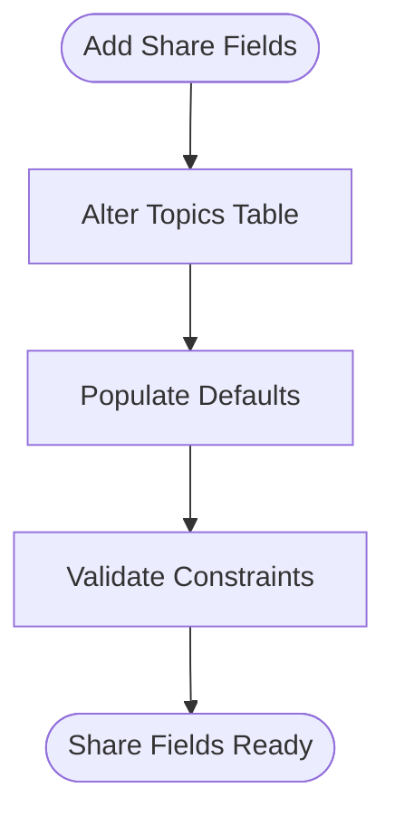

**Diagram sources**
- [database/add_topic_share_fields.py](file://backend/database/add_topic_share_fields.py)
- [database/add_topic_share_fields.sql](file://backend/database/add_topic_share_fields.sql)
- [database/TOPIC_SHARE_MIGRATION.md](file://backend/database/TOPIC_SHARE_MIGRATION.md)

**Section sources**
- [database/add_topic_share_fields.py](file://backend/database/add_topic_share_fields.py)
- [database/add_topic_share_fields.sql](file://backend/database/add_topic_share_fields.sql)
- [database/TOPIC_SHARE_MIGRATION.md](file://backend/database/TOPIC_SHARE_MIGRATION.md)

### Conceptual Overview
Conceptually, the system organizes teaching materials by:
- Defining a hierarchical topic tree (categories and subcategories)
- Linking each teaching item to one or more topics
- Assigning descriptive tags for fine-grained filtering
- Using AI prompts and vector similarity to suggest classifications
- Allowing admins to curate and validate automated suggestions
- Optimizing search by leveraging categorized metadata and embeddings

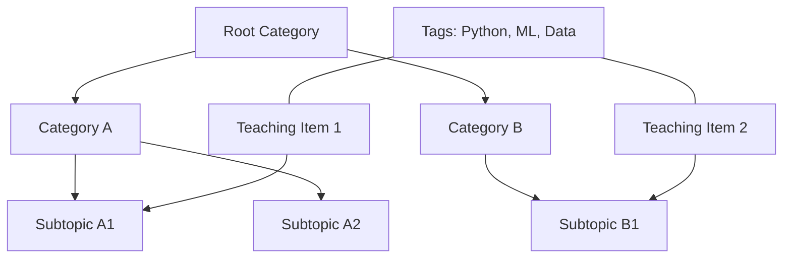

[No sources needed since this diagram shows conceptual workflow, not actual code structure]

## Dependency Analysis
The classification system depends on:
- Database models and schema for persistence
- Prompt templates for AI-driven classification
- Vector utilities for embeddings and similarity search
- Admin authentication for secure operations
- Admin UI for manual curation and bulk actions

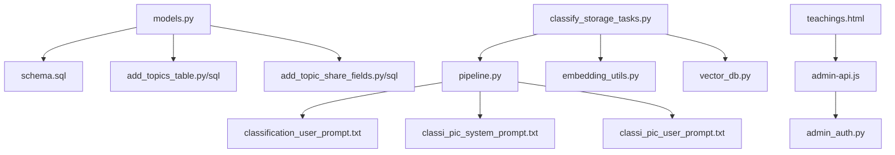

**Diagram sources**
- [database/models.py](file://backend/database/models.py)
- [database/schema.sql](file://backend/database/schema.sql)
- [database/add_topics_table.py](file://backend/database/add_topics_table.py)
- [database/add_topics_table.sql](file://backend/database/add_topics_table.sql)
- [database/add_topic_share_fields.py](file://backend/database/add_topic_share_fields.py)
- [database/add_topic_share_fields.sql](file://backend/database/add_topic_share_fields.sql)
- [pipeline.py](file://backend/pipeline.py)
- [prompt/classification_user_prompt.txt](file://backend/prompt/classification_user_prompt.txt)
- [prompt/classi_pic_system_prompt.txt](file://backend/prompt/classi_pic_system_prompt.txt)
- [prompt/classi_pic_user_prompt.txt](file://backend/prompt/classi_pic_user_prompt.txt)
- [classify_storage_tasks.py](file://backend/classify_storage_tasks.py)
- [utils/embedding_utils.py](file://backend/utils/embedding_utils.py)
- [utils/vector_db.py](file://backend/utils/vector_db.py)
- [web/admin/teachings.html](file://web/admin/teachings.html)
- [web/admin/js/admin-api.js](file://web/admin/js/admin-api.js)
- [admin_auth.py](file://backend/admin_auth.py)

**Section sources**
- [database/models.py](file://backend/database/models.py)
- [database/schema.sql](file://backend/database/schema.sql)
- [database/add_topics_table.py](file://backend/database/add_topics_table.py)
- [database/add_topics_table.sql](file://backend/database/add_topics_table.sql)
- [database/add_topic_share_fields.py](file://backend/database/add_topic_share_fields.py)
- [database/add_topic_share_fields.sql](file://backend/database/add_topic_share_fields.sql)
- [pipeline.py](file://backend/pipeline.py)
- [prompt/classification_user_prompt.txt](file://backend/prompt/classification_user_prompt.txt)
- [prompt/classi_pic_system_prompt.txt](file://backend/prompt/classi_pic_system_prompt.txt)
- [prompt/classi_pic_user_prompt.txt](file://backend/prompt/classi_pic_user_prompt.txt)
- [classify_storage_tasks.py](file://backend/classify_storage_tasks.py)
- [utils/embedding_utils.py](file://backend/utils/embedding_utils.py)
- [utils/vector_db.py](file://backend/utils/vector_db.py)
- [web/admin/teachings.html](file://web/admin/teachings.html)
- [web/admin/js/admin-api.js](file://web/admin/js/admin-api.js)
- [admin_auth.py](file://backend/admin_auth.py)

## Performance Considerations
- Batch processing: Use background tasks to classify large volumes efficiently
- Embedding caching: Cache embeddings for repeated content to reduce compute costs
- Prompt optimization: Keep prompts concise and structured to minimize token usage
- Indexing: Ensure database indexes on frequently queried fields (topic IDs, tags)
- Vector search tuning: Adjust similarity thresholds and top-k values for relevance vs. latency trade-offs

[No sources needed since this section provides general guidance]

## Troubleshooting Guide
Common issues and resolutions:
- Classification failures due to malformed prompts: Validate prompt templates and input formatting
- Vector search inconsistencies: Check embedding dimensions and normalization
- Admin permission errors: Verify admin session and authorization middleware
- Migration conflicts: Review migration scripts and ensure proper execution order
- Slow bulk operations: Monitor queue depth and adjust batch sizes

**Section sources**
- [pipeline.py](file://backend/pipeline.py)
- [utils/embedding_utils.py](file://backend/utils/embedding_utils.py)
- [utils/vector_db.py](file://backend/utils/vector_db.py)
- [admin_auth.py](file://backend/admin_auth.py)
- [database/add_topics_table.py](file://backend/database/add_topics_table.py)
- [database/add_topic_share_fields.py](file://backend/database/add_topic_share_fields.py)

## Conclusion
The classification and organization system combines robust data modeling, AI-assisted prompts, vector similarity, and admin workflows to deliver scalable and accurate categorization of teaching materials. By supporting both manual and automatic classification, it ensures flexibility and maintainability while optimizing search performance through structured metadata and embeddings.

[No sources needed since this section summarizes without analyzing specific files]

## Appendices

### Example Classification Workflow
- Upload teaching material
- System extracts title, summary, and metadata
- Pipeline builds prompts and calls LLM for category/tag suggestions
- Vector similarity checks refine suggestions based on existing topics
- Admin reviews and approves changes
- Database persists final classification

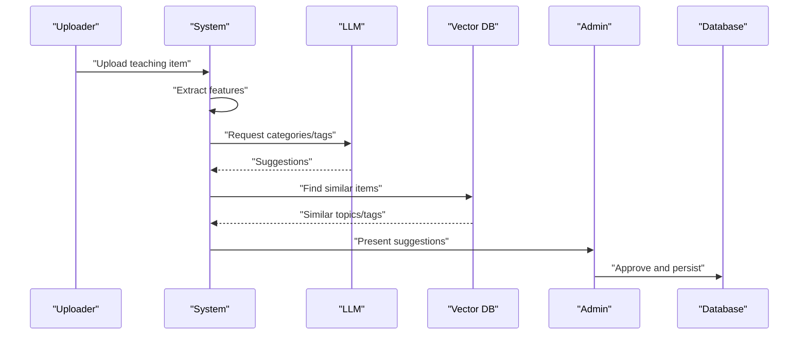

[No sources needed since this diagram shows conceptual workflow, not actual code structure]

### Topic Hierarchy Example
- Root: Computer Science
  - Category: Programming
    - Subtopic: Python Basics
    - Subtopic: Machine Learning
  - Category: Mathematics
    - Subtopic: Linear Algebra
    - Subtopic: Statistics

[No sources needed since this section doesn't analyze specific source files]

### Custom Classification Scheme
- Define new categories and subcategories in the topic tree
- Update prompt templates to include custom labels
- Adjust vector similarity thresholds for domain-specific relevance
- Train or fine-tune prompts for specialized content types

[No sources needed since this section doesn't analyze specific source files]