# Content Lifecycle Management

<cite>
**Referenced Files in This Document**
- [app.py](file://backend/app.py)
- [ai_teacher_route.py](file://backend/ai_teacher_route.py)
- [pipeline.py](file://backend/pipeline.py)
- [gateway_llm.py](file://backend/gateway_llm.py)
- [models.py](file://backend/database/models.py)
- [schema.sql](file://backend/database/schema.sql)
- [add_ai_teaching_tables.py](file://backend/database/add_ai_teaching_tables.py)
- [monitoring.py](file://backend/monitoring.py)
- [config.py](file://backend/config.py)
- [cost_optimization_demo/main_service.py](file://backend/cost_optimization_demo/main_service.py)
- [cost_optimization_demo/cache_service.py](file://backend/cost_optimization_demo/cache_service.py)
- [cost_optimization_demo/gemini_client.py](file://backend/cost_optimization_demo/gemini_client.py)
- [prompt/teaching_system_prompt.txt](file://backend/prompt/teaching_system_prompt.txt)
- [prompt/teaching_user_prompt.txt](file://backend/prompt/teaching_user_prompt.txt)
- [prompt/classification_user_prompt.txt](file://backend/prompt/classification_user_prompt.txt)
- [deploy/deploy.sh](file://deploy/deploy.sh)
- [deploy/rollback.sh](file://deploy/rollback.sh)
</cite>

## Table of Contents
1. [Introduction](#introduction)
2. [Project Structure](#project-structure)
3. [Core Components](#core-components)
4. [Architecture Overview](#architecture-overview)
5. [Detailed Component Analysis](#detailed-component-analysis)
6. [Dependency Analysis](#dependency-analysis)
7. [Performance Considerations](#performance-considerations)
8. [Troubleshooting Guide](#troubleshooting-guide)
9. [Conclusion](#conclusion)
10. [Appendices](#appendices)

## Introduction
This document describes the content lifecycle management system that handles end-to-end processing of teaching content requests. The workflow covers request submission, AI generation and classification, validation, storage, publication, status tracking, approval workflows, version control, error handling with retries and rollbacks, monitoring and logging, performance metrics, and debugging tools. It also includes examples of state transitions, custom workflow extensions, and integration points with external services such as LLM providers.

## Project Structure
The backend implements a modular architecture:
- HTTP API layer exposes endpoints for content creation, status queries, and admin operations.
- A pipeline orchestrates multi-step processing (generation, classification, validation).
- Database models and schema define persistent entities and their relationships.
- Monitoring captures metrics and logs across the lifecycle.
- Cost optimization utilities provide caching and client wrappers for LLM calls.
- Deployment scripts manage releases and rollbacks.

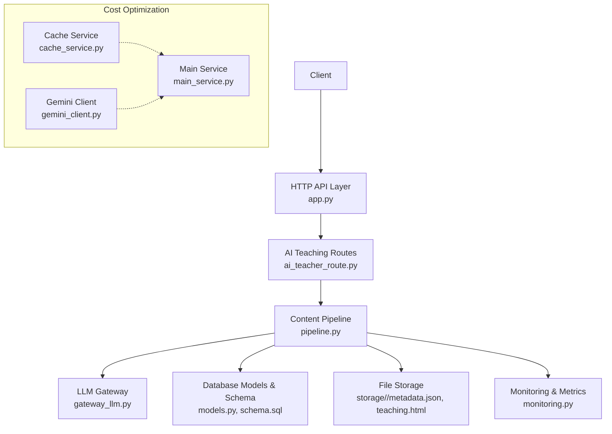

**Diagram sources**
- [app.py](file://backend/app.py)
- [ai_teacher_route.py](file://backend/ai_teacher_route.py)
- [pipeline.py](file://backend/pipeline.py)
- [gateway_llm.py](file://backend/gateway_llm.py)
- [models.py](file://backend/database/models.py)
- [schema.sql](file://backend/database/schema.sql)
- [monitoring.py](file://backend/monitoring.py)
- [cost_optimization_demo/main_service.py](file://backend/cost_optimization_demo/main_service.py)
- [cost_optimization_demo/cache_service.py](file://backend/cost_optimization_demo/cache_service.py)
- [cost_optimization_demo/gemini_client.py](file://backend/cost_optimization_demo/gemini_client.py)

**Section sources**
- [app.py](file://backend/app.py)
- [ai_teacher_route.py](file://backend/ai_teacher_route.py)
- [pipeline.py](file://backend/pipeline.py)
- [gateway_llm.py](file://backend/gateway_llm.py)
- [models.py](file://backend/database/models.py)
- [schema.sql](file://backend/database/schema.sql)
- [monitoring.py](file://backend/monitoring.py)
- [cost_optimization_demo/main_service.py](file://backend/cost_optimization_demo/main_service.py)
- [cost_optimization_demo/cache_service.py](file://backend/cost_optimization_demo/cache_service.py)
- [cost_optimization_demo/gemini_client.py](file://backend/cost_optimization_demo/gemini_client.py)

## Core Components
- HTTP API Layer: Exposes endpoints to submit content requests, query status, and trigger administrative actions.
- AI Teaching Routes: Orchestrates business logic for teaching content creation and related operations.
- Content Pipeline: Implements the core lifecycle steps including generation, classification, validation, storage, and publication.
- LLM Gateway: Abstracts external LLM provider interactions and integrates cost optimization features.
- Data Persistence: Database models and SQL schema define entities like teachings, topics, view history, and user profiles.
- Monitoring: Collects metrics, logs events, and supports observability across the lifecycle.
- Cost Optimization Demo: Demonstrates caching strategies and client wrappers for LLM calls.

Key responsibilities:
- Status tracking and transitions across lifecycle states.
- Approval workflows and versioning for published content.
- Error handling, retries, and rollback procedures.
- Integration with external LLM services and prompt templates.

**Section sources**
- [ai_teacher_route.py](file://backend/ai_teacher_route.py)
- [pipeline.py](file://backend/pipeline.py)
- [gateway_llm.py](file://backend/gateway_llm.py)
- [models.py](file://backend/database/models.py)
- [schema.sql](file://backend/database/schema.sql)
- [monitoring.py](file://backend/monitoring.py)
- [cost_optimization_demo/main_service.py](file://backend/cost_optimization_demo/main_service.py)
- [cost_optimization_demo/cache_service.py](file://backend/cost_optimization_demo/cache_service.py)
- [cost_optimization_demo/gemini_client.py](file://backend/cost_optimization_demo/gemini_client.py)

## Architecture Overview
The system follows a layered architecture with clear separation between API, orchestration, data access, and external integrations. The pipeline is the central coordinator for lifecycle steps, while the gateway abstracts LLM interactions. Monitoring is integrated at each stage to capture metrics and logs.

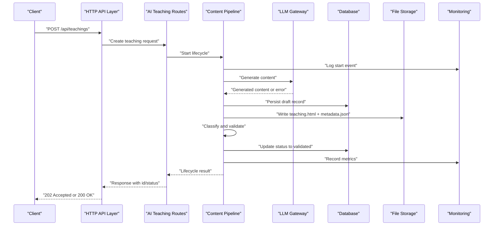

**Diagram sources**
- [app.py](file://backend/app.py)
- [ai_teacher_route.py](file://backend/ai_teacher_route.py)
- [pipeline.py](file://backend/pipeline.py)
- [gateway_llm.py](file://backend/gateway_llm.py)
- [models.py](file://backend/database/models.py)
- [schema.sql](file://backend/database/schema.sql)
- [monitoring.py](file://backend/monitoring.py)

## Detailed Component Analysis

### Content Request Submission and Orchestration
- Entry point: HTTP endpoint receives a content request and delegates to route handlers.
- Route handler validates inputs, initializes a new teaching record, and starts the pipeline.
- Pipeline coordinates generation, classification, validation, storage, and publication.
- Monitoring records lifecycle events and metrics at each step.

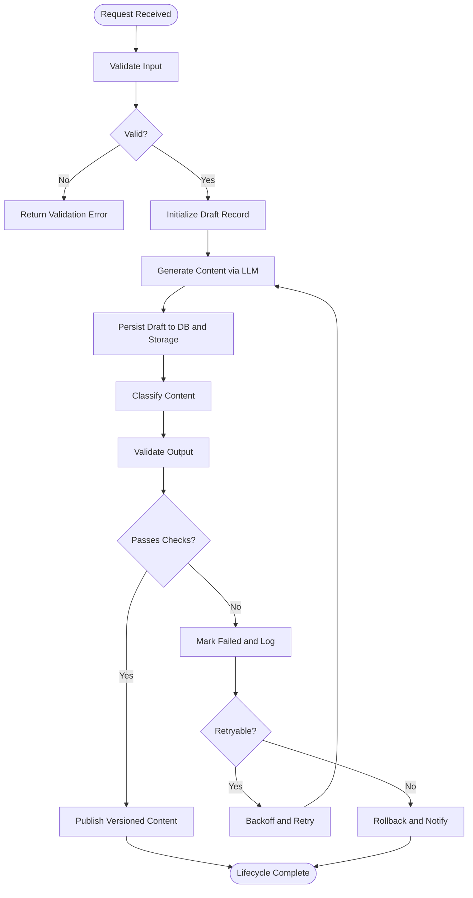

**Diagram sources**
- [ai_teacher_route.py](file://backend/ai_teacher_route.py)
- [pipeline.py](file://backend/pipeline.py)
- [gateway_llm.py](file://backend/gateway_llm.py)
- [monitoring.py](file://backend/monitoring.py)

**Section sources**
- [ai_teacher_route.py](file://backend/ai_teacher_route.py)
- [pipeline.py](file://backend/pipeline.py)
- [gateway_llm.py](file://backend/gateway_llm.py)
- [monitoring.py](file://backend/monitoring.py)

### AI Processing and Classification
- Generation uses prompt templates and an LLM gateway to produce teaching content.
- Classification determines topic tags and categorization using dedicated prompts.
- Results are validated against expected formats and constraints before proceeding.

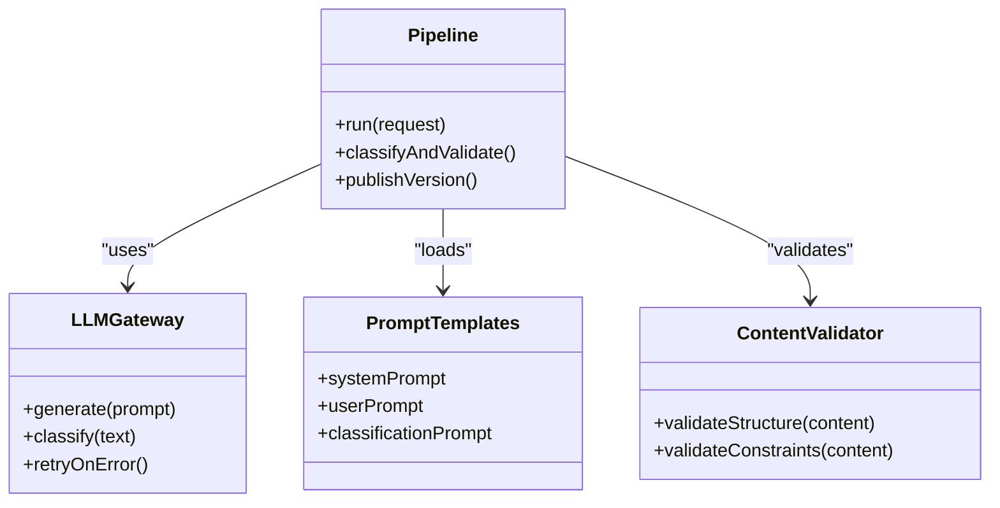

**Diagram sources**
- [prompt/teaching_system_prompt.txt](file://backend/prompt/teaching_system_prompt.txt)
- [prompt/teaching_user_prompt.txt](file://backend/prompt/teaching_user_prompt.txt)
- [prompt/classification_user_prompt.txt](file://backend/prompt/classification_user_prompt.txt)
- [gateway_llm.py](file://backend/gateway_llm.py)
- [pipeline.py](file://backend/pipeline.py)

**Section sources**
- [prompt/teaching_system_prompt.txt](file://backend/prompt/teaching_system_prompt.txt)
- [prompt/teaching_user_prompt.txt](file://backend/prompt/teaching_user_prompt.txt)
- [prompt/classification_user_prompt.txt](file://backend/prompt/classification_user_prompt.txt)
- [gateway_llm.py](file://backend/gateway_llm.py)
- [pipeline.py](file://backend/pipeline.py)

### Storage and Version Control
- Each content item is stored under a unique directory containing teaching.html and metadata.json.
- Versioning tracks revisions and publication status; publishing creates a new version entry.
- Metadata includes timestamps, authorship, and links to generated artifacts.

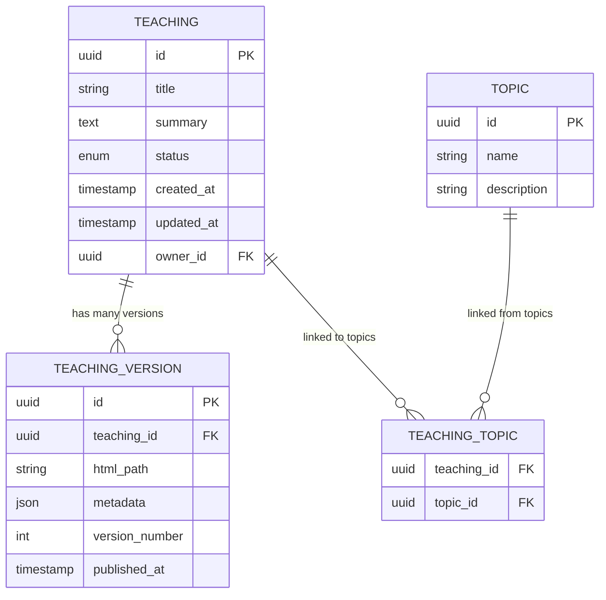

**Diagram sources**
- [models.py](file://backend/database/models.py)
- [schema.sql](file://backend/database/schema.sql)
- [add_ai_teaching_tables.py](file://backend/database/add_ai_teaching_tables.py)

**Section sources**
- [models.py](file://backend/database/models.py)
- [schema.sql](file://backend/database/schema.sql)
- [add_ai_teaching_tables.py](file://backend/database/add_ai_teaching_tables.py)

### Status Tracking and Approval Workflows
- Status transitions include draft, generating, validated, approved, published, failed.
- Approval requires explicit action by authorized users; publishing increments version number.
- Monitoring records all transitions and reasons for failures.

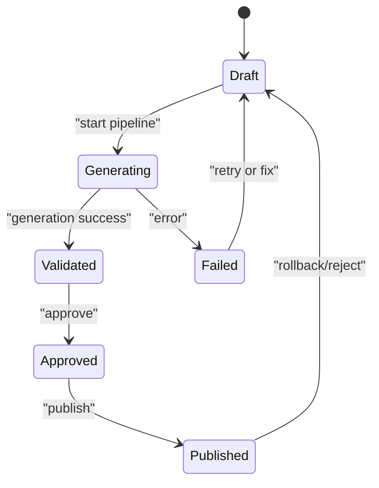

**Diagram sources**
- [pipeline.py](file://backend/pipeline.py)
- [monitoring.py](file://backend/monitoring.py)

**Section sources**
- [pipeline.py](file://backend/pipeline.py)
- [monitoring.py](file://backend/monitoring.py)

### Error Handling, Retry Logic, and Rollback Procedures
- Retry strategy applies exponential backoff for transient errors during LLM calls and I/O.
- On persistent failure, the system marks the record as failed, logs details, and triggers notifications.
- Rollback reverts to the last known good version and cleans up partial artifacts.

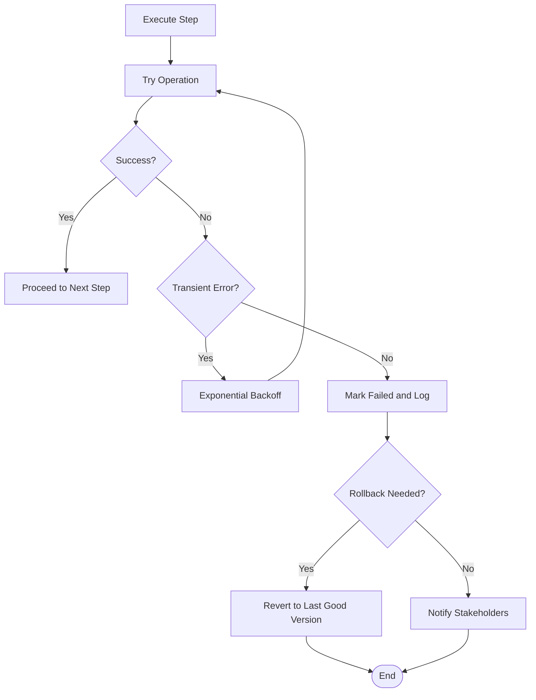

**Diagram sources**
- [gateway_llm.py](file://backend/gateway_llm.py)
- [pipeline.py](file://backend/pipeline.py)
- [monitoring.py](file://backend/monitoring.py)

**Section sources**
- [gateway_llm.py](file://backend/gateway_llm.py)
- [pipeline.py](file://backend/pipeline.py)
- [monitoring.py](file://backend/monitoring.py)

### Monitoring, Logging, and Debugging Tools
- Monitoring captures lifecycle events, durations, and error rates.
- Logs include structured entries for requests, pipeline steps, and outcomes.
- Debugging aids expose status queries and diagnostic endpoints for administrators.

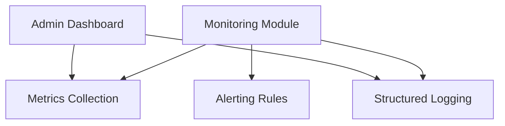

**Diagram sources**
- [monitoring.py](file://backend/monitoring.py)
- [app.py](file://backend/app.py)

**Section sources**
- [monitoring.py](file://backend/monitoring.py)
- [app.py](file://backend/app.py)

### Performance Metrics and Cost Optimization
- Metrics track latency, throughput, and resource usage per pipeline step.
- Caching reduces redundant LLM calls and lowers costs.
- Client wrappers optimize model selection and rate limiting.

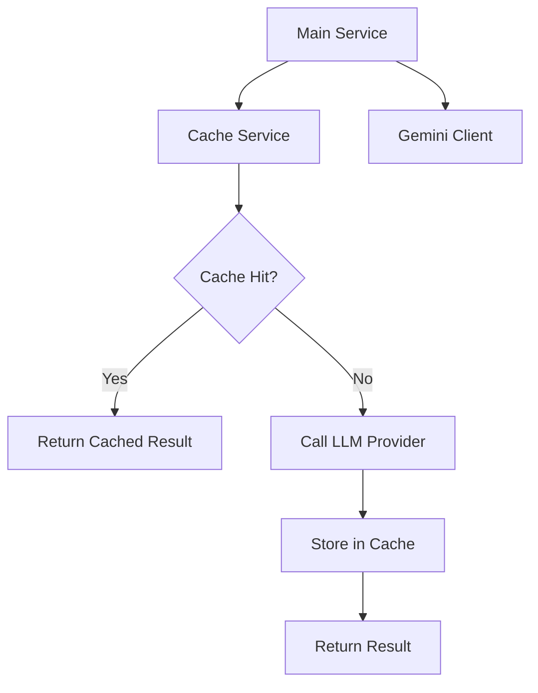

**Diagram sources**
- [cost_optimization_demo/main_service.py](file://backend/cost_optimization_demo/main_service.py)
- [cost_optimization_demo/cache_service.py](file://backend/cost_optimization_demo/cache_service.py)
- [cost_optimization_demo/gemini_client.py](file://backend/cost_optimization_demo/gemini_client.py)

**Section sources**
- [cost_optimization_demo/main_service.py](file://backend/cost_optimization_demo/main_service.py)
- [cost_optimization_demo/cache_service.py](file://backend/cost_optimization_demo/cache_service.py)
- [cost_optimization_demo/gemini_client.py](file://backend/cost_optimization_demo/gemini_client.py)

### Custom Workflow Extensions and Integration Points
- Extensibility points allow adding new pipeline stages (e.g., additional validators or post-publish hooks).
- Integration points include LLM providers, storage backends, and notification services.
- Configuration controls feature toggles and service endpoints.

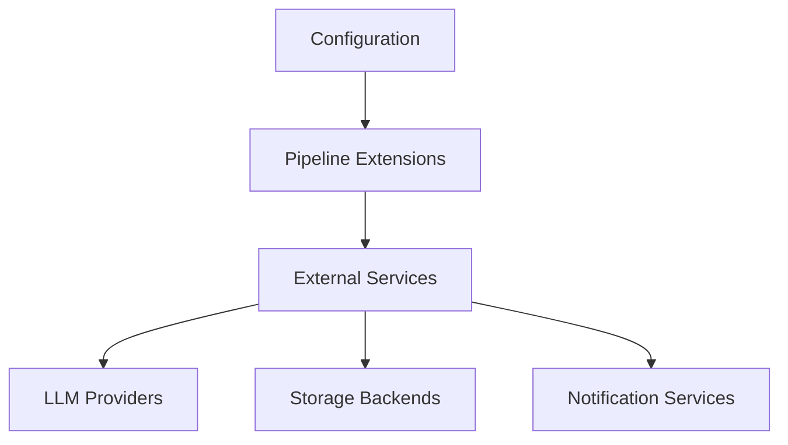

**Diagram sources**
- [config.py](file://backend/config.py)
- [pipeline.py](file://backend/pipeline.py)

**Section sources**
- [config.py](file://backend/config.py)
- [pipeline.py](file://backend/pipeline.py)

## Dependency Analysis
The following diagram shows key dependencies among components involved in the content lifecycle.

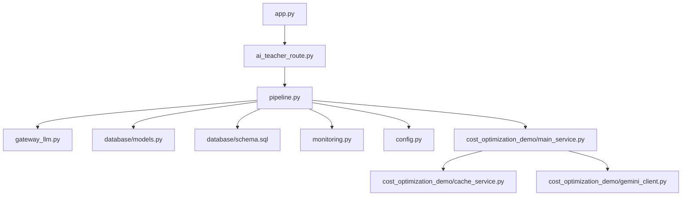

**Diagram sources**
- [app.py](file://backend/app.py)
- [ai_teacher_route.py](file://backend/ai_teacher_route.py)
- [pipeline.py](file://backend/pipeline.py)
- [gateway_llm.py](file://backend/gateway_llm.py)
- [models.py](file://backend/database/models.py)
- [schema.sql](file://backend/database/schema.sql)
- [monitoring.py](file://backend/monitoring.py)
- [config.py](file://backend/config.py)
- [cost_optimization_demo/main_service.py](file://backend/cost_optimization_demo/main_service.py)
- [cost_optimization_demo/cache_service.py](file://backend/cost_optimization_demo/cache_service.py)
- [cost_optimization_demo/gemini_client.py](file://backend/cost_optimization_demo/gemini_client.py)

**Section sources**
- [app.py](file://backend/app.py)
- [ai_teacher_route.py](file://backend/ai_teacher_route.py)
- [pipeline.py](file://backend/pipeline.py)
- [gateway_llm.py](file://backend/gateway_llm.py)
- [models.py](file://backend/database/models.py)
- [schema.sql](file://backend/database/schema.sql)
- [monitoring.py](file://backend/monitoring.py)
- [config.py](file://backend/config.py)
- [cost_optimization_demo/main_service.py](file://backend/cost_optimization_demo/main_service.py)
- [cost_optimization_demo/cache_service.py](file://backend/cost_optimization_demo/cache_service.py)
- [cost_optimization_demo/gemini_client.py](file://backend/cost_optimization_demo/gemini_client.py)

## Performance Considerations
- Use caching to reduce repeated LLM calls and improve response times.
- Implement batch processing for classification and validation where possible.
- Monitor resource utilization and adjust concurrency limits based on capacity.
- Optimize database queries and indexes for frequent lookups on status and version fields.
- Profile pipeline steps to identify bottlenecks and apply targeted optimizations.

[No sources needed since this section provides general guidance]

## Troubleshooting Guide
Common issues and resolutions:
- LLM call failures: Check gateway configuration, retry policies, and provider quotas. Review logs for error codes and messages.
- Validation errors: Inspect output structure and constraints; update prompts if necessary.
- Storage write failures: Verify file permissions and disk space; ensure atomic writes and cleanup on failure.
- Status stuck in generating: Investigate pipeline logs and monitor metrics for timeouts or deadlocks.
- Rollback inconsistencies: Confirm last good version integrity and re-run publish after fixing root cause.

Operational checks:
- Health endpoints and status queries help verify system readiness.
- Admin dashboards provide visibility into recent failures and pending approvals.
- Deployment scripts support safe upgrades and quick rollbacks.

**Section sources**
- [gateway_llm.py](file://backend/gateway_llm.py)
- [pipeline.py](file://backend/pipeline.py)
- [monitoring.py](file://backend/monitoring.py)
- [deploy/deploy.sh](file://deploy/deploy.sh)
- [deploy/rollback.sh](file://deploy/rollback.sh)

## Conclusion
The content lifecycle management system provides a robust, observable, and extensible framework for processing teaching content through AI-driven workflows. It ensures reliable status tracking, approval processes, version control, and resilient error handling with retries and rollbacks. Monitoring and cost optimization features enhance operational efficiency and maintainability.

[No sources needed since this section summarizes without analyzing specific files]

## Appendices

### Example Lifecycle State Transitions
- Draft -> Generating -> Validated -> Approved -> Published
- Any state -> Failed (with retry or rollback depending on error type)

**Section sources**
- [pipeline.py](file://backend/pipeline.py)
- [monitoring.py](file://backend/monitoring.py)

### Custom Workflow Extensions
- Add new validation rules by extending the validator module.
- Integrate external services via configurable adapters referenced in configuration.
- Hook into publish events for notifications or analytics collection.

**Section sources**
- [config.py](file://backend/config.py)
- [pipeline.py](file://backend/pipeline.py)

### Integration Points with External Services
- LLM providers accessed through the gateway with retry and cost optimization.
- Storage backends for HTML and metadata artifacts.
- Notification services for alerts and stakeholder updates.

**Section sources**
- [gateway_llm.py](file://backend/gateway_llm.py)
- [cost_optimization_demo/gemini_client.py](file://backend/cost_optimization_demo/gemini_client.py)
- [monitoring.py](file://backend/monitoring.py)