# Content Management System

<cite>
**Referenced Files in This Document**
- [app.py](file://backend/app.py)
- [config.py](file://backend/config.py)
- [models.py](file://backend/database/models.py)
- [schema.sql](file://backend/database/schema.sql)
- [pipeline.py](file://backend/pipeline.py)
- [classify_storage_tasks.py](file://backend/classify_storage_tasks.py)
- [generate_preview_images.py](file://backend/generate_preview_images.py)
- [update_metadata_format.py](file://backend/utils/update_metadata_format.py)
- [cleanup_storage.py](file://backend/utils/cleanup_storage.py)
- [embedding_utils.py](file://backend/utils/embedding_utils.py)
- [vector_db.py](file://backend/utils/vector_db.py)
- [teaching_system_prompt.txt](file://backend/prompt/teaching_system_prompt.txt)
- [teaching_user_prompt.txt](file://backend/prompt/teaching_user_prompt.txt)
- [classification_user_prompt.txt](file://backend/prompt/classification_user_prompt.txt)
- [ai_teacher_route.py](file://backend/ai_teacher_route.py)
- [gateway_llm.py](file://backend/gateway_llm.py)
- [admin_auth.py](file://backend/admin_auth.py)
- [auth.py](file://backend/auth.py)
</cite>

## Table of Contents
1. [Introduction](#introduction)
2. [Project Structure](#project-structure)
3. [Core Components](#core-components)
4. [Architecture Overview](#architecture-overview)
5. [Detailed Component Analysis](#detailed-component-analysis)
6. [Dependency Analysis](#dependency-analysis)
7. [Performance Considerations](#performance-considerations)
8. [Troubleshooting Guide](#troubleshooting-guide)
9. [Conclusion](#conclusion)
10. [Appendices](#appendices)

## Introduction
This document describes the content management system (CMS) for the XSYY Edu platform. It focuses on a file-based storage architecture organized by UUID, structured metadata, and generated HTML teaching materials. The CMS supports classification of teaching materials, preview image generation, metadata management, versioning strategies, bulk operations, search/discovery via embeddings, and a full lifecycle from generation through approval to publication. It also explains how database records relate to physical files, backup strategies for large libraries, performance considerations, and example workflows for uploads, metadata manipulation, and custom processing pipelines.

## Project Structure
The CMS spans backend services, prompts for AI-driven content generation, a relational database schema, and a flat-file content store under the repository root. Key areas:
- Backend application and routes: HTTP endpoints, authentication, admin controls, LLM gateway integration, and task orchestration.
- Database layer: models, schema, migrations, and utilities.
- Storage: one directory per content item identified by UUID, containing metadata.json and teaching.html; optional template_failure_samples and other artifacts.
- Prompts: system and user prompts used by AI teachers and classifiers.
- Utilities: embedding/vector helpers, preview generation, cleanup, and metadata migration tools.

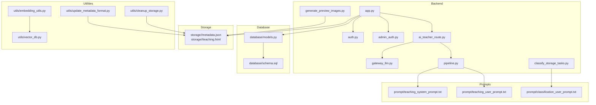

**Diagram sources**
- [app.py](file://backend/app.py)
- [auth.py](file://backend/auth.py)
- [admin_auth.py](file://backend/admin_auth.py)
- [ai_teacher_route.py](file://backend/ai_teacher_route.py)
- [gateway_llm.py](file://backend/gateway_llm.py)
- [pipeline.py](file://backend/pipeline.py)
- [classify_storage_tasks.py](file://backend/classify_storage_tasks.py)
- [generate_preview_images.py](file://backend/generate_preview_images.py)
- [models.py](file://backend/database/models.py)
- [schema.sql](file://backend/database/schema.sql)
- [embedding_utils.py](file://backend/utils/embedding_utils.py)
- [vector_db.py](file://backend/utils/vector_db.py)
- [cleanup_storage.py](file://backend/utils/cleanup_storage.py)
- [update_metadata_format.py](file://backend/utils/update_metadata_format.py)
- [teaching_system_prompt.txt](file://backend/prompt/teaching_system_prompt.txt)
- [teaching_user_prompt.txt](file://backend/prompt/teaching_user_prompt.txt)
- [classification_user_prompt.txt](file://backend/prompt/classification_user_prompt.txt)

**Section sources**
- [app.py](file://backend/app.py)
- [config.py](file://backend/config.py)
- [models.py](file://backend/database/models.py)
- [schema.sql](file://backend/database/schema.sql)
- [pipeline.py](file://backend/pipeline.py)
- [classify_storage_tasks.py](file://backend/classify_storage_tasks.py)
- [generate_preview_images.py](file://backend/generate_preview_images.py)
- [update_metadata_format.py](file://backend/utils/update_metadata_format.py)
- [cleanup_storage.py](file://backend/utils/cleanup_storage.py)
- [embedding_utils.py](file://backend/utils/embedding_utils.py)
- [vector_db.py](file://backend/utils/vector_db.py)
- [ai_teacher_route.py](file://backend/ai_teacher_route.py)
- [gateway_llm.py](file://backend/gateway_llm.py)
- [admin_auth.py](file://backend/admin_auth.py)
- [auth.py](file://backend/auth.py)

## Core Components
- File-based content store: Each content item is stored in its own directory named by UUID. Typical contents include metadata.json describing attributes, tags, status, and references, and teaching.html as the rendered artifact. Optional folders may contain failure samples or auxiliary assets.
- Metadata model: A JSON structure that captures classification, versioning, timestamps, authorship, and links to previews or related resources.
- Classification pipeline: Automated tagging and categorization using AI prompts and classification tasks.
- Preview generation: Tools to generate preview images from teaching content for thumbnails and listings.
- Search and discovery: Embeddings and vector database integration enable semantic search over teaching materials.
- Version control strategy: Incremental updates with version fields in metadata and atomic file replacement patterns.
- Bulk operations: Batch scripts and tasks for reprocessing, cleanup, and metadata normalization across many items.
- Lifecycle management: States such as draft, review, approved, published, with transitions enforced by API routes and background tasks.

**Section sources**
- [models.py](file://backend/database/models.py)
- [schema.sql](file://backend/database/schema.sql)
- [classify_storage_tasks.py](file://backend/classify_storage_tasks.py)
- [generate_preview_images.py](file://backend/generate_preview_images.py)
- [embedding_utils.py](file://backend/utils/embedding_utils.py)
- [vector_db.py](file://backend/utils/vector_db.py)
- [update_metadata_format.py](file://backend/utils/update_metadata_format.py)
- [cleanup_storage.py](file://backend/utils/cleanup_storage.py)

## Architecture Overview
The CMS integrates an HTTP API layer with AI-powered content generation, classification, and search. The core flow:
- Clients submit requests to create or update teaching content.
- The backend orchestrates generation via AI teacher routes and LLM gateway.
- Generated HTML and metadata are persisted under a UUID-named directory.
- Background tasks classify content and generate previews.
- Embeddings are computed and indexed for semantic search.
- Admin interfaces manage approvals and publishing.

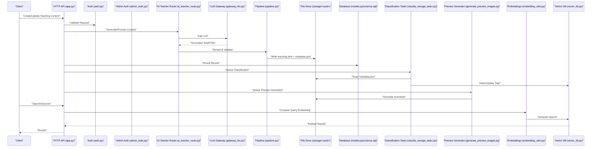

**Diagram sources**
- [app.py](file://backend/app.py)
- [auth.py](file://backend/auth.py)
- [admin_auth.py](file://backend/admin_auth.py)
- [ai_teacher_route.py](file://backend/ai_teacher_route.py)
- [gateway_llm.py](file://backend/gateway_llm.py)
- [pipeline.py](file://backend/pipeline.py)
- [classify_storage_tasks.py](file://backend/classify_storage_tasks.py)
- [generate_preview_images.py](file://backend/generate_preview_images.py)
- [embedding_utils.py](file://backend/utils/embedding_utils.py)
- [vector_db.py](file://backend/utils/vector_db.py)
- [models.py](file://backend/database/models.py)
- [schema.sql](file://backend/database/schema.sql)

## Detailed Component Analysis

### File-Based Storage and UUID Organization
- Directory-per-item: Each content item resides in a folder named by its UUID. Inside, you will find:
  - metadata.json: Structured metadata including classification, version, timestamps, authorship, and references.
  - teaching.html: Rendered HTML content for display.
  - Optional artifacts: template_failure_samples and other auxiliary files.
- Atomic updates: To ensure consistency, write new files to a temporary location and rename atomically when ready.
- Integrity checks: Validate presence and format of required files before marking content as complete.

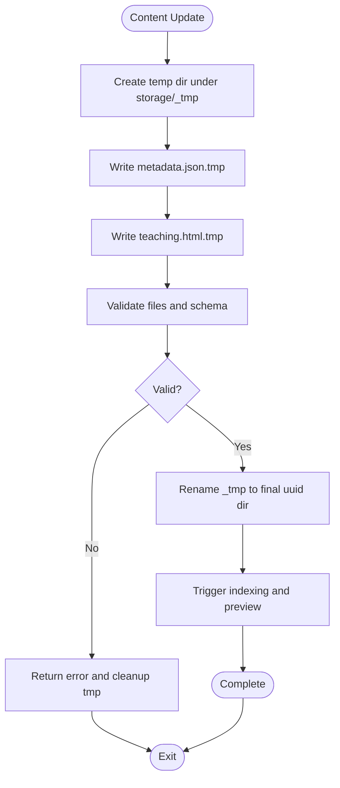

**Diagram sources**
- [generate_preview_images.py](file://backend/generate_preview_images.py)
- [update_metadata_format.py](file://backend/utils/update_metadata_format.py)
- [cleanup_storage.py](file://backend/utils/cleanup_storage.py)

**Section sources**
- [generate_preview_images.py](file://backend/generate_preview_images.py)
- [update_metadata_format.py](file://backend/utils/update_metadata_format.py)
- [cleanup_storage.py](file://backend/utils/cleanup_storage.py)

### Metadata Model and Schema
- Relational records: The database stores high-level records for teachings, users, topics, view counts, and sharing information. These records link to file paths or UUIDs in the storage layer.
- Metadata fields: Include identifiers, titles, descriptions, classification tags, status, version numbers, creation/update timestamps, author IDs, and preview references.
- Consistency: Ensure database records and file metadata remain synchronized after updates.

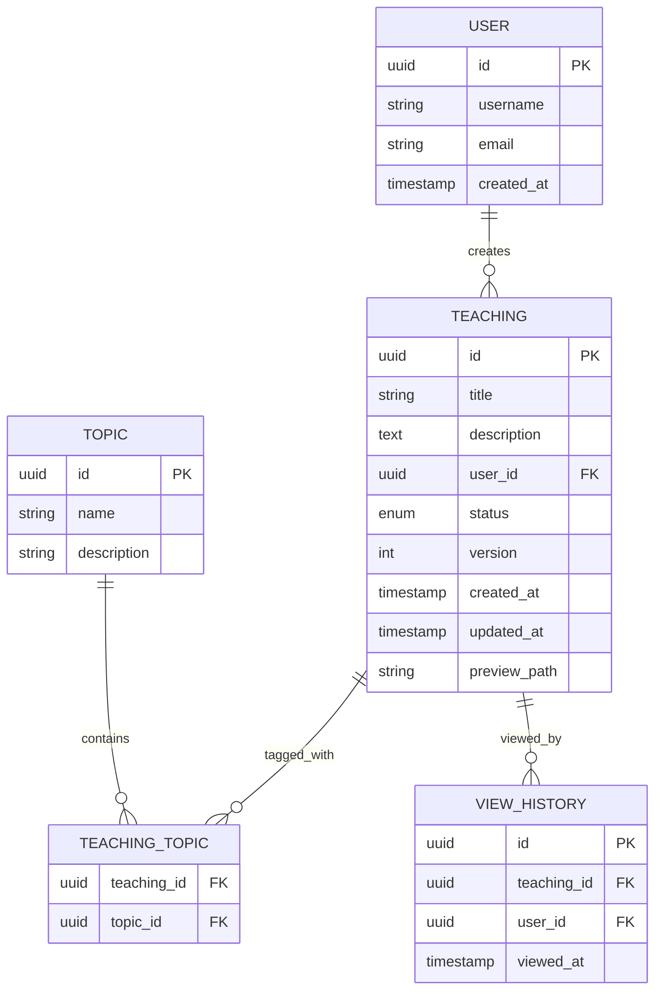

**Diagram sources**
- [models.py](file://backend/database/models.py)
- [schema.sql](file://backend/database/schema.sql)

**Section sources**
- [models.py](file://backend/database/models.py)
- [schema.sql](file://backend/database/schema.sql)

### Classification System
- Purpose: Automatically assign categories/tags to teaching materials based on content analysis.
- Process:
  - Read metadata.json and teaching.html.
  - Use classification prompts to guide AI decisions.
  - Update metadata.json with classification results.
  - Persist changes and optionally index tags for search.
- Prompts: System and user prompts define classification behavior and constraints.

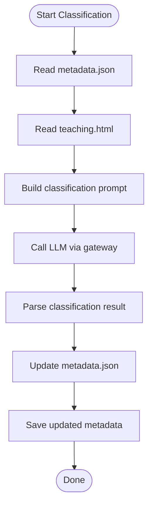

**Diagram sources**
- [classify_storage_tasks.py](file://backend/classify_storage_tasks.py)
- [classification_user_prompt.txt](file://backend/prompt/classification_user_prompt.txt)

**Section sources**
- [classify_storage_tasks.py](file://backend/classify_storage_tasks.py)
- [classification_user_prompt.txt](file://backend/prompt/classification_user_prompt.txt)

### Preview Image Generation
- Purpose: Generate thumbnail images for teaching materials to improve listing performance and UX.
- Process:
  - Scan storage directories for items missing previews.
  - Extract representative frames or render snapshots from teaching.html.
  - Save preview images alongside metadata.
  - Update metadata.json with preview path.

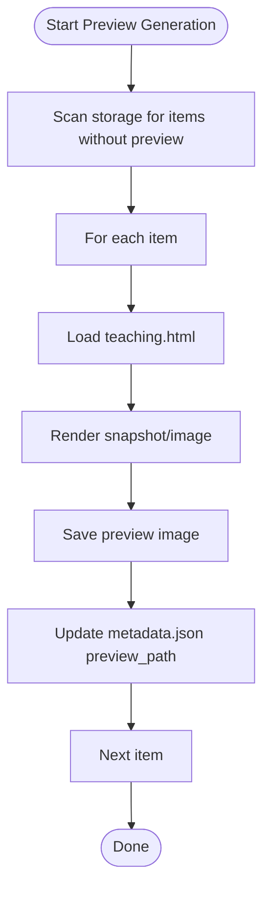

**Diagram sources**
- [generate_preview_images.py](file://backend/generate_preview_images.py)

**Section sources**
- [generate_preview_images.py](file://backend/generate_preview_images.py)

### Metadata Management and Migration
- Normalization: Tools exist to update metadata formats across existing items.
- Workflow:
  - Iterate over storage directories.
  - Load metadata.json, apply transformations.
  - Save updated metadata.
  - Log changes for auditability.

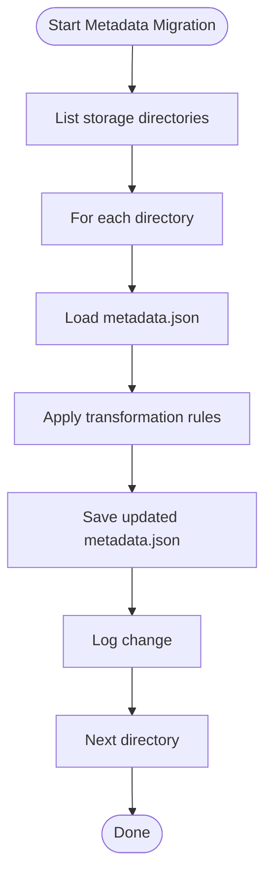

**Diagram sources**
- [update_metadata_format.py](file://backend/utils/update_metadata_format.py)

**Section sources**
- [update_metadata_format.py](file://backend/utils/update_metadata_format.py)

### Search and Discovery via Embeddings
- Purpose: Enable semantic search over teaching materials.
- Process:
  - Compute embeddings for content summaries or key fields.
  - Store vectors in a vector database.
  - On query, compute embedding and perform similarity search.
  - Return ranked results linked to storage UUIDs.

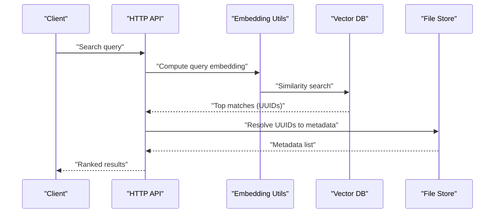

**Diagram sources**
- [embedding_utils.py](file://backend/utils/embedding_utils.py)
- [vector_db.py](file://backend/utils/vector_db.py)

**Section sources**
- [embedding_utils.py](file://backend/utils/embedding_utils.py)
- [vector_db.py](file://backend/utils/vector_db.py)

### Version Control Mechanisms
- Strategy:
  - Maintain a version field in metadata.json and corresponding database record.
  - On updates, increment version and write new files atomically.
  - Keep previous versions if needed for rollback or audit.
- Validation:
  - Check version monotonicity.
  - Ensure integrity of teaching.html and metadata.json after writes.

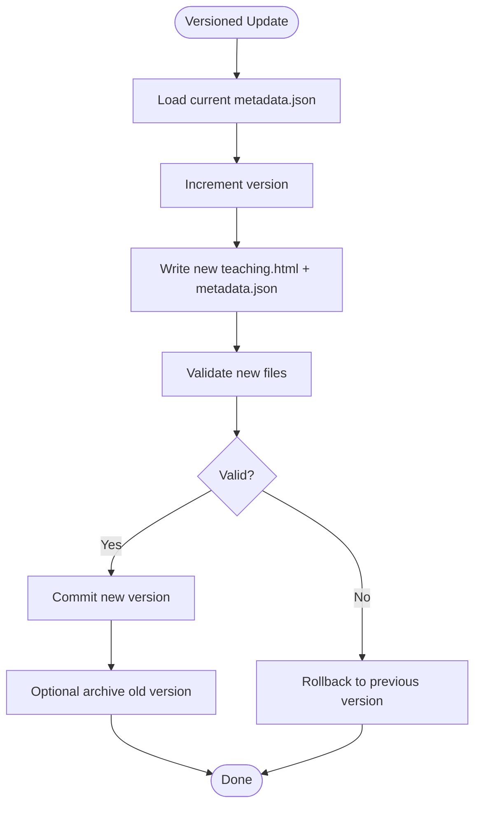

[No sources needed since this section provides general guidance]

### Bulk Operations for Batch Processing
- Cleanup: Remove orphaned files, empty directories, or failed samples.
- Re-processing: Re-run classification, preview generation, or metadata normalization across many items.
- Safety: Use dry-run modes and logging to track progress and errors.

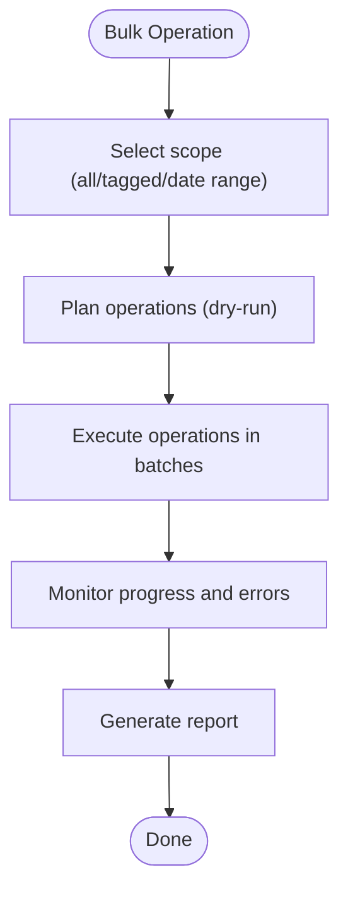

**Diagram sources**
- [cleanup_storage.py](file://backend/utils/cleanup_storage.py)

**Section sources**
- [cleanup_storage.py](file://backend/utils/cleanup_storage.py)

### Content Lifecycle: Generation, Approval, Publication
- Stages:
  - Draft: Initial generation and validation.
  - Review: Quality checks and manual review.
  - Approved: Ready for publication.
  - Published: Visible to users.
- Transitions:
  - Enforced by API routes and admin controls.
  - Background tasks handle indexing and previews upon state changes.

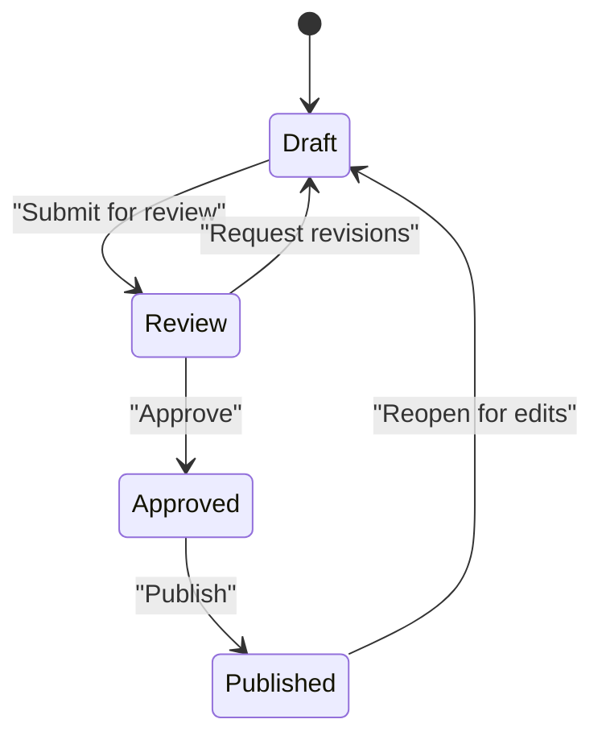

**Diagram sources**
- [ai_teacher_route.py](file://backend/ai_teacher_route.py)
- [admin_auth.py](file://backend/admin_auth.py)

**Section sources**
- [ai_teacher_route.py](file://backend/ai_teacher_route.py)
- [admin_auth.py](file://backend/admin_auth.py)

### Relationship Between Database Records and Physical Files
- Mapping:
  - Database teaching records reference UUIDs and file paths.
  - File store holds actual artifacts (metadata.json, teaching.html).
- Consistency:
  - Updates must synchronize both layers.
  - Migrations and utilities help maintain alignment.

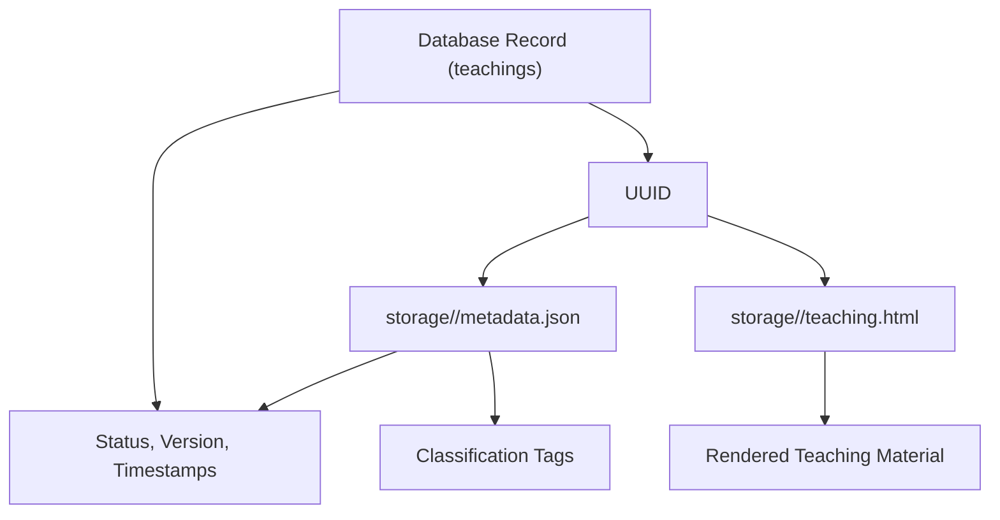

**Diagram sources**
- [models.py](file://backend/database/models.py)
- [schema.sql](file://backend/database/schema.sql)

**Section sources**
- [models.py](file://backend/database/models.py)
- [schema.sql](file://backend/database/schema.sql)

### Backup Strategies for Large Content Libraries
- File-level backups:
  - Periodic snapshots of the storage directory tree.
  - Incremental backups to reduce size and time.
- Database backups:
  - Regular dumps of schema and data.
- Integrity:
  - Verify checksums post-backup.
  - Test restore procedures regularly.

[No sources needed since this section provides general guidance]

### Performance Considerations for Content Retrieval
- Caching:
  - Cache frequently accessed metadata and HTML responses.
  - Use CDN for static assets like preview images.
- Indexing:
  - Precompute and cache embeddings for popular queries.
- Concurrency:
  - Limit concurrent file writes and reads.
  - Use connection pooling for database access.

[No sources needed since this section provides general guidance]

### Example Workflows

#### Content Upload Workflow
- Steps:
  - Client submits content payload.
  - Backend validates input and generates UUID.
  - AI teacher route renders teaching.html and builds metadata.json.
  - Files written atomically under storage/<uuid>.
  - Database record created or updated.
  - Queue classification and preview generation.
  - Return success response with UUID and status.

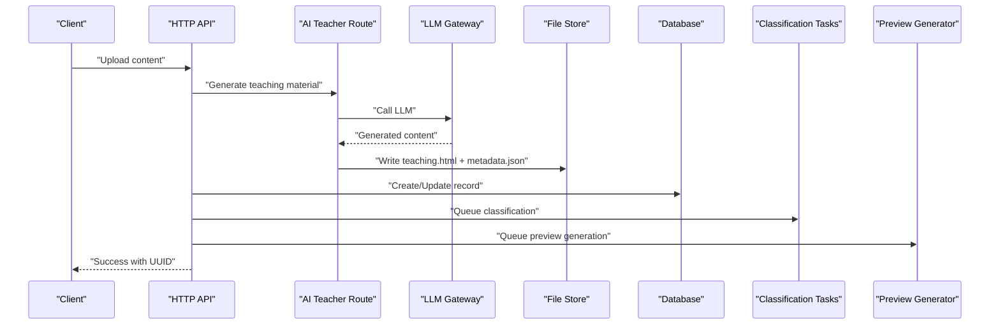

**Diagram sources**
- [ai_teacher_route.py](file://backend/ai_teacher_route.py)
- [gateway_llm.py](file://backend/gateway_llm.py)
- [generate_preview_images.py](file://backend/generate_preview_images.py)
- [classify_storage_tasks.py](file://backend/classify_storage_tasks.py)

**Section sources**
- [ai_teacher_route.py](file://backend/ai_teacher_route.py)
- [gateway_llm.py](file://backend/gateway_llm.py)
- [generate_preview_images.py](file://backend/generate_preview_images.py)
- [classify_storage_tasks.py](file://backend/classify_storage_tasks.py)

#### Metadata Manipulation
- Steps:
  - Load metadata.json for target UUID.
  - Apply transformations (e.g., normalize tags, update status).
  - Validate schema and save updated metadata.
  - Optionally trigger re-indexing.

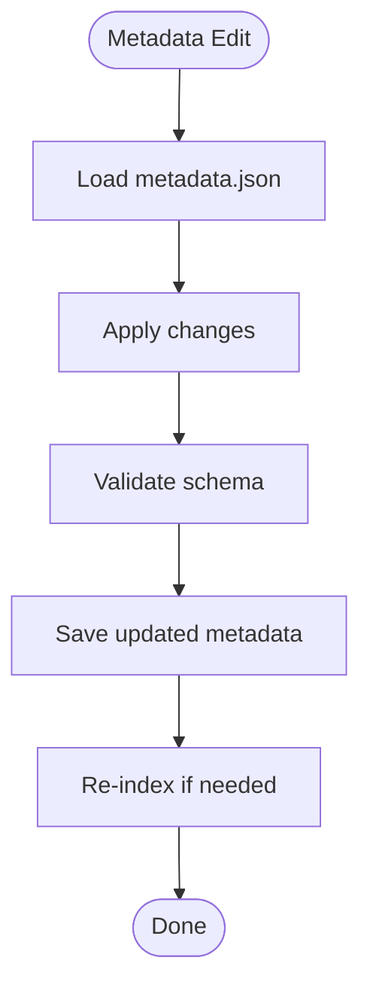

**Diagram sources**
- [update_metadata_format.py](file://backend/utils/update_metadata_format.py)

**Section sources**
- [update_metadata_format.py](file://backend/utils/update_metadata_format.py)

#### Custom Content Processing Pipelines
- Steps:
  - Define pipeline stages (render, validate, classify, preview, embed).
  - Orchestrate via pipeline module.
  - Handle errors and retries per stage.
  - Emit logs and metrics for observability.

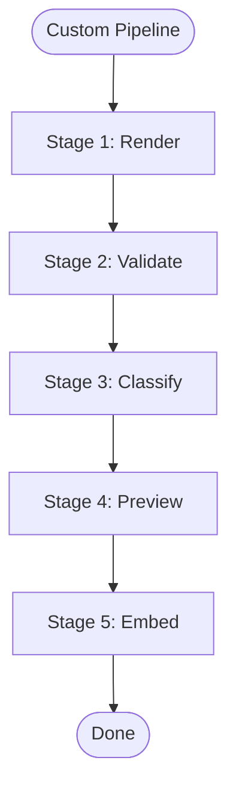

**Diagram sources**
- [pipeline.py](file://backend/pipeline.py)

**Section sources**
- [pipeline.py](file://backend/pipeline.py)

## Dependency Analysis
Key dependencies and relationships:
- HTTP API depends on authentication modules and admin controls.
- AI teacher route depends on LLM gateway and pipeline.
- Classification tasks depend on prompts and vector database.
- Preview generator depends on file store and metadata.
- Embedding utilities depend on vector database.

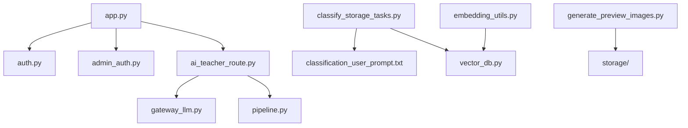

**Diagram sources**
- [app.py](file://backend/app.py)
- [auth.py](file://backend/auth.py)
- [admin_auth.py](file://backend/admin_auth.py)
- [ai_teacher_route.py](file://backend/ai_teacher_route.py)
- [gateway_llm.py](file://backend/gateway_llm.py)
- [pipeline.py](file://backend/pipeline.py)
- [classify_storage_tasks.py](file://backend/classify_storage_tasks.py)
- [generate_preview_images.py](file://backend/generate_preview_images.py)
- [embedding_utils.py](file://backend/utils/embedding_utils.py)
- [vector_db.py](file://backend/utils/vector_db.py)
- [classification_user_prompt.txt](file://backend/prompt/classification_user_prompt.txt)

**Section sources**
- [app.py](file://backend/app.py)
- [auth.py](file://backend/auth.py)
- [admin_auth.py](file://backend/admin_auth.py)
- [ai_teacher_route.py](file://backend/ai_teacher_route.py)
- [gateway_llm.py](file://backend/gateway_llm.py)
- [pipeline.py](file://backend/pipeline.py)
- [classify_storage_tasks.py](file://backend/classify_storage_tasks.py)
- [generate_preview_images.py](file://backend/generate_preview_images.py)
- [embedding_utils.py](file://backend/utils/embedding_utils.py)
- [vector_db.py](file://backend/utils/vector_db.py)
- [classification_user_prompt.txt](file://backend/prompt/classification_user_prompt.txt)

## Performance Considerations
- Minimize disk I/O by batching operations and using atomic renames.
- Cache frequent reads at the API layer and use CDN for static assets.
- Optimize embedding computations by caching and incremental updates.
- Monitor memory usage during large batch jobs and implement backpressure.

[No sources needed since this section provides general guidance]

## Troubleshooting Guide
- Common issues:
  - Missing or malformed metadata.json: Validate schema and run metadata migration tool.
  - Inconsistent database vs file state: Reconcile by scanning storage and updating records.
  - Failed preview generation: Inspect rendering logs and regenerate previews.
  - Classification errors: Review prompts and retry with adjusted parameters.
- Utilities:
  - Cleanup script to remove orphaned files and failures.
  - Metadata migration tool to normalize formats.
  - Vector DB utilities to rebuild indexes.

**Section sources**
- [cleanup_storage.py](file://backend/utils/cleanup_storage.py)
- [update_metadata_format.py](file://backend/utils/update_metadata_format.py)
- [vector_db.py](file://backend/utils/vector_db.py)

## Conclusion
The XSYY Edu CMS combines a robust file-based storage model with structured metadata, AI-driven generation and classification, and powerful search capabilities. By maintaining clear versioning, enforcing lifecycle transitions, and providing bulk operations and utilities, it supports scalable content management for large educational libraries. Proper backup strategies and performance optimizations ensure reliability and responsiveness.

## Appendices

### Configuration and Environment
- Application configuration includes database settings, storage paths, and LLM gateway parameters.
- Ensure environment variables are set correctly for production deployments.

**Section sources**
- [config.py](file://backend/config.py)

### Prompts Reference
- Teaching generation prompts define system and user instructions for content creation.
- Classification prompts guide automated tagging and categorization.

**Section sources**
- [teaching_system_prompt.txt](file://backend/prompt/teaching_system_prompt.txt)
- [teaching_user_prompt.txt](file://backend/prompt/teaching_user_prompt.txt)
- [classification_user_prompt.txt](file://backend/prompt/classification_user_prompt.txt)