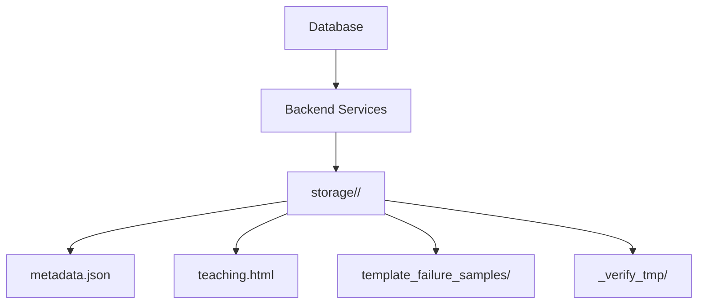
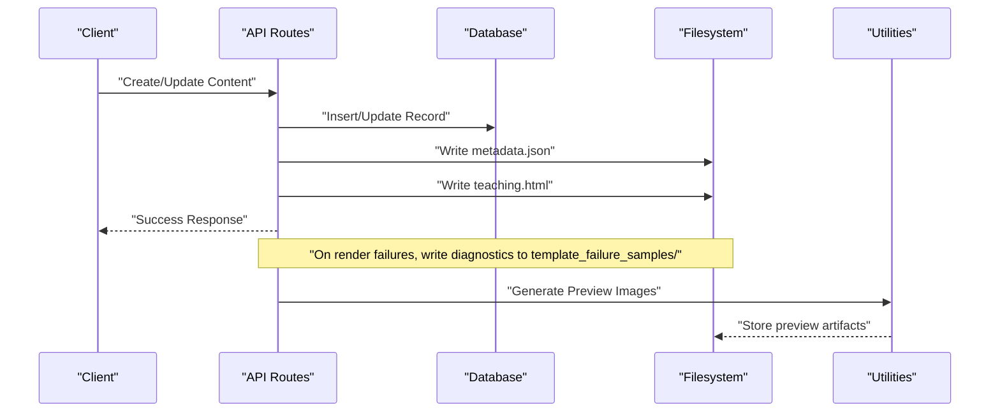
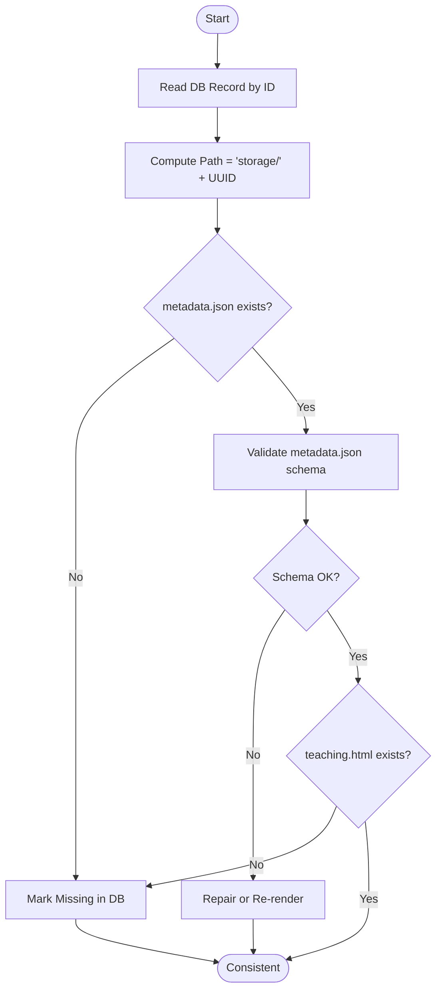
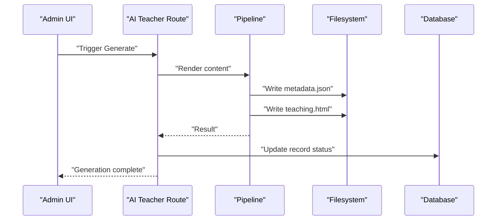
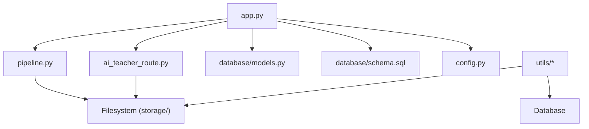

# File Storage Architecture

<cite>
**Referenced Files in This Document**
- [app.py](file://backend/app.py)
- [pipeline.py](file://backend/pipeline.py)
- [ai_teacher_route.py](file://backend/ai_teacher_route.py)
- [models.py](file://backend/database/models.py)
- [schema.sql](file://backend/database/schema.sql)
- [config.py](file://backend/config.py)
- [cleanup_storage.py](file://backend/utils/cleanup_storage.py)
- [generate_preview_images.py](file://backend/generate_preview_images.py)
- [update_metadata_format.py](file://backend/utils/update_metadata_format.py)
- [classify_storage_tasks.py](file://backend/classify_storage_tasks.py)
</cite>

## Table of Contents
1. [Introduction](#introduction)
2. [Project Structure](#project-structure)
3. [Core Components](#core-components)
4. [Architecture Overview](#architecture-overview)
5. [Detailed Component Analysis](#detailed-component-analysis)
6. [Dependency Analysis](#dependency-analysis)
7. [Performance Considerations](#performance-considerations)
8. [Troubleshooting Guide](#troubleshooting-guide)
9. [Conclusion](#conclusion)
10. [Appendices](#appendices)

## Introduction
This document explains the file-based storage architecture used by XSYY Edu for teaching content. Each teaching item is persisted as a folder identified by a UUID, containing:
- metadata.json: structured metadata about the content
- teaching.html: rendered HTML content

The system maintains a dual persistence model:
- Relational database records for search, indexing, and relationships
- Filesystem folders for durable, portable content artifacts

This document covers storage hierarchy, naming conventions, data persistence patterns, mapping between database records and physical paths, performance considerations, disk space management, backup strategies, and integration with the content generation pipeline.

## Project Structure
At the repository root, the storage directory holds one subdirectory per content item named by its UUID. Each subdirectory contains at least metadata.json and often teaching.html. Additional artifacts may exist (for example, template failure samples or temporary verification directories). The backend orchestrates creation, updates, and cleanup of these files through API routes and background tasks.

**Diagram sources**
- [app.py:1-200](file://backend/app.py#L1-L200)
- [pipeline.py:1-200](file://backend/pipeline.py#L1-L200)
- [ai_teacher_route.py:1-200](file://backend/ai_teacher_route.py#L1-L200)

**Section sources**
- [app.py:1-200](file://backend/app.py#L1-L200)
- [pipeline.py:1-200](file://backend/pipeline.py#L1-L200)
- [ai_teacher_route.py:1-200](file://backend/ai_teacher_route.py#L1-L200)

## Core Components
- Content ID to path mapping: Each teaching item’s primary key (UUID) maps directly to a top-level folder under storage/.
- Metadata file: metadata.json stores descriptive fields such as title, tags, timestamps, and references to other assets.
- Teaching artifact: teaching.html is the final rendered output served to clients.
- Auxiliary directories:
  - template_failure_samples/: diagnostic samples when template rendering fails.
  - _verify_tmp/: transient verification artifacts during processing.

Key responsibilities:
- Create and update storage folders on content lifecycle events.
- Ensure atomic writes and consistent metadata.
- Maintain synchronization between database records and filesystem state.
- Provide utilities for cleanup, preview generation, and format migration.

**Section sources**
- [models.py:1-200](file://backend/database/models.py#L1-L200)
- [schema.sql:1-200](file://backend/database/schema.sql#L1-L200)
- [config.py:1-200](file://backend/config.py#L1-L200)
- [cleanup_storage.py:1-200](file://backend/utils/cleanup_storage.py#L1-L200)
- [generate_preview_images.py:1-200](file://backend/generate_preview_images.py#L1-L200)
- [update_metadata_format.py:1-200](file://backend/utils/update_metadata_format.py#L1-L200)
- [classify_storage_tasks.py:1-200](file://backend/classify_storage_tasks.py#L1-L200)

## Architecture Overview
The system follows a clear separation of concerns:
- API layer exposes endpoints to create, read, update, and delete content.
- Pipeline processes content generation, writing both metadata and HTML to the filesystem.
- Database layer persists searchable indexes and relationships.
- Utilities handle maintenance operations like cleanup and previews.

**Diagram sources**
- [app.py:1-200](file://backend/app.py#L1-L200)
- [ai_teacher_route.py:1-200](file://backend/ai_teacher_route.py#L1-L200)
- [pipeline.py:1-200](file://backend/pipeline.py#L1-L200)
- [generate_preview_images.py:1-200](file://backend/generate_preview_images.py#L1-L200)

## Detailed Component Analysis

### Storage Hierarchy and Naming Conventions
- Top-level directory: storage/
- Per-item directory: storage/<UUID>/
- Required files:
  - metadata.json: JSON object describing the content item
  - teaching.html: Rendered HTML content
- Optional directories/files:
  - template_failure_samples/: Diagnostic samples for failed template renders
  - _verify_tmp/: Temporary verification artifacts
- Naming rules:
  - Directory names are UUID strings matching the content record’s primary key
  - Filenames are fixed: metadata.json and teaching.html
  - Auxiliary directories use stable names for consistency across runs

Example structure:
- storage/
  - <uuid-a>/
    - metadata.json
    - teaching.html
    - template_failure_samples/...
  - <uuid-b>/
    - metadata.json
    - teaching.html

**Section sources**
- [app.py:1-200](file://backend/app.py#L1-L200)
- [pipeline.py:1-200](file://backend/pipeline.py#L1-L200)
- [ai_teacher_route.py:1-200](file://backend/ai_teacher_route.py#L1-L200)

### Data Persistence Patterns
- Dual persistence:
  - Database: Stores searchable fields, relationships, and status flags
  - Filesystem: Stores durable artifacts (metadata.json, teaching.html)
- Synchronization:
  - On successful write to filesystem, database record is updated
  - On rollback or error, filesystem changes are reverted or marked via auxiliary files
- Atomicity:
  - Prefer writing to temporary locations then renaming to ensure consistency
  - Use transactional semantics where possible in database operations

**Section sources**
- [models.py:1-200](file://backend/database/models.py#L1-L200)
- [schema.sql:1-200](file://backend/database/schema.sql#L1-L200)
- [config.py:1-200](file://backend/config.py#L1-L200)

### Mapping Between Database Records and Physical Paths
- Primary key (UUID) equals folder name under storage/
- Path resolution:
  - Given a record id, compute path as storage/<id>/
  - Validate existence of metadata.json and teaching.html
- Integrity checks:
  - Compare database fields with metadata.json values
  - Flag inconsistencies for repair workflows

**Diagram sources**
- [app.py:1-200](file://backend/app.py#L1-L200)
- [pipeline.py:1-200](file://backend/pipeline.py#L1-L200)

**Section sources**
- [app.py:1-200](file://backend/app.py#L1-L200)
- [pipeline.py:1-200](file://backend/pipeline.py#L1-L200)

### Integration with Content Generation Pipeline
- Creation flow:
  - API receives request to generate content
  - Pipeline renders HTML and constructs metadata
  - Writes metadata.json and teaching.html to storage/<UUID>/
  - Updates database record with new status and links
- Update flow:
  - Fetch existing record and path
  - Re-render if inputs changed
  - Overwrite artifacts atomically
  - Sync database fields
- Failure handling:
  - Write diagnostic samples to template_failure_samples/
  - Persist error context in metadata or auxiliary files
  - Mark record as failed for retry

**Diagram sources**
- [ai_teacher_route.py:1-200](file://backend/ai_teacher_route.py#L1-L200)
- [pipeline.py:1-200](file://backend/pipeline.py#L1-L200)
- [app.py:1-200](file://backend/app.py#L1-L200)

**Section sources**
- [ai_teacher_route.py:1-200](file://backend/ai_teacher_route.py#L1-L200)
- [pipeline.py:1-200](file://backend/pipeline.py#L1-L200)
- [app.py:1-200](file://backend/app.py#L1-L200)

### Maintenance and Utilities
- Cleanup:
  - Remove orphaned folders without corresponding DB records
  - Purge stale template_failure_samples and _verify_tmp artifacts
- Preview generation:
  - Generate preview images from teaching.html
  - Store previews alongside content or in dedicated asset directories
- Metadata migration:
  - Update metadata.json schema versions
  - Backfill missing fields using DB records

**Section sources**
- [cleanup_storage.py:1-200](file://backend/utils/cleanup_storage.py#L1-L200)
- [generate_preview_images.py:1-200](file://backend/generate_preview_images.py#L1-L200)
- [update_metadata_format.py:1-200](file://backend/utils/update_metadata_format.py#L1-L200)
- [classify_storage_tasks.py:1-200](file://backend/classify_storage_tasks.py#L1-L200)

## Dependency Analysis
The following diagram shows how components depend on each other regarding storage operations:

**Diagram sources**
- [app.py:1-200](file://backend/app.py#L1-L200)
- [ai_teacher_route.py:1-200](file://backend/ai_teacher_route.py#L1-L200)
- [pipeline.py:1-200](file://backend/pipeline.py#L1-L200)
- [models.py:1-200](file://backend/database/models.py#L1-L200)
- [schema.sql:1-200](file://backend/database/schema.sql#L1-L200)
- [config.py:1-200](file://backend/config.py#L1-L200)
- [cleanup_storage.py:1-200](file://backend/utils/cleanup_storage.py#L1-L200)
- [generate_preview_images.py:1-200](file://backend/generate_preview_images.py#L1-L200)
- [update_metadata_format.py:1-200](file://backend/utils/update_metadata_format.py#L1-L200)
- [classify_storage_tasks.py:1-200](file://backend/classify_storage_tasks.py#L1-L200)

**Section sources**
- [app.py:1-200](file://backend/app.py#L1-L200)
- [ai_teacher_route.py:1-200](file://backend/ai_teacher_route.py#L1-L200)
- [pipeline.py:1-200](file://backend/pipeline.py#L1-L200)
- [models.py:1-200](file://backend/database/models.py#L1-L200)
- [schema.sql:1-200](file://backend/database/schema.sql#L1-L200)
- [config.py:1-200](file://backend/config.py#L1-L200)
- [cleanup_storage.py:1-200](file://backend/utils/cleanup_storage.py#L1-L200)
- [generate_preview_images.py:1-200](file://backend/generate_preview_images.py#L1-L200)
- [update_metadata_format.py:1-200](file://backend/utils/update_metadata_format.py#L1-L200)
- [classify_storage_tasks.py:1-200](file://backend/classify_storage_tasks.py#L1-L200)

## Performance Considerations
- I/O efficiency:
  - Batch writes where possible; avoid excessive small file operations
  - Use asynchronous I/O for large content libraries
- Indexing:
  - Keep database indexes lean; rely on filesystem for direct retrieval by UUID
- Caching:
  - Cache frequently accessed metadata and HTML responses
  - Invalidate cache on content updates
- Concurrency:
  - Lock per-folder writes to prevent race conditions
  - Use temporary files and atomic renames for safe updates
- Disk layout:
  - Avoid deeply nested structures; keep flat UUID-based layout
  - Separate large assets into dedicated directories if needed

[No sources needed since this section provides general guidance]

## Troubleshooting Guide
Common issues and resolutions:
- Missing teaching.html:
  - Verify generation pipeline completed successfully
  - Check template_failure_samples for diagnostics
  - Re-run generation for the affected UUID
- Corrupted metadata.json:
  - Run metadata migration utility to fix schema mismatches
  - Cross-check with database record fields
- Orphaned folders:
  - Use cleanup utility to remove folders without DB records
- Inconsistent state:
  - Run integrity checks comparing DB and filesystem
  - Repair by re-rendering content or restoring from backups

Operational tips:
- Monitor disk usage per UUID folder
- Log all write operations with timestamps and sizes
- Implement periodic audits to detect drift between DB and filesystem

**Section sources**
- [cleanup_storage.py:1-200](file://backend/utils/cleanup_storage.py#L1-L200)
- [update_metadata_format.py:1-200](file://backend/utils/update_metadata_format.py#L1-L200)
- [generate_preview_images.py:1-200](file://backend/generate_preview_images.py#L1-L200)
- [classify_storage_tasks.py:1-200](file://backend/classify_storage_tasks.py#L1-L200)

## Conclusion
XSYY Edu’s file-based storage architecture uses a simple, robust design:
- UUID-named folders for isolation and scalability
- Stable filenames for predictable access
- Dual persistence ensuring durability and searchability
- Clear separation between content artifacts and metadata
- Utilities for maintenance, migration, and diagnostics

Adhering to these patterns ensures reliable operation, easy backups, and straightforward troubleshooting across large content libraries.

[No sources needed since this section summarizes without analyzing specific files]

## Appendices

### Example File Structure
- storage/
  - <uuid>/
    - metadata.json
    - teaching.html
    - template_failure_samples/
      - <timestamp>_error_report.json
    - _verify_tmp/
      - <verification_artifact>

**Section sources**
- [app.py:1-200](file://backend/app.py#L1-L200)
- [pipeline.py:1-200](file://backend/pipeline.py#L1-L200)
- [ai_teacher_route.py:1-200](file://backend/ai_teacher_route.py#L1-L200)

### Backup Strategies
- Full filesystem snapshot of storage/
- Incremental backups focusing on changed UUID folders
- Database dump for indexes and relationships
- Versioned backups for metadata.json to track schema evolution

[No sources needed since this section provides general guidance]