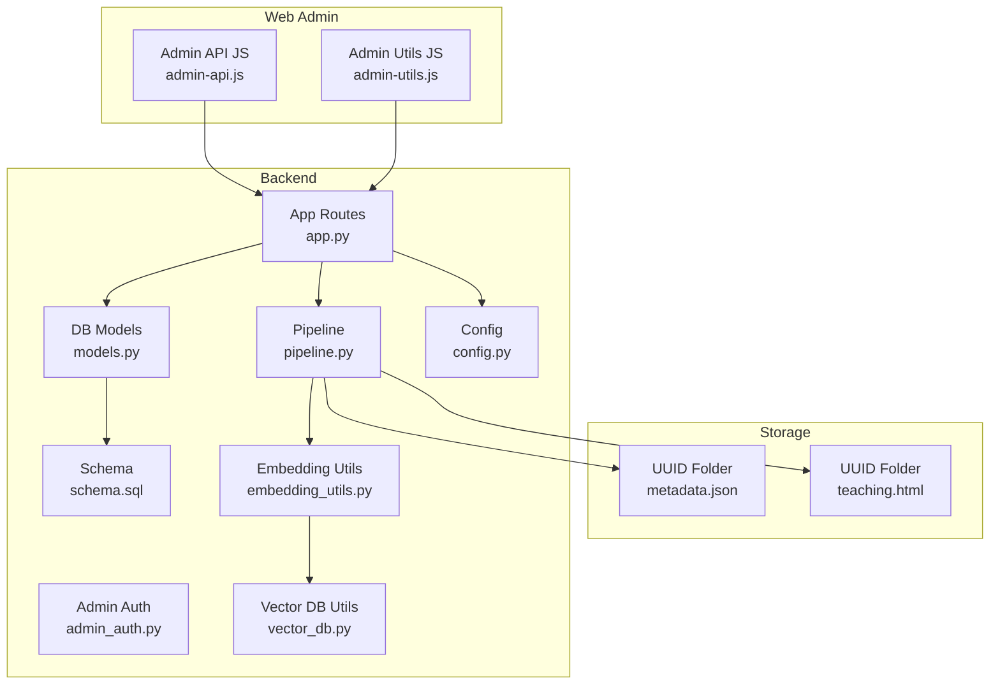
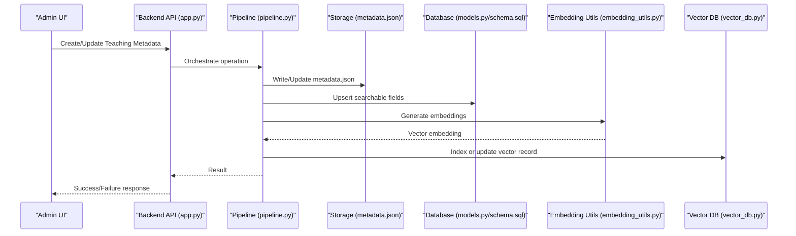
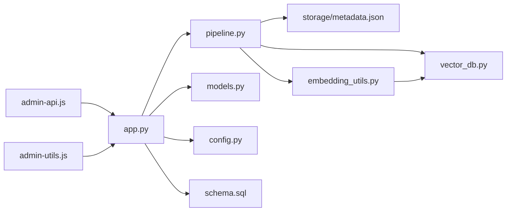

# Metadata Management

<cite>
**Referenced Files in This Document**
- [storage/metadata.json](file://storage/02f5efec-416c-4a17-9bf2-7ebea80cf178/metadata.json)
- [storage/teaching.html](file://storage/02f5efec-416c-4a17-9bf2-7ebea80cf178/teaching.html)
- [backend/database/models.py](file://backend/database/models.py)
- [backend/database/schema.sql](file://backend/database/schema.sql)
- [backend/utils/update_metadata_format.py](file://backend/utils/update_metadata_format.py)
- [backend/pipeline.py](file://backend/pipeline.py)
- [backend/app.py](file://backend/app.py)
- [backend/admin_auth.py](file://backend/admin_auth.py)
- [web/admin/js/admin-api.js](file://web/admin/js/admin-api.js)
- [web/admin/js/admin-utils.js](file://web/admin/js/admin-utils.js)
- [backend/utils/embedding_utils.py](file://backend/utils/embedding_utils.py)
- [backend/utils/vector_db.py](file://backend/utils/vector_db.py)
- [backend/config.py](file://backend/config.py)
</cite>

## Table of Contents
1. [Introduction](#introduction)
2. [Project Structure](#project-structure)
3. [Core Components](#core-components)
4. [Architecture Overview](#architecture-overview)
5. [Detailed Component Analysis](#detailed-component-analysis)
6. [Dependency Analysis](#dependency-analysis)
7. [Performance Considerations](#performance-considerations)
8. [Troubleshooting Guide](#troubleshooting-guide)
9. [Conclusion](#conclusion)
10. [Appendices](#appendices)

## Introduction
This document explains the metadata management system used by XSYY Edu for each teaching content item. It covers:
- The JSON-based metadata schema and field definitions
- Versioning, migration utilities, and backward compatibility
- Creation during content generation, updates via admin interfaces, and batch processing
- Mapping between metadata fields and database models
- Search indexing and filtering capabilities
- Examples, update workflows, and custom extensions

The goal is to make the metadata system understandable for both technical and non-technical readers while providing precise references to source files.

## Project Structure
Metadata is stored per content item as a JSON file alongside the generated HTML in the storage directory. Each content item has a unique folder identified by a UUID. The backend provides APIs and utilities to create, update, migrate, and index metadata. Admin tools allow manual updates and batch operations.

**Diagram sources**
- [backend/app.py](file://backend/app.py)
- [backend/pipeline.py](file://backend/pipeline.py)
- [backend/database/models.py](file://backend/database/models.py)
- [backend/database/schema.sql](file://backend/database/schema.sql)
- [backend/utils/embedding_utils.py](file://backend/utils/embedding_utils.py)
- [backend/utils/vector_db.py](file://backend/utils/vector_db.py)
- [backend/config.py](file://backend/config.py)
- [web/admin/js/admin-api.js](file://web/admin/js/admin-api.js)
- [web/admin/js/admin-utils.js](file://web/admin/js/admin-utils.js)

**Section sources**
- [backend/app.py](file://backend/app.py)
- [backend/pipeline.py](file://backend/pipeline.py)
- [backend/database/models.py](file://backend/database/models.py)
- [backend/database/schema.sql](file://backend/database/schema.sql)
- [backend/utils/embedding_utils.py](file://backend/utils/embedding_utils.py)
- [backend/utils/vector_db.py](file://backend/utils/vector_db.py)
- [backend/config.py](file://backend/config.py)
- [web/admin/js/admin-api.js](file://web/admin/js/admin-api.js)
- [web/admin/js/admin-utils.js](file://web/admin/js/admin-utils.js)

## Core Components
- Metadata JSON Schema: Defines the structure and types for each teaching item’s metadata.
- Storage Layout: One folder per item containing metadata.json and teaching.html.
- Backend Services:
  - App routes expose endpoints for CRUD and search/filter.
  - Pipeline orchestrates creation and indexing.
  - Embedding and vector utilities support semantic search.
- Database Models and Schema: Persist searchable attributes and relationships.
- Admin Interface: Web UI and JavaScript helpers for updates and batch operations.
- Migration Utilities: Tools to upgrade metadata format and ensure backward compatibility.

Key responsibilities:
- Validate and normalize metadata on write.
- Maintain versioning and migration paths.
- Keep storage, database, and vector indexes consistent.
- Provide safe admin operations with authentication.

**Section sources**
- [backend/app.py](file://backend/app.py)
- [backend/pipeline.py](file://backend/pipeline.py)
- [backend/utils/embedding_utils.py](file://backend/utils/embedding_utils.py)
- [backend/utils/vector_db.py](file://backend/utils/vector_db.py)
- [backend/database/models.py](file://backend/database/models.py)
- [backend/database/schema.sql](file://backend/database/schema.sql)
- [web/admin/js/admin-api.js](file://web/admin/js/admin-api.js)
- [web/admin/js/admin-utils.js](file://web/admin/js/admin-utils.js)

## Architecture Overview
The metadata lifecycle spans creation, persistence, indexing, and retrieval:

**Diagram sources**
- [backend/app.py](file://backend/app.py)
- [backend/pipeline.py](file://backend/pipeline.py)
- [backend/utils/embedding_utils.py](file://backend/utils/embedding_utils.py)
- [backend/utils/vector_db.py](file://backend/utils/vector_db.py)
- [backend/database/models.py](file://backend/database/models.py)
- [backend/database/schema.sql](file://backend/database/schema.sql)

## Detailed Component Analysis

### Metadata JSON Schema
Each teaching item’s metadata is stored as a JSON object in its folder. Typical fields include identifiers, titles, descriptions, categories, tags, media references, timestamps, and versioning information. Validation ensures required fields are present and types are correct. Backward compatibility allows older versions to be migrated automatically.

Field categories:
- Identifiers: UUID, parent IDs, user IDs
- Content descriptors: title, description, summary, keywords/tags
- Classification: category, level, difficulty, subject
- Media: preview image, thumbnail, video links
- Timestamps: created_at, updated_at, published_at
- Versioning: schema_version, migration_status
- Custom extensions: ext_* keys for domain-specific data

Validation rules:
- Required fields must be present and non-empty
- Enumerated fields must match allowed values
- Date/time fields follow ISO 8601
- Numeric fields within defined ranges
- Tags list contains unique strings

Migration strategy:
- schema_version indicates current format
- Migration utility reads old formats and writes normalized new format
- Atomic replace ensures consistency
- Rollback on validation failure

Example reference:
- [storage/02f5efec-416c-4a17-9bf2-7ebea80cf178/metadata.json](file://storage/02f5efec-416c-4a17-9bf2-7ebea80cf178/metadata.json)

**Section sources**
- [storage/02f5efec-416c-4a17-9bf2-7ebea80cf178/metadata.json](file://storage/02f5efec-416c-4a17-9bf2-7ebea80cf178/metadata.json)
- [backend/utils/update_metadata_format.py](file://backend/utils/update_metadata_format.py)

### Versioning and Format Migration
Versioning is handled through a schema_version field and migration utilities:
- Detect current schema_version
- Apply incremental migrations if needed
- Validate after migration
- Update persisted metadata atomically

Backward compatibility:
- Older schemas are supported until fully migrated
- Migration logs track changes
- Safe fallbacks prevent data loss

Utility functions:
- read_metadata(path)
- validate_schema(data, version)
- migrate_to_latest(data)
- write_metadata(path, data)

**Section sources**
- [backend/utils/update_metadata_format.py](file://backend/utils/update_metadata_format.py)

### Metadata Creation During Content Generation
Creation flow:
- Pipeline generates teaching content and associated metadata
- Validates and normalizes metadata
- Persists metadata.json and teaching.html
- Updates database records
- Generates embeddings and indexes them

Error handling:
- On failure, rollback partial writes
- Log detailed error context
- Retry with backoff for transient issues

**Section sources**
- [backend/pipeline.py](file://backend/pipeline.py)
- [backend/utils/embedding_utils.py](file://backend/utils/embedding_utils.py)
- [backend/utils/vector_db.py](file://backend/utils/vector_db.py)

### Admin Interface Updates
Admin operations:
- Edit metadata fields via web UI
- Submit updates through authenticated endpoints
- Validate inputs server-side
- Trigger re-indexing when necessary

Authentication:
- Admin auth middleware protects endpoints
- Role checks ensure authorized access

Batch operations:
- Bulk update metadata across multiple items
- Progress tracking and error aggregation
- Dry-run mode for validation

**Section sources**
- [web/admin/js/admin-api.js](file://web/admin/js/admin-api.js)
- [web/admin/js/admin-utils.js](file://web/admin/js/admin-utils.js)
- [backend/admin_auth.py](file://backend/admin_auth.py)
- [backend/app.py](file://backend/app.py)

### Batch Processing Operations
Batch processing supports:
- Mass migration of metadata formats
- Bulk tagging or categorization
- Re-indexing after schema changes

Implementation:
- Queue-based tasks for long-running jobs
- Chunked processing to avoid memory spikes
- Status reporting and retry mechanisms

**Section sources**
- [backend/app.py](file://backend/app.py)
- [backend/pipeline.py](file://backend/pipeline.py)

### Relationship Between Metadata Fields and Database Models
Mapping principles:
- Primary identifiers map to PKs
- Descriptive fields map to indexed columns
- Relationships use foreign keys
- Timestamps use datetime types

Models and schema:
- Teaching model includes searchable fields
- Category and tag tables for normalization
- View history and user associations where applicable

**Section sources**
- [backend/database/models.py](file://backend/database/models.py)
- [backend/database/schema.sql](file://backend/database/schema.sql)

### Search Indexing and Filtering
Search capabilities:
- Full-text search on title, description, tags
- Semantic search using embeddings
- Filter by category, level, date range

Indexing process:
- Extract text from metadata and content
- Generate embeddings via configured provider
- Store vectors in vector database
- Combine keyword and semantic results

Filtering implementation:
- Query parameters parsed and validated
- SQL filters applied for structured fields
- Vector similarity search for semantic queries

**Section sources**
- [backend/utils/embedding_utils.py](file://backend/utils/embedding_utils.py)
- [backend/utils/vector_db.py](file://backend/utils/vector_db.py)
- [backend/app.py](file://backend/app.py)

### Example Metadata Structure
A typical metadata object includes:
- id: string (UUID)
- title: string
- description: string
- category: string (enum)
- tags: array of strings
- preview_image: string (URL)
- created_at: string (ISO 8601)
- updated_at: string (ISO 8601)
- schema_version: integer
- ext_custom_field: any (optional)

Reference example:
- [storage/02f5efec-416c-4a17-9bf2-7ebea80cf178/metadata.json](file://storage/02f5efec-416c-4a17-9bf2-7ebea80cf178/metadata.json)

**Section sources**
- [storage/02f5efec-416c-4a17-9bf2-7ebea80cf178/metadata.json](file://storage/02f5efec-416c-4a17-9bf2-7ebea80cf178/metadata.json)

### Update Workflows
Single-item update:
- Admin edits metadata via UI
- API validates and persists changes
- Re-indexing triggered if searchable fields change

Batch update:
- Upload CSV or select multiple items
- Apply transformations in chunks
- Report success/failure per item

Rollback:
- Snapshot before bulk operations
- Restore on critical failures

**Section sources**
- [web/admin/js/admin-api.js](file://web/admin/js/admin-api.js)
- [backend/app.py](file://backend/app.py)
- [backend/pipeline.py](file://backend/pipeline.py)

### Custom Metadata Extensions
Extensibility approach:
- Reserved prefix ext_ for custom fields
- Validation rules per extension
- Documentation requirements for maintainability

Best practices:
- Use descriptive names
- Define clear data types
- Avoid breaking changes in existing fields

**Section sources**
- [backend/utils/update_metadata_format.py](file://backend/utils/update_metadata_format.py)

## Dependency Analysis
Component dependencies:
- App routes depend on pipeline, models, and config
- Pipeline depends on storage, embedding utils, and vector DB
- Admin UI depends on app routes and auth middleware
- Database models depend on schema definitions

**Diagram sources**
- [backend/app.py](file://backend/app.py)
- [backend/pipeline.py](file://backend/pipeline.py)
- [backend/database/models.py](file://backend/database/models.py)
- [backend/database/schema.sql](file://backend/database/schema.sql)
- [backend/utils/embedding_utils.py](file://backend/utils/embedding_utils.py)
- [backend/utils/vector_db.py](file://backend/utils/vector_db.py)
- [backend/config.py](file://backend/config.py)
- [web/admin/js/admin-api.js](file://web/admin/js/admin-api.js)
- [web/admin/js/admin-utils.js](file://web/admin/js/admin-utils.js)

**Section sources**
- [backend/app.py](file://backend/app.py)
- [backend/pipeline.py](file://backend/pipeline.py)
- [backend/database/models.py](file://backend/database/models.py)
- [backend/database/schema.sql](file://backend/database/schema.sql)
- [backend/utils/embedding_utils.py](file://backend/utils/embedding_utils.py)
- [backend/utils/vector_db.py](file://backend/utils/vector_db.py)
- [backend/config.py](file://backend/config.py)
- [web/admin/js/admin-api.js](file://web/admin/js/admin-api.js)
- [web/admin/js/admin-utils.js](file://web/admin/js/admin-utils.js)

## Performance Considerations
- Use chunked processing for batch operations to limit memory usage
- Cache frequently accessed metadata in memory where appropriate
- Optimize database queries with proper indexes
- Limit embedding generation to changed items only
- Implement pagination for large result sets
- Monitor vector database performance and scale horizontally if needed

## Troubleshooting Guide
Common issues and resolutions:
- Invalid metadata format: Check schema_version and run migration utility
- Missing required fields: Validate against schema before saving
- Embedding failures: Verify external service connectivity and credentials
- Vector index inconsistencies: Rebuild index for affected items
- Admin access denied: Confirm authentication and role permissions

Debugging steps:
- Enable detailed logging for metadata operations
- Inspect storage files for corruption
- Review database constraints and foreign key violations
- Test migration scripts on sample data first

**Section sources**
- [backend/utils/update_metadata_format.py](file://backend/utils/update_metadata_format.py)
- [backend/app.py](file://backend/app.py)
- [backend/admin_auth.py](file://backend/admin_auth.py)

## Conclusion
The XSYY Edu metadata management system provides a robust, versioned, and extensible framework for managing teaching content. Through careful separation of concerns, clear validation rules, and comprehensive tooling, it supports efficient creation, updates, and search across diverse content types. The design balances flexibility with reliability, enabling growth and adaptation as requirements evolve.

## Appendices

### Metadata Field Reference
- id: Unique identifier (UUID)
- title: Human-readable title
- description: Detailed description
- category: Content category (enumerated)
- tags: List of searchable tags
- preview_image: URL to preview image
- created_at: Creation timestamp (ISO 8601)
- updated_at: Last update timestamp (ISO 8601)
- schema_version: Current schema version number
- ext_*: Custom extension fields

### Migration Checklist
- Backup existing metadata
- Run migration utility in dry-run mode
- Validate all migrated records
- Update schema_version field
- Test search and filter functionality
- Monitor for errors in production

### Extension Guidelines
- Prefix custom fields with ext_
- Document field purpose and data type
- Include validation rules
- Test backward compatibility
- Update documentation accordingly