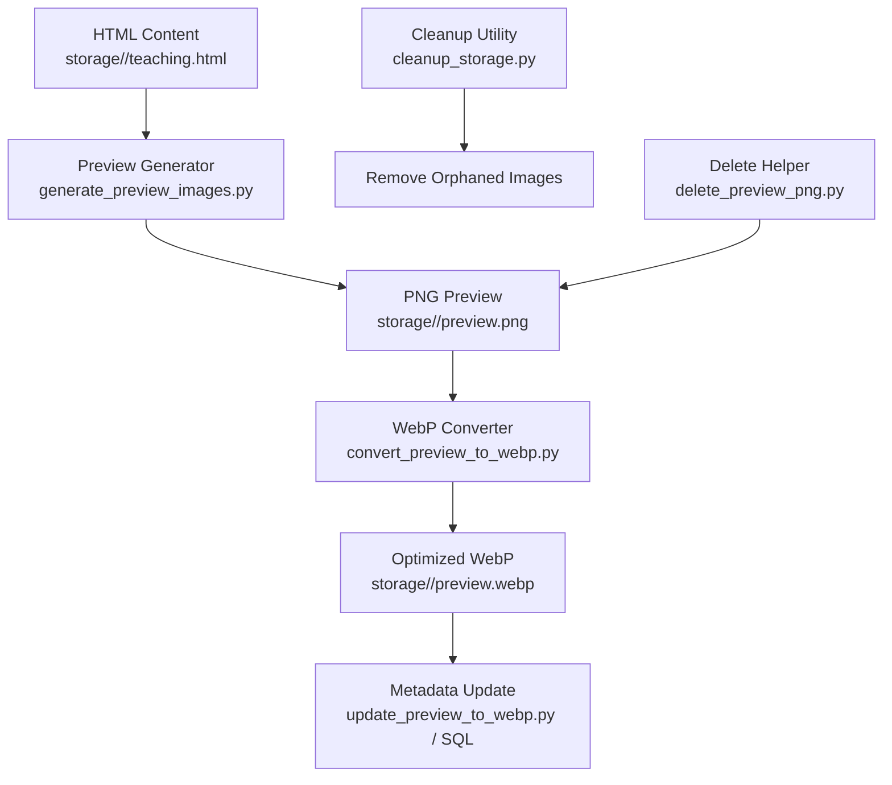
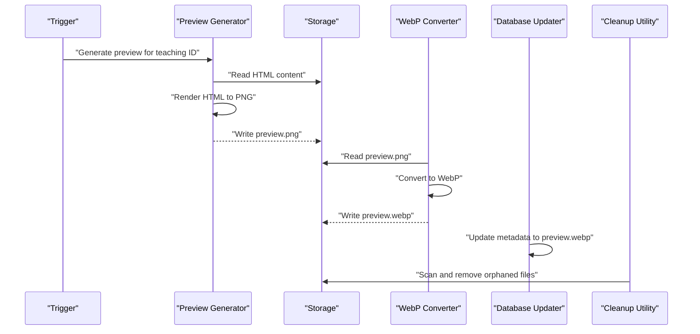
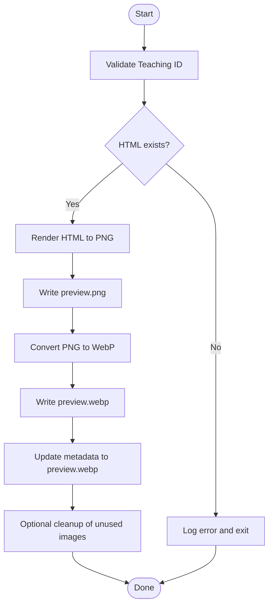
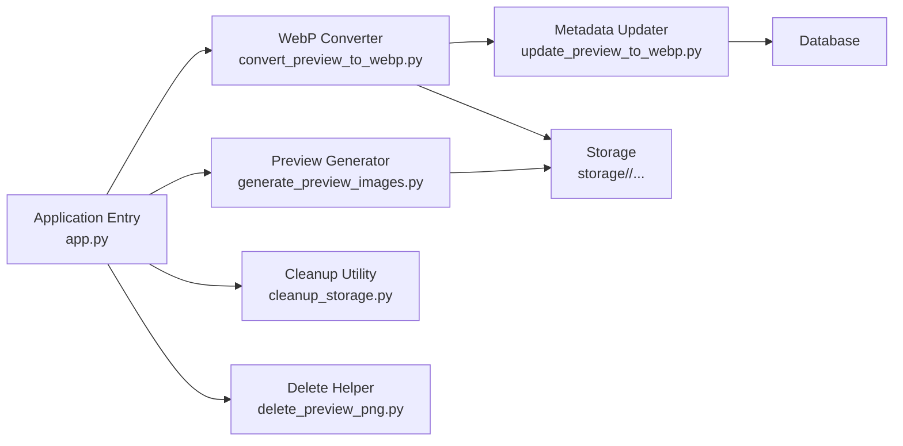

# Preview Image Generation

<cite>
**Referenced Files in This Document**
- [generate_preview_images.py](file://backend/generate_preview_images.py)
- [convert_preview_to_webp.py](file://backend/convert_preview_to_webp.py)
- [update_preview_to_webp.py](file://backend/database/update_preview_to_webp.py)
- [cleanup_storage.py](file://backend/utils/cleanup_storage.py)
- [config.py](file://backend/config.py)
- [app.py](file://backend/app.py)
- [delete_preview_png.py](file://backend/delete_preview_png.py)
- [update_preview_to_webp.sql](file://backend/database/update_preview_to_webp.sql)
</cite>

## Table of Contents
1. [Introduction](#introduction)
2. [Project Structure](#project-structure)
3. [Core Components](#core-components)
4. [Architecture Overview](#architecture-overview)
5. [Detailed Component Analysis](#detailed-component-analysis)
6. [Dependency Analysis](#dependency-analysis)
7. [Performance Considerations](#performance-considerations)
8. [Troubleshooting Guide](#troubleshooting-guide)
9. [Conclusion](#conclusion)

## Introduction
This document explains the preview image generation system used to create thumbnails for teaching content. It covers how HTML content is converted into images, how PNG previews are optimized and converted to WebP, the end-to-end workflow from trigger to storage, error handling strategies, cleanup processes for unused images, configuration options (dimensions, quality, storage paths), examples of triggers and batch operations, and troubleshooting guidance.

## Project Structure
The preview image generation spans several modules:
- Generation scripts that render HTML to images and write them to storage
- Conversion utilities that transform PNG previews into WebP for optimization
- Database migration helpers to update metadata references
- Cleanup utilities to remove orphaned or obsolete images
- Configuration and application entry points that integrate these tools

**Diagram sources**
- [generate_preview_images.py](file://backend/generate_preview_images.py)
- [convert_preview_to_webp.py](file://backend/convert_preview_to_webp.py)
- [update_preview_to_webp.py](file://backend/database/update_preview_to_webp.py)
- [cleanup_storage.py](file://backend/utils/cleanup_storage.py)
- [delete_preview_png.py](file://backend/delete_preview_png.py)
- [update_preview_to_webp.sql](file://backend/database/update_preview_to_webp.sql)

**Section sources**
- [generate_preview_images.py](file://backend/generate_preview_images.py)
- [convert_preview_to_webp.py](file://backend/convert_preview_to_webp.py)
- [update_preview_to_webp.py](file://backend/database/update_preview_to_webp.py)
- [cleanup_storage.py](file://backend/utils/cleanup_storage.py)
- [delete_preview_png.py](file://backend/delete_preview_png.py)
- [update_preview_to_webp.sql](file://backend/database/update_preview_to_webp.sql)

## Core Components
- Preview Generator: Renders HTML content into a thumbnail image and stores it under the teaching item’s directory.
- WebP Converter: Converts existing PNG previews to WebP for better compression and faster loading.
- Metadata Updater: Updates database records to point to the new WebP file when applicable.
- Cleanup Utility: Scans storage and removes unused or orphaned images based on configured rules.
- Delete Helper: Provides targeted deletion of PNG previews after conversion.
- Configuration: Centralized settings for dimensions, quality, output formats, and storage locations.

Key responsibilities:
- Input validation and safe rendering of HTML to images
- Consistent naming conventions for generated assets
- Robust error handling with retries and logging
- Batch processing support for large datasets
- Safe cleanup without affecting active content

**Section sources**
- [generate_preview_images.py](file://backend/generate_preview_images.py)
- [convert_preview_to_webp.py](file://backend/convert_preview_to_webp.py)
- [update_preview_to_webp.py](file://backend/database/update_preview_to_webp.py)
- [cleanup_storage.py](file://backend/utils/cleanup_storage.py)
- [delete_preview_png.py](file://backend/delete_preview_png.py)
- [config.py](file://backend/config.py)

## Architecture Overview
The preview generation pipeline integrates rendering, conversion, metadata updates, and cleanup:

**Diagram sources**
- [generate_preview_images.py](file://backend/generate_preview_images.py)
- [convert_preview_to_webp.py](file://backend/convert_preview_to_webp.py)
- [update_preview_to_webp.py](file://backend/database/update_preview_to_webp.py)
- [cleanup_storage.py](file://backend/utils/cleanup_storage.py)

## Detailed Component Analysis

### Preview Generator
Responsibilities:
- Locate teaching HTML by ID
- Render HTML into a thumbnail image
- Save the PNG preview under the teaching directory
- Handle errors and log failures

Processing logic:
- Validate input parameters (ID, optional overrides)
- Read HTML content safely
- Render to image with configured dimensions and quality
- Persist preview and record status

Error handling:
- Catch rendering exceptions and disk write errors
- Log detailed context for debugging
- Return clear failure signals to callers

Batching:
- Supports iterating over multiple IDs
- Progress reporting and resumable execution

Configuration:
- Dimensions, quality, output path, and format selection

**Section sources**
- [generate_preview_images.py](file://backend/generate_preview_images.py)
- [config.py](file://backend/config.py)

### WebP Converter
Responsibilities:
- Convert existing PNG previews to WebP
- Maintain consistent naming and overwrite strategy
- Preserve original PNG unless explicitly removed

Processing logic:
- Scan for preview.png files
- Convert each to preview.webp with target quality
- Verify successful conversion before proceeding

Error handling:
- Skip corrupted or unreadable PNGs
- Log conversion failures per file
- Continue processing remaining items

Batching:
- Process all available previews or a filtered subset

Configuration:
- Target quality, output format, and concurrency limits

**Section sources**
- [convert_preview_to_webp.py](file://backend/convert_preview_to_webp.py)
- [config.py](file://backend/config.py)

### Metadata Updater
Responsibilities:
- Update database records to reference preview.webp instead of preview.png
- Ensure consistency between storage and metadata

Processing logic:
- Identify teachings with updated WebP previews
- Execute SQL updates or ORM calls to set the new preview path
- Commit changes and verify success

Error handling:
- Transactional updates to avoid partial state
- Rollback on failure and log details

Batching:
- Bulk update across many records efficiently

Configuration:
- Database connection settings and update scope filters

**Section sources**
- [update_preview_to_webp.py](file://backend/database/update_preview_to_webp.py)
- [update_preview_to_webp.sql](file://backend/database/update_preview_to_webp.sql)
- [config.py](file://backend/config.py)

### Cleanup Utility
Responsibilities:
- Remove orphaned or unused images
- Enforce retention policies and safety checks

Processing logic:
- Scan storage directories for images not referenced by metadata
- Compare against known active IDs
- Delete files safely with dry-run option

Error handling:
- Skip locked or inaccessible files
- Log deletions and failures

Batching:
- Process entire storage tree or specific subdirectories

Configuration:
- Dry-run mode, allowed extensions, retention thresholds

**Section sources**
- [cleanup_storage.py](file://backend/utils/cleanup_storage.py)
- [config.py](file://backend/config.py)

### Delete Helper
Responsibilities:
- Provide targeted deletion of PNG previews after conversion
- Optional confirmation and logging

Processing logic:
- Accept list of IDs or wildcard patterns
- Remove corresponding preview.png files
- Report results and errors

Error handling:
- Ignore missing files gracefully
- Log permission issues

Configuration:
- Target directory and file patterns

**Section sources**
- [delete_preview_png.py](file://backend/delete_preview_png.py)
- [config.py](file://backend/config.py)

### Configuration
Responsibilities:
- Centralize settings for image dimensions, quality, formats, and storage paths
- Provide defaults and environment overrides

Key options:
- Preview width/height
- Output quality and compression level
- Storage root and per-teaching directories
- Supported formats (PNG, WebP)
- Concurrency and retry limits

**Section sources**
- [config.py](file://backend/config.py)

## Architecture Overview
End-to-end flow from trigger to optimized preview:

**Diagram sources**
- [generate_preview_images.py](file://backend/generate_preview_images.py)
- [convert_preview_to_webp.py](file://backend/convert_preview_to_webp.py)
- [update_preview_to_webp.py](file://backend/database/update_preview_to_webp.py)
- [cleanup_storage.py](file://backend/utils/cleanup_storage.py)

## Dependency Analysis
Interactions among components:

**Diagram sources**
- [app.py](file://backend/app.py)
- [generate_preview_images.py](file://backend/generate_preview_images.py)
- [convert_preview_to_webp.py](file://backend/convert_preview_to_webp.py)
- [update_preview_to_webp.py](file://backend/database/update_preview_to_webp.py)
- [cleanup_storage.py](file://backend/utils/cleanup_storage.py)
- [delete_preview_png.py](file://backend/delete_preview_png.py)

**Section sources**
- [app.py](file://backend/app.py)
- [generate_preview_images.py](file://backend/generate_preview_images.py)
- [convert_preview_to_webp.py](file://backend/convert_preview_to_webp.py)
- [update_preview_to_webp.py](file://backend/database/update_preview_to_webp.py)
- [cleanup_storage.py](file://backend/utils/cleanup_storage.py)
- [delete_preview_png.py](file://backend/delete_preview_png.py)

## Performance Considerations
- Use WebP for smaller file sizes and faster load times compared to PNG
- Configure appropriate image dimensions to balance quality and performance
- Enable concurrency where supported to process multiple previews in parallel
- Implement caching for rendered HTML if repeated renders occur
- Avoid unnecessary conversions by checking existing WebP presence
- Limit batch sizes to prevent memory spikes during large operations

[No sources needed since this section provides general guidance]

## Troubleshooting Guide
Common issues and resolutions:
- Rendering failures: Check HTML validity and dependencies; ensure required fonts and assets are accessible
- Disk write errors: Verify permissions and available disk space
- Conversion failures: Confirm PNG integrity and converter availability; skip corrupted files
- Metadata mismatch: Re-run metadata updater; validate database connectivity and transaction logs
- Cleanup anomalies: Use dry-run mode to preview deletions; confirm active IDs and retention policies

Operational tips:
- Enable verbose logging for each step
- Run small batches first to validate behavior
- Keep backups of storage and database before bulk operations
- Monitor storage growth and clean up regularly

**Section sources**
- [generate_preview_images.py](file://backend/generate_preview_images.py)
- [convert_preview_to_webp.py](file://backend/convert_preview_to_webp.py)
- [update_preview_to_webp.py](file://backend/database/update_preview_to_webp.py)
- [cleanup_storage.py](file://backend/utils/cleanup_storage.py)
- [delete_preview_png.py](file://backend/delete_preview_png.py)

## Conclusion
The preview image generation system provides an automated, optimized pipeline for creating teaching content thumbnails. By converting HTML to images, optimizing with WebP, updating metadata, and cleaning up unused assets, it ensures efficient storage and fast delivery. Proper configuration, robust error handling, and batch processing capabilities make it suitable for large-scale deployments.

[No sources needed since this section summarizes without analyzing specific files]