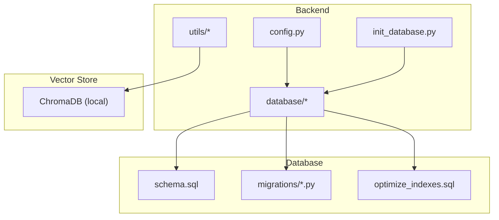
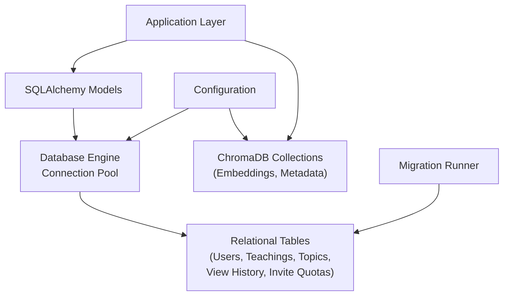
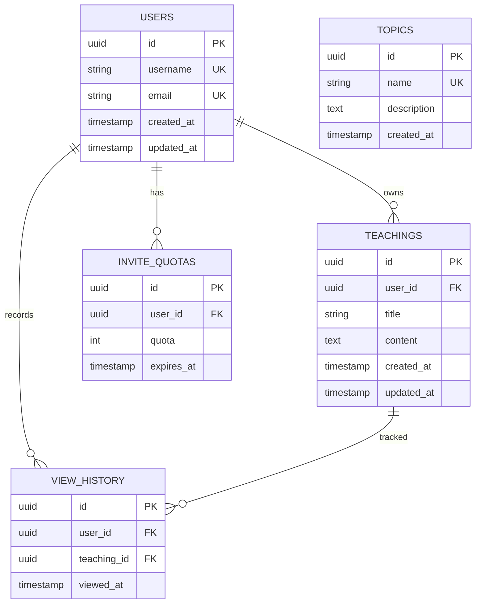
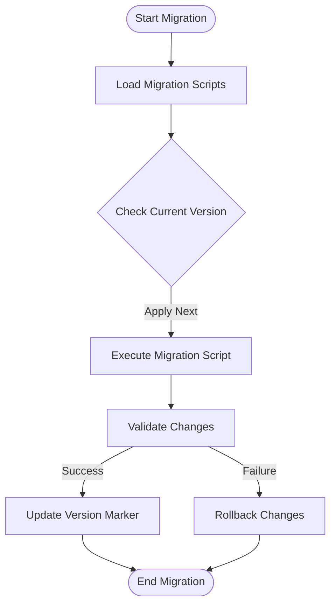
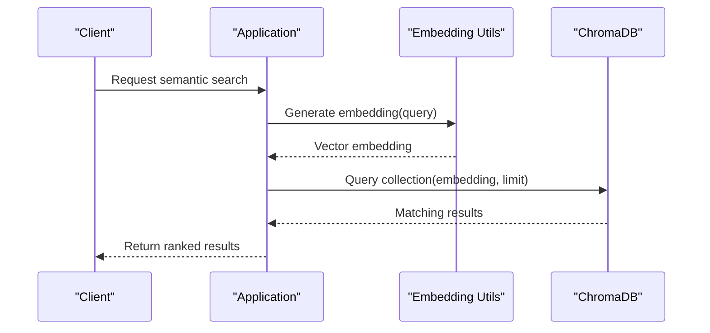
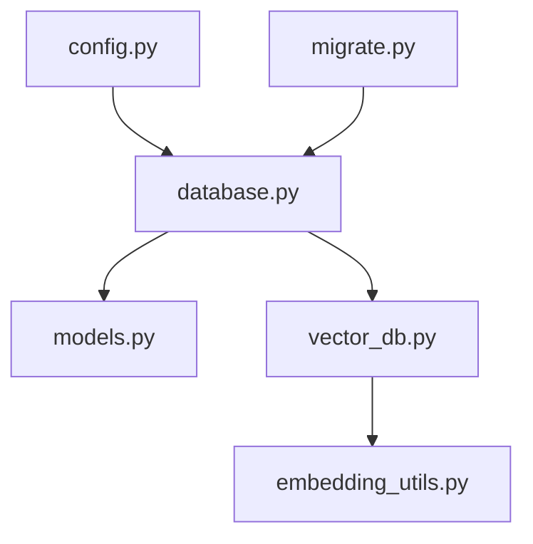

# Database Design & Management

<cite>
**Referenced Files in This Document**
- [database.py](file://backend/database/database.py)
- [models.py](file://backend/database/models.py)
- [schema.sql](file://backend/database/schema.sql)
- [migrate.py](file://backend/database/migrate.py)
- [add_ai_teaching_tables.py](file://backend/database/add_ai_teaching_tables.py)
- [add_invite_quota_tables.py](file://backend/database/add_invite_quota_tables.py)
- [add_topic_share_fields.py](file://backend/database/add_topic_share_fields.py)
- [add_topics_table.py](file://backend/database/add_topics_table.py)
- [add_user_profile_fields.py](file://backend/database/add_user_profile_fields.py)
- [add_view_count_field.py](file://backend/database/add_view_count_field.py)
- [add_view_history_table.py](file://backend/database/add_view_history_table.py)
- [optimize_indexes.sql](file://backend/database/optimize_indexes.sql)
- [vector_db.py](file://backend/utils/vector_db.py)
- [embedding_utils.py](file://backend/utils/embedding_utils.py)
- [config.py](file://backend/config.py)
- [init_database.py](file://backend/init_database.py)
- [xsyy_backup.sql](file://backend/xsyy_backup.sql)
- [PERFORMANCE_OPTIMIZATION.md](file://backend/PERFORMANCE_OPTIMIZATION.md)
</cite>

## Table of Contents
1. [Introduction](#introduction)
2. [Project Structure](#project-structure)
3. [Core Components](#core-components)
4. [Architecture Overview](#architecture-overview)
5. [Detailed Component Analysis](#detailed-component-analysis)
6. [Dependency Analysis](#dependency-analysis)
7. [Performance Considerations](#performance-considerations)
8. [Troubleshooting Guide](#troubleshooting-guide)
9. [Conclusion](#conclusion)
10. [Appendices](#appendices)

## Introduction
This document provides comprehensive database design and management documentation for the XSYY Edu platform. It covers schema design, entity relationships, constraints, indexes, validation rules, migration system, ORM implementation with SQLAlchemy, query optimization patterns, connection pooling, backup and recovery procedures, data archival strategies, performance tuning techniques, and vector database integration using ChromaDB for semantic search capabilities. The goal is to enable both technical and non-technical readers to understand how data is modeled, persisted, evolved, and optimized across deployments.

## Project Structure
The database-related code resides primarily under backend/database and backend/utils. Key files include:
- Schema definition and SQL migrations
- SQLAlchemy models and engine configuration
- Migration scripts for evolving schema
- Vector database utilities for embedding and semantic search
- Configuration and initialization scripts
- Performance optimization notes and index tuning scripts

**Diagram sources**
- [database.py](file://backend/database/database.py)
- [models.py](file://backend/database/models.py)
- [schema.sql](file://backend/database/schema.sql)
- [migrate.py](file://backend/database/migrate.py)
- [vector_db.py](file://backend/utils/vector_db.py)
- [config.py](file://backend/config.py)
- [init_database.py](file://backend/init_database.py)

**Section sources**
- [database.py](file://backend/database/database.py)
- [models.py](file://backend/database/models.py)
- [schema.sql](file://backend/database/schema.sql)
- [migrate.py](file://backend/database/migrate.py)
- [vector_db.py](file://backend/utils/vector_db.py)
- [config.py](file://backend/config.py)
- [init_database.py](file://backend/init_database.py)

## Core Components
- Database Engine and Session Management: Centralized engine creation, session factory, and connection pooling configuration.
- ORM Models: SQLAlchemy declarative models representing users, teachings, topics, view history, invite quotas, and AI teaching artifacts.
- Migration System: Python-based migration scripts and a central migrate runner to evolve schema safely.
- Index Optimization: SQL scripts to add or refine indexes for query performance.
- Vector Integration: Embedding utilities and ChromaDB client for semantic search over teaching content.
- Initialization and Backup: Scripts to initialize databases and generate backups.

Key responsibilities:
- Ensure consistent schema evolution via versioned migrations.
- Provide robust ORM abstractions for CRUD operations.
- Optimize queries through proper indexing and query patterns.
- Integrate vector search for semantic retrieval of teaching materials.

**Section sources**
- [database.py](file://backend/database/database.py)
- [models.py](file://backend/database/models.py)
- [migrate.py](file://backend/database/migrate.py)
- [optimize_indexes.sql](file://backend/database/optimize_indexes.sql)
- [vector_db.py](file://backend/utils/vector_db.py)
- [embedding_utils.py](file://backend/utils/embedding_utils.py)
- [init_database.py](file://backend/init_database.py)
- [xsyy_backup.sql](file://backend/xsyy_backup.sql)

## Architecture Overview
The database architecture combines relational storage (SQLAlchemy + SQL) with vector storage (ChromaDB). Relational tables manage core entities and metadata; vector embeddings support semantic search over teaching content. Migrations ensure schema consistency across environments. Connection pooling and indexes optimize performance.

**Diagram sources**
- [database.py](file://backend/database/database.py)
- [models.py](file://backend/database/models.py)
- [vector_db.py](file://backend/utils/vector_db.py)
- [migrate.py](file://backend/database/migrate.py)
- [config.py](file://backend/config.py)

## Detailed Component Analysis

### Relational Schema and ORM Models
The relational schema defines core entities such as Users, Teachings, Topics, View History, and Invite Quotas. SQLAlchemy models map these entities to tables with primary keys, foreign keys, and constraints. Validation rules are enforced at both model and application layers.

Key aspects:
- Primary keys: Unique identifiers for each entity.
- Foreign keys: Relationships between entities (e.g., user_id in teachings).
- Constraints: Not null, unique, check constraints where applicable.
- Indexes: Optimized columns for frequent queries.

**Diagram sources**
- [models.py](file://backend/database/models.py)
- [schema.sql](file://backend/database/schema.sql)

**Section sources**
- [models.py](file://backend/database/models.py)
- [schema.sql](file://backend/database/schema.sql)

### Migration System
Migrations are implemented as Python scripts that alter the schema incrementally. A central migration runner executes these scripts in order, ensuring consistent evolution across deployments. Each migration targets specific changes like adding fields, creating tables, or modifying constraints.

Common migration types:
- Add new tables (e.g., topics, view history)
- Add fields to existing tables (e.g., user profile fields, view count)
- Modify existing structures (e.g., preview image format updates)

**Diagram sources**
- [migrate.py](file://backend/database/migrate.py)
- [add_ai_teaching_tables.py](file://backend/database/add_ai_teaching_tables.py)
- [add_invite_quota_tables.py](file://backend/database/add_invite_quota_tables.py)
- [add_topic_share_fields.py](file://backend/database/add_topic_share_fields.py)
- [add_topics_table.py](file://backend/database/add_topics_table.py)
- [add_user_profile_fields.py](file://backend/database/add_user_profile_fields.py)
- [add_view_count_field.py](file://backend/database/add_view_count_field.py)
- [add_view_history_table.py](file://backend/database/add_view_history_table.py)

**Section sources**
- [migrate.py](file://backend/database/migrate.py)
- [add_ai_teaching_tables.py](file://backend/database/add_ai_teaching_tables.py)
- [add_invite_quota_tables.py](file://backend/database/add_invite_quota_tables.py)
- [add_topic_share_fields.py](file://backend/database/add_topic_share_fields.py)
- [add_topics_table.py](file://backend/database/add_topics_table.py)
- [add_user_profile_fields.py](file://backend/database/add_user_profile_fields.py)
- [add_view_count_field.py](file://backend/database/add_view_count_field.py)
- [add_view_history_table.py](file://backend/database/add_view_history_table.py)

### Vector Database Integration (ChromaDB)
Semantic search is enabled by generating embeddings for teaching content and storing them in ChromaDB. Embedding utilities create vector representations, while the vector database client manages collections and queries.

Key components:
- Embedding generation: Convert text content into vectors.
- Collection management: Create and update collections for different content types.
- Semantic queries: Search by similarity using vector embeddings.

**Diagram sources**
- [vector_db.py](file://backend/utils/vector_db.py)
- [embedding_utils.py](file://backend/utils/embedding_utils.py)

**Section sources**
- [vector_db.py](file://backend/utils/vector_db.py)
- [embedding_utils.py](file://backend/utils/embedding_utils.py)

### Connection Pooling and Engine Configuration
Database connections are managed through SQLAlchemy engine configuration with connection pooling. Parameters such as pool size, max overflow, and timeout settings are tuned based on workload characteristics.

Best practices:
- Set appropriate pool sizes for concurrent access patterns.
- Configure timeouts to prevent resource exhaustion.
- Use scoped sessions for thread safety.

**Section sources**
- [database.py](file://backend/database/database.py)
- [config.py](file://backend/config.py)

### Index Optimization
Index optimization scripts define additional indexes to improve query performance. These target frequently queried columns and join conditions.

Common optimizations:
- Composite indexes for multi-column queries.
- Partial indexes for filtered queries.
- Rebuilding indexes after bulk operations.

**Section sources**
- [optimize_indexes.sql](file://backend/database/optimize_indexes.sql)

## Dependency Analysis
The database layer depends on configuration for connection parameters and interacts with both relational and vector storage systems. Migration scripts depend on the migration runner for execution order and validation.

**Diagram sources**
- [config.py](file://backend/config.py)
- [database.py](file://backend/database/database.py)
- [models.py](file://backend/database/models.py)
- [migrate.py](file://backend/database/migrate.py)
- [vector_db.py](file://backend/utils/vector_db.py)
- [embedding_utils.py](file://backend/utils/embedding_utils.py)

**Section sources**
- [config.py](file://backend/config.py)
- [database.py](file://backend/database/database.py)
- [models.py](file://backend/database/models.py)
- [migrate.py](file://backend/database/migrate.py)
- [vector_db.py](file://backend/utils/vector_db.py)
- [embedding_utils.py](file://backend/utils/embedding_utils.py)

## Performance Considerations
Performance optimization focuses on query efficiency, connection management, and storage utilization. Key areas include:
- Query optimization through proper indexing and query patterns.
- Connection pooling configuration for optimal concurrency.
- Data archival strategies to manage growing datasets.
- Vector search optimization for semantic queries.

Recommendations:
- Monitor slow queries and add targeted indexes.
- Tune connection pool sizes based on load testing.
- Implement data partitioning for large tables.
- Cache frequently accessed data at application level.

**Section sources**
- [PERFORMANCE_OPTIMIZATION.md](file://backend/PERFORMANCE_OPTIMIZATION.md)
- [optimize_indexes.sql](file://backend/database/optimize_indexes.sql)
- [database.py](file://backend/database/database.py)

## Troubleshooting Guide
Common issues and solutions:
- Connection errors: Verify database credentials and network connectivity.
- Migration failures: Check script syntax and rollback mechanisms.
- Slow queries: Analyze execution plans and add appropriate indexes.
- Vector search issues: Validate embedding dimensions and collection names.

Debugging steps:
- Enable detailed logging for database operations.
- Use database-specific tools to inspect query performance.
- Validate schema consistency across environments.
- Test migrations in isolated environments before deployment.

**Section sources**
- [database.py](file://backend/database/database.py)
- [migrate.py](file://backend/database/migrate.py)
- [PERFORMANCE_OPTIMIZATION.md](file://backend/PERFORMANCE_OPTIMIZATION.md)

## Conclusion
The XSYY Edu platform implements a robust database design combining relational storage with vector search capabilities. The migration system ensures schema evolution, while connection pooling and indexing optimize performance. The integration with ChromaDB enables semantic search over teaching content, enhancing user experience. Proper backup and recovery procedures maintain data integrity across deployments.

## Appendices

### Backup and Recovery Procedures
- Regular backups using database dump tools.
- Incremental backups for large datasets.
- Recovery procedures for disaster scenarios.
- Testing backup restoration processes regularly.

### Data Archival Strategies
- Archive old records to separate tables or databases.
- Implement retention policies for compliance.
- Compress archived data to save storage space.
- Maintain referential integrity during archival.

### Example Migration Pattern
When creating a new table:
1. Create migration script with CREATE TABLE statement.
2. Add necessary indexes and constraints.
3. Include rollback logic for safe deployment.
4. Test migration in development environment first.

### Query Optimization Examples
- Use EXPLAIN ANALYZE to identify slow queries.
- Add composite indexes for common filter combinations.
- Avoid SELECT * statements; specify required columns.
- Use pagination for large result sets.

### Custom Data Access Patterns
- Implement repository pattern for data access abstraction.
- Use context managers for transaction handling.
- Cache frequently accessed data at application level.
- Implement retry logic for transient failures.