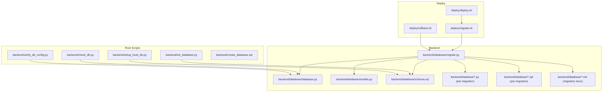
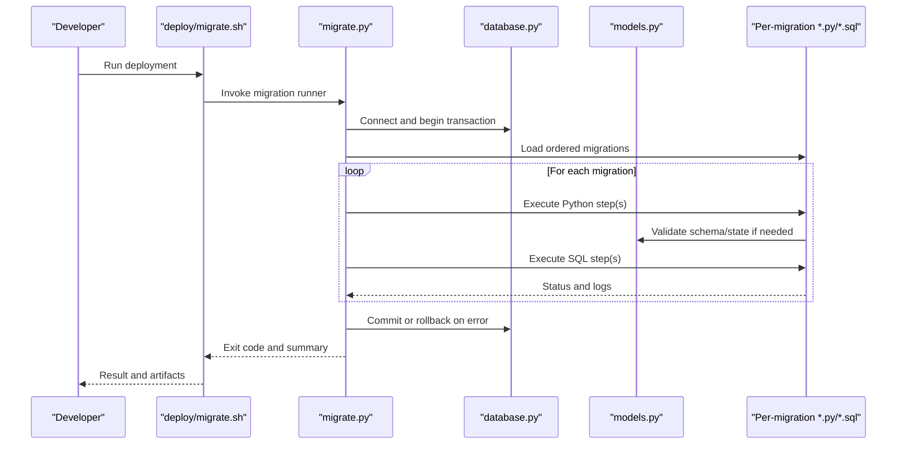
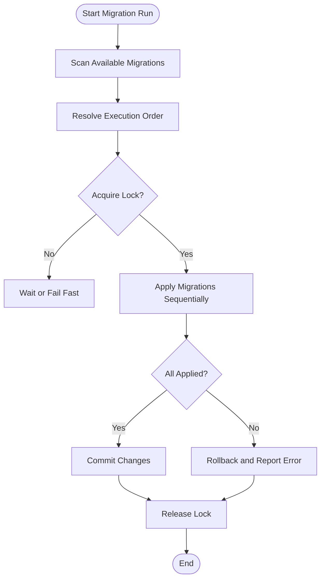

# Migration Management & Version Control

<cite>
**Referenced Files in This Document**
- [migrate.py](file://backend/database/migrate.py)
- [database.py](file://backend/database/database.py)
- [models.py](file://backend/database/models.py)
- [schema.sql](file://backend/database/schema.sql)
- [TOPIC_SHARE_MIGRATION.md](file://backend/database/TOPIC_SHARE_MIGRATION.md)
- [VIEW_COUNT_MIGRATION.md](file://backend/database/VIEW_COUNT_MIGRATION.md)
- [add_ai_teaching_tables.py](file://backend/database/add_ai_teaching_tables.py)
- [add_ai_teaching_tables.sql](file://backend/database/add_ai_teaching_tables.sql)
- [add_daily_calls_fields.py](file://backend/database/add_daily_calls_fields.py)
- [add_has_pic_to_teachings.sql](file://backend/database/add_has_pic_to_teachings.sql)
- [add_invite_quota_tables.py](file://backend/database/add_invite_quota_tables.py)
- [add_invite_quota_tables.sql](file://backend/database/add_invite_quota_tables.sql)
- [add_topic_share_fields.py](file://backend/database/add_topic_share_fields.py)
- [add_topic_share_fields.sql](file://backend/database/add_topic_share_fields.sql)
- [add_topics_table.py](file://backend/database/add_topics_table.py)
- [add_topics_table.sql](file://backend/database/add_topics_table.sql)
- [add_user_id_to_teachings.sql](file://backend/database/add_user_id_to_teachings.sql)
- [add_user_profile_fields.py](file://backend/database/add_user_profile_fields.py)
- [add_user_profile_fields.sql](file://backend/database/add_user_profile_fields.sql)
- [add_view_count_field.py](file://backend/database/add_view_count_field.py)
- [add_view_count_field.sql](file://backend/database/add_view_count_field.sql)
- [add_view_history_table.py](file://backend/database/add_view_history_table.py)
- [add_view_history_table.sql](file://backend/database/add_view_history_table.sql)
- [optimize_indexes.sql](file://backend/database/optimize_indexes.sql)
- [update_preview_to_webp.py](file://backend/database/update_preview_to_webp.py)
- [update_preview_to_webp_simple.py](file://backend/database/update_preview_to_webp_simple.py)
- [update_preview_to_webp.sql](file://backend/database/update_preview_to_webp.sql)
- [init_database.py](file://backend/init_database.py)
- [check_db.py](file://backend/check_db.py)
- [setup_local_db.py](file://backend/setup_local_db.py)
- [verify_db_config.py](file://backend/verify_db_config.py)
- [create_database.sql](file://backend/create_database.sql)
- [deploy.sh](file://deploy/deploy.sh)
- [migrate.sh](file://deploy/migrate.sh)
- [rollback.sh](file://deploy/rollback.sh)
</cite>

## Table of Contents
1. [Introduction](#introduction)
2. [Project Structure](#project-structure)
3. [Core Components](#core-components)
4. [Architecture Overview](#architecture-overview)
5. [Detailed Component Analysis](#detailed-component-analysis)
6. [Dependency Analysis](#dependency-analysis)
7. [Performance Considerations](#performance-considerations)
8. [Troubleshooting Guide](#troubleshooting-guide)
9. [Conclusion](#conclusion)
10. [Appendices](#appendices)

## Introduction
This document explains the database migration system implemented for the project. It covers the migration framework architecture, version control strategy, rollback procedures, and how to create new migrations safely. It also documents schema evolution patterns, data consistency strategies, execution workflow, dependency management, conflict resolution, best practices for safe migrations, testing approaches, backward compatibility considerations, and the relationship between migration files and database state synchronization.

## Project Structure
The migration-related code is primarily located under backend/database, with supporting scripts at the repository root and deployment helpers under deploy. The structure separates:
- Schema definition (initial baseline)
- Python-based migration orchestrators
- SQL migration scripts
- Documentation for specific migrations
- Deployment and rollback utilities

**Diagram sources**
- [migrate.py](file://backend/database/migrate.py)
- [database.py](file://backend/database/database.py)
- [models.py](file://backend/database/models.py)
- [schema.sql](file://backend/database/schema.sql)
- [add_ai_teaching_tables.py](file://backend/database/add_ai_teaching_tables.py)
- [add_ai_teaching_tables.sql](file://backend/database/add_ai_teaching_tables.sql)
- [add_daily_calls_fields.py](file://backend/database/add_daily_calls_fields.py)
- [add_has_pic_to_teachings.sql](file://backend/database/add_has_pic_to_teachings.sql)
- [add_invite_quota_tables.py](file://backend/database/add_invite_quota_tables.py)
- [add_invite_quota_tables.sql](file://backend/database/add_invite_quota_tables.sql)
- [add_topic_share_fields.py](file://backend/database/add_topic_share_fields.py)
- [add_topic_share_fields.sql](file://backend/database/add_topic_share_fields.sql)
- [add_topics_table.py](file://backend/database/add_topics_table.py)
- [add_topics_table.sql](file://backend/database/add_topics_table.sql)
- [add_user_id_to_teachings.sql](file://backend/database/add_user_id_to_teachings.sql)
- [add_user_profile_fields.py](file://backend/database/add_user_profile_fields.py)
- [add_user_profile_fields.sql](file://backend/database/add_user_profile_fields.sql)
- [add_view_count_field.py](file://backend/database/add_view_count_field.py)
- [add_view_count_field.sql](file://backend/database/add_view_count_field.sql)
- [add_view_history_table.py](file://backend/database/add_view_history_table.py)
- [add_view_history_table.sql](file://backend/database/add_view_history_table.sql)
- [optimize_indexes.sql](file://backend/database/optimize_indexes.sql)
- [update_preview_to_webp.py](file://backend/database/update_preview_to_webp.py)
- [update_preview_to_webp_simple.py](file://backend/database/update_preview_to_webp_simple.py)
- [update_preview_to_webp.sql](file://backend/database/update_preview_to_webp.sql)
- [init_database.py](file://backend/init_database.py)
- [check_db.py](file://backend/check_db.py)
- [setup_local_db.py](file://backend/setup_local_db.py)
- [verify_db_config.py](file://backend/verify_db_config.py)
- [create_database.sql](file://backend/create_database.sql)
- [deploy.sh](file://deploy/deploy.sh)
- [migrate.sh](file://deploy/migrate.sh)
- [rollback.sh](file://deploy/rollback.sh)

**Section sources**
- [migrate.py](file://backend/database/migrate.py)
- [database.py](file://backend/database/database.py)
- [models.py](file://backend/database/models.py)
- [schema.sql](file://backend/database/schema.sql)
- [init_database.py](file://backend/init_database.py)
- [check_db.py](file://backend/check_db.py)
- [setup_local_db.py](file://backend/setup_local_db.py)
- [verify_db_config.py](file://backend/verify_db_config.py)
- [create_database.sql](file://backend/create_database.sql)
- [deploy.sh](file://deploy/deploy.sh)
- [migrate.sh](file://deploy/migrate.sh)
- [rollback.sh](file://deploy/rollback.sh)

## Core Components
- Migration Orchestrator: Central logic that discovers, orders, and executes migrations. It coordinates with the database layer and applies both Python and SQL steps.
- Database Layer: Provides connection management, transaction handling, and query execution used by the orchestrator.
- Models: Defines ORM or schema-aligned structures used to validate or interact with tables during migrations.
- Baseline Schema: The initial schema file used for fresh installations and as a reference for future schema reconciliation.
- Per-Migration Artifacts: Paired Python and SQL files implementing idempotent changes, conditional logic, and data transformations.
- Migration Documentation: Markdown files describing intent, risks, and rollback notes for complex migrations.
- Deployment Utilities: Shell scripts that invoke the orchestrator during CI/CD and manual deployments, including rollback support.

Key responsibilities:
- Idempotency: Ensure repeated runs do not break existing state.
- Ordering: Respect dependencies across migrations.
- Atomicity: Use transactions where possible to maintain consistency.
- Observability: Log progress and errors for troubleshooting.
- Safety: Provide clear rollback paths and pre-checks.

**Section sources**
- [migrate.py](file://backend/database/migrate.py)
- [database.py](file://backend/database/database.py)
- [models.py](file://backend/database/models.py)
- [schema.sql](file://backend/database/schema.sql)
- [TOPIC_SHARE_MIGRATION.md](file://backend/database/TOPIC_SHARE_MIGRATION.md)
- [VIEW_COUNT_MIGRATION.md](file://backend/database/VIEW_COUNT_MIGRATION.md)

## Architecture Overview
The migration system follows a layered approach:
- Orchestrator reads configuration and environment, loads migrations, and executes them in order.
- Database layer abstracts connectivity and transaction boundaries.
- Each migration can be implemented in Python for orchestration and conditionals, and/or SQL for direct schema/data changes.
- Deployment scripts wrap the orchestrator to integrate with CI/CD and provide rollback capabilities.

**Diagram sources**
- [migrate.py](file://backend/database/migrate.py)
- [database.py](file://backend/database/database.py)
- [models.py](file://backend/database/models.py)
- [add_ai_teaching_tables.py](file://backend/database/add_ai_teaching_tables.py)
- [add_ai_teaching_tables.sql](file://backend/database/add_ai_teaching_tables.sql)
- [add_topic_share_fields.py](file://backend/database/add_topic_share_fields.py)
- [add_topic_share_fields.sql](file://backend/database/add_topic_share_fields.sql)
- [add_view_count_field.py](file://backend/database/add_view_count_field.py)
- [add_view_count_field.sql](file://backend/database/add_view_count_field.sql)
- [add_view_history_table.py](file://backend/database/add_view_history_table.py)
- [add_view_history_table.sql](file://backend/database/add_view_history_table.sql)
- [update_preview_to_webp.py](file://backend/database/update_preview_to_webp.py)
- [update_preview_to_webp.sql](file://backend/database/update_preview_to_webp.sql)
- [migrate.sh](file://deploy/migrate.sh)

## Detailed Component Analysis

### Migration Orchestrator
Responsibilities:
- Discover available migrations from the database directory.
- Determine execution order based on naming/versioning or explicit dependencies.
- Apply Python and SQL steps within transactional boundaries.
- Track applied migrations to ensure idempotency.
- Handle errors, logging, and partial failure recovery.

Implementation patterns:
- Conditional checks before applying changes to avoid duplicate work.
- Batched operations for large data updates to reduce lock time.
- Pre-flight validations using models or schema introspection.

Best practices:
- Keep each migration focused on a single change.
- Make all operations idempotent.
- Prefer SQL for schema changes; use Python for orchestration and complex logic.
- Record metadata about what was applied for auditability.

**Section sources**
- [migrate.py](file://backend/database/migrate.py)
- [database.py](file://backend/database/database.py)
- [models.py](file://backend/database/models.py)

### Database Layer
Responsibilities:
- Manage connections and pooling.
- Provide transaction APIs for atomic execution.
- Execute prepared statements and raw SQL safely.
- Surface consistent error types and messages.

Operational notes:
- Use short-lived transactions for small changes.
- Wrap long-running data migrations in larger transactions or chunked batches.
- Avoid holding locks longer than necessary.

**Section sources**
- [database.py](file://backend/database/database.py)

### Models
Responsibilities:
- Define table structures and constraints aligned with schema.
- Provide validation helpers used by migrations to check existence of columns/tables.
- Serve as a source of truth for schema expectations.

Usage in migrations:
- Conditional logic uses model definitions to detect current state.
- Data integrity checks rely on model constraints.

**Section sources**
- [models.py](file://backend/database/models.py)

### Baseline Schema
Purpose:
- Establishes the initial database state for fresh installs.
- Acts as a reference for reconciling drift and generating diffs.

Usage:
- Used by initialization scripts to bootstrap databases.
- Referenced when creating new migrations to ensure alignment.

**Section sources**
- [schema.sql](file://backend/database/schema.sql)
- [create_database.sql](file://backend/create_database.sql)
- [init_database.py](file://backend/init_database.py)

### Per-Migration Artifacts
Patterns observed across the codebase:
- Pairing Python and SQL files for clarity and separation of concerns.
- Using Python for pre/post checks and orchestration.
- Using SQL for DDL/DML operations.
- Implementing idempotency via conditional checks.

Examples:
- Adding AI teaching tables: Python orchestrates creation and SQL defines schema.
- Adding topic share fields: Python validates presence and SQL alters tables.
- Adding view count field: Python ensures column existence and SQL adds it.
- Adding view history table: Python prepares context and SQL creates table.
- Updating preview images to WebP: Python iterates records and SQL updates blobs.

Idempotency techniques:
- Check for table/column existence before altering.
- Skip steps if already applied.
- Use upsert-like patterns for data normalization.

Error handling:
- Catch exceptions and log detailed context.
- Roll back transactions on failure.
- Provide actionable messages for operators.

**Section sources**
- [add_ai_teaching_tables.py](file://backend/database/add_ai_teaching_tables.py)
- [add_ai_teaching_tables.sql](file://backend/database/add_ai_teaching_tables.sql)
- [add_topic_share_fields.py](file://backend/database/add_topic_share_fields.py)
- [add_topic_share_fields.sql](file://backend/database/add_topic_share_fields.sql)
- [add_view_count_field.py](file://backend/database/add_view_count_field.py)
- [add_view_count_field.sql](file://backend/database/add_view_count_field.sql)
- [add_view_history_table.py](file://backend/database/add_view_history_table.py)
- [add_view_history_table.sql](file://backend/database/add_view_history_table.sql)
- [update_preview_to_webp.py](file://backend/database/update_preview_to_webp.py)
- [update_preview_to_webp.sql](file://backend/database/update_preview_to_webp.sql)
- [update_preview_to_webp_simple.py](file://backend/database/update_preview_to_webp_simple.py)
- [add_daily_calls_fields.py](file://backend/database/add_daily_calls_fields.py)
- [add_has_pic_to_teachings.sql](file://backend/database/add_has_pic_to_teachings.sql)
- [add_invite_quota_tables.py](file://backend/database/add_invite_quota_tables.py)
- [add_invite_quota_tables.sql](file://backend/database/add_invite_quota_tables.sql)
- [add_topics_table.py](file://backend/database/add_topics_table.py)
- [add_topics_table.sql](file://backend/database/add_topics_table.sql)
- [add_user_id_to_teachings.sql](file://backend/database/add_user_id_to_teachings.sql)
- [add_user_profile_fields.py](file://backend/database/add_user_profile_fields.py)
- [add_user_profile_fields.sql](file://backend/database/add_user_profile_fields.sql)
- [optimize_indexes.sql](file://backend/database/optimize_indexes.sql)

### Migration Documentation
Role:
- Explain purpose, scope, and risk of complex migrations.
- Provide rollback guidance and verification steps.
- Document assumptions and prerequisites.

Examples:
- Topic share migration documentation outlines rationale and steps.
- View count migration documentation describes tracking and aggregation.

**Section sources**
- [TOPIC_SHARE_MIGRATION.md](file://backend/database/TOPIC_SHARE_MIGRATION.md)
- [VIEW_COUNT_MIGRATION.md](file://backend/database/VIEW_COUNT_MIGRATION.md)

### Deployment and Rollback Utilities
Functions:
- deploy.sh: Orchestrates full deployment including migrations.
- migrate.sh: Runs the migration orchestrator with environment setup.
- rollback.sh: Reverts recent migrations or restores previous state.

Integration:
- CI/CD pipelines call these scripts to apply changes consistently.
- Rollback scripts coordinate with the orchestrator to reverse applied migrations safely.

**Section sources**
- [deploy.sh](file://deploy/deploy.sh)
- [migrate.sh](file://deploy/migrate.sh)
- [rollback.sh](file://deploy/rollback.sh)

## Dependency Analysis
Migration ordering and dependencies are managed by the orchestrator, which:
- Scans migration files and resolves order.
- Ensures prerequisite migrations are applied first.
- Prevents concurrent application conflicts by locking or serializing execution.

Potential issues:
- Circular dependencies must be avoided.
- Out-of-order applications should be detected and prevented.
- Conflicts arise when multiple instances attempt to apply migrations simultaneously.

Resolution strategies:
- Use a centralized lock mechanism during migration runs.
- Enforce strict ordering via naming conventions or explicit dependency declarations.
- Validate state before applying dependent migrations.

[No sources needed since this diagram shows conceptual workflow, not actual code structure]

**Section sources**
- [migrate.py](file://backend/database/migrate.py)
- [migrate.sh](file://deploy/migrate.sh)

## Performance Considerations
- Chunk large data updates into batches to minimize lock duration and memory usage.
- Create indexes after bulk inserts to speed up writes.
- Use temporary tables for heavy transformations and swap atomically.
- Monitor long-running queries and set timeouts to prevent blocking.
- Schedule heavy migrations during low-traffic windows.

[No sources needed since this section provides general guidance]

## Troubleshooting Guide
Common issues and resolutions:
- Connection failures: Verify credentials and network access using verification scripts.
- Schema mismatch: Compare current state against baseline schema and models.
- Partial application: Inspect logs, identify failed step, and re-run with idempotent safeguards.
- Lock contention: Ensure only one migration process runs at a time.

Diagnostic tools:
- check_db.py: Validates connectivity and basic schema health.
- verify_db_config.py: Confirms environment configuration.
- setup_local_db.py: Bootstraps local development database.

**Section sources**
- [check_db.py](file://backend/check_db.py)
- [verify_db_config.py](file://backend/verify_db_config.py)
- [setup_local_db.py](file://backend/setup_local_db.py)

## Conclusion
The migration system combines a robust orchestrator with clear separation of concerns between Python orchestration and SQL operations. It emphasizes idempotency, safety, and observability. By following the documented patterns and best practices, teams can evolve schemas confidently, maintain data consistency, and manage rollbacks effectively.

[No sources needed since this section summarizes without analyzing specific files]

## Appendices

### Creating a New Migration
Steps:
- Identify the change and its impact on schema and data.
- Create paired Python and SQL files under backend/database.
- Implement idempotent checks in Python and DDL/DML in SQL.
- Add documentation if the migration is complex.
- Test locally using initialization and verification scripts.
- Integrate into deployment scripts if required.

Example references:
- Adding tables and fields: see add_ai_teaching_tables, add_topic_share_fields, add_view_count_field, add_view_history_table.
- Updating data: see update_preview_to_webp.

**Section sources**
- [add_ai_teaching_tables.py](file://backend/database/add_ai_teaching_tables.py)
- [add_ai_teaching_tables.sql](file://backend/database/add_ai_teaching_tables.sql)
- [add_topic_share_fields.py](file://backend/database/add_topic_share_fields.py)
- [add_topic_share_fields.sql](file://backend/database/add_topic_share_fields.sql)
- [add_view_count_field.py](file://backend/database/add_view_count_field.py)
- [add_view_count_field.sql](file://backend/database/add_view_count_field.sql)
- [add_view_history_table.py](file://backend/database/add_view_history_table.py)
- [add_view_history_table.sql](file://backend/database/add_view_history_table.sql)
- [update_preview_to_webp.py](file://backend/database/update_preview_to_webp.py)
- [update_preview_to_webp.sql](file://backend/database/update_preview_to_webp.sql)

### Handling Schema Evolution
Guidelines:
- Always make changes additive first (new columns, tables).
- Deprecate old fields gradually with dual-writes and backfills.
- Use default values and nullable columns to avoid breaking reads.
- Validate data integrity post-change and monitor for anomalies.

**Section sources**
- [models.py](file://backend/database/models.py)
- [schema.sql](file://backend/database/schema.sql)

### Managing Data Consistency Across Deployments
Recommendations:
- Use transactions for multi-step changes.
- Backfill data in batches with checkpoints.
- Provide compensating actions for failed steps.
- Maintain audit logs of applied migrations.

**Section sources**
- [migrate.py](file://backend/database/migrate.py)
- [database.py](file://backend/database/database.py)

### Testing Migration Scripts
Approaches:
- Unit tests for Python orchestration logic.
- Integration tests against a test database initialized from baseline schema.
- Dry-run mode to validate idempotency and ordering.
- Post-migration assertions for schema and data integrity.

**Section sources**
- [init_database.py](file://backend/init_database.py)
- [check_db.py](file://backend/check_db.py)
- [verify_db_config.py](file://backend/verify_db_config.py)

### Maintaining Backward Compatibility
Practices:
- Support both old and new schema versions temporarily.
- Feature flags to toggle new behavior behind compatibility layers.
- Graceful degradation when optional features are unavailable.

**Section sources**
- [models.py](file://backend/database/models.py)
- [schema.sql](file://backend/database/schema.sql)

### Relationship Between Migration Files and Database State Synchronization
Concept:
- Migration files represent desired state transitions.
- The orchestrator compares current state with target state and applies deltas.
- Baseline schema serves as the starting point for fresh environments.
- Applied migrations are tracked to prevent reapplication and enable rollbacks.

**Section sources**
- [migrate.py](file://backend/database/migrate.py)
- [schema.sql](file://backend/database/schema.sql)