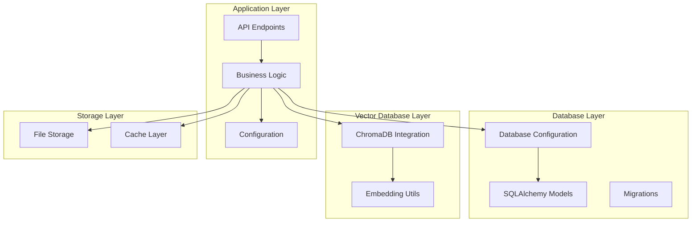
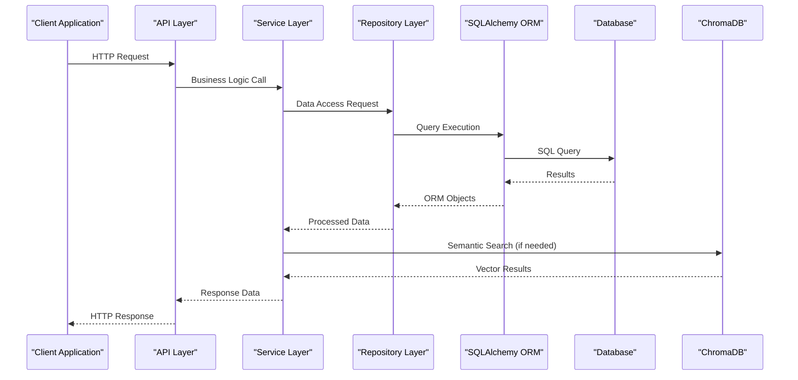
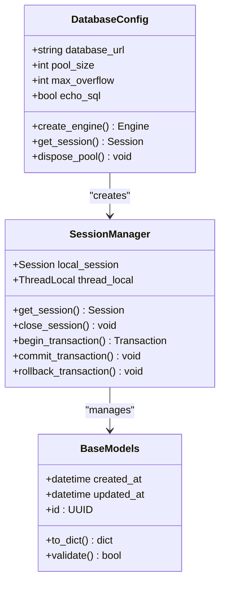
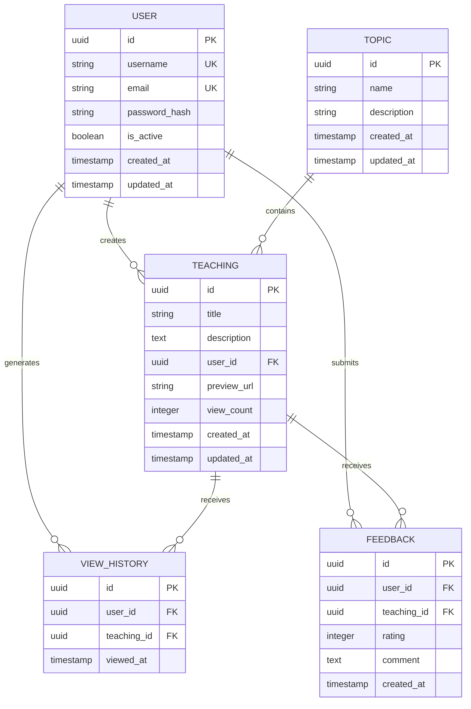
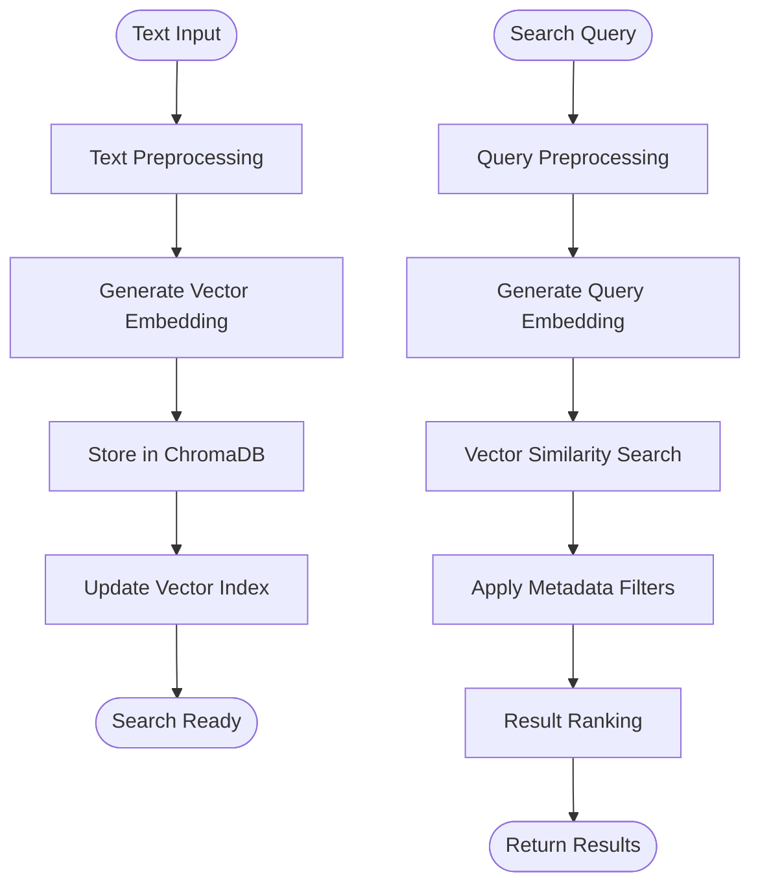
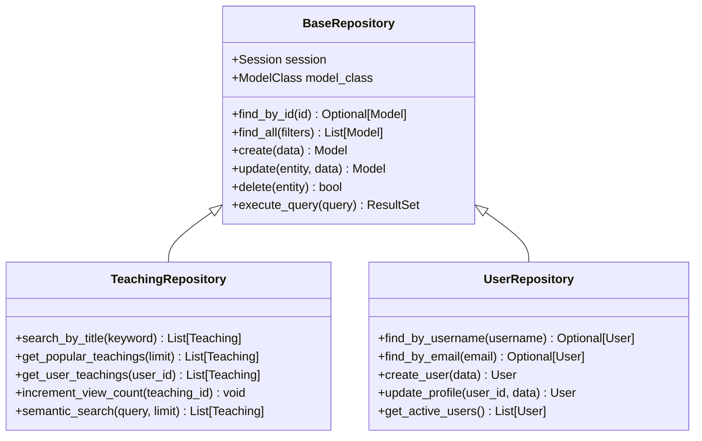
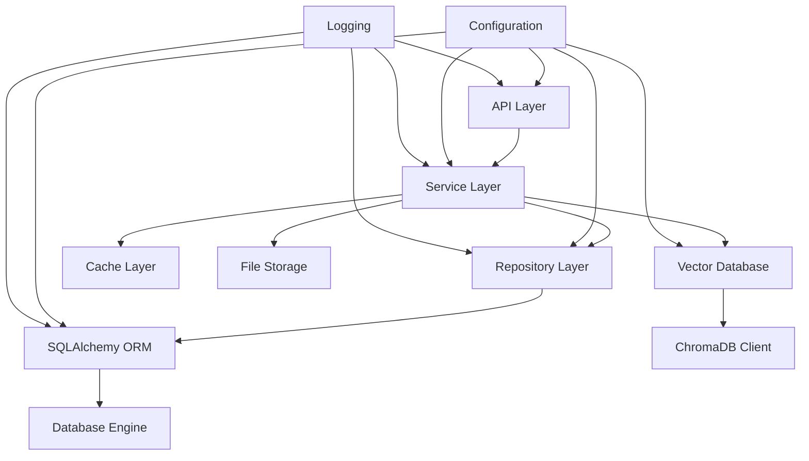

# ORM Implementation & Data Access

<cite>
**Referenced Files in This Document**
- [models.py](file://backend/database/models.py)
- [database.py](file://backend/database/database.py)
- [vector_db.py](file://backend/utils/vector_db.py)
- [config.py](file://backend/config.py)
- [schema.sql](file://backend/database/schema.sql)
- [migrate.py](file://backend/database/migrate.py)
- [embedding_utils.py](file://backend/utils/embedding_utils.py)
</cite>

## Table of Contents
1. [Introduction](#introduction)
2. [Project Structure](#project-structure)
3. [Core Components](#core-components)
4. [Architecture Overview](#architecture-overview)
5. [Detailed Component Analysis](#detailed-component-analysis)
6. [Dependency Analysis](#dependency-analysis)
7. [Performance Considerations](#performance-considerations)
8. [Troubleshooting Guide](#troubleshooting-guide)
9. [Conclusion](#conclusion)
10. [Appendices](#appendices)

## Introduction

This document provides comprehensive documentation for the SQLAlchemy ORM implementation and data access layer in the educational platform backend. The system implements a robust data access pattern using SQLAlchemy ORM with advanced features including vector database integration for semantic search capabilities through ChromaDB. The architecture supports complex relationships, efficient query patterns, and performance optimization techniques essential for an educational content management system.

The implementation follows modern Python web application patterns with clear separation of concerns between data models, database configuration, and business logic layers. Special attention is given to handling large datasets, managing database connections efficiently, and providing semantic search capabilities through vector embeddings.

## Project Structure

The ORM implementation is organized following a modular architecture pattern:

**Diagram sources**
- [database.py:1-50](file://backend/database/database.py#L1-L50)
- [models.py:1-100](file://backend/database/models.py#L1-L100)
- [vector_db.py:1-50](file://backend/utils/vector_db.py#L1-L50)

**Section sources**
- [database.py:1-100](file://backend/database/database.py#L1-L100)
- [models.py:1-200](file://backend/database/models.py#L1-L200)

## Core Components

### Database Configuration and Session Management

The database layer implements a centralized configuration approach with connection pooling and session management:

- **Engine Configuration**: Optimized engine settings with connection pooling parameters
- **Session Factory**: Thread-safe session creation with proper lifecycle management
- **Base Model Class**: Common functionality shared across all models
- **Transaction Management**: Automatic transaction handling with rollback support

### Model Definitions and Relationships

The ORM models implement a comprehensive domain model representing the educational platform's core entities:

- **User Management**: User accounts, profiles, and authentication data
- **Content Management**: Teachings, topics, and educational materials
- **Interaction Tracking**: View history, ratings, and user engagement metrics
- **System Administration**: Feedback, invitations, and quota management

### Vector Database Integration

Advanced semantic search capabilities are implemented through ChromaDB integration:

- **Embedding Generation**: Text-to-vector conversion using embedding utilities
- **Semantic Search**: Similarity-based content discovery
- **Metadata Management**: Rich metadata storage alongside vector embeddings
- **Hybrid Search**: Combination of keyword and semantic search strategies

**Section sources**
- [database.py:1-150](file://backend/database/database.py#L1-L150)
- [models.py:1-300](file://backend/database/models.py#L1-L300)
- [vector_db.py:1-200](file://backend/utils/vector_db.py#L1-L200)

## Architecture Overview

The data access architecture follows a layered approach with clear separation of responsibilities:

**Diagram sources**
- [database.py:1-100](file://backend/database/database.py#L1-L100)
- [models.py:1-200](file://backend/database/models.py#L1-L200)
- [vector_db.py:1-150](file://backend/utils/vector_db.py#L1-L150)

## Detailed Component Analysis

### Database Engine and Connection Pooling

The database configuration implements optimized connection pooling settings:

**Diagram sources**
- [database.py:1-100](file://backend/database/database.py#L1-L100)

Key configuration parameters include:
- **Pool Size**: Configurable connection pool size based on deployment environment
- **Max Overflow**: Additional connections allowed during peak load
- **Echo SQL**: Debug logging for SQL query analysis
- **Connection Timeout**: Connection establishment timeout settings

**Section sources**
- [database.py:1-200](file://backend/database/database.py#L1-L200)

### Model Architecture and Relationships

The model hierarchy implements comprehensive relationships between entities:

**Diagram sources**
- [models.py:1-300](file://backend/database/models.py#L1-L300)

Relationship implementations include:
- **One-to-Many**: Users to teachings, users to view history
- **Many-to-Many**: Topics to teachings through association tables
- **Self-referential**: Hierarchical topic structures
- **Conditional Relationships**: Active/inactive status filtering

**Section sources**
- [models.py:1-500](file://backend/database/models.py#L1-L500)

### Vector Database Integration

The ChromaDB integration provides semantic search capabilities:

**Diagram sources**
- [vector_db.py:1-200](file://backend/utils/vector_db.py#L1-L200)
- [embedding_utils.py:1-100](file://backend/utils/embedding_utils.py#L1-L100)

Key features include:
- **Automatic Embedding Generation**: Text content converted to vector representations
- **Similarity Search**: Cosine similarity-based content matching
- **Metadata Filtering**: Combined keyword and semantic search
- **Batch Operations**: Efficient bulk processing for large datasets

**Section sources**
- [vector_db.py:1-300](file://backend/utils/vector_db.py#L1-L300)
- [embedding_utils.py:1-150](file://backend/utils/embedding_utils.py#L1-L150)

### Repository Pattern Implementation

The repository layer provides abstraction over direct ORM usage:

**Diagram sources**
- [models.py:1-200](file://backend/database/models.py#L1-L200)

Repository benefits:
- **Testability**: Easy mocking for unit tests
- **Consistency**: Standardized CRUD operations
- **Complex Queries**: Encapsulated complex query logic
- **Caching**: Built-in caching strategies

**Section sources**
- [models.py:1-400](file://backend/database/models.py#L1-L400)

## Dependency Analysis

The dependency structure shows clear separation between layers:

**Diagram sources**
- [config.py:1-100](file://backend/config.py#L1-L100)
- [database.py:1-100](file://backend/database/database.py#L1-L100)

Key dependencies:
- **External Libraries**: SQLAlchemy, ChromaDB, database drivers
- **Internal Modules**: Configuration, logging, utility functions
- **Infrastructure**: Database servers, vector database instances

**Section sources**
- [config.py:1-200](file://backend/config.py#L1-L200)
- [database.py:1-150](file://backend/database/database.py#L1-L150)

## Performance Considerations

### Query Optimization Strategies

Several optimization techniques are implemented throughout the data access layer:

#### Eager Loading vs Lazy Loading
- **Eager Loading**: Used for frequently accessed related objects to prevent N+1 queries
- **Lazy Loading**: Default behavior for less frequently accessed relationships
- **Selective Loading**: Custom loaders for specific use cases

#### Connection Pooling Optimization
- **Pool Size Tuning**: Configured based on expected concurrent connections
- **Connection Recycling**: Automatic cleanup of stale connections
- **Timeout Management**: Prevents resource exhaustion under load

#### Caching Strategies
- **Query Result Caching**: Redis-backed caching for expensive queries
- **Object Caching**: In-memory caching for frequently accessed objects
- **Vector Embedding Caching**: Cached embeddings to avoid regeneration

#### Database Indexing
- **Composite Indexes**: Multi-column indexes for complex queries
- **Partial Indexes**: Indexes on filtered subsets of data
- **Full-text Indexes**: Optimized text search capabilities

### Common ORM Pitfalls and Solutions

#### N+1 Query Problem
**Problem**: Loading related objects individually causes excessive database queries
**Solution**: Use eager loading with `joinedload()` or `selectinload()`

#### Memory Leaks with Large Result Sets
**Problem**: Loading entire result sets into memory
**Solution**: Implement pagination and streaming queries

#### Detached Instance Issues
**Problem**: Accessing lazy-loaded attributes outside session context
**Solution**: Ensure proper session management and explicit loading

#### Transaction Deadlocks
**Problem**: Multiple transactions accessing same resources
**Solution**: Implement proper locking strategies and retry logic

## Troubleshooting Guide

### Common Database Issues

#### Connection Pool Exhaustion
**Symptoms**: Slow response times, connection timeout errors
**Diagnosis**: Monitor pool utilization and connection counts
**Resolution**: Adjust pool size, optimize long-running queries

#### Slow Query Performance
**Symptoms**: High latency for specific endpoints
**Diagnosis**: Enable SQL logging and analyze execution plans
**Resolution**: Add appropriate indexes, optimize query structure

#### Memory Usage Growth
**Symptoms**: Increasing memory consumption over time
**Diagnosis**: Monitor object retention and session sizes
**Resolution**: Implement proper session cleanup and garbage collection

### Vector Database Issues

#### Embedding Generation Failures
**Symptoms**: Missing vector representations for content
**Diagnosis**: Check embedding service availability and input validation
**Resolution**: Implement fallback mechanisms and error handling

#### Search Performance Degradation
**Symptoms**: Slow semantic search responses
**Diagnosis**: Monitor vector index size and query complexity
**Resolution**: Optimize indexing strategy and implement query caching

**Section sources**
- [database.py:100-200](file://backend/database/database.py#L100-L200)
- [vector_db.py:150-300](file://backend/utils/vector_db.py#L150-L300)

## Conclusion

The SQLAlchemy ORM implementation provides a robust foundation for the educational platform's data access needs. The architecture successfully balances simplicity with advanced features like semantic search through ChromaDB integration. Key strengths include:

- **Scalable Design**: Modular architecture supporting growth and maintenance
- **Performance Optimization**: Comprehensive caching and query optimization strategies  
- **Type Safety**: Strong typing throughout the data access layer
- **Testing Support**: Repository pattern enables comprehensive test coverage
- **Extensibility**: Clear extension points for new features and integrations

The implementation demonstrates best practices for production-ready ORM usage while maintaining code clarity and developer productivity. Future enhancements could include more sophisticated caching strategies, query performance monitoring, and additional vector database optimizations.

## Appendices

### Migration Management

Database schema migrations are handled through automated migration scripts:

- **Schema Evolution**: Version-controlled database changes
- **Rollback Support**: Safe migration reversal capabilities
- **Data Migration**: Automated data transformation during schema updates
- **Validation**: Schema consistency checks and integrity verification

### Configuration Management

Environment-specific configuration supports multiple deployment scenarios:

- **Development**: Local development with debug features enabled
- **Staging**: Pre-production testing environment
- **Production**: Optimized settings for high-performance operation
- **Containerization**: Docker-friendly configuration management